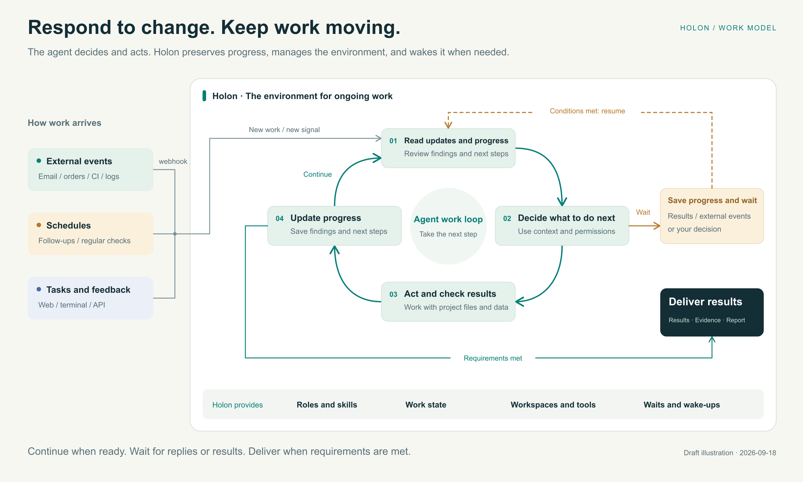
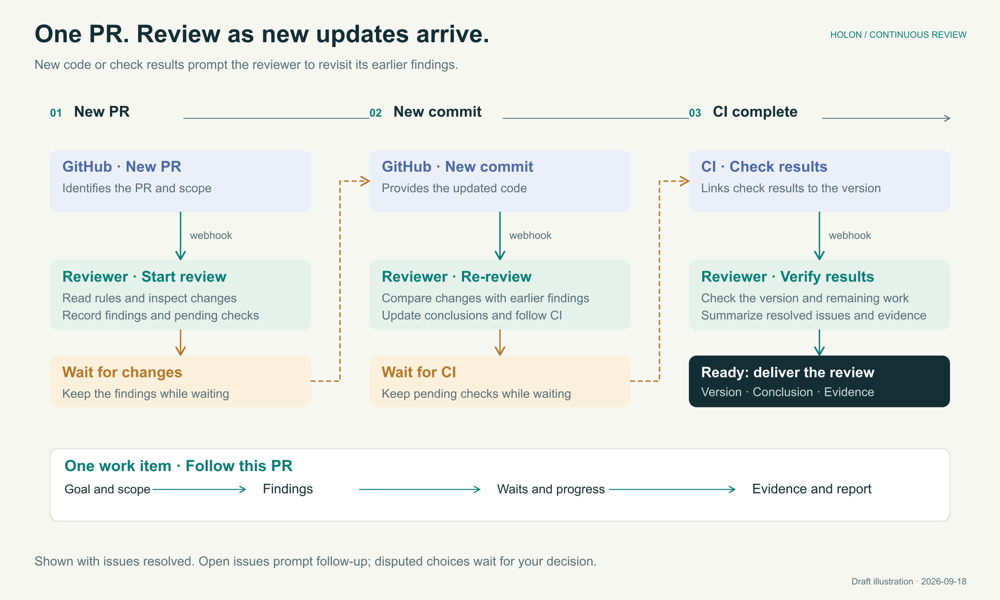
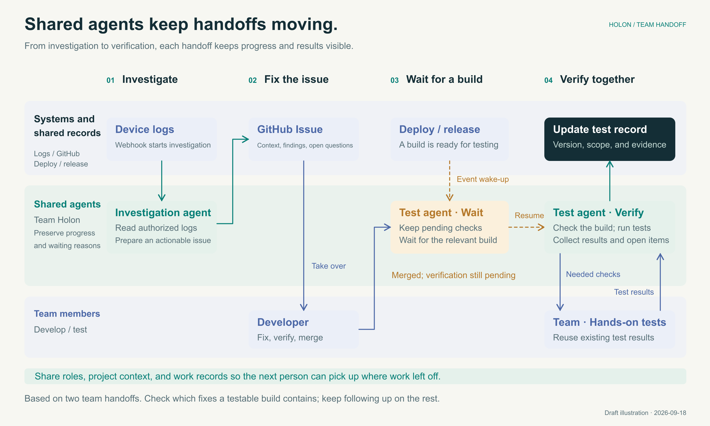
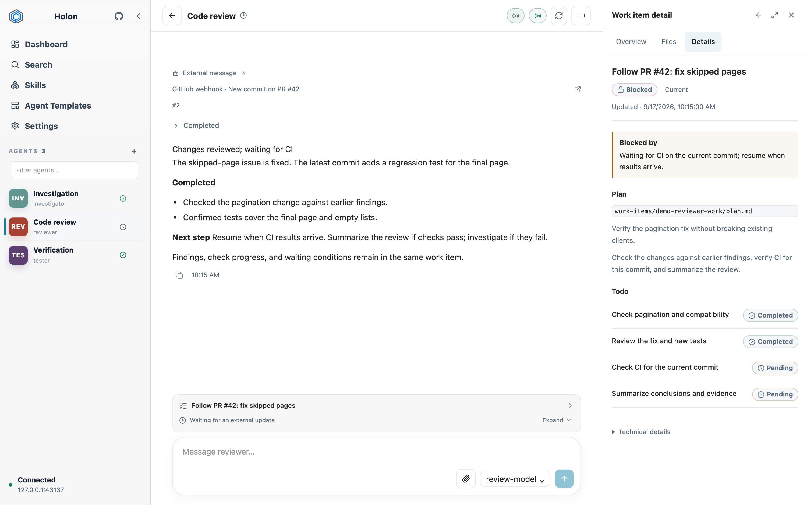

# Holon: Create and run AI assistants

**Delegate real work, track transparent progress, and let assistants follow through.**

Holon is an open-source AI assistant runtime designed for individuals and teams to run long-lived assistants on their own computers or servers. Hand an assistant a clear goal, reference materials, and acceptance criteria. It runs configured tools to do the work, leaving verifiable evidence and structured deliverables.

Start by delegating a concrete task—like analyzing an incident log or reviewing a pull request (PR). Once you connect tools and system events, assistants can take on recurring responsibilities such as email triage or alert follow-up. When a task must wait for a long command, an external reply, or human review, it suspends gracefully and preserves its full state, resuming automatically when the condition is met.

**Hand over a clear objective**\
Define the problem, expected deliverables, and critical decisions that require your approval.

**Pick up right where work left off**\
Goals, findings, and pending checklists stay with the work item rather than being re-explained from scratch.

**Step in to guide and decide**\
Review conclusions and raw evidence, provide missing context, adjust scope, and make judgment calls.

## Delegate a concrete task to an assistant

You don't need to connect all your business systems on day one. Pick a single, well-defined task with complete input materials, and see whether the assistant delivers useful, production-ready results.

**1. Define goals and boundaries.** Specify the objective, inputs, and acceptance criteria. For example: "Analyze this device crash log. Surface reproduction clues, probable root causes, and open questions. Do not modify source code."

**2. Execute with bounded tools.** In its configured environment, the assistant inspects files, runs diagnostic commands, and structures its findings. File changes and external access are strictly bounded by your configured permissions.

**3. Inspect structured progress.** Rather than conversational chat bubbles, inspect concise findings, checklists, and explicit waiting states. Drill down into underlying tool executions and raw evidence whenever needed.

**4. Add context or make trade-offs.** Supply missing materials, narrow the task scope, or resolve architectural dilemmas. While the assistant waits for your feedback, existing discoveries and planned steps remain intact.

**5. Review against acceptance criteria.** Verify the final report, code diff, or artifacts. Failed checks and unresolved edge cases are stated plainly—never hidden behind a generic "completed" claim.

### Decouple roles, methods, and active work

In Holon, an assistant is called an **Agent**. Each maintains its own role definition, persistent memory, and execution history. Create one from a template or tailor it to your workflow.

| Component | Core Purpose | Example |
| --- | --- | --- |
| **Agent Template** | Defines the assistant's persona, duties, and boundaries | Bug investigator, code reviewer |
| **Skills** | Encapsulates domain workflows, playbooks, and checklists | Log triage protocol, PR review checklist |
| **WorkItem** | Tracks a specific objective, dynamic plan, and live progress | Investigating a specific device anomaly |

**Workspaces** connect assistants directly to local repositories and project directories. A single assistant can switch between workspaces across tasks. For software engineering tasks, it can create isolated Git worktrees to work on branches cleanly.

## How work keeps moving forward

Progress does not mean generating model tokens nonstop. Real-world tasks inevitably have pauses and external dependencies. Holon’s runtime core is built on **Wait & Wake**: explicitly recording what each task is waiting for, and waking it automatically when matching results or events arrive.

**Wait for long-running execution.** When running test suites, builds, or delegated subagent tasks, the assistant suspends its turn. Upon completion, it reads the full output and decides the next move.

**Wait for human judgment.** When missing critical context or encountering high-stakes choices, the assistant hands the decision to you. When you reply, it resumes without restarting the conversation.

**Respond to external system events.** Ingest Webhook events from CI/CD, issue trackers, or alerts. New git pushes, completed builds, or customer tickets serve as wake-up triggers for ongoing work.

**Check on a schedule.** Persistent timers enable one-off reminders and recurring checkups—ideal for daily audits, weekly digests, or following up on stalled blockers.

Every ongoing initiative is captured in a durable **WorkItem**, containing objectives, execution plans, pending checklists, waiting reasons, and final completion briefs. When new signals arrive, the assistant wakes up and advances work with full continuity.

### What ongoing work requires

- **The host environment must stay online.** Closing your browser or terminal merely disconnects the UI client; Holon's background daemon continues running. Shutting down the host machine pauses agent execution.
- **Integrate systems as needed.** Webhook-enabled services can send asynchronous triggers; interacting with proprietary platforms or formats requires corresponding tools or adapters. You can always feed new data manually before automating integrations.
- **Event notifications do not imply execution authority.** System events and operator instructions have distinct provenance and trust classifications. An incoming event does not grant permissions to merge PRs, deploy to production, or perform privileged actions.

Self-hosting means Holon and your workspaces run entirely on your designated infrastructure, **not that model inference is necessarily local**. Data flow depends on whether you configure local models (e.g., via Ollama) or commercial cloud providers.

## An assistant dedicated to code review

**Ideal for: solo developers and engineering teams dedicated to maintaining continuous code quality.**

Create an assistant from the code review template, attach review skills and your repository workspace, and assign it an ongoing role. You can start by handing it a single PR manually, then connect GitHub Webhooks once the workflow is proven:

> Review this repository's pull requests (PRs), focusing on compatibility and regressions. Follow up when code changes or automated checks (CI) finish. Ask me about disputed trade-offs. Keep a conclusion and supporting evidence for each PR.

Each review delivery explicitly outlines: issues detected, underlying evidence, test commands run, and trade-offs requiring your decision. Once events are connected, CI completion notifies the assistant via Webhook. If tests fail, it investigates root causes; if CI passes, it verifies whether all outstanding review remarks have been resolved.

**Every PR gets an independent, auditable WorkItem.** When new commits are pushed, the assistant re-checks previous remarks; while waiting for updates or CI runs, the item remains parked; once all conditions are satisfied, it submits a final brief.

**Review conclusions inform decisions—they never bypass human judgment.** The assistant spots regressions, runs test suites, and collects evidence, while merge authority remains entirely in your hands. You can close your terminal at any time and inspect the overview from the browser later.

*Workflow illustration. Automated GitHub integration requires tool setup, API credentials, and Webhook ingress. You can also supply PR events manually. Publishing reviews or merging code requires explicit authorization.*

## Solo developers and team collaboration

For individual developers, an assistant runs in the background, continuously shepherding tedious tasks so you can pick up fresh summaries anytime. For teams, deploy Holon on a shared server to let team-wide assistants handle triage, code reviews, and release verification; team members share the exact same context via Web or terminal.

[A four-person AI hardware team's experience](../website/blog/agents-in-a-small-team.md) highlights two practical handoffs:

**Triage Agent: turns noisy logs into structured issues.** When device logs arrive, the assistant filters out telemetry noise, extracts crash traces, and drafts a structured GitHub Issue ready for developers to tackle.

**Testing Agent: verifies fixes through to deployment.** After bugfix PRs merge, the agent waits for release builds. Once a testable firmware is published, it triggers automated test suites and compiles hands-on feedback from team testers.

**The entire team stays aligned on ownership, current status, and blockers.** Context and checklists persist across handoffs. Work waiting on builds or human reviews suspends cleanly, resuming the moment results land.

You can also set up periodic patrol timers: which fixes are ready for testing, which remain blocked, and which require manual re-testing.

*Diagram synthesizes two handoffs from real team practice rather than a single uninterrupted test run. Scheduled checks are a configuration example. Logs, GitHub, and deployment systems require corresponding access permissions.*

## Start with your first task

Install Holon, configure a model provider, and launch the daemon. Successfully deliver one concrete task before layering on continuous responsibilities.

**1. Instantiate from a template.** Choose a built-in Agent Template to inherit pre-configured roles and standard methodologies.

**2. Establish scope and boundaries.** State what it owns, what artifacts it delivers, and when it must escalate. Attach necessary skills and restrict accessible workspaces.

**3. Assign the initial task.** Provide concrete objectives, reference inputs, and acceptance criteria. As it runs, monitor progress on the dashboard, supply extra clues, and decide edge cases.

**4. Wire up event-driven triggers.** Connect Webhooks, platform adapters, or schedule recurring timers; define which external signals require action and when to notify you.

*Workbench demonstration interface. Select agents on the left, follow real-time execution in the center, inspect plans and waiting states on the right, and supply input below. The terminal TUI connects to the same daemon.*

### Choose how to connect

**Web dashboard and terminal TUI.** The release binary bundles an embedded Web GUI. A lightweight TUI connects to the same daemon to monitor active agents; CLI and HTTP APIs provide programmatic access.

**Mobile companion clients.** iOS and Android apps connect to a running Holon host as lightweight remote clients; they do not run the engine on your phone. Configure network access and authentication prior to connecting. Beta access:

- [iOS · TestFlight](https://testflight.apple.com/join/XkTfN12S)
- [Android · Join testing](https://groups.google.com/g/holon-pioneers/c/Cgs_KEAjdN0): Google Group testing instructions; access may require membership or permission.
- [Android APK downloads](https://github.com/holon-run/holon/releases): choose an APK from a release; direct installation requires allowing that installation source.

Configure models, tools, and workspaces before delegating tasks. For continuous follow-through, keep your host machine and Holon daemon running. Shared team hosting does not imply hard sandbox isolation between agents; define file and tool permissions explicitly.

**Get started:** [Installation and quick start](../website/getting-started/README.md) · [Source code](https://github.com/holon-run/holon) · [Documentation](https://holon.run)

**Questions and feedback:** [hello@holon.run](mailto:hello@holon.run)
