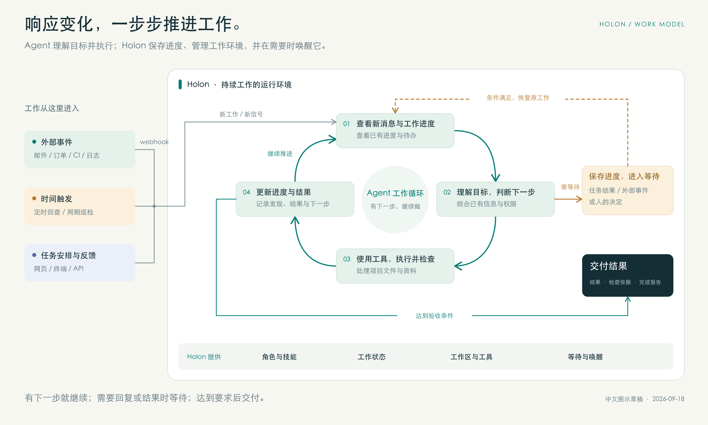
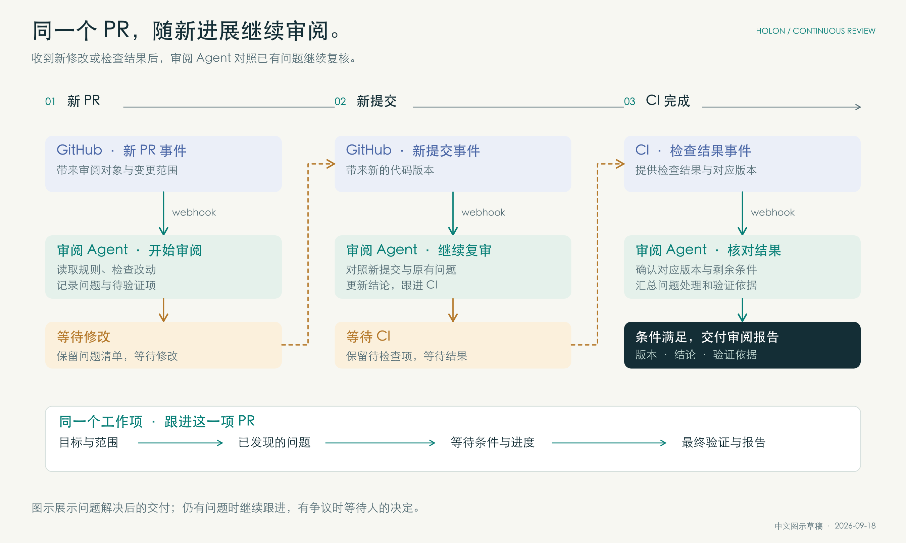
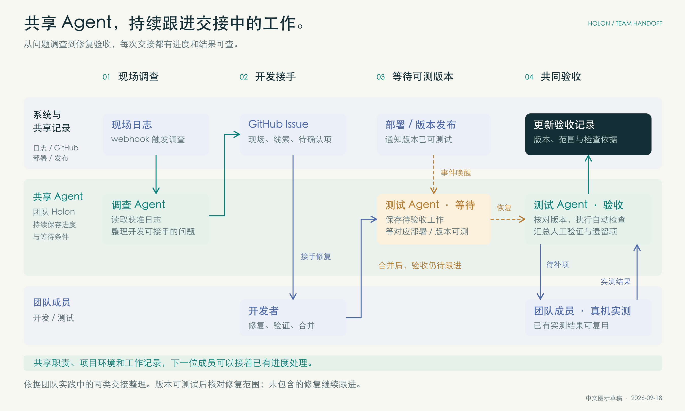
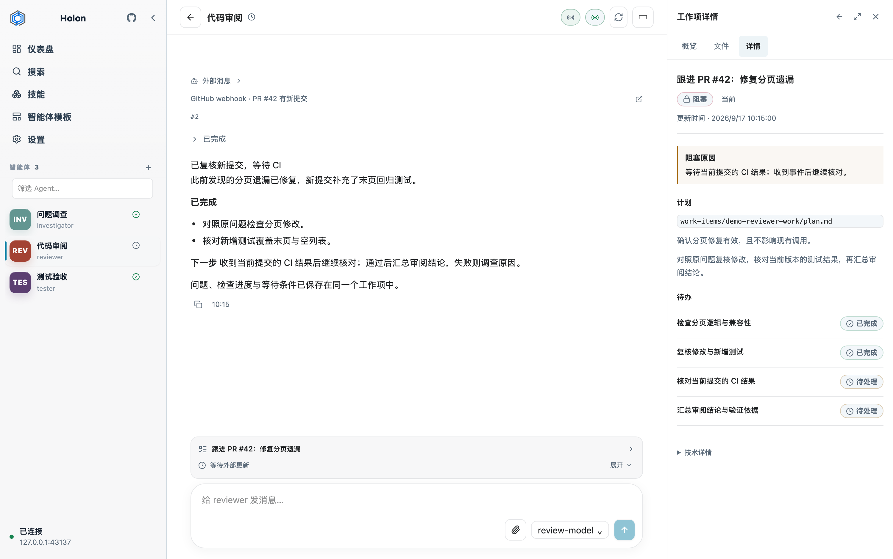

# Holon：创建和运行 AI 助手

**把具体工作交给助手，查看进展，持续跟进。**

Holon 是一个开源的 AI 助手运行平台，专为在本地电脑或自有服务器上长期工作而设计。给助手明确的目标、参考资料与完成要求，它会调用配置好的工具开展工作，并留下清晰的执行依据与结果。

你可以从排查一次日志异常、审阅一个代码变更（PR）开始；在接入工具与系统事件后，也能让助手持续负责信件分拣或告警跟进。需要等待耗时命令、外部回复或人工确认时，工作会自动挂起并保存进度；条件就绪后，直接接着推进。

**交代明确目标**\
说清要解决什么、交付什么，以及哪些关键决定必须由你定夺。

**随时接续进展**\
目标、上下文与待办清单随工作持久保存，不必每次从头重述。

**按需介入把关**\
查看结论与原始依据，补充信息、校正方向，在关键节点做好决策。

## 把一项工作交给助手

不必一开始就对接全部业务系统。挑一项材料完整、目标明确的具体任务，先验证助手能否交出符合预期的交付物。

**1. 明确目标与边界。** 给出目标、参考资料与验收标准。例如：“分析这份设备日志中的异常，梳理复现线索与可能原因，列出待排查疑点；不要修改代码。”

**2. 受控调用工具。** 助手在独立配置的环境中读取文件、执行检查、沉淀发现。改动文件或访问外部系统时，严格受限于你配置的权限和授权范围。

**3. 分层查看进展。** 交付的不只是聊天气泡，而是分层的结论摘要、待办清单与等待原因；需要时可随时穿透回溯底层的工具调用记录与原始证据。

**4. 按需补充决策。** 补齐缺失材料、校正执行范围，或在有分歧的方案间拍板。在你回复前，既有发现与后续计划完好冻结。

**5. 对照标准验收。** 核对交付的报告、补丁或产物。未通过的检查与尚未确认的盲区会如实暴露，绝不用一句“已完成”掩盖隐患。

### 角色、方法和具体工作分开管理

Holon 将助手的专业角色、工作方法与具体推进的任务清晰解耦。助手统称为 **Agent**，各自拥有独立的职责设定、长期记忆和工作记录。可以从模板直接创建，也可以自由配置。

| 组成 | 核心作用 | 示例 |
| --- | --- | --- |
| **模板（Agent Template）** | 定义助手承担什么角色与职责 | 问题排查专家、代码审阅员 |
| **技能（Skills）** | 固化做这类工作时的标准流程与规范 | 日志分析规程、PR 审阅检查清单 |
| **工作项（WorkItem）** | 记录一项具体任务的目标、规划与实时进展 | 跟进一次具体的设备异常排查 |

**工作区（Workspace）** 直接连接本地实际的项目目录与代码仓库。同一个助手可以按任务在多个工作区之间灵活切换；对于编程任务，还能通过 Git worktree 隔离改动，互不干扰。

## 工作为什么能持续推进

持续推进不是让大模型无休止地吐字。真正的工作常有停顿与等待，Holon 的核心机制是**挂起与唤醒（Wait & Wake）**：明确记录工作正在“等什么”，并在相应结果或事件到来时自动唤醒继续。

**等耗时命令执行。** 编译测试、深度检索或子任务后台运行时，工作主动挂起；收到完成通知后，读取完整输出再决定下一步。

**等人的把关与决策。** 信息缺失或涉及高风险操作时，将关键问题交回操作者。收到回复后，结合原有目标和发现接着做，不必重新开一轮对话。

**响应外部系统变化。** 通过 Webhook 接收外部事件。例如新的代码提交、CI 构建结果或业务通知，都能作为唤醒助手推进工作的信号。

**按约定时间巡检。** 定时器支持一次性提醒与周期性循环，用于定期巡检系统状态、汇总周期摘要或跟进未闭环事项。

每个长期目标都由独立的**工作项（WorkItem）**承载，完整记录目标、计划、待办清单、等待原因与最终完成报告。新信号到来时，助手结合这些上下文继续推进行动；交付后，查阅者可先看核心摘要，再按需核对来源与操作细节。

### 持续运行的前提

- **运行主机保持在线。** 关闭网页或断开终端只是退出界面，后台服务仍在常驻；若电脑关机或停止 Holon 守护进程，助手将暂停执行。
- **按需配置系统集成。** 支持 Webhook 的系统可自动发送通知；读取专有邮件、特定格式文档需要配置相应工具或适配器。在未打通接口前，完全可以手动补充输入。
- **事件通知不等于操作授权。** 系统通知与人工指令有严格的来源和信任边界；接收到系统事件并不代表助手自动获得了发布、合并代码或越权操作的许可。

自行部署意味着 Holon 与工作环境完全运行在你指定的机器上，**但并不意味着模型推理都在本地**。请求的数据流向取决于你选择配置的是本地模型（如 Ollama）还是云端服务商。

## 一个助手如何持续负责审阅

**典型场景：个人开发者，以及需要持续把控代码质量的技术团队。**

从审阅模板创建助手，配置对应技能与项目工作区，然后赋予它一项长期职责。你可以先手动交给它一个 PR，验证顺畅后再接入 GitHub 事件：

> 负责这个仓库的代码变更请求（PR）审阅。收到新 PR 后开始检查，重点关注兼容性和回归风险；有新修改或自动检查（CI）结果时继续跟进。有争议的取舍等我决定，为每个 PR 留下审阅结论和验证依据。

每次交付应清晰说明：发现了哪些问题、依据在哪里、执行了哪些验证，以及还有什么事项需要维护者判断。接入事件后，CI 跑完能通过 Webhook 自动通知助手；若检查失败，助手主动分析原因；若顺利通过，则核对是否仍有未化解的代码隐患。

**每个 PR 都有独立可追溯的工作记录。** 当开发者提交新代码时，助手对照此前的反馈逐条复核；等待修改或等待 CI 时，当前工作项挂起；各项条件达成后，交付最终审阅报告。

**审阅结论是决策参考，而不是越俎代庖。** 助手负责排查盲点、核验测试并沉淀证据，最终的合并授权始终握在开发者手中。你可以关闭终端，随时通过浏览器查看全局进展。

*本例为流程示意。自动接收 GitHub 变化需要配置工具、账号权限和事件接入，也可以先手动提供新结果。发布或合并代码需获得相应授权。*

## 个人使用与团队协作

个人使用时，可以让同一个助手持续负责一个项目，工作在后台推进，稍后随时接续查看。团队使用时，可以将 Holon 部署在服务器上，让公共助手分担问题调查、代码预审和发布验收等工作；成员通过网页或终端共享相同的任务上下文，随时补充线索或接手处理。

[一个四人 AI 硬件团队的实践](../website/zh-CN/blog/agents-in-a-small-team.md)展示了两类交接：

**排查助手：把现场线索提炼成可直接跟进的 Issue。** 收到崩溃日志后，助手滤除噪音、提取异常堆栈与复现线索，整理成结构化的问题记录，供工程师快速切入。

**测试助手：跟进修复是否真正生效。** 修复代码合并后，自动挂起等待固件打包；包含该修复的测试固件就绪时，唤醒执行自动化测试，并汇总团队成员的实测反馈。

**团队随时清楚谁在负责、当前走到哪一步、下一步缺少什么。** 成员换班或交接时，完整上下文与待办依然清晰；等待部署或等待人工复核时进度挂起，信号就绪立刻恢复。

你还可以为助手设置周期性巡检：哪些已修复问题可供测试、哪些仍被依赖项阻塞、哪些需要团队成员补测验证。

*图示汇集实践记录中的两类交接，并非一次完整流程的实测；定期检查为配置示例。日志、GitHub 和发布系统需配置接入与访问权限。*

## 从第一项工作开始

先安装 Holon、配置模型服务并启动常驻后台，试着跑通一项具体任务。确认结果切实有用后，再逐步赋予它持续跟进的长期职责。

**1. 从模板创建。** 选择合适的助手模板，快速复用预置的角色定位与工作方法。

**2. 明确职责边界。** 写清它具体负责什么、交付什么成果、哪些事项必须请示。挂载所需技能，并限定其可访问的目录与系统。

**3. 交代初始任务。** 明确目标、输入材料与验收标准。启动后，通过工作台查看进度、补充线索，并在必要时拍板决策。

**4. 接入持续触发。** 通过 Webhook 或系统适配器对接外部通知，或配置定时巡检；明确哪些变化需要响应、何时向你汇报。

*工作台演示界面。左侧切换不同 Agent，中间查看消息往来与实时执行流，右侧查看目标规划、待办与等待状态，底部可随时补充指令。终端 TUI 同样支持连接该后台。*

### 选择访问方式

**网页与终端。** 二进制分发包内置 Web 界面，也能通过轻量 TUI 连入同一后台，查看已有助手与工作进展；脚本化自动化集成可通过 CLI 与 HTTP API 调用。

**移动端连接。** iOS 与 Android 客户端作为轻量前端连接运行中的 Holon 节点，并非在手机上跑后端服务。远程访问需事先配置网络连接与认证，测试版入口如下：

- [iOS · TestFlight](https://testflight.apple.com/join/XkTfN12S)
- [Android · 加入测试](https://groups.google.com/g/holon-pioneers/c/Cgs_KEAjdN0)：Google Group 测试说明，访问可能需要加入群组或取得权限。
- [Android APK 下载](https://github.com/holon-run/holon/releases)：在发布页选择 APK；直接安装需允许相应安装来源。

使用前请配置好模型提供商、工具与工作区；持续推进工作期间，请保持宿主机器与后台进程运行。团队共享部署并不等同于助手间存在强沙箱隔离，仍建议按需清晰划分文件与系统权限。

**开始使用：** [安装与快速开始](../website/zh-CN/getting-started/README.md) · [项目源码](https://github.com/holon-run/holon) · [文档](https://holon.run)

**交流与反馈：** [hello@holon.run](mailto:hello@holon.run)
