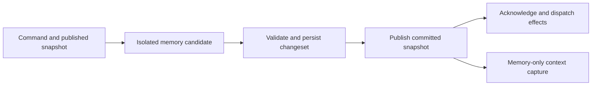

# Agent Runtime State and Context Snapshots

## Migration lineage compatibility

Published upstream migrations through 90 retain their versions and names. The
integrated feature lineage occupies 91–102, including original turnless command
creation at 102. Before applying migrations, an exact contiguous feature prefix
starting at the unpublished versions 81, 83 or 89 is remapped atomically,
preserving names and application timestamps. Unknown, mixed or gapped feature
histories fail closed without modifying their ledger. Version numbers alone
never identify the feature lineage; published upstream names must not be
mistaken for old feature migrations in the overlapping range.

Remapping history does not rerun schema changes or capture canonical history.
Task's schema cut moves from 88 to 98 and Scheduling's from 89 to 99; their
hooks are selected by migration name and consume the original fixed Episode
checkpoints. Already captured members and body qualifications remain unchanged.

The migration data regression covers a fresh database, canonical prefixes
80 through 102, and each feature prefix through 102 for all three unpublished
lineage starts. It seeds running and completed Tasks with their original rejoin
identity, a pending result settlement and queue entry, a repeating Timer and
pending wake, an external trigger, and a delegation. It compares canonical
records before and after migration, compares the fixed Task/Input/Scheduling
domains and TaskStatus sources across lineages, and checks that reopening
neither recaptures members nor rewrites migration names or timestamps. Run the
full lineage and data regression with
`cargo test --locked --lib runtime_db::migration_history::tests -- --test-threads=2`.

## Summary

Holon should represent each loaded agent's current business state in an
explicit in-memory model. Runtime decisions and context construction should
read consistent snapshots of that model. Persistent storage saves committed
changes, reconstructs the model after restart, and holds history that does not
need to remain resident.

The target is an agent state architecture. Context is a request-scoped
projection of that state; provider input is its rendered representation.
Working memory, episodes, evidence, and their durable relationships belong to
state domains. The projected context has no independent mutation authority.

The proposed contract has three parts:

1. All current core state of a loaded agent is represented in memory; ordinary
   context acquisition, construction, and budget reprojection require no
   database or filesystem reads after initialization.
2. The runtime also owns transient resources and rebuildable observations that
   are initialized dynamically and are not serialized as agent business state.
3. A mutation first computes an isolated in-memory candidate, persists its
   changes atomically, and then publishes the committed memory snapshot.
   Acknowledgements and dependent effects observe committed state.

This document specifies the proposed architecture and its invariants. Execution
admission, authority, provider replay, and storage durability retain their
respective contracts. The addressing, provenance, transactional-change, and
state-projection requirements of
[#3478](https://github.com/holon-run/holon/issues/3478) are part of this
architecture. They do not require a separate canonical context store.

### SQLite-only upgrade boundary

This refactor supports new SQLite databases and upgrades of existing SQLite
state. It retires automatic import of the old agent JSON and ledger JSONL
storage format, including its first-import sealing/checkpoint path. The fixed
SQLite upgrade seed, member qualification, incarnation fencing, and restart
recovery remain required. JSON fields inside SQLite and current tool/provider
payloads are not retired storage formats.

Repository `import_legacy` entrypoints and their domain-import transaction
wrapper are removed, rather than retained as an alternate import API. Work
import-write bookkeeping and Task/Timer/Trigger import-inventory writers are
also removed. Existing sealed inventories remain readable for SQLite upgrade
and recovery; ordinary writes cannot recreate import authority.

Startup must reject a legacy-file-only scope or an unfinished legacy import
explicitly, rather than initializing an apparently empty agent. Detection uses
file metadata and database cutover metadata, never legacy body replay. Completed
SQLite installations may retain old files; they are not read, imported, or
deleted. New database domains are initialized directly as SQLite-canonical.
Historical first-import details below are superseded by this boundary and are
being removed with their implementation.

## Goals

- Give loaded-agent consumers one typed model of current business facts and
  one versioned publication boundary.
- Make context selection, rendering, and reprojection pure computations over
  an immutable snapshot.
- Keep ordinary warm execution reads in memory, including source hydration
  needed for normal tool follow-ups and budget retries.
- Make durable changes, transient resources, and external observations explicit.
- Preserve atomic transitions, fencing, provenance, restart recovery, and
  existing ownership rules while moving computation toward memory.
- Bound resident history and large payloads independently of agent lifetime.

## Non-Goals

- A general-purpose in-memory database, dynamic object registry, or graph engine.
- Keeping every historical record, tool output, and attachment resident.
- Replacing current canonical tables with mandatory event sourcing. Audit
  events remain evidence, not a sufficient replay source for all business state.
- Changing the scheduler's execution protocol or creating a second authority
  for WorkItem, wait, queue, or task lifecycle.
- Allowing uncommitted state to drive model requests or acknowledged work.
- Making model-authored summaries authoritative for runtime state.
- Requiring new model calls, replacing compaction, or changing prompt content
  to establish the state architecture.

## Related Contracts

- [Scheduler–WorkItem Unified Execution Protocol](./scheduler-work-item-unified-execution-protocol.md)
- [Runtime Transition Commit Contract](./runtime-transition-commit-contract.md)
- [Runtime Host Activation Admission and Read Projections](./runtime-host-activation-admission-and-read-projections.md)
- [Runtime Object and Reference Model](./runtime-object-and-reference-model.md)
- [Runtime Ledger Sequences and Object Revisions](./runtime-ledger-sequences-and-revisions.md)
- [Provenance, Admission, and Authority](./default-trust-auth-and-control.md)
- [WorkItem Current Focus](./work-item-current-focus.md)
- [Context Candidate Budget Planner](./context-candidate-budget-planner.md)
- [Deterministic Projection Evaluation Phase 0](./projection-evaluation-phase-0.md)
- [Runtime SQLite Retention](./runtime-db-retention.md)
- [Read-Side Performance Attribution](./read-side-performance-attribution.md)

## State Model

### One logical state, two representations

`AgentStateStore` is the proposed runtime-facing owner of agent state. Its
published `AgentRuntimeState` is the representation used during loaded-agent
execution. Persistence records represent the same committed business facts
for reconstruction and unloaded access. They must not have independent
mutation semantics.

Existing domain records retain their responsibility. For example, an
`ExecutionAttempt` owns the execution lane, WorkItem execution state owns
eligibility, and a `WaitCondition` owns exact resume identity. The store groups
these facts for coherent reads and commits; it does not add another stored
`runnable`, focus, or lifecycle authority.

Loaded-agent scheduling, readiness, wait, and control projections derive from
this captured state without querying persistence for current facts. Durable
read adapters serve unloaded inspection and bootstrap; transaction-time fence
and revision validation remains part of persistence rather than a second
runtime read model.

An illustrative organization is:

```text
AgentStateStore
  published: AgentSnapshot
    identity and control
    execution attempts and bindings
    pending input metadata and admission watermarks
    current WorkItems, tasks, waits, timers, triggers, continuations
    working memory, episode anchors, continuity references
    bounded evidence working set and lookup indexes
  resources: RuntimeResources
    provider clients, task handles, cancellation, subscriptions
    versioned configuration, capabilities, guidance and file observations
  persistence: typed load and commit adapter
```

These are responsibility boundaries, not a requirement for one large struct,
one global mutex, or a new public API.

### Immutable sharing and publication

Each agent has a single writer and an `ArcSwap<AgentSnapshot>` publication
root. The root shares immutable domain state for identity/control, execution,
WorkItems/waits, tasks, scheduling, and evidence. Domain indexes reference
immutable records through `Arc<Record>`. A candidate reuses unchanged domains
and records, copying only changed records and the affected index structures.
Atomic root replacement publishes the complete compatible state together.
Records and indexes reachable from a published root are not mutated in place.

Each canonical commit returns a typed committed-domain delta containing all
records and removals in its invariant, including database-assigned sequences.
It describes the existing transaction; it is not a second event log or mutation
authority. A domain reader is usable only when coherent bootstrap, every writer,
removal/availability changes, and recovery cover its dependencies. Partial domain
coverage does not imply that the complete context or scheduler view is Ready.

A resident record may be a typed projection of a canonical persistence record:
identity/revision, required current facts, bounded preview, and a body locator.
It need not retain an entire storage record with embedded stdout or attachment
bytes. Projection metadata refers to the canonical fact and has no independent
mutation authority. Referencing an allocation containing a full body retains
and accounts for that whole allocation, even when only its preview is rendered.

Finite idle selection and successive per-source attachments retain the qualified
Turn together with its original capture. Read-only validation and installed-ACK
handoff do not clone its body; constructing an actual changed Turn or restoring
an owned replay batch still requires admission before copying. Each attachment
keeps its original transaction, ACK, ordering, and cancellation fences.
Named Work preflight may borrow the same unchanged transaction's
`ContextScopeRead`, sharing its original State allocation rather than decoding it
again. It revalidates the transaction fingerprint and agent/incarnation, retains
the usual Work qualification and budget checks, and never publishes coverage.

Input qualification tracks the canonical payload and its actual dependency
relationships. Observer revisions, such as a conversation display revision
advanced by a queue status change, do not invalidate an unchanged input body.
A fixed upgrade checkpoint must include a body digest for records without a
canonical content hash. A selected body is checked against that digest after
its metadata and byte-budget preflight, before its first materialization.
Payload hints do not establish a Turn assignment or authorize loading another
record; only the canonical relationship or a validated recovery proof does.

An asserted provider-recovery source may be invalid because its canonical
Message or Turn does not exist. Preparation can capture a dedicated, bounded
authority-validation proof of that absence in the same persistence view. It
does not turn a missing, unqualified, foreign, or pruned record into a general
empty lookup. Related source writes invalidate the proof and require a newly
prepared closure before the scheduler can reject the input; a source that has
become valid requires replanning. Selecting a recovery message as ordinary
history does not itself grant its asserted sources authority or residency.

Successful-turn recovery supersession reads only same-agent, currently queued
`InternalFollowup` candidates through one canonical Queue/Message join. This
necessary-kind filter is not a recovery authorization: the original provenance,
directive, owner, earlier-source-turn, live Queue membership, and compare-and-set
checks still apply. Ordinary pending messages need not be reloaded once per
candidate after every completed turn; no candidates means no Turn-history read.
The query adds no cache, admission authority, or fallback body lookup.

Use standard collections and explicit copy-on-write ownership. The design
does not require a persistent-collection library, generic actor framework, or
multi-version database. An affected index may still cost O(n) to copy; sharing
records avoids deep-copying payloads but does not make every update O(1).

Scheduler preparation preserves the owner's full Queue/current/query root union.
Its actual Input capture selects the Brief window, explicit roots, current source
and binding, exact Work observations, and the same publication's complete open
Attempt/nonterminal Work frontier. Queue-only Message source indexes are not
scheduler read dependencies. Frontier IDs do not qualify bodies: the original
exact capture still rejects missing or unqualified allocations, and the complete
live-frontier checks remain mandatory.

Capture holds the published root only while selecting and validating its
dependencies. `ContextSnapshot` retains the selected record and observation
references, identity tokens, and request metadata; it does not retain the
entire `AgentSnapshot` or its complete domain maps across a model call. Domain
and record references must not point back to the root. There is no automatic
history of published roots: old roots and records are released when their
actual readers finish.

Records needed by permitted budget/history reprojections are selected as part
of the snapshot's prepared input set. A request cannot escape that set by
following a mutable global index during rendering. Resource observations are
immutable as well; compatible observation references are captured under the
same short publication boundary, while live clients and handles remain outside
the state graph.

### Residency and persistence classes

| Class | Examples | Residency and recovery |
| --- | --- | --- |
| Current business facts | identity/control, execution binding, open WorkItems, active tasks/waits/timers/triggers, pending input identities | Resident while the agent state owner is loaded; recovered from committed persistence |
| Continuity working set | relevant operator input, recent turn evidence, pending results, selected episode previews | Resident under explicit limits, with required references pinned; recoverable from their canonical sources |
| Derived indexes and projections | readiness indexes, by-ref lookup, context candidates, token estimates | Rebuilt from published facts; no independent business authority |
| Transient resources | process handles, clients, locks, cancellation tokens | Initialized or reattached according to existing recovery rules; not restored by deserializing handles |
| Observed external resources | plan files, AGENTS.md, curated memory, skill catalogs, configuration | Canonical source retains ownership; memory stores the latest explicitly observed version |
| Cold evidence and large bodies | old transcript, full stdout, attachments, historical episode bodies | Persisted and addressed by refs; loaded explicitly into a bounded working set when needed |

All live business metadata must remain available to correctness checks.
Resident history limits do not authorize discarding active waits or pending
input. Large results and attachments may use locators with resident bounded
previews where the input protocol permits it. Accepted queued messages must
retain the input payload required for their ordinary execution while the owner
is loaded, including an operator anchor that subsequent rounds still require.
A locator cannot replace a required root-input body merely to meet a cache
budget. Account pending input bytes separately, apply backpressure before
accepting more input, and release them to history policy only after consumption
or cancellation and all continuity pins end. Bootstrap restores pending input
before readiness; ordinary queue claim is not a cold-hydration exemption.

Logical accepted-input accounting follows the durable pending obligation across
runtime unload and reload. Physical allocation accounting follows the actual
shared buffers and their remaining owners; releasing a runtime does not erase
an accepted or indeterminate admission ticket. Within a live Host ledger, a
fresh pending read preserves the original accepted ticket identity rather than
issuing a new allowance. A known deletion acknowledgement releases Accepted
charges only under the original identity reservation, with a fresh coherent view
proving the same incarnation is Deleted and has no pending queue entries. A
tombstone alone does not prove its pending obligations ended. Unknown admissions
remain fenced until their original commit family resolves them.

Bootstrap reads current facts and bounded continuity through one coherent
database read transaction. Focused loaders use queue identities, by-ID/batch-ID
lookups, and owner tails rather than loading all history to filter it afterward.
The prepared history coverage includes the current owner's configured window
and the agent-tail fallback that the enabled selector can use. Ordinary window
advancement incorporates committed evidence; it does not repeatedly hydrate.

If an existing accepted backlog exceeds the configured activation budget,
activation reports explicit resource exhaustion with required and available
capacity. Durable work and identity remain intact; an operator can adjust the
budget and retry. Activation does not silently drop payloads, overcommit without
a bound, or replace ordinary claims with per-message cold reads.

If required live metadata or pending payloads exceed resource limits, apply
explicit admission/backpressure or report resource exhaustion; do not silently
forget accepted work. Unloaded agents remain unloadable without losing identity.

Task status and recovery obligations are durable even though the associated
process handle is transient. Observed file content is not ephemeral merely
because it is cached in memory: the file remains its persistent source.

### Memory budgets

History residency is byte-budgeted per agent and across the host, with record
count and per-body limits as additional guards. The proposed starting budgets
are 32 MiB per loaded agent and 512 MiB across the host for reclaimable history.
These are configurable sizing assumptions to calibrate with measurements,
not total agent/process memory limits or established production defaults.

Accounting separates current business metadata, reclaimable history, pinned
request evidence, observations, index overhead, and temporary candidate copies.
Within the historical payload pool, shared allocations are counted once;
pinning reclassifies a retained allocation rather than charging it twice.
Pinned evidence remains visible in total retained-memory accounting even when
it cannot be reclaimed to satisfy the history budget.
Per-agent accounting charges the allocations that agent retains; host-wide
physical accounting deduplicates allocations shared across agents. Observations
and superseded versions still pinned by requests are accounted separately from
the 32 MiB / 512 MiB reclaimable-history budgets, with explicit size and
admission limits rather than an unmeasured exemption.

Eviction removes only unpinned, nonrequired history from the resident working
set. The prepared ordinary-context window and its bounded dependency closure
remain available. Memory pressure cannot convert ordinary history-window
advancement into repeated disk hydration. If mandatory facts or pins prevent
bounded operation, limit additional optional hydration and apply explicit
admission/backpressure before accepting more work. Do not evict accepted work,
invalidate a live snapshot, or delete identity to satisfy a cache budget.

### Snapshot identity

A published root has an opaque identity scoped to its owner incarnation and
publication generation. This is an in-process consistency token, not a new
global ledger sequence or a replacement for object `revision` fields.

A context snapshot captures together:

- the published state identity and relevant committed object revisions;
- execution attempt, turn, owner binding, and admitted input watermark;
- the selected immutable records and resolved evidence dependencies;
- resource observation epochs and projection policy version;
- an explicit clock sample and other request-specific environment values.

State identity and resource epochs have different meanings. The capture fixes
their compatible combination; it must not read separate mutable maps at
different times and call the result one snapshot. A snapshot records which
pending inputs have actually been admitted to this execution, not every input
currently queued for the agent.

An older snapshot can remain readable for an in-flight request or diagnostics.
It cannot authorize a later state mutation without current revision and
execution-fence validation. Capture is a short memory operation; no store
lock is held across model calls, tools, or network waits.
The capture boundary checks owner readiness and fences together with the root
and resource epochs. An `ArcSwap` load alone does not establish this contract.
Commit/publication coordination must close the relevant capture/authority gate
before a durable result can leave memory behind, keeping it closed until the
root is installed or recovery owns the fence.

## Mutation Ownership and Commit

### Ownership

Each agent has one serialized mutation coordinator at a time. This is state
mutation ownership, independent of whether a model execution lane is active.
Commands may arrive from tools, control APIs, task supervisors, timers,
callbacks, message delivery, recovery, or resource refresh.

Host registry phase, agent lifecycle/incarnation, and shared host resources
remain host-owned. Ownership transfer between a loaded runtime and an unloaded
agent coordinator uses the existing lifecycle/admission fences. Two owners
must never concurrently accept authoritative writes for one agent incarnation.

A host-owned per-agent slot outlives any execution runtime. Ownership transfer
uses the same mutation reservation as submissions; it cannot overtake a pending
commit. Durable identity incarnation, process-local owner epoch, and publication
generation are distinct: identity recreation changes the receipt namespace,
owner replacement fences old handles, and publication advances only within the
current owner epoch. A successor inherits unresolved recovery responsibility;
claiming ownership does not itself open the publication gate.

Retiring an identity closes new admission while preserving narrowly proven
cleanup for its already accepted executions. A cleanup command validates the
same incarnation, original qualified source and actual execution relationship,
and the original State expectation in its transaction. Its finite write set
may settle the original queue item and create the corresponding terminal
evidence; it cannot start a new run or Turn, grant unrelated history current
membership, or recreate evidence with a pruned current alias. An exact original
receipt remains recoverable in that retiring incarnation. Cleanup authority
does not grant ordinary context activation or access to a successor identity.

Unloaded metadata mutations can load the necessary state, use the same commit
protocol, and release it without starting a provider or scheduler execution.
Read-only access to unloaded agents continues to use durable reads and must not
activate the runtime. Loaded-to-unloaded handoff must reconcile in-flight
commits before releasing mutation ownership.

Global startup repair runs before runtime activation. It reserves all affected
agent incarnations, including orphaned durable records, and revalidates that
scope under the activation handoff before committing. It cannot run while a
loaded, temporary, or retiring instance is active. A known commit retains its
original recovery result across publication repair; rerunning SQL must not
replace an already consumed recovery result.

Offline repair borrows the caller's existing exclusive maintenance lease for
that database. Each original repair transaction freezes and validates its finite
qualified input footprint before writing, then refreshes the actual changed
versions in the same transaction. A maintenance capability cannot adopt late
history or grant an unrelated new identity old continuity.

Cross-agent delivery submits a command to the target owner and preserves its
existing authorization, delivery identity, and receipt protocol. The sender
does not mutate the target snapshot or hold its own mutation lock while waiting
on another owner. Operations that already require a transaction spanning
multiple agents or host facts retain a host coordinator and their complete
atomic write set. Before preparing or committing such a transaction, the host
coordinator reserves the affected owners in deterministic order and fences
dependent authority decisions and new context captures. Reservations use a
deadlock-free host protocol; an agent command does not hold its mutation lock
while awaiting another owner. All affected snapshots must be reconciled to the
commit or marked unavailable before reservations are released. A partially
published host transaction cannot grant execution from mismatched owner views.

A transaction may reserve an additional owner solely to coordinate a recovery
gate. Such a reservation does not authorize a business write to that namespace.
The prepared command validates every mutable target against its primary scope,
including existing rows reached through global IDs. A truly absent read-only
namespace can remain absent; a State row without its identity is an error.
The original receipt still covers the complete reserved group.

Supervised invocation admission preserves its original parent Task binding and
child Queue/Input transaction. Its prepared command freezes both scopes and the
child incarnation; the receipt installs their independently qualified write keys.
The normal ACK carries the parent Task delta separately from child effects.
Before the commit fence, the coordinator retains each owner's prior publication;
it applies that delta only to the parent's already prepared Task domain and
publishes both owners as one group. An absent Task domain remains unprepared.
Unknown commits and receipt replay use the existing fresh recovery protocol.

### Memory-first preparation, commit-before-publication

Provider recovery is a terminal-settlement output, not an independent enqueue
from the still-active Turn. Its Message, queued source and audit event commit
with the source Turn terminal under the same owner reservation. Publication
installs both together; rollback exposes neither. Recovery lineage still
requires the actual durable source Turn assignment and terminal kind.

The proposed sequence is:



1. The coordinator authorizes the caller and checks for an already committed
   command identity/payload. An exact replay returns its original receipt
   without running the state reducer or replaying effects; a conflicting
   payload is rejected. Only a new command is validated against the current
   published state and prepared as a candidate with a typed changeset. Stable
   command identity,
   timestamps, and allocated identifiers are fixed for retries. Record/index
   allocation and invariant checks are prepared before persistence wherever
   possible, leaving committed sequence binding and root publication small.
2. Inside the transaction the persistence adapter checks the receipt again,
   before rejecting stale expected revisions, then validates new mutations'
   object revisions, owner incarnation, and admission fences. A replay never
   reapplies the private candidate. The candidate remains private throughout.
3. One transaction writes the complete invariant: changed business records,
   related records, audit events, and required indexing/delivery intents.
   Typed transaction repositories implement this persistence boundary.
4. The adapter returns committed records and assigned sequences. The owner
   installs a snapshot containing exactly that committed result, including
   updates or invalidation of its dependent derived indexes.
5. The runtime acknowledges success and runs the permitted post-commit effects.

Readers do not consume candidates. Commands affecting the same owner are
ordered through publication, so delayed installation cannot replace a newer
snapshot. A known persisted-but-unpublished state blocks new authoritative
decisions and new context captures until reconciliation. Observational readers
may still receive an explicitly versioned older snapshot.

Publication does not perform a second authoritative write. Resolve conflicts
before commit or submit a new explicit command after installing the committed
result. A replay of an older committed command returns its receipt without
reinstalling historical records over a newer published root.

A per-agent reservation spans preparation, persistence, and publication or
explicit recovery handoff. Runtime-state locks and the publication gate are
short critical sections used to copy or install facts; they are released before
SQL, provider, tool, or network waits. Reservation acquisition belongs at the
command entry point, before taking state locks. Acquiring a reservation inside
a legacy persistence helper that already holds a state lock reverses this order.
Root, readiness, and owner epoch are validated under one publication gate.

Transaction callbacks may be retried and must have no provider, filesystem,
notification, or external side effects. Persistence stores changed records,
not a full serialized copy of all resources and history after every mutation.

### Durable command identity and receipts

Reuse a domain's stable delivery, execution, or operation identity when it
already proves the command's committed outcome. Expected revision validation
alone prevents conflicting writes; it does not necessarily recover the result
of a successful command after the object has advanced again. Where the domain
witness is insufficient, persist a focused receipt in the same transaction as
the mutation. This is a per-family contract, not a universal event-sourcing
requirement or a new unbounded command registry.

A receipt contains the following logical information:

- schema version and operation family;
- stable command identity scoped to the durable agent identity/lifecycle;
- canonical request digest, including requested expected revisions;
- original committed outcome, affected object identities and committed
  revisions, and any result data required to answer a retry;
- durable commit witness and recoverable effect/attempt references when needed.

The digest covers the original semantic command and frozen operation fields,
not a retry's transport metadata, new process-local snapshot token, or current
owner incarnation. Runtime-owner incarnation remains an admission fence, not
the deduplication namespace: replacing a process must not hide old receipts.
A deleted and newly created durable identity cannot reuse another identity's
receipts. Diagnostic timestamps do not serve as deduplication keys.

New evidence and invocation bindings retain verifiable lifecycle attribution.
Initial upgrade can explicitly adopt existing live work, pending inputs/results,
waits, continuations, and recovery obligations together with their mandatory
source closure. The adoption records permitted owner/reference scopes, policy,
and upgrade boundary; it does not claim that legacy evidence originally belonged
to the current incarnation. Later selection of an adopted live owner can prepare
its bounded history under the same scope. Adoption neither rewrites all old
payloads nor creates another lifecycle authority or unlimited retention root.
Identity recreation starts new automatic continuity. Authorized explicit queries
can still inspect old history, with legacy/unknown attribution represented.

The same identity and payload recover the original result even after subsequent
state changes. The same identity with a different payload is a conflict. The
receipt must retain sufficient historical outcome information; looking up the
latest mutable row is not equivalent. For example, when a Stop acknowledgement
was lost and a later Start has succeeded, retrying that Stop returns its original
result without stopping the agent again. A genuinely new Stop needs a new
command identity.

Receipt retention covers the domain's supported retry and recovery horizon.
After expiry, a previously accepted identity must not silently become a fresh
command; the domain needs a retained deduplication fence or an enforceable
expiry protocol. Result payload pruning and replay protection are separate
retention decisions.

### Failure and acknowledgement semantics

| Outcome | Required behavior |
| --- | --- |
| Validation rejection or definitely uncommitted failure | Discard candidate; keep published state; return typed failure |
| Committed and published | Return committed identity/revisions; dispatch permitted effects |
| Committed but publication failed | Keep commit authoritative; fence the owner, rebuild/install in place, and reconcile the request; never roll back persistence to match old memory |
| Commit result is indeterminate | Fence dependent decisions; resolve the stable command identity against canonical records/commit witness before retrying |
| Event or worker notification failed after commit | Recover from persisted event/queue/outbox state; report the effect failure without undoing business state |

A caller retry after a lost acknowledgement recovers its durable receipt and
committed object identities/revisions. After restart or owner replacement, the
response may carry a new in-process snapshot identity; a token from the old
incarnation is not restored. Audit text alone is not a commit witness.

For a known commit with a still-valid owner, publication failure immediately
fences new mutations, dependent authority decisions, and context captures.
Rebuild from the committed result or a coherent persistence snapshot, validate
identity/revisions and dependency invariants, then atomically install the root
and remove the fence. Recovery never rewrites business state to match an old
cache and never blindly replays external effects.

An indeterminate commit, unreadable persistence, or a failed bounded rebuild
keeps the owner fenced for host recovery. If the incarnation has changed, the
old owner exits rather than reloading and overwriting its successor. Releasing
or replacing an owner still requires commit reconciliation, execution
quiescence, and producer/admission fencing; publication failure grants no
shortcut to unload.

Before SQL starts, the owner retains a typed witness descriptor with the recovery
ticket: command family/version, durable incarnation, stable operation scope,
request digest, and required invocation binding. A resolver handles only its
matching family and complete recovery group. Receipt absence proves an attempt
uncommitted only after that attempt ends, a sufficiently fresh read succeeds,
and every successful branch (including no-op) is atomically linked to an
immutable, retained witness. An optional or mutable sub-command witness cannot
prove the encompassing transaction absent. A receipt recovers the original
outcome; it never reinstalls a historical candidate over current committed state.

Replay does not redispatch completed or indeterminate non-idempotent effects.
Safe scheduler/index notifications may be reissued, and unfinished durable
cancellation/cleanup obligations continue under their original run/task
generation. Returning the original receipt does not assert physical completion.

A newly submitted invocation that finds a fully observed original receipt does
not republish that invocation's historical events or recreate its physical
cancellation responsibility. This differs from resolving the original lost
acknowledgement or repairing its known publication failure, which still owns
the original unresolved installation and notification responsibility. Both
paths reconcile affected caches from current coherent records and preserve
the original small command result, including successful no-op outcomes.

Control commits the complete administrative transition together: posture and
admission facts, affected tasks/results, waits, timers and pending wakes,
queue disposition, triggers, execution interruptions, workspace occupancy,
audit/index intents, original outcome, and exact cancellation obligations.
Pending wakes remain targets even when their one-shot timer has completed.
A healthy Start preserves the current execution, including the interval
between canonical claim and Turn creation; it requires the original active
processing lease and canonical source/attempt proof.

A queued reducer-only Control need not create an execution attempt. Protecting
its consuming run instead requires the same-view canonical Control message,
Dequeued queue entry, actual input assignment, active Turn and State binding,
plus the original registered processing lease. An absent attempt alone grants
no protection. A preallocated Turn ID is a hint until the Turn and assignment
exist; a missing started Turn remains a consistency error.

When Stop has already settled an executing input, the original run verifies
that exact Control receipt and canonical terminal facts before completing its
local exit responsibility. It preserves that result instead of writing a second
terminal disposition over it, including when provider completion races Stop.

Before an acknowledged claim can yield during installation, the runtime
retains its original processing completion lease. Stop signals and joins
these exact run/task/timer generations only after publication. Missing local
handles are not completion evidence. Proven never-started or joined resources
may settle their obligations; unprovable legacy or orphan resources are
durably handed off with explicit needs-attention evidence. In particular, an
exclusive database lease does not prove an orphan OS command has exited.
Artifact cleanup requires proof that its original producers ended and that
the current artifact still belongs to the exact committed task generation.

Runtime retirement stops and drains its own physical producers without
changing durable Task/Timer intent into an administrative Stop. A Host Start
that replaces a stopped instance retains the entire admitted handoff before
closing that instance, targets its exact owner epoch, and never reopens the
old instance's admission.

Persistence errors retain transaction phase and certainty independently of
retryability. A failed commit or uncertain cleanup must not rerun a transaction
callback merely because the underlying error is normally retryable. Only a
proven uncommitted attempt may use that retry policy.

The owner retains commit and publication responsibility after a request is
cancelled. Dropping a waiting request or reservation cannot reopen a gate after
SQL may have committed. Shutdown and unload drain owned mutation tasks outside
the reservation so admitted producers can complete their terminal settlements.
An already admitted Host startup worker retains its preactivation recovery
authority during Closing; new startup requests remain fenced. This authority
does not permit recovery after runtime activation or prove that an OS producer
has terminated.

The host retains physical exit responsibility for temporary instances from
creation, atomically ordered with host shutdown admission. Caller cancellation
or cleanup arriving after Closing cannot detach an unowned instance. Shutdown
stops and drains registered instances before coordinating their existing
identity retirement; an indeterminate commit preserves the recovery fence and
home. This fallback does not authorize home removal. Normal successful cleanup
retains its existing cleanup policy.

Event, scheduler, or index-worker notification failures after successful root
publication use durable rediscovery and bounded retries. They do not invalidate
the committed root merely because a wakeup was lost. A derived index required
for snapshot correctness must be repaired before Ready; an asynchronous search
index follows its own availability contract. Resource observation failures
normally make only dependent contexts `NotReady`, rather than declaring all
business state corrupt.

Cache publication is rebuildable; scheduler notifications are hints backed by
durable work. External sends, process launches, tool actions, and provider
requests preserve their existing attempt/receipt and recovery contracts. An
unknown non-idempotent external result must not be replayed merely because a
snapshot is being reconstructed. This RFC adds no blanket exactly-once claim.

### Work, wait, and continuation coverage

The Work domain shares qualified WorkItems, waits, and continuation frames with
State and input evidence under one publication token. State retains focus and
the execution protocol retains eligibility. This domain derives their views;
it does not add a second runnable, focus, or lifecycle authority.

Live coverage includes every Open or Completing WorkItem, Active or Triggered
wait, active continuation, and the WorkItems at its endpoints. State bindings,
settlement obligations, and exact resolved-wait generations add mandatory
owners. The non-open display window is independently bounded to 128 records in
canonical order. That window cannot truncate live obligations. The existing
work-queue projection still selects Active waits belonging to Open WorkItems;
resident coverage and a particular consumer's selection are distinct.

A fixed upgrade or explicit import checkpoint freezes this domain's members,
canonical digests, and latest completion heads. Its optional historical owners
do not expand Episode live-owner membership. First import can extend only the
original import actor's mandatory closure and actual received or changed
records. A later body, duplicate append, or ordinary acquisition cannot grant
old records new scope. Fresh durable identities start with empty coverage.

The latest completion head follows the canonical nonempty Result Brief query,
including its deterministic timestamp and ID ordering. An explicit empty head
is a proved observation; an absent index entry requires preparation. Head
source refs follow the actual content-source Transcript and, for an incoming
Transcript, its related Message. A missing optional completion source can
retain the existing empty presentation only with an exact same-view proof
bound to that head version and that source edge. It cannot exempt the same
record when another owning edge or mandatory root requires it. Foreign,
unqualified, or pruned records are not global absence. Related writes
invalidate or refresh this observation in their original transaction.

Canonical writers return finite actual write sets, including older waits
implicitly cancelled by registration. Several updates to the same key return
only its final transaction state. Complete continuation-set OCC remains in
force. Qualification and dependent input facts are registered after business
writes and final State/count updates, before the original whole-command
receipt. Queue, Control, TaskResult, Timer, startup, and existing deletion or
repair transactions obey the same boundary when they touch this domain.
Uncertain persistence keeps the original receipt and owner gate; positive
recovery installs current coherent domains while returning the original
command outcome.

### Dispatch memory and compound Work commands

A prepared wait or completion that ends an actual dispatch commits its business
facts and the dispatch memory phase in the original Queue transaction. The
whole Queue receipt is checked before new business OCC. Memory validation
binds the original pre-State, actual Turn, source, and builder once. After
business writes, the memory plan is applied to the actual final State by
replacing only its working-memory fields. It cannot overwrite final focus,
control, counts, usage, workspace, or execution bindings. No later State write
may invalidate the memory receipt's recorded revision. Episode, audit, index,
memory-phase receipt, and whole-command receipt commit or roll back together.
An isolated memory-phase receipt cannot acknowledge the enclosing command.

Post-dispatch idle or sleep projection retains the original run binding and
cancellation owner until its Queue terminal and memory transaction is
acknowledged. A posture change alone does not prove producer exit. The
completion epilogue releases only that exact original run; if runtime admission
is closing, it then exits before starting further scheduling or planning.

A detached Work completion during a running dispatch records a focused durable
memory obligation in its original transaction. The first obligation freezes
that dispatch's prior closure, memory baseline, source, and operation values;
subsequent commands deduplicate and append their refs without replacing the
baseline. Normal dispatch finalization derives the final committed Work view,
applies the existing memory planner once, and marks the obligation settled in
the same transaction as the memory receipt. It does not finalize a new Episode
for each intermediate tool call.

Both the next-dispatch claim and actual Turn creation reject an unresolved
obligation for the preceding dispatch. Existing terminal settlement and
preactivation recovery can settle it after proving its original producer
ended, without a provider call or a new background actor. A lease or cancelled
handle does not prove physical exit. If State or builder advanced beyond the
frozen fence, recovery retains a typed repair gate rather than overwriting
newer memory. An already committed memory receipt may settle the obligation
without rerunning its plan.

A direct or Control-driven Work change with no actual dispatch keeps the last
canonical working-memory checkpoint. Current context derives the new Work
facts from the published domain. It creates no artificial Turn, Episode
boundary, or second persistent memory baseline. Existing-admission cleanup
retains its exact incarnation and lifecycle proof; it does not authorize new
work or installation into a successor identity.

Automatic memory decoration preserves the original typed command descriptor,
complete owner group, and frozen memory intent. A retry restores that exact
decoration before checking the whole-command receipt; a command originally
committed without a dispatch remains undecorated after a later Turn starts.
Reusing its nonce with changed business input is a conflict. Replayed result
metadata does not authorize repeating effects or publishing the old State.

A stopped dispatch may finish memory only after its original processing lease
has physically completed and the same transaction validates its original Stop,
terminal Turn, source sequence, and Start receipt. This finishes memory without
rewriting the terminal Turn or interrupting tools again. If its identity has
retired, the original lease instead records an immutable, bounded handoff of
these addresses before releasing the physical cancellation obligation. The
handoff neither completes the memory phase nor writes a successor State.

Preactivation recovery uses a revocable exclusive startup capability together
with canonical interruption or Stop evidence. Interruption, posture clearing,
and memory completion retain their separate acknowledged transactions and exact
recovery gates. Completing memory under this capability does not prove an
orphan OS process exited. Proof selection, decoded records, and planner output
share the preparation budget; persisted addresses do not grant authority to
recreate a process capability.

### Task facts, results, and original Stop effects

Task residency distinguishes qualified current records, explicit unavailable or
pruned references, and historical records that cannot grant current authority.
Relations validate their exact Task generation before following Work or source
Message dependencies. An invalid Result relation remains observable for finite
canonical cleanup; it cannot make a foreign or unqualified Work a capture root.
A cleanup phase rechecks that relation in its own transaction, so a relation
that became valid cannot be settled from an earlier invalid observation.

Complete active Task metadata, unsettled Result metadata, and pending Stop
responsibilities are independent of bounded terminal history. Selected records
and exact-generation Stop heads share the Task domain revision. A terminal Task
or empty queue does not remove an unfinished Stop from startup inventory. Raw
maintenance can invalidate coverage without manufacturing qualified records or
a Ready Task domain. Result writers, Control, startup interruption, and deletion
maintenance return their complete actual write footprint for one domain install.

Task status also captures read-only observations of original worktree cleanup
and the latest child delegation. These observations bind the exact selected Task
locator and share its domain revision; they grant neither mutation authority nor
source-body membership. Cleanup overlays preserve the original artifact and
lineage, exposing only cleanup status, reason, error, changed files, retention,
and branch-cleanup evidence. Delegation observations preserve the existing
latest-for-child ordering. Unavailable metadata and observed absence remain
separate, including when an optional delegation is omitted from a response.
The original completion and delegation writers maintain accepted metadata in
their owning transactions. Named preparation can consume the fixed original
inventory; a normal reader cannot adopt an unacknowledged canonical tail.

Task query relations are complete observations in the same captured view. A
native Task's first acknowledged insertion advances a durable incarnation-local
birth cursor; updates and receipt replay do not create another birth. Fixed
history and first-import members precede a newly admitted observation session.
Live query roles retain the entire required birth interval or completed-reply
relation independently of the bounded terminal history window. Their members
count as current facts while the role remains live, and admission fails before
allocation when that complete set exceeds its budget. An observed empty reply
relation differs from unavailable or pruned membership. These indexes select
already qualified Task facts and grant no Input body or mutation authority.

A producer generation preserves the raw rejoin shape as well as the Task's
original birth. An absent contract, a creator-allocated partial obligation, a
Turn-bound rejoin, and an independently admitted Command creation are distinct.
Explicit null, zero or foreign markers cannot become an unbound contract by
failing to decode a complete fence.

A Command may be created by the authenticated runtime control path without an
Agent execution Turn. Its original creator must atomically persist positive
creation evidence bound to the exact owner scope, incarnation, Task birth and
rejoin generation. This evidence must remain independently verifiable after
terminal publication, producer acknowledgement and restart; an in-memory seal,
a missing parent or a coverage/absence flag is not a substitute. Raw Task detail
cannot manufacture this authority. The original admission and subsequent
qualified readers and writers must validate the same creation association.

Task creation provenance and Result execution are separate relationships. A
Turn-bound Task still requires its actual qualified canonical parent Turn;
missing, pruned or foreign parents remain errors. An independently created
Command has no parent Turn and instead requires its qualified original creation
evidence. Neither path may promote a preallocated Result dispatch Turn ID to a
parent or insert a placeholder Turn. The actual Result execution Turn is created
only by its normal execution admission. Normal completion, cancellation and
restart recovery preserve the original creation source and validate it before
accepting the Result relation; it grants no unrelated Input body membership.

A Running input obtains its original clock from the qualified actual Task and
its independently accepted canonical Message in the same owner-held capture.
A native expected-birth header supplies equality only. A historical missing
header requires an immutable association between both original fixed-cohort
members, or the exact live producer's private seal. Such an association never
follows a later Task birth or raw rejoin generation under the same Task ID and
does not itself admit an Input body. Fixed Input and Task-query fingerprints use
the same metadata representation and retain the independent body proofs required
by that original cohort.

The original child monitor retains actual child incarnation, delivery/baseline,
lifecycle duty and artifact addresses before it can publish Running or freeze a
Stop that takes over those responsibilities. Binding is an acknowledged Task
mutation under the original producer, with its own recoverable whole receipt;
it preserves the Task birth, Work and rejoin contract. A Stop coordinating that
binding releases its first parent reservation before awaiting the same producer,
then reacquires and validates the current Task and the identical original lease.
Missing current qualification preserves the producer's responsibility.

Finite child creation is Host-owned from registration through its actual result,
independently of the abortable monitor and caller. Created identity or worktree
side effects remain attached to that original responsibility even if a later
creation step fails; an unexecuted plan is not proof of a created artifact.
The subsequent whole ACK or an exact durable Stop handoff must cover the actual
child and artifact facets before releasing the source. None of these
observations independently grants identity deletion or artifact removal.

TaskStop has a focused durable effect record within the Task domain. Its first
transaction updates the original Task and records its immutable intent and
whole-command receipt. The intent freezes identity incarnation, original Task
locator and generation, owner epoch, signal kind, exact local lease identity or
explicit absence, original child association, artifact addresses, and the
Result continuation's nonce, Message identity, clock, and canonical Work binding.
It admits no Result and performs no physical action in that transaction.

The runtime retains its local plan before SQL and registers the owned worker
before the caller's first suspension. An unknown commit cannot permit a signal;
only the original acknowledged and published intent can authorize the frozen
local target. A distinct later Force request is a new intent, never an upgrade
of replayed Cancel. The worker never looks up a replacement handle by Task ID.
A child included solely as an initial read dependency preserves its existing
published State and domain allocations; this grants no child mutation or
activation. Retired or absent-State child observations remain metadata only.

Physical monitor completion, child retirement, worktree disposition, and Result
admission have separate acknowledged progress. A monitor join proves neither
OS-process exit nor child retirement. Archiving a child revalidates the frozen
incarnation and parent creation-Task association before and after drain using
the existing lifecycle rules. Worktree removal requires original artifact
ownership and producer-exit evidence held through the filesystem operation;
missing evidence produces an explicit retained disposition. These observations
do not independently authorize identity deletion or successor writes.

Result delivery proceeds independently of physical attention. Its original
frozen continuation uses the existing qualified Task/Result/Work/Wait/Input
transaction and applicable deferred-memory obligations, with one complete
receipt after all writes. The typed ACK distinguishes actual delivery from
finite unavailability; a successful metadata-only outcome cannot count its
unadmitted template as accepted input. Only that original attempt's newly
reserved tickets are resolved from this ACK. Existing accepted inputs remain
owned and accounted independently.

A loaded runtime may install a Stop phase through its ordinary mutation adapter
only when both the original ACK and the fresh current scope support complete
current-domain installation. No State, incomplete coverage, or a retired scope
uses the original owner's finite metadata actor. A sealed fresh observation
binds the finished original attempt, phase receipt, initial whole Stop receipt,
and actual current scope; it cannot hydrate missing State or turn TaskNone into
Ready. Retired recovery does not read successor State. Positive recovery returns
the original result while preserving current installation and accepted-input
accounting; receipt replay is not permission to repeat physical effects.

The public Stop reply describes the acknowledged initial Task mutation.
Its owned continuation remains responsible for Result admission and the
independent physical facets after the caller disconnects. A completed original
monitor releases only the matching instance handle; a later lease under the
same Task ID remains untouched.

Physical retirement joins the original instance's owned mutation workers before
resolving their durable scope. When that instance's owner has been replaced,
only a closed-admission instance may ask the Host to reconcile its original
agent/incarnation through the current owner and complete witness group. This
does not grant the old token publication rights. Unknown outcomes and original
worker failures remain errors; resource drain cannot turn them into Ready or
successful exit proof.

An original Stop plan can outlive replacement of its in-process mutation owner.
A retry keeps its original descriptor, immutable receipt binding and exact local
lease; Cancel and Force remain distinct commands. A positive publication can
be reused without selecting another Task handle. If the initial publication
was lost, the Host first resolves the original finished attempt under the real
current scope owner. Only a ready current publication containing the exact
original Stop record, equal to its fresh whole receipt, may grant the frozen
local signal capability. The publication token belongs to that current owner;
the old Runtime does not install state with its former epoch. Missing Task
coverage permits named preparation through an already registered current
Runtime, never activation merely to continue Stop. Missing or retired State
remains an explicit unavailable/attention outcome, not fabricated readiness.

Completed Stop facets may no longer appear in pending inventories. The Host
also observes retained finished local attempts by their original descriptor,
including terminal whole acknowledgements, before releasing their exact local
plan. An original attempt may be released as uncommitted only after it ended,
its complete recovery group is resolved, and a fresh reserved read proves the
joint absence of both the mandatory Stop effect and its unpruned whole receipt.
Every successful initial Stop, including a Task no-op, writes both atomically.


#### Original worktree cleanup observation

Worktree cleanup is a closed continuation of one initial Stop receipt. Its
request identity contains that immutable original address and a deterministic
phase nonce. Only this action excludes the current progress revision and
filesystem observations from the business digest: those are local compare-and-
set metadata and derived results, not a new cleanup request. Existing progress
commands retain their original digest contract.

The Host first reconciles the original owner's unknown attempt and checks the
full phase receipt. A committed receipt returns its original ACK before Git is
run. Otherwise it holds bootstrap locks and mutation owners in sorted scope
order, validates the same parent incarnation, qualified original Task generation,
frozen artifact and repository address, retired original child association, and
the sealed complete producer-exit capability. Retired/successor or unavailable
associations retain the artifact. The SQLite read ends before Git; the bootstrap
and owner gates cover branch inspection, dirty checking, and ordinary removal.

Only that gated actual cleanup can mint the opaque Removed/AlreadyRemoved
observation. The Host releases its owners before the original metadata actor
commits that observation, actual audits, domain revision and whole phase receipt
atomically. If FS succeeded but SQL definitely rolled back, retry may observe
AlreadyRemoved under the same original request. A positive receipt always wins
and never repeats FS. Failed/retained outcomes keep the existing branch/dirty
policy; monitor join, Task cancellation and Result delivery are not exit proof.

### Durability level

Commit means a successful database transaction under the configured durability
policy. Transaction commit, WAL synchronization, and checkpointing are distinct;
acknowledgements must not promise stronger crash or power-loss durability than
the selected policy provides. This architecture does not change that policy.

Arbitrary delayed write-back of published core business state is not part of
the proposal. Derived caches and transient observations need no business-state
commit. Files retain their own persistence and acknowledgement contracts.

## Memory-Only Context Construction

### Capture and render interfaces

The conceptual boundary is:

```text
capture_context(state, resources, request, policy)
  -> Ready(ContextSnapshot)
   | NeedsHydration(required_refs, reason)
   | NotReady(reason)

build_context(snapshot, budget) -> BuiltContext
reproject_context(snapshot, smaller_budget) -> BuiltContext
```

Selection, reference lookup, rendering, and budget reprojection for a ready
snapshot have no storage, filesystem, network, or mutation capability. Existing
budget priorities, pinned minima, owner filters, and cache stability rules
continue to apply. `build_context` does not create plan files or resolve
recovery lineage from the database.

Initial assembly, history-selector changes within prepared policy bounds,
ordinary tool follow-ups, and budget retries use resident data. New request
snapshots may include newly committed tool results and admitted input. A retry
of one snapshot with a smaller budget preserves its input set and state
identity; it cannot consume queued input again.

Late operator input is admitted at the existing safe boundary. Arrival after
capture does not mutate an already-submitted provider request. Provider
fallback/reentry preserves the admitted root message, predecessor attempt,
owner binding, provenance, and exact continuation fences.

Snapshot readability does not grant execution authority. Immediately before a
new provider request or effect is admitted for dispatch, the runtime validates
the current owner/execution fence and applicable capability policy. A Stop,
owner replacement, or authorization revocation after capture can therefore
block dispatch from that snapshot. A budget retry that starts a new provider
attempt crosses the same barrier. Ordinary resource-content refresh alone
does not invalidate previously captured input unless execution policy requires
it; already dispatched requests follow the existing cancellation protocol.

### Working-set preparation and explicit hydration

Bootstrap populates current business facts and the initial continuity working
set. Committed mutations update it incrementally: accepted input, tool results,
briefs, turn outcomes, and episode anchors enter memory when produced, rather
than being reread from storage at the next turn.

Required context roots include the admitted current input, relevant operator
anchor, execution-bound WorkItem and plan observation, active waits/pending
results, and evidence needed by selected recent turns. Recovery additionally
requires the validated source turn, root message, and predecessor execution.
Typed bounded dependency rules determine the necessary closure; the runtime
does not recursively load every historical lineage edge.

A genuinely nonresident dependency can request hydration under a typed cause:
`Bootstrap`, `ExplicitRefRecall`, `ExecutionOwnerChange`, `WorkspaceChange`,
`ValidatedRecovery`, or explicit `ProjectionPolicyExpansion`. Ordinary
relevance selection and advancement of the recent-history window are not
hydration causes. New committed evidence updates the resident window directly;
ordinary selection operates on that prepared window. A new policy requiring
more archived history must declare its expansion rather than silently fall
back to storage each turn.

The loader authorizes the target, reads the needed
version, and returns immutable records. The owner revalidates their dependency
versions before installing them. A mutable current-state reference must match
the requested current revision; an explicit immutable historical reference
may legitimately resolve an older version. A changed request binding, mismatched
version, or unauthorized target rejects installation rather than substituting
the newest record. Existing same-agent cross-workspace ref access remains valid;
the active workspace alone is not an authorization boundary.
Missing optional history is represented as unavailable; missing mandatory
continuity evidence prevents `Ready` with a typed reason.

An explicit preparation uses the caller's frozen selector windows, history
limits, recovery sources and resource version under the same reservation as
capture. It may add required accepted/current-owner dependencies, but it does
not reselect the model or replace that request with default policy. The owner
retains all accepted payloads; each request pins only its selected dependency
closure, rather than pinning the entire pending queue or published root.

Hydration has explicit ref/count/byte/depth limits and records its reason,
source reads, bytes, and duration. Oversized bodies remain addressable through
existing tools with bounded previews. Hitting a bound cannot silently remove
the root operator input or fabricate an empty history. Snapshot references pin
the records they use until the request, its reprojections, and any in-flight
provider continuation release them; resource accounting includes these pins.

Ordinary steady-state capture must not perform recurring "preparation" queries
for the latest records. Moving current I/O into a wrapper before the pure
renderer is an intermediate refactor, not achievement of the memory-read goal.

### Dynamic resources and files

Resource observations carry source identity, content digest when applicable,
an immutable body or bounded preview, and an observation epoch. Known file-tool
writes, workspace switches, configuration reloads, and explicit refresh requests
invalidate or update the affected observation. Watchers discover external edits;
watcher overflow, restart, or known missed events invalidate affected
observations and schedule reconciliation. An explicit refresh operation remains
available when watching is unsupported or unreliable. The renderer never polls
or scans files once per turn to simulate fresh memory state.
An asynchronous refresh carries the invalidation generation it observed;
installation revalidates that generation, workspace, and source identity so a
late read cannot overwrite a newer invalidation or observation.

The runtime promises the latest observed resource version, not instantaneous
agreement with arbitrary external file writes. Once a required observation is
known dirty, capture reports `NotReady` until it is refreshed or a documented
error policy is applied. Refresh happens outside rendering and is measured as
I/O. Strict freshness checks, when requested, are explicit operations with
their own cost.
Existing captured snapshots retain their immutable observation version when a
later invalidation blocks new captures.

Plan creation belongs to the WorkItem/file workflow. The renderer consumes an
already observed plan preview and locator. Workspace identity participates in
resource keys so switching roots cannot reuse another root's instructions.
Capabilities, skill catalogs, and environment projections are initialized and
refreshed as resources; refresh does not invent durable business mutations.
Clock samples are captured explicitly per request under the existing time
context contract.

#### Independent observation core

The process-local resource registry owns immutable source-keyed observations.
Keys include agent incarnation, workspace/execution-root identity and
configuration generation; tickets additionally fence invalidation generation
and refresh nonce. An observation has its own epoch and content digest, including
private guidance and memory contents omitted from public serialization.
Observed optional absence is distinct from Dirty and RefreshFailed. Dirty
mandatory observations reject new captures while existing Arc holders remain
stable. Counter exhaustion permanently fences all earlier tickets.

The explicit synchronous refresh seam prepares and meters source ownership,
reserves Candidate material, reads under ResourceReadBudget, and ends I/O before
attempting the mutation owner. Retained coverage checks, sealing the original
material guard and streaming the content digest finish on the private candidate
before acquiring that owner or a Host readiness fence. Its caller must revalidate
root, source and identity under that reservation. Installation consumes the sealed
candidate, then checks generation and nonce before atomically publishing
the candidate source, source generation and observation. Preparation keeps the
published source and posture intact. Busy or rejected different-source candidates
preserve Ready/Dirty and its reason; only a failure matching the published source
(or an initial failure before any publication) marks RefreshFailed. Obsolete
completions cannot change a newer observation or failure posture.
Retained accounting includes private records and spare owned capacity and is
released with the last registry/ticket/snapshot holder.
The retained seal takes actual total coverage floors and adds only missing
bytes/records to the original Candidate reservation under one lock; it neither
reduces prior charges nor reapplies the raw-read multiplier. Failure latches
before any partial update. Allocation gates still precede ownership, and the
core rejects retained bodies exceeding their prior admission before sealing.

#### Loaded Context resource boundary

Loaded Context acquires guidance, agent memory, the effective skills/template
catalogue and notes from one immutable observation. Startup, explicit refresh,
source acknowledgements, configuration publication and known writes wake the
resource actor; capture does not scan or repair a missing observation. An
unready or source-mismatched observation rejects the new Context without
changing snapshots or prompts already in use.

The explicit Context preparation boundary may re-enter preparation when a typed
active-writer conflict races its later pure capture, including across provider
tool selection. This writer path makes at most two preparation re-entries and
releases the failed capture's mutation owner before waiting for writers or
refreshing. Configuration/dependency retry bounds remain unchanged. Pure capture
still rejects without refreshing; Closing and other failures do not enter this
writer retry path.

Refresh releases filesystem TLS and all I/O before acquiring the original
mutation reservation. Installation rechecks incarnation, workspace/execution
root, active-skills selector and monotonic configuration generation, then holds
a short Host generation/active-writer/Closing fence through registry install.
The lock order is owner, Host readiness, registry; no inventory or owner lock
crosses I/O or await. Owner Busy retains the existing Ready/Dirty posture and
uses the original owner-release wake. Inventory contention is a separate,
non-failure result: after releasing publication guards the finite refresh
waits for actual inventory availability or close. A superseded inventory
snapshot permits one fresh-base acquisition and source revalidation per
event; another conflict fails explicitly, without polling or a per-turn scan.

The permanent event observer has an idempotent start/join lifecycle separate
from finite owned refresh work. Public synchronous construction needs no Tokio
context; the first async Context starts observation when necessary. Close
latches initial completion and wakes all initial and inventory waiters. A
cancelled request or observer does not detach finite physical I/O or its
budget: its owned refresh remains responsible until the worker exits.
Cleanup first quiesces refresh admission, then evaluates its original
admission checks; rejection does not close the usable runtime. Successful
cleanup closes and joins the observer outside the mutation reservation. Idle
observers alone are not pending mutations and cannot prevent idle retirement.
An event whose current source already has a Ready observation performs only
an in-memory capture, without registering finite refresh work. Idle candidate
observation excludes initial or finite refresh still in flight; the final
cleanup gate continues to reject a refresh admitted after that observation.

The shared SkillsRegistry exposes immutable COW catalogue snapshots. Physical
scan candidates and retained Host inventory carry real Host-owned ledger
guards, drawing from the same resource-phase remaining allowance as scoped
agent projections. Agent files, source identity and owned Context/prompt copies
remain scoped to the original incarnation. Arc observation pins are not a
substitute for admitting copied strings and vectors.

Known writers enter only after existing authorization/admission, before
inventory or filesystem mutation. Their guard follows the physical kernel,
including failure and cancellation of its HTTP/tool waiter. Closing rejects
new writers and joins the old kernels before Closed or maintenance-lease
release. Shell start and actual OS wait invalidate resources without retaining
a writer for the command lifetime. OS wait proves only the original process
exit, not detached descendants; the original process-group responsibility is
unchanged.

Remote template source synchronization admits its Host writer only after the
original source selection, job-queue admission and home resolution. The detached
job owns that writer through downloads, template/registry writes and result
publication; returning the HTTP job response is not physical completion. A
queued job cannot acquire a writer after Closing. Empty source selection remains
a no-op without writer admission. Runtime configuration saves and model-migration
file effects use the same writer gate at their original admitted write boundary;
effective configuration publication still uses its separate short install fence.

Loaded Work plans are immutable registry observations, stamped with the same
agent scope/incarnation, Work revision and finite selected plan IDs, execution
root, configuration and Host writer generation. Ordinary loaded capture never
reads plan files or refreshes implicitly; mismatched stamps reject capture.
Turn/debug context preparation explicitly readies the registry for the admitted
Work stamp before loaded acquisition, outside its mutation reservation.
Explicit refresh observes available, empty and missing files without creating
them. Unknown external edits/deletes require explicit refresh; reader and quota
errors are not converted to absence.

Workspace mutation acknowledgement does not wait for resource I/O. A caller
that needs immediately usable instruction resources must observe the original
refresh publication before capture; a mismatched or Dirty source is not a
successful Summary. Capture itself does not trigger that refresh.

Plan creation belongs only to the original Work first-file preparation, which
preserves the supplied initial body. A recorded-but-missing plan makes an owning
preparation that requires it fail rather than recreate it. That operation admits
its writer and finite file material before I/O or directory creation, and owns
the blocking kernel independently of the caller's cancellation. Its named
preparation attachment follows the original mutation, Facts, completion carrier
and deferred queue handoff into the original witness. Only successful original
Accepted/DefinitelyNotCommitted/FreshNotCommitted resolution releases the shared
writer (including empty input-pending sets); Started, Unknown or ledger failure
cannot release it. SQL attempt completion alone is not an ACK. Historical
witness/Facts/carrier clones share the idempotent writer terminal, while immutable
material and observed plan descriptors follow their actual final holders.

Completion reports retain the original selected Work head and frozen Input
source closure, independently of the plan registry. Before cloning selected
Brief/Transcript/Message bodies or resolving report text, loaded acquisition
admits their JSON-shaped material against the resource phase's used remainder.
For selected Work without a Result, a named legacy SQL adapter borrows each
candidate payload in the same validated transaction and admits it before Rust
body allocation/JSON decoding. It keeps the original created-at/evidence-ID
ordering and first nonempty result, without materializing unrelated history.
The original writer-maintained Work selector column, not JSON body extraction,
selects candidates; decoded payload scope and Work identity are still checked.
Context precedence remains latest nonempty Result, then delivery summary, then
Work result-summary fallback; Get/List keep their different binding-first policy.
The phase allocation follows the frozen snapshot as well as the real prompt,
its clones and reprojection. Neither a stack-only adapter nor a ledger entry
without a pre-allocation gate establishes this boundary.
The same allocation-free structured counter also admits ordinary resident Input
lookup/assignment/owner keys and selected bodies before their owning projection,
and borrowed Current State/Message/execution/continuation values before durable
Context reads and snapshot copies. A typed clone has no JSON decoder or
completion resolver: it admits `s + 16` structural records for that copy, rather
than the decoder/aggregate envelope's `4s + 16`. Both retain the original bytes
envelope and phase eightfold allowance; each owning copy is charged separately.
These gates consume the original resource
phase remainder, not a newly reset allowance; its snapshot/prompt holder remains
responsible for the material. Loaded Context starts this same phase from its
validated Task publication before constructing Current request keys/windows,
decoding recovery directives, selecting completion head IDs, or cloning the
acquisition request. Each synchronous constructor consumes that phase's used
remainder; no TLS entry crosses preparation awaits. The final Input scope must
match the Task scope before the original snapshot/prompt handoff.
Loaded Context explicitly passes that material through owner Input/Work/Scheduling
preparation. Each owner request copy, retained-root/queue/binding extension, and
the Input SQL preparation's request copy/pending key insertion consumes its
existing remainder before allocation. Only synchronous construction/preparation
enters TLS; installation awaits do not. These request credits stay with the
original prompt holder. Scheduling's synchronous Input request constructor also
enters this same phase and passes it to those downstream request gates; it does
not hold a TLS entry across the preparation await. The extra Input-owned
Scheduling SQL-entry selector also consumes this remainder before its clone
and keeps the original phase guard with the selector through its nested read.
Its existing local selector/loader allowance and Candidate guard remain intact;
no active phase means the original independent path, not a new phase allowance.
The Scheduling loader separately admits each of its two required-key copies and
its final resident coverage copy against that same phase before cloning. The
resident carries the original guard through installed publications, committed
replacement and capture; the last holder releases it, not the temporary SQL
snapshot. Resident bootstrap separately admits each owning map-key copy after
its original record qualification/revision checks and before insertion. Key
qualification compares borrowed Timer/Trigger IDs and streams the canonical wake
tuple against the existing key bytes, without allocating a temporary key.
Resident roots and live working sets admit each owning key before insertion,
including duplicate input keys that are still cloned. The closure's initial
vector, both wake parent-ID copies and owned lookup-error keys consume the same
phase before allocation. Validation borrows its required selector instead of
first cloning a temporary capture request. Policy, qualification and lookup
order remain unchanged. Validation's observation and pending-wake parent
deduplication sets separately admit each distinct borrowed-reference node before
insertion: 128 metadata bytes and one record, under the existing phase's eightfold
allowance. They do not copy or charge the referenced body; duplicate references
allocate no node, and invalid wake status retains its original short circuit.
Loaded Context's planned and final same-root Scheduling captures enter that
original phase synchronously; the final entry encloses only Scheduling capture,
not the other domain captures or an await. Capture admits its records/view vector
capacities and each coverage, required-selector and scope copy before allocation.
The records vector shares existing body Arcs, not cloned bodies. The returned
capture retains both its source resident's material and its own active phase
until the last capture holder drops. The ordinary owner Scheduling read boundary
reuses an active material without another header or fresh credit; otherwise it
admits a phase from the runtime ledger and the selected domain's scope. Only the
synchronous resident capture enters TLS, never owner acquisition or an await.
Direct resident helpers without an active phase do not create an independent
allowance. Ordinary owner Scheduling preparation likewise admits or reuses one
material before constructing its Input request, then explicitly threads it
through owner/SQL request copies and Scheduling loader/resident installation.
The internal Scheduling preparation requires that material; its existing Context
entry does not acquire a second allowance. The material stays alive across
installation awaits, but TLS enters only the synchronous construction/preparation
segments. An AlreadyPrepared result need not retain the new temporary phase after
its request/capture temporaries drop; a newly installed resident retains its
original material through publication and subsequent captures. The ordinary
preparation entry borrows its reservation's agent ID/incarnation through phase
header admission and ledger registration, with no temporary owned scope before
the header gate. Scoped and borrowed-identity registrations share the same
validation, nonce, charge and guard lifetime. Capture also compares reservation
identity fields without allocating a temporary scope. This does not cover
downstream owner/Input scope copies or all budget bookkeeping allocations.
Committed replacement on a budgeted Scheduling resident also reuses the active
phase, including its failure latch, or admits one from its existing ledger and
scope. Namespace/revision checks remain before this boundary. Each Arc-vector,
scope and coverage copy is admitted before allocation; bootstrap/validation and
refresh consume the same remainder. The replacement retains its own phase
separately from the original body source's material, and captures retain both.
Replacing it again need not retain the discarded metadata projection's phase.
The owner checks the delta's identity by borrowing reservation fields.
The SQL finalizer's selected-install carrier separately admits its shared-body
Arc vector, combined guard-vector capacity and each scope/coverage copy against
the existing active phase before allocating. The carrier retains that phase
through its original receipt holders; the selected records still share the SQL
snapshot's body Arcs. The synchronous SQL registration entry reuses the active
phase, including its used remainder and failure state, or admits a standalone
phase from the proof's ledger before reading final SQL material. It enters that
phase through the loader and selected-install return, never across an await.
Each Material-admitted stored body also captures its original active phase before
decode. Qualification transfers that guard to a non-serialized field on the
qualified body. The body's Arc, including an unchanged Arc reused by a later
resident, retains its own source phase after receipt/effects guards are released;
captures and independently retained body Arcs do likewise. Value equality and
wire JSON exclude the guard. Metadata replacements need not accumulate old
receipt guard lists. The fixed `read_stored(None)` path does not acquire an
allowance. Synchronous proof acquisition also reuses the active phase or admits
one from its original scope/ledger before selector material or SQL reads. The
proof retains that allowance as well as its Material guards. Additional key
reservation keeps an explicit caller phase, including its failure latch; without
one it reenters the proof's original used allowance instead of creating a fresh
budget. Material guards still pass through the finalizer's receipt holders.
Each newly observed target separately admits its one owned before-map/error key
before copying it. Wake observation also admits the two decoded strings and
canonical re-encoding before parsing; moving the decoded timer into its parent
lookup key does not allocate another string. Already observed targets retain
their allocation-free short circuit. These charges use the original Material
phase and bounds, whose guards remain with the proof and finalizer receipt.
If reservation observation fails after retaining a prefix in its before-map,
that proof still takes the observation's material counters and guards; returning
an error cannot release accounting for keys that remain owned by the proof.
Upstream command/key construction, standalone maintenance and budget bookkeeping
remain separate admission work.
The aggregated `selected` keys are also admitted separately before
copying them into the `core` set and, after prior-head expansion, the `pending`
vector; neither worklist can reuse another copy's phase credit.
Nonempty live/history merge copies, the retained loaded-order fallback and
prior-key worklist also consume that remainder before cloning. Each wake's
parent-key copy and pending Message root, including its subsequent Input request
copy, is admitted separately. Moving existing keys does not mint new credit.
Scheduling SQL `Material::charge` also consumes the same phase remainder before
its existing raw key/body, scope, saved-coverage, manifest and alias reads. Its
original scope header, eightfold allowance and independent bounds remain intact;
the read-material guards retain the original phase even for a Retired result.
When that phase has the same ledger and agent/incarnation, its existing owned
view already accounts for those bytes: Material retains it rather than allocating
another view for every charge. Host or foreign phases retain independent local
views; their allowance cannot substitute for the caller's owned binding.
The Scheduling scope adapter decodes its canonical State directly under the
existing raw/node gates and reuses its validated identity, without repeating a
generic scope acquisition. Revision-column and canonical decoding errors remain
in their original order.
Context, scheduler and recovery adapters likewise pass their original canonical
scope read to Work/Task observation checks instead of decoding State again.
The read is bound to the borrowing transaction and agent/incarnation; borrowed
identity/State payloads, normalized identity status and control revision are
fingerprinted before reuse, including same-transaction drift. It grants no
qualification or missing-domain preparation. A Timer finalizer borrows its actual
State ACK when present; the existing Scheduling finalizer still compares it
against canonical final State in that original transaction.
The selected loader's live/history SQL selectors now count borrowed escaped
inventory/rank fragments before allocating each owning String. Their exact UTF-8
length plus String header consumes the same Material and phase before an
exact-capacity allocation, including every derived cutoff-bucket query. Original
cutoff fragments compose borrowed formatting without intermediate owning strings.
The ID aggregate and selected executions share one admitted aggregate String;
the selected query borrows its inner slice through statement consumption.
An empty accepted history cohort needs no cutoff query; it retains complete
empty loaded history without admitting later raw rows. Nonempty query text,
manifest precedence and independent limits remain unchanged.
This certifies only allocations covered by these preflights, not every decoder
allocation, stored fixed SQL template or resident bootstrap/validation. The
`read_stored(None)` cutover/import/deletion paths remain separate, not certified
Context selector reads.
Independent owner callers without explicit material, config/model copies,
recovery-only Task/Work request extensions, SQL body decoding and the remaining
resident installation allocations are not certified by these gates.
This does not migrate mutation-private State/root/Episode capture, Work queue
projection, SQL adapters or Get/List/Work tool serialization, and post-copy
observed-byte statistics alone still do not establish pre-allocation admission.
This is not a completion registry hit or a new Legacy resident family. Original
immediate/deferred completion, Work/Input publication and source ACK paths are
unchanged; their complete command/result allocation budget is separate work.
Cold/temporary Host consumers, Work coordination and joint Context/SQL budgets
remain outside this migration. None of these boundaries claims OS-level zero
physical reads or instantaneous detection of unknown external edits.

The prepared completion closure expands each `(evidence key, owning path)` pair
at most once, in first-discovery FIFO order. An owner reachable through many
input messages or a recovery cycle is therefore reference-resolved once instead
of once per discovery. Selection membership, the strict/completion path
distinction, the record and path limits and the failure order are unchanged:
the limits count distinct selected keys and distinct visited paths, not repeated
discoveries of the same pair.

## Startup, Unload, and Persistence Boundaries

Startup loads a coherent persistence snapshot, applies the existing canonical
recovery protocol, initializes resources, and prepares required continuity
data before announcing the owner ready. Bootstrap reads and explicit cold
loading are allowed and separately observable.

The store is not ready if an interrupted commit, an ownership fence, or missing
required evidence is unresolved. Recovery compares canonical identity and
state; it does not reconstruct lifecycle by guessing from rendered prompts or
model summaries.

Unload closes the mutation admission gate, reconciles outstanding commits,
and releases memory/resources under existing runtime retirement rules.
Resident-state eviction does not delete agent identity or durable history.
Read-only inspection of an unloaded agent continues without waking it.

Persistence remains typed. Its schema needs to support coherent loading,
expected-revision validation, durable command outcome lookup, and bounded cold
evidence reads; it need not mirror the memory layout or add a universal version
column to every record. Files remain separate canonical resources; a SQLite
commit cannot make arbitrary file edits atomic. Operations publishing a new
artifact reference must use their defined file-write/receipt protocol before
exposing that reference as ready.

## Context as an Agent State Projection

The projection boundary is:

```text
ContextSnapshot = capture(
  published agent state, compatible resource observations, admitted request,
  frozen projection policy and clock sample
)
Context = project(ContextSnapshot, budget)
ProviderInput = render(Context, provider format)
```

Agent state here includes current business facts and the prepared continuity
working set. Resource observations make external guidance and capabilities
available as frozen inputs; clients, process handles, and private or irrelevant
state do not enter the prompt merely because they are held in memory. Selection
preserves execution ownership, access policy, provenance, and the admitted
input set. A full state serialization is not a valid substitute for projection.

### Addressable projection inputs

Context candidates expose a common descriptor over typed domain records:
reference and kind, owner, source identity/revision, applicable provenance and
authority metadata, available lineage, and a bounded payload or body locator.
This is a read interface over the same canonical facts, not another independently
mutable `ContextNode` payload table. Fields retain their domain meanings; a
unified descriptor does not grant every record the same authority or lifecycle.

Every emitted runtime reference has a typed resolver contract. A ready snapshot
already contains its mandatory projection dependencies; an explicit lookup of
optional cold evidence may load it under the hydration contract. Resolution
distinguishes access denial, unavailable or pruned evidence, and version
mismatch instead of silently substituting a current record. Existing lineage
and evidence links are accessible through this same interface and preserve
their source identities across capture and rendering.

WorkItem current-state refs and mutable plan paths are distinct from immutable
version refs. Exact historical retrieval requires saved versions and the
applicable retention contract; a descriptor must not claim historical content
exists merely because an object has a revision counter. No universal graph
database or speculative version history for every table is required.

### Durable memory and semantic changes

Episode finalization atomically persists the episode, source relationships,
builder/epoch progression, command witness, audit, and index intent before
publication. Boundary detection remains deterministic and finalization retries
preserve the original operation and episode identities. Finalized content is
immutable; a semantic correction requires an explicit successor operation
rather than overwriting evidence that an earlier snapshot referenced.

The original StartedTurn transaction freezes the actual dispatch identity,
source binding, prior closure, and working-memory baseline. An unfinished start
is a durable memory obligation even before the first detached Work command.
Detached commands append their original command identities and actual source
references in their own whole transactions; they preserve the first baseline,
episode identities, and clock sample. Continuation tools in the same dispatch
may proceed, while a new dispatch cannot replace an unfinished baseline.

Wait/completion settlement and normal dispatch completion consume that original
obligation with the final business state in one transaction. The planner may
overlay only working memory, preserving all other business changes. Its episode,
phase receipt, obligation completion, and whole-command receipt commit together.
A completed obligation retains compact receipt bindings instead of old bodies.
Recovery requires the original producer to have ended and the original state
fence still to match; otherwise it retains an explicit repair gate. Direct Stop
keeps its cancellation authority, and same-incarnation Deleting cleanup remains
limited to the original admitted dispatch.

Addressing, provenance, atomic state changes, and projection are intrinsic to
this design. An in-memory representation alone does not create model-authored
summaries, `supersedes` relationships, semantic retirement, or cross-agent
sharing rules. These are optional state-domain capabilities with their own
commands, validation, and policy. When present, `derive/retire/restore/relate`
use the same owner and commit protocol, and their results become state that
subsequent projections can select.

A model proposal is input to a validated state command. Proposal absence or
failure must not block wait/settlement, and summaries remain derived evidence.
Projection does not call a model or silently persist a new summary while
rendering. Cross-agent sharing requires explicit access and provenance rules;
the existence of a resolvable ref does not authorize sharing.

Messages remain canonical ingress and causal evidence, while structured work,
wait, plan, and memory state provide explicit continuity facts. This does not
authorize dropping the admitted operator input, required dialogue history, or
provider protocol anchors. Choosing a different mix of messages and derived
memory is a projection-policy decision; memory residency by itself does not
establish that summaries can safely replace messages.

Provenance, `authority_class`, admission, and execution policy retain their
distinct meanings. A tool receipt's runtime origin does not elevate the
authority of external text in its output. A model summary of an operator
instruction does not become a new operator instruction.

Memory eviction, prompt budget omission, semantic retirement, and physical
retention are four distinct operations. `retire` itself does not delete bytes;
it also does not promise that all referenced history is retained forever.
Existing typed retention roots remain authoritative until explicitly revised.
Reading a ref or following an edge still requires target access checks.

Retention and maintenance are state writers too. A pruning batch uses the same
affected-owner coordination to return typed removal/availability changes and
update or invalidate resident lookups before new captures. A dropped
notification cannot leave the owner treating pruned evidence as available.
Already captured immutable snapshots may retain their materialized copies
until release; those copies must not be reinserted into persistence or presented
as proof that a durable source still exists. Subsequent lookups observe the
pruned state under the existing resolver contract.

Transcript and tool evidence belonging to a current Deleting identity stays
protected until retirement completes. The retention planner checks this in its
own coherent view, including dry-run and deletion; it does not bypass an
unresolved owner or grant a Deleting identity ordinary writer authority. After
the identity becomes Deleted, the existing age, floor, and durable-root rules
apply again. A stalled retirement can therefore delay evidence reclamation.

A memory pin preserves bytes for an in-flight snapshot; it is not a new durable
retention root. Evidence required for restart/replay must be protected through
the existing typed durable-root contract. Identity deletion keeps its own
admission, cancellation, and disposal protocol and is not treated as ordinary
history pruning.

## Projection and Consistency Invariants

Context is a deterministic projection of a captured state and policy. It
preserves admitted current input, the required direct predecessor, canonical
evidence uniqueness, execution ownership, and authority boundaries. A smaller
budget does not add new evidence or change the admitted input set; mandatory
continuity that cannot fit fails explicitly rather than silently disappearing.
Restart reconstruction of the same committed inputs preserves these semantics.

The memory-only boundary includes acquisition through provider-request
construction, ordinary tool follow-ups, history-window advancement, and budget
reprojection. It is not limited to rendering one already prepared snapshot.
Explicit cold recall, recovery loading, and resource refresh remain visible
operations with distinct reasons and costs; ordinary selection cannot be
reclassified as cold loading.

Observability distinguishes context reads, hydration causes, captured state and
resource identities, resident/pinned/candidate bytes, commit/publication lag,
and outstanding recovery/effect obligations. Performance or cache measurements
must include acquisition and request preparation, not just renderer time.
Provider usage and cache placement have their own contract; deterministic
snapshot content alone does not imply a cache hit or better task quality.


### Accepted TaskResult reducer routing

After the original EnsurePending/Admit ACK, owner-unavailable routing captures the
finite qualified Result/Work dependency under its original owner. Invalid Result
relations grant no Work body access. The unchanged owner-unavailable settlement
actor commits before the subsequent Task/parent routing read. That read selects
Task and Work from one final publication; ordinary decisions borrow only those
selected facts and the finite parent Input read carrier.

When that qualified parent read proves delivery already completed, the reducer
settles the exact Result as `InvalidOrStale` through its original prepared Task
writer before producing the reducer-only terminal. A reducer-only turn has no
canonical execution binding to discharge an earlier admission; suppressing model
reentry alone must not leave a deferred Result or recheck behind.

An existing Task authorizes only its exact current qualified locator and original
parent. Canonical Task global absence preserves the original first-create timing
and `should_ignore(None) == false`. In that branch a private parsed-source proof
must bind the actual accepted Message, exact agent/origin/task, original
RuntimeInstruction/RuntimeOwned TaskRejoin route, and every parser-derived Task
field. The parser's two original local timestamps remain local constructor facts.
A candidate detail hint alone grants no historical Input read.

The parent read is a visible, owner-held accepted-source preparation. It reuses
current/fixed Input fingerprint and prune validation without creating aliases or
adding parent IDs to long-lived mandatory roots. Only the parent Turn and its
produced Brief IDs are read; real global absence preserves false, while known
pruned/frozen-missing/foreign/corrupt evidence stays a typed failure. NoState,
retired identities, missing Task domains and unknown qualification never fall
back to canonical repository reads.

Actual ledger guards precede parser clones, SQL body materialization and native
JSON node traversal. The same finite allowance subtracts selected capture/proof
materials before the read phase; shared Arc payloads keep their existing Weak/Pins
observation rather than being counted as new copied allocations. Returned
carriers hold selected Arcs, finite observations and guards, with no root/storage
back-reference. Original Task writes, model-reentry rules and final writer OCC
remain separate from this read authority.

### Child monitor 的完整 Task 观察

Child completion 使用同一 child scope、incarnation 与 publication 的 State、完整 active Task 和 live Work/Wait 观察。invocation 的 parentTurn 关系使用有限活跃角色，完整保存已接纳 Task 的 ID、原 parent_turn_id、status、locator 与 availability；显式空集表示完整观察，Pruned/Unavailable 成员不得通过忽略该成员而判定完成。该关系不授予历史 Task 正文、Input/Result、重入或删除权限。

原 accepted monitor 持有调用者拥有的角色 lease，覆盖首次具名有限元数据 acquire、后续纯 capture 与实际消费。只有新的协议 Turn 或实际 owner 更替建立新角色；普通轮询不得因窗口滚动、缺失或失败而隐式回读 canonical history。角色集合通过已有 Task writer/Current recovery 同 revision 维护，Weak registry 不保留 Runtime 或 Root，释放角色后下一次实际 ACK 可以收窄元数据。

Loaded 分支严格使用当前 owner 的 selected capture，并把实际 ledger guards 保留至同步判断及其原消费边界。TaskNone、foreign、retired 或不完整观察显式失败，不转入 raw Storage 兜底。Host registry 中仍注册但已经不可访问的实例也显式拒绝，不能因 loaded getter 过滤掉 FailedCleaning/Terminated 而伪装为 cold。真正 unloaded 的显式 inspection 保持独立边界，不为查询激活 Runtime。Delivery/ExecutionProtocol 证据保持各自来源，不能借 Task 关系授予其他领域的资格。
### Scheduling residency and original fixed qualification

Scheduling uses three explicit families: Timer, TimerWake and ExternalTrigger.
Its ready view contains all qualified active timers, all pending wakes (including
those owned by a completed timer), the active default trigger, bounded historical
bodies and requested by-ID facts. A pending wake retains its original fire count;
later timer advances do not rewrite that admission identity. Captures hold only
selected record Arcs, independent metadata and Weak ledger observations. They do
not retain an Agent root, storage handle or physical timer/command resource.

The original fixed cutover actor stores a sealed, bounded metadata inventory with
exact body and full normalized-column digests. This inventory is independent of
Episode ownership: it does not widen Episode members or source refs, or rewrite
old payloads with an invented incarnation. The final Scheduling migration consumes
that original inventory. Historical import inventories remain immutable; there
is no Timer/Trigger JSON import writer. A later current read cannot recapture a
canonical tail.
Ordinary preparation requires the exact Active identity and State; named original
recovery may read its same-incarnation Deleting scope without granting business
admission. NoState and retired predecessors return unavailable metadata, never
Ready, and do not read a successor State.

Original writers reserve a finite pre-SQL footprint, including any wake's owning
timer. A non-cloneable proof borrows that actual transaction and verifies original
qualification or actual global absence. The finalizer checks every reserved target
against the actual write set, reads stored canonical facts, validates the final
business State and emits one complete finite delta before the original whole
receipt. Its body and metadata guards remain alive through receipt/publication;
the delta alone cannot manufacture a ready domain when the original root was
unprepared. Generic new writes cannot revive pruned or foreign-incarnation IDs.
NoState maintenance and actual removals require their own original actor proof.

Timer preparation admits its initial owning selector, set-key copy, and each
canonical wake/lookup key before construction. Borrowed IDs and tuples are
counted without allocating an intermediate JSON String. This synchronous
preparation reuses the caller's used phase or opens one before the first key;
the original proof/finalizer guards retain that phase through the writer ACK.
Timer execution and its finalizer resume that same used phase after preparation
leaves TLS; each actual Timer/Wake effects key is admitted before construction.
A failed phase cannot acquire a fresh allowance on either boundary.

ExternalTrigger original observations likewise enter a phase before their first
selector allocation and retain its handle. Their synchronous commit shares that
same used allowance for reserved selectors, canonical lookup keys, actual effects
keys and the finalizer; every owning key copy is admitted before construction.
Transaction material has a separately releasable sibling ledger view: rollback
releases its allocations without refunding the original phase's used allowance.
Its header and growth consume every ancestor's remainder, and rejection latches
those phases without partially charging a rejected allocation. Successful
proof/body/finalizer guards retain the transaction view through ACK; replay also
retains the original observation guards. Failed observation phases cannot obtain
a new allowance at commit. Observation record/scope copies are admitted before
cloning. The four command constructors resume that same observation phase for
each expected-record copy and fresh-body owner/hash allocation; ensure/reset
construction propagates admission failures. The observation retains the charged
material through command ownership and the existing ACK/replay handoff.
Commit-internal revoke/account bodies and each owning effects projection are
admitted before copying under the original transaction phase. Ensure/reset
repository helpers borrow the command's ID/token rather than copying arguments
or constructor intermediates; the new body admits each ID/owner/token/hash
allocation, and actual affected-ID insertions admit their owning nodes/copies.
The hash encoder writes into one result String, while fresh-capability validation
compares the stack digest directly against the exact lowercase hex bytes.
The ensure/reset repository query borrows SQLite's UTF-8 payload and admits
decoding before constructing its typed body, without an intermediate payload
String. Upsert admits its JSON serialization and each timestamp String under
the same transaction phase; status uses borrowed exhaustive enum constants.
The existing transaction/ACK holders retain these charges, and rollback drops
their material without refunding the original allowance. Public repository
single/list reads and the Context compatibility list likewise borrow SQLite
payloads and admit each decode under the caller's active phase. Trigger lists
admit their actual geometric Vec capacity growth before explicit fallible
reservation, then decode and push without implicit growth. Empty lists allocate
no slots; filtering, SQL order, limits, global reversal and all-or-nothing errors
are unchanged. This covers the repository, Context compatibility and ordinary
work-queue reader, not the separate Host observed Scheduling reader.
Their plain-record API relies on that
caller's explicit material holder and does not create a detached phase.
Legacy inspection without an active phase remains unaccounted and unqualified;
its standalone return ownership, original random ID/token generation, the Input
envelope and maintenance remain separate boundaries.
The four public Timer repository reads (`latest`, `latest_all`, `recent`, and
`recent_for_agent`) also borrow SQLite payloads and admit each decode and list
cell under the caller's original phase. Storage and recovery forwarding retain
their plain-record inspection contract, including list ordering and limits;
these entry points neither open a detached phase nor qualify their results.
Transaction-local `timer_tx` uses the same borrowed row decoder. Timer upsert
admits JSON serialization and every present timestamp String under the original
caller/transaction phase; status uses exhaustive borrowed constants. Prepared
Timer execute/finalizer and their original Scheduling facts/ACK holders retain
that phase; these helpers never create a detached phase for a bare record.
The SQL monotonicity predicate and timestamp format remain unchanged.
Timer execute/ACK admits each typed Timer, Message, expected/validation State
and dropped-message ID clone under that same original phase. Both Message
effects are constructed before publishing either; repository Work ACK borrows
the original Wait write set and then moves it to the outer effects, without a
duplicate set. Failure drops transaction material; success keeps its charges
through the existing whole ACK holders. Timer State validation and ACK reads
share the transition State reader: it borrows the SQLite payload and admits
decoding under the original caller phase. The shared State writer admits JSON
and the actual updated-at timestamp before allocating either, with static status
text; turn monotonicity, control revisions and timestamp format are unchanged.
Neither helper opens a detached phase for its plain return value. The shared
trigger reducer and its prediction now borrow their Wait candidate pool from
SQLite, admitting each typed decode and list cell under that same caller phase.
Prediction retains its count limit and independent Work projection bound/guard;
both reads preserve active/triggered filtering and deterministic SQL ordering.
No helper opens a detached phase or qualifies a plain result. Wait selection
streams borrowed candidates and wake source/subject fields: no candidate list,
owned wake strings or sorting workspace is allocated for exact, single or
deterministic task matches. Stale IDs and each ambiguous ID/list cell are admitted
before allocation under the original caller phase; allocation refusal propagates
through both reducer and prediction. Exact-correlation fences, same-turn
exclusion, owner/time/ID preference and ambiguity order are unchanged. The other
matcher callers borrow these fields until their existing JSON construction.
The primary Wait upsert borrows its existing SQLite payload for decode under
the original caller phase and admits its record, wake-source and optional
continuation JSON plus each present timestamp String before allocation.
Status and kind use exhaustive borrowed constants; SQL timestamp formatting,
monotonicity and transition/idempotence rules are unchanged. It does not open
a detached phase or qualify a plain result. Existing caller/transaction material
and ACK holders keep their original lifetime. The shared reducer admits the
selected Wait body clone, mark-triggered ID, outcome ID and staged list cell
under that same phase before each allocation, publishing the staged record only
after all gates succeed. Generation-stale and duplicate outcome IDs are likewise
admitted. Trigger identity borrows the message/reply reference, and transition
validation borrows the already selected Wait in the same transaction, before
any intervening writes; neither needs a redundant owning copy or SQL decode.
Prediction likewise admits its selected Wait clone and mark-triggered ID before
each allocation under the original caller phase, after all generation and claim
checks. Timer Work preflight explicitly resumes the original Scheduling
transaction phase after preparation's TLS scope exits; its candidate-pool and
prediction charges continue through that transaction's whole ACK. Other Input
command phase/ownership boundaries remain separate work.
Its existing independent Work projection guard and proof/transaction
holders are unchanged; it neither opens a detached phase nor qualifies a plain
return value. No-match, existing admission, triggered, stale-generation and
already-claimed branches do not allocate this predicted body.
Stale-owner cancellation freezes its complete candidate pool before writing,
borrowing SQLite payloads for gated typed decoding instead of copying JSON.
Each SQL identity/candidate cell, cancelled JSON, actual timestamp and logging
list cell is admitted before allocation under the same caller phase and retained
by its existing transaction material. Owner/status/time filtering, SQL identity
versus payload identity, revision calls and whole-transaction rollback are
unchanged. Conversation source revision identity checks now borrow SQL text
and return only scalar comparison/revision facts. Source insert/update and
turn revision ensure/bump/settle admit their timestamp formatting under the
original caller phase's DateTime serialization envelope; the stored millisecond
format, identity fences, revisions and no-write short circuits are unchanged.
Existing transaction material retains these charges through its last holder;
no detached phase or standalone return qualification is introduced.
The assignment writer likewise compares borrowed SQL identities and admits its
INSERT timestamp under that original phase before formatting. Its scalar result,
identity/idempotency fences, source/turn revision updates and missing-table
compatibility are unchanged; assignment reads and Input owner scope are not
qualified by this helper-level write contract.
Actual Wait write-set insertion admits each new ID String and logical set slot
before allocation under the same caller phase. Duplicate IDs do not allocate.
Move merges admit all new destination slots before changing either set or the
primary outcome, without copying or charging the moved String payload again.
Errors propagate through the existing whole transaction; its material and ACK
holders retain the charges through the last shared holder. This does not open
a detached phase or qualify standalone results. Queue, Task and Stop Result
move the reducer's original write set into effects without copying its Strings
or set nodes; the reducer's applied outcome and audit events remain intact.
Startup passes a borrowed intersection of actual and qualified Wait IDs into
the same cleanup finalizer, preserving the candidate fence and empty-set
short circuit without an owning filtered write set or unused Turn ID copies.
Loaded and cold recovery notification queues retain the original
`Arc<RuntimeMutationFacts>` and borrow its effects, rather than cloning ACK
bodies or Wait write sets. Notification dispatch only reads the original audit,
notification flags and notification faults; it cannot install authoritative
facts or repeat business SQL. Original owner/incarnation/epoch fences and
whole-group install/reconcile ordering remain unchanged, and the original
material follows the last facts holder. Cold storage notifications never
consume fault injection flags; loaded dispatch still ignores BeforeCacheUpdate
and preserves event/scheduler fault behavior.
Audit append/import ID checks and import sequence checks borrow SQLite identity
and JSON text, admitting each decode on the caller's original active phase before
allocating a typed body. Their common insert admits its actual timestamp and JSON
buffers before allocation and SQL. Identity conflicts still precede decoding;
content/epoch/sequence conflicts, idempotency, sequence allocation and observer
projection remain in the original transaction. No active phase still means an
unqualified persistence operation, not a detached budget or owned runtime read.
Audit append/import also admit each typed event clone on that same caller phase
before copying; zero-sequence import admits both its normalized copy and the
append copy. Import validates a supplied epoch before cloning. Duplicate append
still returns its decoded existing event without a new typed clone. The original
phase/transaction holders, error release and whole-ACK lifetime are unchanged;
unqualified persistence APIs do not gain return ownership from these gates.
Audit epoch resolution borrows SQLite text when validating a supplied epoch and
returns that caller-owned string by borrow. Only append or empty-epoch import
copies the runtime epoch, after admitting its String metadata on the original
caller phase; zero-sequence import admits both actual epoch copies. Epoch
identity failures still precede the typed clone and do not allocate an epoch.
Audit append/import write sequence scopes borrow the static host key and admit
each actual agent key String before construction on the original caller phase.
Duplicate short circuits do not construct a write key. Import still observes
the sequence after insertion in the same transaction, so key rejection rolls
back that insertion. The observer projection-effect proof compares SQLite epoch
text by borrow and returns only scalars to both proof-reuse and trusted-append
callers. Trusted append admits its timestamp and unsupported-detail JSON on the
original caller phase before allocation; the detail serializes borrowed fields
and static reason text without an intermediate JSON tree. The existing proof
predicates, conditional SQL updates and original transaction/ACK holders remain
unchanged. Foundation inspection also borrows the current metadata epoch while
its SQLite row is alive and passes it to the same scalar proof-reuse helper;
neither epoch is copied into inspection output. Missing metadata and read errors
still degrade only this proof capability to false. No phase or return holder is
introduced for this scalar read. Other owning metadata readers remain separate.
Projection capability verification enumerates sorted active public member IDs
by borrowing SQLite text while each row is alive. It synchronously validates
each member's original projection instead of first staging a complete roster
that it uses only for those IDs. Empty membership still validates the original
runtime metadata, policy generation and roster SQL column dependencies by
preparing the shared roster queries without collecting their rows.
The existing caller phase, metadata
admission, source checks and all-or-nothing projection validation are unchanged.
Only a boolean escapes this enumeration; no phase or return holder is created.
Owning roster/projection responses and their assembly remain separate boundaries.
The scalar projection reader admits each copied SQL text and the returned
Agent ID on its existing caller phase, before allocating. NULL optional text
allocates nothing. Its raw return retains that phase through Host assembly
and the HTTP serializer; owning snapshot clones register an independent view
before copying fields. No active phase still means an unbudgeted read, and
no new phase is introduced. Host per-Agent projection assembly additionally
admits identity and optional AgentState JSON decoding before allocation on that
same phase. NULL state does not invoke the decode gate; malformed payloads retain
their existing decode errors, while admission failures latch the original phase.
The decoded fields use the existing snapshot holder through HTTP serialization.
Per-Agent hydration references borrow their selected anchor IDs, admit the
actual vector slots before reserving, and admit each ID before copying it.
No references means no allocation. Message, TranscriptEntry, Brief ordering,
optional presence and duplicate IDs are unchanged. These fields move through
the same snapshot holder to HTTP; failure drops partial assembly without
refunding the original phase's consumed allowance. This does not cover roster
decoding or the remaining Host-created projection fields.
Host latest-Brief preview assembly consumes the already-owned SQL string and
truncates it in place at the existing UTF-8 byte boundary. It neither copies nor
shrinks the allocation: the complete SQL text charge and original per-Agent
snapshot holder remain responsible for its retained capacity through HTTP.
NULL yields an empty string without allocating. The shared roster helper uses
the same move. The roster snapshot reader now completes its own admission
chain: every identities/briefs/states SQL text column is admitted before the
owned copy, the identities vector, both anchor maps, the final row vector and
the Host entry vector admit each slot before growth, and the Host admits the
identity/state JSON decode envelopes before parsing. The row set returns the
original caller's phase holder, which moves onto the Host snapshot and stays
alive through HTTP wire assembly and serialization on either path. AgentList
identity views in both snapshot paths consume their decoded identity records:
Agent ID, name, parent/lineage IDs and delegated Task ID retain their original
String allocations without another copy or charge. The original decode charge
and snapshot holder cover that capacity through HTTP, including failure.
Default-Agent, rename and legacy ownership/profile decisions are unchanged.
The shared snapshot entry helper also consumes its constructed AgentModelState:
model routes, fallback vector and override reasoning move into the list summary
without another owned copy or charge. The borrowed summary conversion remains
available to other callers, and resolved policy is still omitted from that
summary. Catalog/model initial construction admission remains a separate boundary;
this move does not claim that those source allocations are already admitted.
The shared Host snapshot entry builder now constructs that list-model summary
directly from its existing catalog. The same field-selection helper feeds the
full model-state API, which still resolves and returns its policy separately.
Snapshot assembly no longer reconstructs a context catalog or allocates a
resolved policy solely to discard it in the list summary. Route, fallback,
override, active-model and service-tier selection and wire fields are unchanged.
This removes unused material, not the remaining catalog/model admission gap;
successful summaries still travel with the original raw/Host/HTTP holder.
Effective/active route selection now borrows its catalog or committed-state
source. A shared borrowed provider-chain iterator retains primary-first order,
route equality and first-wins deduplication without an intermediate owning chain;
only the final summary routes are copied. The owning provider-chain API uses the
same selection. This removes temporary route copies, not the remaining final
summary, tier-lookup or catalog allocation-admission boundaries.
The shared Host snapshot entry helper now uses a checked summary constructor.
It admits each final route's three text copies and String headers (including
fallback Vec slots), and optional reasoning text/header, before constructing
any owning summary field. Borrowed selection and owning construction are shared
with the unchanged unchecked model API. Admission uses the original caller phase;
failure returns no partial entry, and successful fields retain the existing
raw/Host/HTTP holder. This does not admit tier-lookup temporaries or catalog
construction, nor certify CPU costs of the additional borrowed preflight walk.
The checked snapshot summary now also admits service-tier lookup temporaries.
The alias-query ModelRef's two strings are admitted before copying; alias
canonicalization then borrows its result, without a canonical ModelRef or route
copy. The single final BTreeMap lookup key is admitted before allocation.
Provider/endpoint identity, alias model names, override-tier short circuit and
active-fallback selection remain unchanged. Failure propagates on the original
phase with no partial summary; successful Copy tiers retain the existing
raw/Host/HTTP holder. Ordinary model and tier lookup APIs are unchanged.
Catalog initial construction and HTTP wire material remain separate boundaries.
Host roster and per-Agent snapshot assembly now bypasses the owning runtime
catalog entirely. A borrowed list-catalog view selects only configured default,
fallback and tier fields plus the existing shared built-in alias registry.
The same view can borrow a full catalog for ordinary model summaries, preserving
caller-supplied catalog values and sharing fallback/tier selection. No provider
endpoint, discovery, override or registry-map copies are made solely to build a
snapshot summary. Final summary and tier-key admission and the original
raw/Host/HTTP holder are unchanged. This removes temporary catalog copies; it
does not admit first initialization of the existing process-wide built-in
registry, owning catalogs used elsewhere, or HTTP wire material.
The shared Host snapshot entry builder borrows scheduling-posture selection
before admitting its final reason text and optional Work/Task/Run ID strings.
A stack-only count uses the same WorkItem formatter before a single atomic
admission, then constructs the final fields on the original phase. Existing
precedence, reason bytes, ordinary posture APIs and raw/Host/HTTP holder remain
unchanged. Work-queue/wait read materials and wire assembly are separate
boundaries; this does not claim full posture-read or D7/D8 acceptance.
That shared snapshot builder now borrows the existing RuntimeDb and identity
scope through a read-model view instead of constructing an owning AppStorage,
RuntimeStore, EventLog and IndexOutbox solely to query posture. No temporary
storage paths, database-path copies, repeated Agent IDs or append mutex are
created on this chain. The ordinary owning read-model constructor and storage
APIs retain their behavior; empty scope validation, posture selection, SQL
errors and the original phase/returned holder are unchanged. This removes the
temporary storage handle, not the owning work-queue/wait query material or
HTTP wire allocations.
The open/non-open work-queue SQL readers now borrow payload text, admit
geometric Vec growth before reserving slots, and admit JSON decoding before
constructing WorkItem records. SQL ordering, scope, limits, column/UTF-8 errors
and all-or-nothing returns are preserved. Their existing caller phase and
raw/Host/HTTP holder cover consumption; ordinary reads outside an active phase
remain unaccounted and unqualified. Queue derivation copies, wait queries and
wire allocations are separate unaccepted boundaries.
Queue derivation now consumes the latest-record map and moves each WorkItem
into its final scheduling projection, rather than cloning the record into an
unused intermediate and cloning it again inside the scheduling helper. The
ordinary borrowed scheduling API still returns an independent record. Separate
current/display records and class windows remain owning copies with unchanged
selection, ordering and wire values. No new phase, charge or qualification is
introduced; the original admitted SQL record and snapshot holder cover its
consumption. This removes only these redundant WorkItem copies, not map/Vec
allocation, wait material, remaining display copies or HTTP wire allocation.
The scoped/global Active-wait SQL readers borrow SQL text for enum, timestamp
and JSON decoding, admit final String fields and JSON decoding before their
allocations, and admit geometric Vec growth before reserving slots. SQL column
and UTF-8 errors, decode diagnostics, scope, order, null values and all-or-nothing
returns are preserved. They reuse the caller's original phase and snapshot
holder, including context-input and Host/HTTP consumption; reads outside an
active phase gain no qualification. Live-scope filtering, WorkItem lookup,
queue/display collections, other wait readers and wire allocation remain
separate unaccepted boundaries.
The storage read-model live-scope filter now borrows wait WorkItem IDs in a
pre-admitted Vec, sorts/deduplicates them in place, and reuses the original wait
Vec for retention. Batched WorkItem lookup uses bounded stack SQL and iterator
parameters, with geometric result slots and JSON decoding admitted before
allocation. Its pre-admitted sorted state index moves payload IDs and preserves
the previous last-payload-ID-wins rule, including mismatched SQL/payload IDs or
states. The public owned-ID lookup keeps its 128-ID chunking, order, duplicate,
missing-row and error contracts. No new phase or qualification is introduced;
the existing Host snapshot holder covers filtering, consumption and HTTP
serialization. Coherent context/resident filtering, remaining queue/display
material and HTTP wire allocation remain separate unaccepted boundaries.
The shared queue derivation now admits every separate current/display record
and scheduling-class window copy before cloning. Display Vecs count selected
rows without allocation and admit slots before reserving; each typed clone
uses the existing allocation-free serialized-shape envelope. Selection, sort
order, class limits and canonical WorkItem moves are unchanged. Storage,
coherent-context and resident callers propagate admission failures explicitly,
on the original phase and snapshot holder, without a new qualification.
The shared derivation also admits the final items Vec backing slots before
reserving its exact record count and moving canonical WorkItems into it.
An empty map neither charges nor reserves slots; admission/allocation errors
return no partial queue on the existing caller phase and snapshot holder.
Selection, sorting, windows and ordinary outside-phase behavior are unchanged.
The shared continuation suspended-ID index admits String backing slots for the
input frame count before reserving, moves the original IDs, then sorts and
deduplicates in place for binary-search membership. Duplicate IDs consume their
actual pre-deduplication slots; empty input neither charges nor reserves.
Admission/allocation errors propagate without a partial queue on the same phase
and snapshot holder.
The active-continuation SQL reader shared by storage and coherent context
borrows each SQL TEXT payload, admits geometric Vec backing slots and JSON
decode material before allocation, then moves decoded frames into the result.
The existing agent/state filtering, timestamp/ID order, SQL type/UTF-8 errors
and JSON decode context remain unchanged. Empty results allocate no slots;
admission/allocation failures return no partial result on the caller's original
phase and holder, without introducing a new qualification.
The shared queue's display-record and scheduling-projection sorts use in-place
unstable sorting without scratch allocation. All three production callers key
the latest map by payload WorkItem ID, and both existing comparators end in that
unique ID, preserving the full order and all class-window selections. The
original phase, admission errors and snapshot holder remain unchanged.
The shared queue also admits the independently cloned `current_todo` before
entering owning scheduling derivation. The allocation-free borrowed selection
preserves the first InProgress item, otherwise the first Pending item. No
candidate incurs no clone charge. Admission errors propagate through all three
queue callers on their original phase; successful projections retain the
existing Host/HTTP holder. Public scheduling/Todo APIs remain unchanged.
Queue scheduling also pre-admits the final diagnostics Vec's String slots and
static message text on that same phase. Borrowed wait-kind inspection and owning
derivation share the diagnostic selector, preserving message order and matching
only the WorkItem's waits. The owning builder reserves exactly the selected
slot count; an empty diagnostic list allocates and charges nothing. Rejection occurs before
owning derivation, propagates through the three queue callers without partial
results, and leaves the original phase latched. Existing snapshot holders retain
successful material.
Queue wait summaries use an admitted Vec of borrowed record references and input
ordinals, sorted in place by created-at/ID/ordinal to preserve stable equal-key
order. A separate admitted final Vec receives only the summary's retained owning
fields, pre-admitted as a borrowed tuple before each clone. No whole wait record
or stable-sort scratch is allocated on this queue path. No-fallback reason
selection shares the existing borrowed selector; trigger lookup order, maximum
delivery time, recoverability and wire fields are unchanged. Empty/foreign
waits charge no material. Errors propagate on the original caller phase with no
partial queue and successful summaries retain the existing Host/HTTP holder.
Public scheduling APIs retain their existing behavior and share the final
projection builder.
All three queue adapters pre-admit each copied latest-map WorkItem key's
String header and UTF-8 bytes before allocating it. Duplicate/payload ID
overwrite behavior, input order and scope are unchanged. Admission errors
propagate without a partial queue on the original caller phase; successful
reads retain their existing snapshot/Host/HTTP holder through consumption.
The resident adapter also pre-admits its necessary typed WorkItem clones.
Its Active-wait owner filter borrows the final latest map and retains the
original wait Vec in place, avoiding a second set of WorkItem clones and an
owning status index. Global waits and Open-owner semantics, original ordering,
key-before-record admission, errors and caller material holders are preserved.
The resident displayed-ID index borrows Open payload IDs and nonopen window key
IDs into a Vec, admitting all candidate reference slots before reserving on the
original caller phase. In-place sorting/deduplication and binary search preserve
membership, including duplicate/empty IDs and window keys without records, without
copied ID text, tree nodes or sort scratch. Empty candidates incur no slot charge.
Scope/live/window/trigger validation still precedes this gate; errors return no
partial queue and successful reads retain their original material holder.
The resident Wait/Frame output Vecs admit checked geometric slot growth before
explicit reservation, then preflight each selected typed record before cloning.
Wait selection/owner filtering, Frame membership and record traversal order remain
unchanged; empty/filtered inputs do not allocate. The Context projection explicitly
enters its existing resource material, and the original prompt holder retains the
charges through consumption. No new phase or qualification is introduced.
The Context caller passes its trigger observation by reference to this adapter.
For a nonempty input the adapter preflights the full typed Vec clone on that
same phase, explicitly reserves its slots, and only then copies the records.
Empty inputs have no copy charge. The original Scheduling observation/Pins,
complete trigger fields and input order, owning projection, errors and final
prompt holder are preserved; the caller no longer clones outside the phase.
The List/Get/Query Work snapshot caller enters the existing resource material
only around its synchronous resident queue construction; without an active phase
it acquires the ordinary caller read phase. Trigger records move into the queue
without another copy. The snapshot retains that same material guard through
consumption, including empty results. A latched phase is never replaced or reset,
and projection/admission errors propagate without a partial snapshot. The
original selected domains, publication checks and post-projection item
registration remain unchanged.
Query-snapshot finalization consumes the selected Work read and moves its
original scope, State Arc and items Vec into the returned snapshot. It does not
copy the scope's Agent ID or create another phase. The existing streaming
item-footprint estimate and Pins registration remain unchanged; registration
failure returns no snapshot and drops the consumed material. The same snapshot
retains both guards through List/Get/Query consumption. Ledger registry
bookkeeping allocations and historical by-ID registration remain separate
unaccepted boundaries.
Selected Work readers sort their unresolved-Wait and blocked-recheck reference
Vecs in place without stable-sort scratch. Their qualified unique ID sets and
final ID comparison make both orders total, including equal timestamps and
normalized-millisecond recheck ties. Raw unresolved membership (including
Triggered), Open/blocked/unconsumed recheck predicates, validation errors,
borrowed record ownership and downstream first-match/recheck selection are
unchanged. Return-Vec slots, temporary lookup IDs and ledger registry allocations
remain separate unaccepted material boundaries.
The context Active/Open-owner Wait filter consumes that raw unresolved reference
Vec and compacts its references in place, retaining its allocation and order
instead of allocating a second result Vec. Raw membership/body validation still
finishes before owner lookups; the first owner error returns no partial result.
The filter neither clones records nor changes caller phases or holder lifetimes.
The original raw Vec, temporary lookup IDs and downstream scheduler-owned copies
remain separate unaccepted material boundaries.
Typed Work/Wait readers borrow their lookup family and ID through the existing
observation BTreeMap. A private borrowed-key ordering matches the owning WorkKey
order exactly, preserving logarithmic observation lookup without a temporary ID
copy or linear observation scan. Present/Absent/Pruned and missing-body behavior,
record pointer identity, caller phase and captured holders remain unchanged.
NeedsPreparation still owns its original diagnostic key; that error material,
other owning-key callers, raw Vecs and downstream copies remain separate.
The latest WorkItem index uses an append-only Vec builder rather than implicit
hash-table growth. Each geometric slot expansion is checked and admitted before
fallible reservation on the existing caller phase. Finalization sorts in place by
payload key and reverse input ordinal, then deduplicates in place, preserving
last-source-wins (including empty/duplicate IDs) without new keys, records or
sort scratch. The read-only ordered index provides borrowed binary-search lookup
and moves its records into the existing queue projection. Spare capacity after
deduplication stays charged through the original snapshot/Host/HTTP holder;
empty input allocates nothing. Other callers' material boundaries and downstream
query-snapshot registration remain separate unaccepted boundaries.
The queue trigger-delivery lookup admits a compact Vec's slots before allocation,
moves the original IDs, and sorts/deduplicates in place for binary search.
Only Active triggers with a delivery timestamp participate; input ordinals
preserve the last effective record for duplicate IDs, not the newest timestamp.
Filtered-out and empty inputs charge no slots. Internal scheduling borrows a
timestamp lookup; the public map-based facts/API, maximum delivered timestamp
across waits, original caller phase and snapshot holder are unchanged.
Admission/allocation errors return no partial queue. Trigger reader allocations
and other scheduling-derived material remain separate unaccepted boundaries.
The shared queue also reuses its incoming active-wait Vec as the grouped lookup:
unscoped waits are discarded as before, and records are sorted in place by
WorkItem ID, creation time and wait ID. Canonical SQL/resident callers supply
unique wait IDs, so borrowed group slices preserve scheduling's existing
creation-time/ID order without copied group IDs, tree nodes, per-group Vecs or
sorting scratch. Empty and missing groups borrow empty slices. This adds no
admission gate or phase; the original caller material/returned holder and
all-or-nothing errors remain unchanged.
Trigger/latest indexes, other sorting scratch, scheduling-internal material, other wait readers,
registry initialization and HTTP wire allocation remain separate boundaries.
The queue current-ID selector is borrowed from the caller through shared
derivation; observed Host and resident reads no longer clone the state's ID.
Host observed Scheduling also lends the original trigger slice through queue
derivation, instead of cloning every record before SQL reads. Its delivery index
borrows effective IDs, uses the existing caller-phase admission for its actual
reference-slot capacity before reserve, and retains the same last-effective-input rule. Ordinary owning callers still
move IDs with their original String-slot cost. Both indexes are consumed before
return; no borrowed observation escapes. Cold Scheduling material remains with
the Host result through final consumption. This removes the two Host whole-Vec
copies. The three cold Host queue callers now share an explicit synchronous
resource-only adapter boundary: reuse the current allowance and failure latch,
or admit the standalone queue phase under the acquired identity/incarnation.
The original queue gates run before allocation, and its guard follows the
original Scheduling response holder through final consumption, including empty
queues' actual header/SQL costs. No TLS entry crosses an await, and the existing
Scheduling combined-material/Pins guards and eligibility are unchanged. This
does not cover scheduler retained copies, other Host allocations or selected/body
material. Lightweight reads drop the consumed source Vec at the
original consumption boundary.
SQL-backed callers keep their original state-derived String alive through the
call. The selector is not retained, so this adds no material or qualification
and does not change current/open selection or the existing snapshot holder.
Other AgentList entry fields created during assembly remain separate boundaries.
The shared Host roster/per-Agent entry builder admits the stopped lifecycle
hint's fixed text and String header before constructing it on the original
caller phase. Other statuses do not allocate a hint or consume this gate.
Admission failures propagate without returning a partial entry; successful
hints use the existing raw/Host/HTTP snapshot holder through serialization.
The unchecked lifecycle constructor remains available to other callers with
unchanged text and wire semantics. This does not cover catalog/model initial
construction or other Host-created entry fields.
When that shared Host entry builder has no committed AgentState, it admits the
placeholder Agent ID's text and String header before copying it into the stopped
state on the same phase. Existing committed states bypass this allocation and
gate; other callers of the unchecked stopped-state constructor are unchanged.
The temporary state is consumed into the entry without refunding phase allowance,
and the original snapshot holder covers successful returns and HTTP consumption.
The six typed canonical relation readers also
admit copied SQL text, copied caller Agent IDs and policy rule vector slots
before allocation on that phase; records move into the same raw/Host/HTTP
holder without another relation decode. Their shared backfill/release callers
use their existing phase as well. Missing rows and NULL text allocate nothing;
SQL ordering, validation and transaction boundaries stay unchanged.
The canonical projection's identity and task evidence readers likewise admit
their SQL text and JSON decoding before allocation on the original caller phase,
including copied task/work IDs. Missing rows and optional NULLs incur no owning
text charge; Task kind and effective WorkItem fallback remain unchanged.
The resulting relations move through the existing raw/Host/HTTP holder.
Relation enum decoding borrows its already-admitted SQL text directly through
Serde and returns only `Copy` unit enums; no owning enum String or JSON value
is constructed. Unknown-value errors retain the existing serde_json error and
context, and the nine reader call sites keep their original phase and holder.
Legacy lineage and supervision admit each returned ID before copying or
formatting on the original caller phase. Supervision borrows its candidate
parent until all task evidence matches, without an owning temporary on missing
or conflicting evidence. Admission failures propagate through the private
projection, lineage-child enumeration and backfill readers; canonical axes
still bypass legacy derivation. Successful records move into the same
raw/Host/HTTP holder; no new phase or holder is introduced.
Legacy durability, lifecycle attachment, capability and message policy also
admit each successful ID, route and principal copy before allocation on that
same phase. Known rule counts are admitted before collecting capability rules
or reserving the exact final message-rule capacity; an optional parent rule
does not trigger an extra growth allocation. The projection's own Agent ID is
admitted even when all relation axes are canonical. Private Result returns
propagate rejection without changing preset inference or supervision-state rules.
Relation diagnostic formatting borrows its arguments and counts UTF-8 bytes
without an owning temporary. The diagnostic String and issue-list slot are
admitted together on the original caller phase before exact slot reservation
and formatting. Legacy helpers and all three validators propagate rejection;
diagnostic text, order, axes and resolution precedence are unchanged. Observer
diagnostics move through the existing raw/Host/HTTP holder, including failure
and last-holder release; no new phase is introduced.
Backfill consumes the resolved projection and moves eligible legacy axes into
the writer, rather than deep-cloning their IDs and policy rules. Axis order,
diagnostic exclusions and the message-policy supervision exclusion are unchanged.
Agent-ID, axis and diagnostic-sample list slots are admitted before exact
reservation; moving a sampled ID, axes or issues adds no second owning copy.
Run/checkpoint/identity SQL text and checkpoint/identity JSON decoding use the
original caller phase. Shared relation writers admit JSON and enum serialization,
UTC millisecond timestamp text (including signed years) and dynamic SQL before
allocation. Persisted success/failure reports use that same serialization gate;
an exhausted phase cannot bypass it to write a failure report.
Per-Agent commits, checkpoint reuse, report-only inspection without migration
and backup behavior remain unchanged. Previously committed checkpoints can
still be resumed if subsequent admission fails. A transparent backfill snapshot
retains the original phase through report/CLI serialization; its owning Clone
registers a new view before copying, and the CLI borrows it until printing ends.
No caller phase means the existing unbudgeted offline command, not a new phase.
Independent lineage-child enumeration borrows SQL text and admits each JSON decode
on the original caller phase. An admitted key/ordinal/record list preserves canonical
SQL-key precedence and legacy first-wins with in-place sorting and deduplication;
legacy candidates append rather than shifting the list per insertion.
Records move into an admitted output
list, sorted by payload child ID without allocating sort scratch. Its transparent
array snapshot moves through AgentDetail to HTTP serialization and retains the
original phase; owning Clone forks its view before copying. Empty fields stay
omitted and deserialized arrays have no local phase. No active phase still means
unbudgeted offline reading, not a new phase. Host JSON decoding/created fields
and AgentList entry fields remain separate unfinished allocation boundaries.
State identity verification likewise borrows each SQLite ID and JSON body,
admits the JSON decode on the original caller phase, and compares the decoded
ID by borrow before releasing that row's value. It returns only a mismatch
count; malformed JSON and missing or non-string IDs still count as mismatches,
while SQL/type and admission errors propagate. No active phase still means
unqualified verification, not a detached budget or an owned runtime read.
The mutation identity fence still reads the canonical identity before admitting
the owner. This single-row check borrows the existing writer connection under
its FIFO turn and connection mutex, with the original sidecar protection check.
It does not begin a transaction, cache the identity, or change the public
identity repository read. Deleted/recreated identities remain visible across
independent writers; the incarnation and retirement rejection is unchanged.
Bootstrap uses that same canonical identity read, including its pre-owner lookup.
Its scope-facts and pending-metadata reads each borrow the writer connection
under a separate FIFO turn and independent Deferred transaction. Each read
still acquires fresh canonical facts; neither identity nor metadata is cached.
The callback may not write or reenter the writer. Commit/drop ends the read
view before releasing the turn, and failed transaction cleanup quarantines the
connection. The original normalization, metadata handoffs and posture ACKs
remain separate; ordinary repository reads still open their own connections.
Short canonical preparation for Control recovery obligations, the legacy episode
import check, scheduler adapter metadata and execution authority fences follows
the same independent Deferred-read contract. Scheduler claim Queue/Delivery
preflight has explicit preparation entrypoints using the original decoders;
ordinary Queue/Delivery repository reads still use fresh connections. These
reads neither cache canonical facts nor retain a transaction across an await,
and claim commit retains its original in-transaction authority/source checks.
There is no shared read-connection cache or new read fallback.
Bootstrap workspace, Message count and execution-root lookups, and startup
recovery Queue/Turn scans use explicit preparation entrypoints under this same
contract. They share SQL and decoders with ordinary reads, including scope,
ordering, empty limits and malformed-payload rejection. Each call ends its own
read view before subsequent writes or awaits; no combined bootstrap ACK is
introduced.
Original Input recovery separates read-only receipt/metadata observation from
positive-receipt preparation. The latter may initialize or qualify named Task
and Input query relations, so it opens an independent Immediate transaction
before receipt preflight; it must not upgrade a Deferred read snapshot after a
concurrent writer commits. Read-only status/command observation remains
Deferred. Both paths retain finished-attempt validation, pre-decode material
admission, exact receipt/scope checks, rollback and final-owner publication;
neither path reruns business SQL or introduces a retry loop.
Projection-effect inventory verification borrows grouped SQLite kind/schema
text. Unsupported diagnostic Strings and their list slots are admitted together
before formatting on the original caller phase; the warning streams borrowed
diagnostics through Display instead of allocating a joined String.
Grouping, classification and warning text remain
unchanged. Supported inventory rows allocate no owning text or diagnostic list
entries. This scalar verifier introduces neither a new phase nor a return holder;
other verification/detail allocations remain separate.
Foundation verification error details borrow the original error and stream its
alternate Display directly through the JSON serializer, without an intermediate
formatted String or JSON tree. Each final detail String is admitted on the
original caller phase before allocation. Error/source fields, escaping and
ordinary error-to-false persistence remain unchanged; an admission failure
propagates instead of allocating a degradation detail on an exhausted phase.
Foundation verification's seven non-error detail shapes (including ordinary
false verdicts) borrow their existing fields and serialize directly, without
an intermediate JSON tree. Their final Strings are admitted on the original
caller phase before allocation; field order, JSON bytes and SQL ordering are
preserved. These details are consumed synchronously by the existing verifier,
not returned with a detached phase. Foundation verification also admits the
reservation probe's timestamp and the single timestamp shared by verification
writes before formatting, using the same timestamp gate as trusted append.
Clock sampling, millisecond UTC text, SQL order and probe rollback are unchanged.
Both Strings are consumed synchronously under the original caller phase; no
phase or return holder is introduced. The shared observer metadata reader
borrows SQLite text and admits each actual String copy on the caller's original
phase before allocation. Missing keys and SQL/type failures still fail the read;
no active phase preserves the unqualified persistence behavior. Foundation
verification consumes its three metadata copies synchronously, and its ordered
missing-source list is a used slice of a fixed stack array, not a heap Vec.
These gates do not provide ownership for standalone roster/projection returns.
Foundation visibility-scope verification compares the shared fixed-size encoded
bytes directly, without allocating scope Strings, and borrows the same first
16 ASCII bytes for its diagnostic fingerprint. Policy generation is hashed as
the same unsigned decimal bytes from a fixed stack buffer. The scalar predicate,
empty-identity short circuit and derivation order are unchanged. No phase or
return holder is added.
The owning String helper used by HTTP/projection retains its exact output; its
return ownership and other verifier working sets remain separate.
The reservation probe admits the constructor's owning ID String before copying
the static probe ID, on the original caller phase. All other constructor fields
are inline scalars or empty options. The body stays inside the same synchronous
transaction, through both real registry writes and unconditional rollback; an
admission failure propagates before either write verdict can swallow it, and
transaction drop rolls back the reservation. No new phase or return holder is
introduced. Internal registry SQL/serialization/continuity allocations remain
separate boundaries, not a completed registry budget contract.
The shared registry upsert's pre-write incarnation lookup borrows its SQLite
payload and admits the complete identity decode on the original caller phase.
Only a scalar incarnation survives the row scope; a denial propagates before
the reservation guard or any write. Missing rows remain free, and decoding
still validates the complete identity, not only its incarnation field.
When incarnation changes, the post-write lookup also borrows SQLite text and
admits the complete identity decode on the original caller phase. Only the
equality boolean survives the row scope, before the original continuity call.
Missing rows, SQL/type/decode errors, stale writes and equality semantics are
unchanged. Both reservation-probe registry results check the original phase's
budget failure latch before converting ordinary write errors to business
verdicts; budget denial propagates and transaction drop rolls back all writes.
No new phase or return holder is introduced. Registry SQL enum columns borrow
static text: kind/status use exhaustive matches, visibility/ownership/profile
reuse their existing static labels, and absent options remain SQL NULL. No JSON
AST or owning enum String is created for these five columns. The registry
name key counts the original Unicode case-fold iterator's UTF-8 output without
allocating, then admits the output bytes and String cell against the caller's
original phase before calling the unchanged name-key constructor. Absent names
remain SQL NULL; key bytes, SQL order, stale/retired guards and rollback remain
unchanged. The key is consumed synchronously in SQL, with no new phase or holder.
The registry upsert's created/updated/optional deleted SQL timestamps count
the actual UTC RFC3339 millisecond output length (including signed wide years)
and String cell without allocating, then admit each format on the original
caller phase. The original formatter and argument order remain unchanged,
absent deletion remains SQL NULL, and all strings are consumed synchronously
by SQL. A denial propagates through the original transaction rollback and
phase holder; no new phase or return holder is introduced. Reservation/release
clock timestamps use that same pre-format gate on the caller's original phase
and remain synchronous SQL temporaries. Reservation samples its clock at the
original point but skips formatting on the retired short circuit, retaining
the original rejection/idempotent verdict. The fresh Episode continuity insert
encodes its original UTC RFC3339 AutoSi timestamp into a checked stack buffer,
then borrows those bytes synchronously in SQL. Naive datetime streaming avoids
both the output String and DateTime formatting's owned offset name; wide years,
leap seconds and the original `+00:00` suffix are retained. This scalar-returning
path neither creates a phase nor changes the caller's holder. Legacy binding
inserts reuse that same checked stack encoder after their original identity/seed
validation; upgrade, explicit identity import and unbound materialization retain
their existing SQL/conflict/transaction behavior without a timestamp String.
The shared seed INSERT also borrows this stack encoding for `captured_at`;
its metadata boundary is borrowed from the SQLite row through the original
ID derivation and seed INSERT, without an owned text copy. The reader is released
before subsequent domain captures; SQL errors still unwind the original
transaction and caller phase. Seed ID derivation streams the original JSON
tuple directly into a stack SHA-256 hasher and formats the digest once into
the unchanged ID. Neither a JSON preimage Vec nor an intermediate hex String
is retained. Candidate map keys borrow the original episode IDs through
synchronous JSON serialization and SQL INSERT; BTreeMap ordering, duplicate-key
replacement and receipted filtering are unchanged, without cloning key text.
Candidate digest values retain fixed-size SHA-256 outputs and stream their
unchanged lowercase hex directly into JSON, without per-value hex Strings.
The seed INSERT's optional identity digest streams the original identity JSON
directly into SHA-256, without a preimage Vec; absent identity remains SQL NULL.
Its final lowercase hex is encoded in a fixed 64-byte value and bound as borrowed
SQLite TEXT through the same synchronous INSERT, without a hex String.
Candidate map nodes are admitted on the caller's original active phase before
each new-key insertion, using the existing eightfold metadata envelope.
Replacing a duplicate key only moves its fixed digest and incurs no node charge;
receipted rows and an empty map allocate no nodes. The map remains local through
serialization and synchronous SQL consumption, including error unwinding.
Candidate JSON serialization is admitted on that same caller phase before its
output String is allocated at the original SQL parameter position. Its
allocation-free counting pass preserves the exact JSON bytes, parameter
evaluation order and synchronous consumption, without a new phase or holder.
The preceding roots JSON parameter uses its own allocation-free serialized
admission on that original caller phase before allocating its output String.
It is consumed by the same synchronous SQL bind/step; rejection and SQL errors
release the local temporary and boundary reader through the original transaction.
The final ID String, other JSON outputs and owning seed
return remain separate, incomplete boundaries.
Continuity member capture admits an explicit usize index workset on the caller's
original active phase before allocation for multi-row inputs. Its in-place
unstable index sort uses the original three ordering fields and original position
as a final tie-breaker, preserving stable row order without implicit stable-sort
scratch. Empty and singleton inputs need no workset. The original rows remain
unmoved; the local indices and records are released on success or transaction
error before the caller phase ends. The private continuity list loader borrows
each SQL payload while checking the original count/byte caps, then admits JSON
decoding, the owning payload and EpisodeRow slot on that same caller phase before
allocation. Its Vec is consumed synchronously by the original seed/member
transaction and released on success or error; no detached phase or local holder
stands in for the caller's last holder.

The retired Episode repository importer, sealer, checkpoint construction and
single-row import loader have been removed. SQLite upgrade capture no longer
constructs a Work import authority or traverses imported Work/Task footprints.
Historical sealed SQLite phases and their immutable qualification records remain
readable; removing the writer does not rewrite or delete those records.
Unfinished import-required seeds remain an explicit startup/read rejection,
including after an ordinary Episode upsert and a database reopen.

The shared fixed Output input capture facet is SQLite-upgrade-only. Its sole
constructor binds the original connection and open manifest; it has no import
mode or prior-inventory copy branch. Fixed input members and pruning inventories
are still retained and validated by ordinary Output reads.

The private ContinuitySeed return value carries the original active phase guard
through its synchronous member-capture and binding consumers, releasing owned
text before its last guard field. Generated seed ID and agent ID text are admitted
on that phase before allocation. Seed lookup borrows SQL seed text and admits
both owned seed/agent strings before copying, retaining the original holder
through synchronous binding and releasing it on error or with the last seed.
Missing seeds allocate no return text. Calls without an active
phase retain their existing unbudgeted synchronous behavior; none creates a
detached phase or extends authority. Other root clones and collection nodes
remain separate incomplete boundaries.

Continuity member capture stores its first twelve unreceipted IDs in a fixed
stack array borrowing the original sorted rows, without cloned ID text or tree
nodes. Duplicate IDs retain their original membership semantics, including an
older row matching a recent ID. SQL consumes borrowed rows synchronously; the
original records Vec is released on success or error before the caller phase
ends. Each member's at most three static qualification reasons also use a
fixed stack array, sorted as a slice to preserve the original set's JSON order
without tree nodes. Predicate and SQL parameter evaluation order are unchanged;
the slice is consumed synchronously on success or SQL failure. Its qualification
JSON uses a fixed stack buffer sized from the complete three-reason array.
The original serializer writes through a bounded cursor at the same fifth SQL
parameter, and SQL borrows only the written bytes as TEXT. This removes the
temporary qualification String without changing JSON bytes or parameter order;
the buffer is released on success or error before the original caller phase ends.
The explicit-ref predicate skips formatting for empty source roots. Otherwise,
it admits the prefix and ID's UTF-8 bytes plus one record on the original caller
phase before creating the temporary `episode:<id>` lookup key. The original
BTreeSet lookup consumes the key synchronously without changing match semantics,
predicate order or SQL ordering. Rejection propagates through the original
transaction; successful charges remain on the original phase until its last
holder releases them. This does not cover sorting scratch for records or owning
seed returns, and adds no phase or holder.
Member content digests encode SHA-256 into a fixed 64-byte lowercase hex array
and bind it as borrowed SQL TEXT at the original fourth parameter. The array
lives through the synchronous bind/step and is released on success or SQL error;
no intermediate digest String, new phase or holder is introduced. Other digest
outputs outside member capture remain separate, incomplete boundaries.
No phase, guard or returned holder is added; upstream seed/roots/identity
allocations are not covered by this timestamp-only boundary. Payload JSON and
other Episode continuity allocations remain separate, incomplete boundaries.
Shared inspection/retention sequence scope allocations,
Message/Transcript sequence keys, output lists and other observer allocations,
normal commit-to-facts copies, other effects/commit clones and facts projections,
other startup working sets and owner scopes,
other revision/assignment bookkeeping,
upstream command construction, maintenance and standalone return ownership
remain separate boundaries.
The public loaded `RuntimeHandle::latest_external_triggers` and `recent_timers`
instead return read-only `OwnedExternalTriggersRead` and `OwnedTimersRead`:
their original records and complete
Scheduling read material remain together through borrowed consumption or JSON
serialization. The JSON remains an array, without material or scope fields.
The carrier has no unguarded Vec extraction or owning record iterator; a caller
that needs a borrowed record keeps the carrier alive. This does not change the
plain persistence inspection APIs or qualify their results.
The single-record `latest_timer` returns `Option<OwnedTimerRead>`: the existing
wire-budgeted typed copy retains its complete exact-query read, including the
selected capture, key and output/selector guards, until the last holder drops.
Borrowing, Debug and serialization expose only the original record; absent
records still serialize as `null`. It has no mutable or unguarded extraction
API and does not change exact-query qualification or persistence inspection.

Timer fire merge and callback accounting retain their existing transaction
boundaries. A merged fire may advance its Timer without a new wake, Message or
pending ticket. Callback wake admission and delivery accounting remain separate
reservations and preserve an intervening revocation. Loaded Scheduling readers
require complete writer, removal and joint recovery/publication coverage, with
one body owner and no independent shadow cache.


Timer producers use a frozen whole-transaction command for creation, firing,
and cancellation. A frozen existing pending wake keeps the original merge
branch: only the Timer advances, with no new Message, Pending ticket, or Memory
responsibility. A new-wake branch preserves the original Message/Queue/Wait/State
transaction and its accepted Source metadata. Queue incorporation reports its
actual Wake write from the successful original update. Each domain finalizes
once before the original whole receipt; current installation uses fresh current
facts rather than replaying historical DTOs. Scheduling dependencies are derived
from the current pending frontier, not pinned forever by an old receipt window.
Control, startup, deletion/import actors and coherent root/read integration
preserve this qualification and publication contract. Ordinary readers cannot
fall back to storage or create a NoState Ready domain.


Control Stop maintains Scheduling qualification in its original transaction. Its
finite target set includes active Timers, the independent complete pending-Wake
set (whose owner may already be Completed), and the actual active Triggers. SQL
write acknowledgments, rather than desired DTOs or cancellation counts, identify
the changed records. Existing raw cleanup preserves the business contract without
adopting unqualified history. The actual final State and complete Scheduling view
are finalized once before the original Control receipt and its immediately
referencing cancellation obligations; publication and physical signals follow ACK.

Existing-only Scheduling maintenance is a separate borrowed, same-transaction
qualification proof. It checks the exact identity before any State access and
retains only original qualified/fixed aliases. NoState maintenance emits incomplete
coverage with an explicit new revision after actual changes; it does not construct
State or a Ready domain. It cannot introduce new IDs, revive Pruned members, or
replace a successor's facts. The original startup/deletion actor still supplies
business authorization and whole-outcome responsibility. Unbound original seed
overlays and owner/receipt integration preserve the same qualification boundary.


#### 删除协调者的既有 Scheduling 维护 ACK

删除 admission 的重放继续使用持久化 job.mode：operator 入口重放 ParentCleanup 不得升级为强制 drain；安全清理由原 Fence 阶段负责 cooperative exit。Delete/CleanupRepair 继续原强制 drain。

删除协调者沿原 unloaded、job/inc/phase 与 metadata owner 执行。普通 Quiesce 保留每个 Active Timer 仅改 Cancelled 的原事务；ParentCleanup 保留原 blocker，并在原 bulk 事务取消 Timer 与 pending Wake、丢弃对应 Queue；Ingress 保留每个 Active Trigger 的原撤销事务。有限 IDs 按原顺序分批，实际写集只来自 SQL changed/RETURNING，不能从计划、计数或返回候选反推。

同一事务先预预算实际 identity/job、原正文和 normalized projection、有限关联 Queue/Wake，再验证既有 qualified/fixed 子集；原业务 SQL 后只更新该子集 alias，并使已有 coverage 以一次 revision 进入显式 incomplete。raw 旧行可以按原业务取消，不能由清理获得新成员资格。已固定但尚未完成 JSON 导入的原成员可以维护其版本；普通 loader 仍要求原 import seal，清理不制造 seal、补采尾部或新 Ready。NoState 不创建 State；同原 inc 的 Deleted CleanupRepair 保原业务且不更改已退休 namespace，不读取 successor State。

实际 Host ledger 的 Candidate guards 经原 metadata ACK/Known 保存与发布交接；Unknown 保原 owner 门禁，不能以后一次 no-op 冒充原事务不存在。元数据 ACK 不安装 Scheduling Ready。startup/exclusive-unbound、复合 root 准备与恢复及普通读取遵循相同资格和原回执发布边界。

#### Scheduling exclusive startup 的固定版本维护

原 Host preactivation handoff、maintenance lease 与完整原 scope reservation 持续覆盖原 global stale-Wait/Stopped 清理事务。该事务先以真实 Host ledger 计量 State/live Wait/有限同 owner 依赖及取消候选，再执行原 canonical Wait/Timer/Wake/Queue/State 顺序；actual Timer/Wake keys 来自原更新出口，资格 ACK 与业务同事务。Current 或同代 Deleting 仅维护既有 fixed/qualified 子集并使 coverage 显式 incomplete，raw 旧清理不追认；Deleted 原清理不触退休 namespace。原历史 Task/Trigger/Timer 观察只选择 live Wait 实际引用，保持原同 owner/ID/status stale 判定，不授任何依赖正文新资格。

无 identity 的原 fixed seed 只由实际 `ExclusiveStartupInputRecovery` 与原 `LegacySeedRecoveryScope` 授予现有 Timer/Wake 的取消版本记录。原 fixed manifest/digest 不变，focused seed sidecar 同事务保存当前已 ACK digest；只接受 Active→Cancelled、Pending→Cancelled 及原取消时间字段，地址、owner、火次与其余正文保持。真正首次绑定原 seed 后可以物化该已 ACK 版本，FreshEmpty/successor、晚到 raw key、Pruned 或无原 anchor 均不能借此获得成员资格。该版本记录不构造 identity/incarnation/State/Ready，也不扩原固定承接集合、窗口或 manifest。返回的 actual identities/States/material guards 先进入原 Known metadata 再发布；不会先激活或在事务外重读正文补资格。

#### Scheduling cold bootstrap 的 Wake 规范化

原 bootstrap Wake 规范化保持独立的 metadata 事务、原 Queue 重复项顺序/丢弃规则、原 pending keeper、原独立火次、原每个分支的时钟调用和之后的 pending 重算。单次原 selection 在实际 Host ledger 的原始字节/normalized字段/native JSON节点 admission 后读取；原逻辑 Pending 额度门禁先于 native JSON 解析。实际取消 keys 从原 UPDATE RETURNING 取得，复活与 INSERT keys 从其实际 affected 出口取得。

已有 fixed/qualified Wake 只更新其现有成员版本，raw 旧清理不追认。首次缺失 Wake 的私有同事务能力只能由原 qualified Timer、实际同 owner Queued/Interrupted TimerTick Message 的完整字段/实际序号及 Input current/fixed 资格构造；只允许该冻结 pair/body，Timer 其余正文保持，禁止旧 Pruned/global collision 或 raw Timer 授权。原已观察 Absent 可以接受首次实际版本，且原 alias 必须在业务期间不变。它不写 Message、不建 Run/Turn/activation、无新 Input 票或 dispatch memory checkpoint，也不把 Message body grant 回普通 Input aliases。取消/复活/首次实际 Wake 资格与原 canonical Queue/Wake 写入同 ACK；一次 sparse revision 使完整标记失效，原 cold Known metadata 后才开始下一 bootstrap 阶段，不隐式安装 Ready 或启用普通 reader fallback。


#### Scheduling ExternalTrigger 的原回执与两阶段 delivery

ExternalTrigger producer 使用封闭的 Ensure、Reset、Revoke、Account 原命令及独立 whole receipt family。真实 owner 下的写前观察先验证原 identity/State、有限 key 的 fixed/current 资格与 full normalized projection；它不是普通 reader fallback。命令冻结原 default/body、生成的 ID/token/hash、第一次时钟与 callback disposition。Ensure 命中已有 token 时保留原 no-op/旧记录，未使用的新 ID 不成为写目标；缺 token 的替换与 Reset 按原同事务先撤销再创建，actual keys 仅从实际 affected 出口取得。

原 receipt 在原业务前查询，重放只返回原 outcome，不能用后来 latest record 改写成功结果。finite preproof 后执行原 SQL、读取实际 stored ACK，一次 Scheduling finalizer 与原 whole receipt 同事务。初始观察、命令、完整原 receipt、pre/post readback 与 finalizer 共用本次剩余额度；真实 Host Candidate guards 贯穿 ACK、publication 与原后置 audit 边界。原 namespace 未准备时 delta 仍显式需要具名准备，不能制造 Ready。新 ingress 仅 Active；原既有 Revoke/Account 可在同代 Deleting 收束，但不替代原业务 admission gate，不复活 Pruned 或 raw/foreign key。

callback delivery 保留两个独立原 ACK：第一阶段在 owner 下观察已 qualified 的 Active capability，释放 owner 后按原 submit_wake_hint 取得 disposition；第二阶段重新获 owner 并读取当前已 qualified record，再按第一时钟记账。中间撤销不会被旧快照覆盖，Account 保留当前 Revoked/revoked_at。两阶段不合并为新事务，也不引入新 callback 外发。Trigger producer 本身不写 Message、Queue、Task、Run/Turn、activation、identity 或 Episode/dispatch memory；Wake 的责任仍属于其原独立入口。

### Scheduling publication and projection reads

Scheduling is an explicit optional domain in the same published Agent root as
State, Episode, Input, Work and Task. None requires preparation and cannot stand
for an empty live frontier. A successful original ACK saves its actual finite
Scheduling delta in Known facts before installation awaits. Exact original
receipt recovery prepares current Scheduling in the same SQL view as the other
domains; the old receipt grants no historical Timer or Trigger body authority.
A metadata-only or retired scope carries no Ready Scheduling and cannot load a
successor State. Pending Wake Message dependencies join Input preparation from
the actual current frontier, independently of optional history.

The scheduler, Work projections and loaded context select Trigger facts and the
active Timer count from that same root. They do not query canonical Timer or
Trigger bodies, consult a shadow cache, or interpret a missing domain as empty.
An explicit owner preparation may install a requested current/fixed selector;
ordinary capture itself cannot hydrate a missed key or recapture a late tail.
Selected copies share the caller's remaining bounded read allowance: retained
Scheduling metadata and bodies are counted with new Trigger DTO copies before
allocation, and actual ledger guards remain through derived projection building.
This read allowance does not redefine every named preparation's separate
material budget or claim an exact allocator/RSS bound.


Accepted Timer/Trigger read queries keep selected Scheduling facts and their
actual owned-output guard through synchronous Tool or HTTP serialization.
An exact Timer query reserves selector material before copying its ID and may
prepare only the original current/fixed namespace. A foreign normalized owner
is rejected before decoding its body; unqualified raw late rows, pruned members
and historical-table unavailability retain their distinct strict failures.
Legacy in-process DTO methods preserve their return shape, while production
wire adapters use the internal owned carrier. Loaded Host State queries select
Timer and Trigger DTOs together and verify one stable publication generation
across their other loaded projections; a changing publication is a typed retry
failure, never a storage-body fallback. These DTO guards carry no root, storage,
producer handle or new admission authority.


Timer bootstrap retains a selected Scheduling capture from the same coherent
read as its published root, rather than decoding an additional raw active-Timer
list. Recovery preserves the canonical millisecond created-at descending / ID
ascending order. Before building that borrowed ordering vector or copying any
Timer body, it reserves bounded metadata and counts selected material together
with the new copies against the clamped read allowance.

Timer loop registration uses the already held original owner and its published
Scheduling capture. It checks the exact Timer agent, ID and original created-at
generation, then preserves the original admission, cancellation and lease
checks. Missing or unqualified facts cannot fall back to a canonical Timer row
or the caller's DTO. The loop owns only its Timer copy and actual ledger guard;
it does not retain the captured root or unrelated Timer/Trigger history. That
guard remains through sleeps, original firing and physical loop completion.


### Timer fire/cancel 的读取与提交

原 accepted Timer writer 在既有 owner 内显式准备有限 Timer key 与必要 Work live 集合，随后只从同一个 published root 读取 Timer、完整 pending Wake 和唯一 Active Timer Wait 的 Open-owner 关联。纯 lookup 不做 SQL fallback；原 fixed/current qualification、Pruned/foreign/NoState 仍严格。初次 Timer generation/expected/cadence/source 冻结，State OCC 重试只重新观察该原 scope 的 pending 分支；actual Timer/Queue/Wait/Work/Input/Task/Source 仍由原 whole TX/receipt 与一次 finalizer 负责。merge 不投新 Input 票或新 source。

最终选中 Scheduling+Work、仍活 selector 与 Timer/pending/correlation owned command 副本先 clamp64MiB/65536 后累计，actual Host Candidate guard 先于 clone并跨原 ACK。具名 hydration 继续原独立 hard bounds/ledger，不声明整个 Runtime acquire/native RSS 同时限64MiB。原低层 SQL pending observer 保留作独立writer兼容/测试，不再是这些 Runtime 路由的普通读取回退。

### WaitFor 的 Scheduling 只读边界

原 WaitFor 命令在已持有的 mutation owner 内，以有限 current/fixed Scheduling
请求显式准备 Timer/完整 pending Wake 或 active default ExternalTrigger。后续
Timer deadline、completed pending trigger 及 ExternalIngress ID 只由该次 published
root 派生；原 Absent/foreign/Pruned/不可用分别保持 typed 结果，不以旧 DTO 或 SQL
miss fallback 补正文。register 复用原 owner，外部 Tool/terminal retry 准备只取得一次
owner，不能嵌套取得同 scope 的 mutation owner。

新 Scheduling 派生材料在 clone 前按已选中记录与该材料的组合预算计量，guard
随 PreparedWait 保留到原 Wait/Queue whole ACK。active Timer 仍选择 nextFireAt，
completed Timer 仍必须有真实 pending Wake；取消、缺失、owner mismatch 与原
TaskResult/OperatorInput 的业务错误、exact Wait、Work blocker、执行协议保持原义。
这不声称整段 Wait 既有 State/Work/Task/事件适配器或所有 native RSS 已统一预算；
普通 reader 的 projection 不执行隐藏 hydration。

A Timer queue claim selects its incorporation tuple from complete pending-Wake
coverage and Work facts in the same owner-held publication. The accepted claim
prepares these domains explicitly before the pure selection. Absence or a Wake
for another Message preserves the original no-incorporation branch; a missing
or incomplete Scheduling domain cannot fall back to the canonical Timer tables.
The original Queue transaction still validates and writes incorporation with its
other domain effects and whole receipt. Selected views and owned tuple copies
share the finite claim-read allowance; the tuple guard remains held through ACK.

Work focus and Command environment decisions use the complete active Trigger
relation from the same publication as their Work or State observations. Work
focus may prepare that finite relation at its accepted command boundary; an
ordinary Command projection cannot adopt a missing or raw Trigger. Trigger
copies and generated callback URLs are admitted before allocation, and their
actual material guards remain with the prepared Work or Command value. These
read projections grant no delivery, activation, reset or revocation authority.


### Cold Host Scheduling read scope

An accepted cold state query reserves the exact Active incarnation without
activating a Runtime. If that owner still has a ready published root, Scheduling
selection uses that root, while a bounded same-scope State read verifies the
pair. Otherwise the named preparation uses only the original current/fixed
qualification in one transaction. No read can adopt a later raw row.

NoState may display an empty Scheduling list only after an exact fresh-empty
binding or the original sealed fixed inventories prove all three families were
observed empty, and canonical, current, qualified, fixed and import membership
are all empty. Missing availability or any original member yields a typed
failure; the query does not create State, aliases, a ready root or activation.
Retired/successor scopes are rejected before the successor State body is read.

The cold decode material, selected facts and projected Timer/Trigger copies
share one bounded allowance. Their actual ledger guards remain in the response
carrier through child observations and synchronous serialization. The closure
uses the same complete selected active Timer observation, rather than reading
Timer bodies again. Primary-scope owners are released before awaiting child
summaries; immutable selected material survives independently of the root.


### Finite cold Summary and independent observer material

The inactive Summary and child-observability adapters select Scheduling,
Task, Work and Input with their original finite loaders under the exact
incarnation owner. Their facts and scalar Current metadata are checked in one
SQL transaction; no Runtime or publication token is manufactured. The pure
scheduler derivation consumes these selections, rather than rereading raw
Wait/Task bodies or counting them independently. NoState display requires
empty-domain continuity and metadata-only rejection of mixed-domain bodies.
Body eligibility is still granted only by each original domain's proofs.

Operator tree entries reuse explicit inventory acquisition and preserve
canonical relation filtering and cycle handling. Observer roster/projection
snapshots retain their original single committed SQL view and independent
coherence boundary, with Host inventory material retained by serialization
and cached/sliced Bytes. Posture derivation reuses the selected State focus
instead of rereading its body. Scheduling State sizing retains the canonical
decoder's exact error if SQLite cannot traverse the JSON; that fallback decode
is admitted before allocating State. Global SSE roster hints contain only Agent IDs and
never inherit Audit body eligibility. These adapters do not assert a unified
cross-domain publication or make wrapper ownership into body authority.
This API group is implementation WIP pending targeted verification.

### Agent summary Scheduling material

The full summary's active Trigger list is derived from the same SchedulerRead
as its State, Work posture and Timer closure observation. It cannot open a
second Trigger read after those facts have been captured. A cold full or compact
summary uses the exact-incarnation cold Scheduling query and its original
current/fixed qualification, including its explicit NoState empty proof.

The Rust summary return value owns the selected Scheduling observations and
projection allowance. It serializes transparently as the existing AgentSummary
DTO. Host bridge and list calls preserve that carrier; GetAgent keeps its
material while serializing the original full or compact DTO, and HTTP consumes
the carrier in its synchronous serializer. Compact projections retain the
Scheduling observation independently through serialization. These values have
no Root, database or physical producer back-reference.

This contract concerns Scheduling material. State, Work, Task, Wait,
event and child observations retain their own explicit accounting and
coherence boundaries; a summary does not assert that all domains share one
whole-request peak allowance or publication.


### Callback token discovery

HTTP callback discovery reads only a finite address and delivery-mode header.
Integer raw and normalized-column lengths are admitted to the actual Host ledger
before any JSON parse or owned address; native JSON node counts consume the
remaining record allowance before header decoding. The original active-token
LIMIT 1 selection is preserved. Normalized ID, owner, active status and token
hash must agree with the body. No State, incarnation, qualification or activation
is inferred from this global locator.

The locator and its material survive until the scoped producer's original
admission and delivery finish. That producer still verifies original qualified
Scheduling membership, authority and revocation fences in its existing two
phases. Discovery never authorizes delivery after revocation.

The existing public Host Record-returning APIs are explicit bounded compatibility
adapters. They use the same raw/node preflight and then deserialize the finite record and
validate all normalized fields before returning the DTO; their material spans any
activation await. The legacy DTO output boundary retains explicit wire material
accounting limits. Production HTTP does not use that compatibility route.


### Scheduling installation has one body owner

Timer and Trigger bodies are installed only through the qualified Scheduling
domain in the original joint publication. Bootstrap and mutation installation
do not retain a second full-history projection cache. Current recovery keeps
only the original acknowledged selectors; an existing normalized foreign row
fails, and a missing row remains an original selector rather than a body to
resurrect. Fresh qualified-domain preparation supplies current availability
and bodies independently of the original outcome.

The first whole receipt still verifies every original Timer/Trigger target is
present, fully typed, and exact in normalized/body ID and owner under its
original scope. Receipt replay does not require that old row to remain after
pruning. This separation cannot adopt raw rows or turn a metadata-only recovery
into a ready domain.


#### Scheduling history preserves each original consumer order

Loaded Timer history uses the original full payload creation time descending and
ID tie-break; cold Timer output retains the original normalized update/creation
order, selects its bounded limit, then reverses. Cold Trigger output retains
normalized creation order and ID; loaded Trigger order uses full payload time.
The resident coverage retains the finite union of both accepted head selections,
and each projection emits only its own history keys plus complete live keys.

History selection follows original current aliases or fixed/import metadata,
never a later raw canonical tail. Current aliases preserve actual acknowledged
status, update-sort and creation headers beside their body/projection digests.
The loaded selector expands only the normalized creation-time cutoff bucket;
raw byte/slot admission precedes every header String, projection encoding and
payload JSON extraction. Every expanded candidate must match its original
body/projection digests before its full timestamp participates in ordering.
Creation headers must also match canonical and payload-normalized time. Missing,
foreign or changed present members remain typed failures. Optional Pruned heads
retain their accepted cohort and availability without a body; explicit body or
owning-dependency reads remain typed Pruned. Original loaded timestamp order may
be reused only from a complete, same-revision observation of the same cohort;
otherwise loaded-history reads require preparation. Millisecond headers never
substitute for removed payload nanoseconds, and no later tail fills the gap.
An oversized boundary bucket is ResourceExhausted, never an approximate or truncated top K. Prior
finite accepted heads are revalidated so drift cannot hide a previously observed
member below a later cutoff. None of these observations grants new membership,
activation, identity mutation or historical Input authority.

### Context resource read allowance

Synchronous catalog, plan, notes, guidance and agent-memory reads share one
resource allowance backed by the Runtime's existing ledger. File buffers,
directory entries, parser collections and cached catalog copies are admitted
before allocation. Thread-local entries cover synchronous operations only;
latched quota failures remain typed and retryable even when an optional reader
omits an unreadable source. The original guard retains the observed peak through
the last prompt or reprojection holder. Template TOML preparation alone separates
temporary parser/Serde/conversion storage into an independent reservation before
its first allocation. Its length-based allowance includes lexer input capacity,
EOF/recovery growth and simultaneous intermediate representations, not just
punctuation. It shares the existing source/Host/agent phase remaining allowance
and exact ledger ownership; only that reservation is released at physical parser
exit. Success values, input-carrying errors and conversion/name copies receive
separate retained admission before parsing and keep the original last-holder
lifetime. Dropping scratch cannot decrease previous Candidate charges, restore
source-prior allowance, clear a sticky failure or release a running worker.
These allowances remain owned-material estimates, not allocator or RSS caps.
The completion aggregate borrows its qualified resident Brief, Transcript and
Message bodies through resolution instead of deep-copying a temporary bundle.
Only the final owning Brief and resolved text are admitted at their actual copy
boundaries. Cold adapters retain owning decoded rows and admit the Brief before
its original JSON decoder; borrowing never changes head, source, absence or
scope validation. The final Context/Prompt still retains the original material
through its last holder.
Refresh finishes independent template parsing before acquiring the Host skills
candidate and projecting its owned catalog copies. Only parser scratch is
released between these steps; all template output and earlier source charges
remain admitted against the same shared phase, and publication still uses the
original source/generation fence. Acquisition order must not force independent
temporary and later-retained peaks to coexist.
For the locked TOML 1.1.2 parser, template scratch records distinguish the
length-reserved lexer from token-shaped collections: with `n` input bytes,
reserve `3(n+1)` lexer slots (including the
old/new allocations during EOF growth), `12t` event slots (up to four events
per token, including recovery and old/new capacity growth), `32(t+1)`
DOM/key-path/Serde/conversion slots, and 64 fixed slots. Raw punctuation is
not a bound on malformed DOM collections: missing-comma recovery synthesizes
array separators. Omitting input length would undercount lexer capacity.
For empty input the lexer has a minimum capacity of four slots; its fourth
slot uses one of the 64 fixed slots, not another length-based allowance.
Here `t` is an
allocation-free token upper bound: one EOF, each raw lexer delimiter or quote
byte, and each maximal run of other bytes. The locked atom lexer consumes a
whole run; quote/comment/whitespace tokens can only merge these counted pieces.
This is not an alternative parser and never changes TOML acceptance. Events
reserve by token count, not the lexer's length-based initial capacity.
During skill conversion the lexer, events and DOM have already been dropped.
The `3(n+1)` slots can then cover the old/new slash-split reference vector;
this conversion vector is not bounded by TOML token count.
Scratch bytes separately
reserve `8192(n+1)` plus the ledger-view header. Dependency or template-schema
changes require rechecking these representation allowances, not silently
increasing the shared phase limits.
Retained template records instead reserve `128 + 8(a+d)`, where `a` and `d`
are the numbers of raw `=` and `.` bytes. This gate is limited to `TemplateManifest` (five strings)
and `TemplateSkillsManifest`: each skill needs a `kind` and value assignment,
so each entry receives at least 16 slots for fields, vector capacity and
normalized names. Counting these bytes inside strings/comments overestimates entries.
Internally-tagged skill deserialization buffers unknown fields in Serde Content:
conversion errors there can retain nested dotted key paths, not only the
template's typed fields. Dot admission covers that escaping path before parsing;
the fixed portion also covers bounded array nesting and error/context wrappers.
Syntax errors have no key path. Ignored
DOM trees and lexer capacity remain scratch, not retained objects. Retained
bytes still cover input-carrying errors and decoded/normalized string copies
before parsing, independently of the retained record estimate.
Pathname error context uses the reader's separate pre-I/O path admission, not
the template scratch constant. A failed path/body admission propagates before
formatting that context; ordinary I/O diagnostics retain their existing context.
File permissions and business outcomes
are preserved. Loaded refresh/capture deliberately no longer creates plans:
creation and its initial body stay in the original owning Work workflow, while
recorded-missing preparation fails explicitly. Cold adapters and Get/List retain
their existing independent file policies; they are not loaded registry hits.
This allowance covers resource preparation only: it does not establish a joint
Context/State/SQL budget, versioned resource publication, or a zero-file-read
Context path. A shared registry sync prepares all changed-root candidates and
admits the complete sync before installing any root, entry or fingerprint.
Content refreshes of the same registration preserve its existing watch status;
ordinary filesystem failures retain their existing stale-entry removal semantics.
Reader and directory headers are admitted before opening or reading, including
empty bodies. Plan metadata and declared body length are checked before body
reads, and a latched failure stops later optional plans before filesystem work.
The I/O probe counts instrumented operations, not OS syscalls or physical I/O.

Resident Brief history resolution borrows its already captured Transcript and
Message sources instead of cloning whole records to extract text. Exact source
preparation, scope checks and recorded absence remain mandatory. Selected body
material and fallback text are admitted before projection using the existing
caller phase and counters; this creates no extra phase or retained source cache.
Transcript text selection is shared with the object resolver as a borrowed body
or text-block projection. Admission covers only that selected text and its
block-list slots, not unrelated tool payloads in `entry.data`; the original
structured accounting formula, text precedence, spacing and fallback remain.
History trigger validation similarly observes Message existence without copying
its body. Resident existence reads retain exact key preparation, scope/family
checks and recorded absence; canonical assignment still controls ownership.
Cold adapters keep their existing owning-read behavior.
Scheduling output selects Timer top-k with a fixed 128-slot borrowed stack
array before owning output bodies; zero limit selects none. It preserves the
original cold SQL-millisecond and loaded nanosecond comparators, including the
ID tie-break and cold reverse step. ExternalTrigger filtering likewise precedes
output capacity and body admission. Only the final output counts and typed slot
sizes enter the unchanged conservative combined prior/selected/output formula.
After the original Pins admission, exact reservations and body admission precede
cloning; no discarded Timer body is copied. The original complete selected
capture, read and output guards still follow the returned records through
consumption, including sources omitted from the wire result. This does not
qualify legacy Work readers lacking an active material phase or cover shared
ledger node allocation.
The cold comparator renders repository-equivalent UTC millisecond keys into
fixed stack storage, not temporary Strings. It preserves millisecond truncation,
leap seconds, signed expanded-year text order and the existing ID tie-breaks;
it deliberately does not substitute chronological DateTime order. Naive UTC
formatting writes directly to that buffer without an owned offset name or a
DelayedFormat Display String. This adds no material phase or retained charge:
the original combined admission, loaded nanosecond order and returned holders
remain unchanged. Deeper selected/body clones and Host/wire copies are separate
unaccepted material boundaries.
Scheduler derivation consumes the owned execution snapshot when constructing
its canonical state map, moving WorkItem keys and Waiting wait IDs instead of
cloning them before discarding the source. Runnable revision/generation fences,
the fail-closed Some(empty) map, observation/error order and Scheduling holders
remain unchanged. HashMap capacity, upstream snapshot copies and explicit
material-phase gaps remain separate unaccepted boundaries.
The scheduler's internal construction chain also consumes its temporary
SchedulerAgentSnapshot after the original observation reads, moving the retained
agent ID and optional run ID into the projection. Status, terminal and pending
wake fields are preserved, including Some(empty) run IDs counting as in progress.
The source AgentState capture copies, borrowed Work records, output Vec/map
capacity and explicit material-phase gaps remain separate unaccepted boundaries.
The cold lightweight Host response moves its original decoded AgentState after
the posture, closure, model and lifecycle consumers finish borrowing it. It does
not duplicate that full nested State at final DTO assembly. The original
Scheduling material still follows the response to its last consumer; this
ownership change does not close the separate Host material-phase gaps.
The cold full summary transfers its original WorkQueue to the closure scheduler
after posture derivation: no later summary consumer needs that queue. It does
not clone the entire nested display queue merely to consume and discard it.
Cold lightweight and full state responses instead borrow their retained queue
for scheduler derivation. The shared adapter accepts an owned or borrowed queue:
owned callers move the current, queued runnable and first eligible waiting
records; borrowed callers copy those retained fields without consuming the
original queue. Waiting selection still follows the original items order,
independently of duplicate payload IDs. Output Vec allocation, borrowed record
copies, observation/error order, Scheduling holder and material-phase gaps
remain unchanged; the responses no longer clone every nested display group first.
Loaded scheduler planning and dispatch-memory final closure use the same borrowed
derivation while retaining the original queue for advisories, the prepared read
or memory derivation. They no longer clone every display group into a temporary
owned queue before selecting scheduler fields. Original observations and error
order, canonical authority, conservative Pins estimates and final holders remain
unchanged. Retained Work clones, output Vec/map capacity and pre-allocation
material admission remain separate unaccepted boundaries.
Host detail assembly likewise consumes its owned identity through the existing
identity view constructor, after producing the outer name/display name and
timestamps. Public/operator detail and rename retain their validation, SQL/error
order, wire fields and original lineage-children material holder. This removes
only the redundant final identity text copies, not the Host material-phase gap.
The same detail assembly consumes its owned bootstrap record into the summary.
All five steps, including optional error text, move without cloning their bodies.
The borrowed summary API and shared Ready/Degraded rule remain unchanged, as do
the SQL/error order, detail wire shape, canonical checks and lineage holder.
This removes only final summary copies; bootstrap SQL decoding, other summary
callers and the Host explicit material-phase gap remain separate boundaries.

Scheduler active-wait observations borrow the caller's original slice solely
for synchronous intent counts. Loaded planning and dispatch-memory closure no
longer clone that full Vec and its nested Wait bodies; the cold adapter borrows
its original SQL result after the same observation reads. No wait-body borrow
escapes in the projection. Owner/kind counts, caller-selected membership and
order, activation-wait ownership, conservative Pins estimates, original phases
and final holders are unchanged. This removes a transient copy, not the separate
retained-record, Vec/map admission or Host explicit material-phase gaps.

The cold Host summary, lightweight state and full operator state assembly consume
their original decoded identity into the final view. The five identity text fields
move without a second allocation; policy/default resolution, observation/error
order, reservation release and original Scheduling holders are unchanged. Loaded
readers and the separate Host explicit material-phase gap are not changed.

Host child summaries also consume their owned roster identities into the final
views. The cold branch finishes the same observability reads before moving its
owned State run ID; the loaded branch keeps the necessary run ID copy from its
shared State Arc. Child selection, ordering, policy/default resolution, SQL/error
order, wire fields and caller Scheduling holders are unchanged. This eliminates
only final text copies, not roster/State decoding, output Vec admission or the
separate Host explicit material-phase gap.

Cold Host ready-root and cold-resident selected captures enter a shared
synchronous resource-only phase, reusing an inherited allowance and failure
latch when present. Capture's existing pre-allocation Candidate gates and
original guard cover its owning selection metadata through the selected
Scheduling response's last holder; the entry never crosses an await. This
boundary does not certify source SQL/State/resident preparation, Scheduling
body output, scheduler retained Work/Vec, or shared registry allocations.

Cold Scheduling body output separately enters an explicit synchronous resource
phase after the unchanged combined-material/Pins check. It reuses an inherited
allowance and failure latch. Timer/Trigger output now holds read-only loans into
one shared original capture instead of deep-cloning each body. Loan Vec slots
and the shared owner are admitted before allocation; the original conservative
combined-material/Pins checks and generic clone envelope are unchanged.
Each detached or cloned loan retains the complete capture, read/Pins guards and
original resource phase through its last holder. Later acquisition, Work queue
and scheduler-Work materials attach once to that same shared source; dropping
the outer response cannot release them while a detached loan is alive. Loaded
ambient output, proven-empty output and scalar observation also admit their new
owner/handle storage before allocation. Public list wrappers expose
`TimerRecordLoan` / `ExternalTriggerRecordLoan`, which dereference to the original
records and serialize as the unchanged JSON arrays. Required public Trigger DTO
fields are separately admitted before copying; token/hash bodies are not copied.
No TLS entry crosses an await. Selection, windows and ordering are unchanged.
This boundary does not certify source SQL/State/resident preparation, scheduler
retained Work/Vec, or shared registry allocations.

The three cold Host scheduler callers separately provide an explicit synchronous
resource phase for the runnable Work Vec slots and, on borrowed queues, the
retained current/runnable/first-waiting WorkItem clones. Admission occurs after
the unchanged source observations and before shared derivation; it preserves
selection, order and duplicates. The original Candidate guard follows the
Scheduling response to its last holder, without a TLS entry across await.
Cold canonical output table slots also enter this same phase before allocation,
using typed key/state tuple sizes and the existing conservative metadata factor.
The table reserves once for the source map length; keys and Waiting wait IDs
still move without cloning. Empty/uninitialized authority remains fail-closed.
Cold activation-wait SQL explicitly borrows this original phase only for its
synchronous agent-scoped row decoding. It reuses the active-wait decoder's
typed Vec slots, owned text and structured JSON gates, decodes every status in
the original ID order, then retains Active/Triggered/Resolved Task rows in place.
The ordinary API is unchanged; filtered rows still decode and can fail. The
same Scheduling guard retains source charges through the last response holder.
The cold acquisition now enters an explicit synchronous phase after its
reservation await and before source State/resident preparation. Its original
guard follows the Scheduling response. Cold scheduler construction enters the
same caller phase for source observations as well as retained output material.
Loaded scheduler acquisition likewise establishes its phase before selectors,
adapter validation and pure derivation, retaining the guard in
`PreparedSchedulerRead`. Task source Vecs and execution authority maps borrow
SQLite text until their slot/body admission has completed; source ordering and
decoding errors remain unchanged.

Owned ledger registration admits identity, table-node and guard bookkeeping
before allocating a nonce or taking the ledger lock. Its new view retains the
original acquisition guard. Already admitted completion growth keeps its
infallible continuation contract and never obtains another nonce or allowance.

Dispatch-memory finalization uses its original transaction budget, not a new
Candidate phase. `capture_final_work` returns a borrowed admission witness that
holds both the exact captured Work and its transaction budget through
`finish_dispatch_memory_tx` and `final_closure_tx`. The original adapter and
48-copy final Work allowances, State read order and scope checks are unchanged.
Work observation accounting serializes borrowed entries as the same ordered
sequence, without allocating a temporary Vec before admission.

Generic cold scheduler and child-observability reads use that same explicit
acquisition. State and Event decoders borrow SQLite text until admission;
Brief reads retain their original two stages (collect all raw rows, reverse,
then decode) and admit both raw and typed containers. Loaded Event observations
remain in their original read transaction and ordering.

Ordinary durable Work history returns an owning array-shaped value whose guard
survives serialization; it does not return a bare Vec. Child observations carry
their acquisition through final Host assembly, including the necessary loaded
State run-ID copy. If a cold State read races with Runtime activation, the
returned observability snapshot retains both the original source guard and the
loaded observation guard. Internal guards do not alter wire or equality.

Acquisition and holder contracts do not replace writer, consumer, API, or
pressure acceptance.

The scheduler wait guard and committed orphan-sleep observation use the existing
borrowed reactivation WorkItem query when they only need presence. They retain the
same semantic selection and resolution path without constructing a final owning
WorkReactivationSignal or copying its WorkItem ID. This does not remove the
semantic selection context's own allocations or change its admission boundaries,
capture phases, authority fences, other signal consumers, or read holders.

Resident history windows select the original members before projecting only
AssistantRound and ToolResults entries consumed by process traces and execution
sequences. Discarded kinds do not cause body clones or refill the selected window.
Scope/family validation still precedes filtering. Retained entries share their
qualified Transcript body and original capture/material through the last history
holder; only the facade and guard metadata are newly admitted. History rendering
borrows that body, preserving order, contents and deduplication. Full owning
Transcript reads keep their original body-copy admission; exact Brief source
resolution remains separate and unchanged.

Brief window and exact-reference history acquisition likewise retain qualified
Brief bodies and the original capture/material. Global and owner-scoped history
can render the same Brief without a second body copy; hydration, source manifests
and formatters borrow the retained record. Owning Brief APIs still admit their
full copies, and scope, family, recorded absence and failure-latch checks remain
unchanged. Cold readers move their original owned records into the history facade.

Tool history windows and exact Turn references also retain the qualified
ToolContextProjection and the same history material through the final holder.
Process traces, projection evidence and execution sequences borrow that exact
projection; ordering, reference ownership, command summaries and serialization
remain unchanged. This retains only the already-selected compact projection,
never the original tool input/output or an additional history cache. Full owning
tool reads still admit their copies. Scope, family, recorded absence,
preparation and failure-latch checks are unchanged.

### Original Input Native writer phase

When queue selection has no runnable candidate, the scheduler retains the
original queue-head starvation diagnostic. It prepares only that head's
qualified Current Queue body in the same State/scope cut, with finite read
material retained through the diagnostic. It does not use an unscoped Queue
history fallback; the original age threshold and per-message rate limit remain
unchanged.
Advisory deduplication projects only matching timestamps from the original
64-event, agent-scoped window. It does not decode unrelated Audit bodies into
the diagnostic's finite material allowance; the timestamp comparison preserves
the event payload's precision and the original strict interval boundary.

Supervised invocation admission freezes both the child's Input scope and the
parent's original Task and scope. The source binding, parent Task update and
child Message/Queue/State remain one SQL transaction with the original strict
replay checks. Both owners are reserved before that transaction, and its receipt
carries separate child Input and parent Task installation keys. The parent Task
is not a child-scope effect; neither owner becomes readable before the complete
group is installed. A legacy admission followed by a second publication
transaction is not an equivalent adapter.

The original generic, Evidence, Control and delivered Stop-result transactions
observe their frozen possible Input addresses before business SQL. A native birth
proof is non-Clone, tied to that exact transaction, and cannot authorize a body.
Existing canonical or qualification addresses are never adopted as newly born.
Only exact final D3 ACKs can advance the scope/incarnation cursor; all D3 merges
precede that advance and the original receipt still commits atomically with it.

The phase retains its cumulative allowance across original kernels. When Memory
is present it borrows the same ledger and transaction allowance, observing held
guards rather than registering their bytes again. The non-Serde committed delta
retains those guards until its final holder is released.

An owner may supply its frozen accepted Input query metadata, independently of
the old domain/root map. Before business SQL the Native proof checks the original
scope, ledger and birth cursor. After the final D3 ACK it constructs the complete
accepted birth-interval advancement using that same cumulative Native allowance.
The non-Serde publication retains both its original metadata baseline and its
allocation guards; it does not grant body membership independently of the D3
records. Exact receipt replay precedes this new-write check and creates no birth.

The installer accepts only the identical original metadata allocation, keeps the
old query roots through intermediate recall cleanup, and selects the new frontier
only after merging all actual records and relations. Existing captures keep
their old cut. A writer without an explicit source still invalidates query
coverage; ordinary readers never prepare or repair it by scanning storage.
Only a named owner preparation may respond to a missing query or frontier.

Live Input roles use weak registry slots and caller-held strong leases, scoped
to one runtime instance, incarnation and owner epoch. Preparation merges the
live selectors; a writer freezes them through its original transaction and
narrows the accepted metadata to that exact union before advancing births.
The installer still compares the original accepted allocation, not the newly
narrowed allocation. A completed role is not resurrected from durable coverage,
and an older capture keeps its original cut without retaining the runtime.
Metadata and slot allocation must be admitted before cloning selectors.

RunOnce's existing Task birth session also holds its Input birth role under the
same owner. Missing Input frontiers use explicit owner preparation; registration
against an already prepared frontier stays storage-free. Its combined reader
captures State, born Tasks and qualified Message/Tool membership from one Root;
the selected allocations do not retain that Root. Birth metadata never supplies
body authority. Polling uses the bounded Tool projection; full Tool JSON belongs
to the explicit final product-history phase, selected by the accepted interval
rather than an all-history baseline. Message results must preserve the original
SQL sequence/NULL/time/ID order, not just timestamp order.

Each pure Input capture owns a bounded acquisition on the original ledger and
retains its source guard. Repeated polls do not consume or reset the original
writer allowance, and a failed source remains refused. RunOnce consumer and API
acceptance must cover the complete call chain, not only individual captures.

A new owner writer acquires its own finite metadata material after checking the
previous cut's source latch. It never replenishes that previous allowance or
spends it as a lifetime writer counter. Mandatory execution roots are derived
from borrowed selected records plus the last actual delta for each address,
without copying an unrelated query frontier.

The final RunOnce Tool product loan reads only accepted scoped locators in one
read transaction. The current alias must still match its incarnation, revision
and canonical digest; the borrowed SQLite JSON is admitted before parsing, and
the exact body digest and prepared projection must agree. Missing or changed
bodies fail rather than disappearing from the report. The full product Vec and
JSON allocations retain their acquisition until the report's final holder;
polling continues to use only the prepared bounded projection.

Internal State-only consumers capture the acknowledged State allocation from
the published owner. GenerateImage routing keeps that State Arc, not the Root
or the mutable RuntimeAgent lock. Unpublished State
is not an empty default. An unresolved original attempt follows the existing
owner reconciliation fence, and a replaced epoch/incarnation cannot supply
State. This State-only path does not attest Queue/Event coverage.

Turn terminal assembly has a named, one-shot Input preparation boundary under
the original mutation owner. One transaction selects the complete Message,
Brief and Tool relations in their original SQL order, including the binding's
source Message and its prior Turn outside the history window. These IDs select
Input bodies; they do not attest membership or authorize a raw body. The same
transaction checks the held State and qualifies only these finite selected
bodies. This is an owning Input read cut, not a full-domain preparation or a
replacement publication: the original Input windows, live query roles, Current
and all other ready domains remain unchanged. In particular, pending recovery
Messages are not yet execution sources for the terminal being assembled.
Optional Turn absence is observed in this transaction; it creates no body
qualification or tombstone and cannot hide an unacknowledged deletion.

Idle input selection also uses a finite, transaction-bound read cut. It decodes
the scope once and validates that same scope before each named read, including
cache hits. Exact-root reads do not acquire unrelated live protocol roots or
replace published domains. Repeated requests share the qualified capture and
its material rather than decoding and charging the same bodies again. A changed
scope still invalidates the read; cached absence is not new authority.
Overlapping named roots and repeated Task/Work selectors reuse their original
qualified carriers within this non-writing transaction, not only identical
Input requests. A claim's assigned but never-born Turn is finite absence;
an attested body removed without a tombstone remains an error.
Work and Task selections in this cut use non-publishing qualification: selecting
another finite request must not replace durable coverage or advance its revision
behind an already published Root. Pending-result capacity trials project each
qualified source once, then count the shared prompt formatter's immutable text
without copying bodies or allocating another rendered prompt. The original
receive order, reply-source deduplication, anchor suppression and omission limit
are identical for byte selection and the final prompt.
The projection admits text and its fixed containers, not JSON parser cells for
the already qualified source shape. After an idle ACK changes the publication,
Context re-enters the explicit resource preparation barrier before another
pure capture; rendering does not silently refresh resources.

Under that same held owner, terminal projection consumes the captured Work and
finite Input cut,
without storage access or changing Root between members. It uses the qualified
Tool projection rather than copying Tool output JSON or attachment bodies.
The owning Turn value retains its selected sources and explicit acquisition
through settlement and fallible record copies, without retaining the Root.
Settlement amendments re-enter that original acquisition and admit IDs or a
terminal summary before copying; production exposes no unchecked mutable Turn.
Synthetic scheduler-acceptance command producers may own a command value
without an Input source; this custody does not supply Input qualification.

Generated-image Brief attachments keep the original global recent-64 Tool
selection (SQL time/ID descending before Turn, status and tool-name filters).
The held owner qualifies that finite membership and loans each selected full
Tool body by its exact incarnation/revision/digest in the same transaction.
Attachment assembly borrows that full JSON, admits decoding and final owning
fields before allocation, and performs no storage lookup. The source cut and
acquisition remain held through the original Brief publication; this read does
not replace Input windows, Current, live roles or the Root. Missing, raw and
changed bodies do not become attachment authority, including large outputs
whose resident Tool projection omits the image result.

Tool body projections retain the canonical payload's full timestamp precision.
The millisecond SQL timestamp still defines selection order; it is not a
substitute for the canonical timestamp when comparing a full-body loan.

Runtime Markdown image input uses an explicit prompt-incarnation acquisition.
Path resolution keeps the original execution-visible root rules. File metadata
is only preflight: actual chunks are admitted before heap growth, and base64
storage is admitted before encoding. Resource exhaustion fails the request,
not merely its optional-image resolver. Encoded image data is immutable and
shared across request/conversation clones, retaining its source acquisition
through the last image holder. A standalone provider caller's image value has
no Runtime eligibility. This custody does not qualify new Input bodies.

Generated-image requests carry an explicit opaque provider material, bound at
the Runtime entry to the original ledger, agent, and incarnation. Standalone
provider requests default to an unscoped material; serialization never emits
this capability. Images JSON and Codex image SSE admit owning buffers and JSON
decoding before allocation, independently of ambient async thread state.
Serialized HTTP `Bytes` retain that acquisition through clones and slices.
Decoded image bytes are immutable, shared, and retain their acquisition through
the last output holder. The tool result retains its original material for image
metadata and model rendering. Existing route, auth retry, wire, and separate
physical-write contracts are unchanged. Ordinary Markdown-image transport
lowering/HTTP buffers use the same explicit material boundary; neither shared
input data nor this generated-image path proves complete consumer coverage.

Ordinary multimodal Turn requests and responses carry the same opaque material.
Every scoped input image must belong to that exact acquisition; mixing a
standalone image, another ledger, or another acquisition is not a handoff.
Continuation requests retain the original image acquisition rather than
recovering authority from ambient thread state. Serialized HTTP bodies and
returned response/error holders retain material independently of the request.
Errors use an admitted display copy in `anyhow::Context`, preserving the original
typed downcast, classification, retry hints, and displayed message. A trace
capture admits its redacted copies before buffering, retains its acquisition
through its last clone, and writes JSON directly to the file without an
intermediate serialized String. A refused trace allocation is latched in the
same acquisition and must be surfaced by the owning provider boundary.
Anthropic JSON and SSE readers now use the explicit acquisition for network
appends, event decoding, sparse content cells, deltas, final tool-input decoding,
and the response projection. An incomplete SSE frame retains its material until
consumption or cancellation. Tool-input deltas append to the existing string
rather than repeatedly copying its prefix. Only syntax/protocol failures are
classified as invalid SSE; material refusal propagates unchanged. Generated-image
provider boundaries likewise retain the material on errors, including failures
before HTTP, and Images trace capture uses that same acquisition.
The specified Anthropic and generated-image error/trace paths have targeted
verification; this is not complete consumer acceptance.

Continuation windows are immutable shared snapshots, not deep-cloned history
owned by each reader. Prefix matching and compaction candidates borrow their
original items and tail. Actual request-shape, replay, incremental-input, and
replacement-window copies require explicit admission before allocation; shared
snapshots retain their original acquisition until their last holder. Canonical
hashing and token-pressure estimation do not serialize an owning copy of the
whole history merely to inspect it. Compact HTTP uses material-retaining request
Bytes, admitted response decoding and trace buffers, and material-retaining
output/error holders. Both optional compaction entrypoints return
`Result<Option<...>>`: a material denial is an error, not an optional skip/failure
diagnostic. No-pressure skips do not consume an acquisition. Existing safe
tool-call boundaries, unsupported-endpoint diagnostics, store/instructions and
lossless-replay behavior, and stale-generation installation fences are retained.
Continuation and compaction retain the original request's material through
the final response, error, trace, and window holders.

Current Queue/Event writer qualification has a separate incarnation-scoped
revision and digest namespace; Input family eligibility never supplies it.
Before business SQL, a non-Clone/non-Serde proof observes only frozen command
addresses. An address is eligible only if it was absent in both canonical and
qualification storage, or its original canonical digest matched its existing
qualification. The actual ACK alone advances qualification in that same
transaction. Unobserved, legacy raw or changed canonical values invalidate
their addresses rather than acquiring authority from a later read.

An actual address ACK distinguishes `Qualified(digest)`, `Absent`, and
`Unprepared`. An observed qualified value deleted by the original transaction
produces `Absent`, not a missing-body failure. Negative outcomes retain their
durable address fence instead of deleting qualification metadata: a later
transaction cannot reuse a deleted or refused ID as a fresh birth. Only the
same incarnation's previously attested absence may remain absent; it never
authorizes a new body, even in an Active namespace. A raw or unobserved deletion
remains `Unprepared`, not attested absence. These states and their revision
commit with the original transaction and retain the original material guards.

This proof borrows the original Native Input material phase and, where present,
its original dispatch-memory witness. Current observation and finalization
consume the cumulative allowance; they do not open a separate Current budget.
ACK metadata keeps its guards until the last holder. Empty ACKs do not advance
the Current revision. Qualification failure rolls back the original business
write and receipt. Finalization checks every original guard against the current
material ledger inside that transaction, not only during owner installation.
Missing tables after the Current migration is installed are corruption, not
legacy absence. A same-incarnation Deleting namespace may maintain an already
qualified address, but absence cannot grant it a new qualification.

Generated wait-trigger Event addresses use the same identity constructor in
preparation and the canonical writer. Before business SQL, Queue/Task admission,
Control TaskResult, delivered Stop Result and new Timer wake prepare the primary,
stale and per-Wait suffix addresses from the original Active/Triggered Wait IDs
and command-local new Wait IDs. Dynamic identity allocation is admitted by the
original cumulative Native phase; an existing raw Event or a Wait first added
after that preparation cannot gain authority from the final ACK. Timer cancel
also observes its frozen pending Queue address, without inventing a new wake.
Control consumes the helper's exact canonical Audit ACKs, keeping new
notifications separate from idempotent existing events. Receipt bindings do not
come from later prefix guesses, so an unrelated historical correlation Event
cannot join this command's receipt.

The original Current finalizer admits and decodes each qualified Queue/Event
body before the original transaction can commit, using the same cumulative
Native material phase. Its immutable typed body carries an individual guard and
the exact original digest. Installing a body from an older revision at the same
address is rejected. Negative or unprepared addresses never produce a body.
Queue writes report their actual successful mutation addresses independently
of enqueue/removal notifications: a retained `Interrupted` row still needs its
original Current ACK. A failed CAS contributes no write address. This receipt
does not synthesize a wake, bypass original preparation, or qualify a later read.
The admission envelope uses the existing allocation-free JSON shape counter,
not a new TLS budget or post-commit canonical loan.
When the original helper has already returned a canonical Audit ACK, the
finalizer compares its serialized bytes with the original SQL payload without
allocating or parsing another body. An immutable Audit ACK carrying its original
writer's matching scope/ledger material shares that same body with Current and
notifications; ordinary owned or replayed values cannot manufacture this marker.
Without that observation it still admits the existing typed-clone envelope.
An exact typed Queue ACK retains its one admitted clone. Neither path charges a
completion parser/resolver pipeline that never runs. Addresses without such an ACK
retain the full JSON decoding gate; all paths
share the original cumulative Native limits and per-body guard.
For a non-ambient Memory finalizer, its already admitted allocation guards move
into one shared material holder before derivation. The original final Work
witness binds that holder to the same Transaction object, agent and incarnation
at the Episode writer, where only the actual canonical Audit ACK receives it.
The new holder header consumes the original allowance; it neither discounts
another body copy nor grants Current qualification. Its guards remain alive
through the last ACK/notification/Current holder, even after the original
transaction budget is released. SQL digest and original address checks remain
mandatory; arbitrary guards and receipt deserialization cannot replace this
explicit writer-to-ACK handoff.
The original address map becomes the committed outcome map in place: its admitted
keys and tree slots are moved, not copied into separate fact and body maps.
Scope and frozen address slots reserve one owning material group before key
allocation, with the same per-address bytes and nodes. Both borrowed passes
must fit that original reservation. Generated addresses similarly reserve their
complete group first and move each constructed identity directly into its slot;
there is no temporary identity copy or separately allocated per-key guard.
These groups consume the same cumulative allowance, not a new budget.
An actual unobserved address still requires a new admitted slot and remains
unprepared. Bodies retain their independent guards after the ACK is released.

The Native Input birth proof likewise completes its pre-admitted absence slots
in place. Each actual birth stores the sequence, revision and fixed-size SHA-256
bytes beside the original key; the common scope is retained once. Finalization
does not build another map or clone a D3 locator, and birth facts do not retain
the body. The original cumulative phase, transaction/ledger checks and exact D3
ACK validation still apply, including an allocation-free empty finalization.

An original transition may reuse its canonical `ContextScopeRead` for Native
Input identity validation. The proof rechecks the same transaction, incarnation,
status and unchanged SQL fingerprint before borrowing that decode; it does not
allocate another SQLite identity tree. Identity-only validation accepts the
observed absence of the initial State, as the original Native birth path does;
that absence is fingerprinted and cannot survive an intervening State write.
Full Context/Work validation still requires a matching State. Standalone writers retain the original
identity acquisition path, and both paths keep the same cumulative allowance.

The original Native allowance comes from the Input ledger's configured
history-plus-pending bytes and record limit, bounded by the existing Input hard
caps. A Work body-selection request does not replace that allowance. Generic,
Evidence and delivered Stop-result writers use that same policy; an original
Memory transaction still observes every held domain guard against its shared
total. Neither a smaller Work selection nor a borrowed canonical decode resets
the original cumulative material phase.

Input preparation also passes its validated canonical scope read to Scheduling.
Scheduling rechecks the original transaction, incarnation, registry status and
unchanged SQL fingerprint, then shares the already decoded State. Its owning
identity projection remains admitted, and its returned resident retains the
original Context material through the last holder. Independent Scheduling
preparation retains its existing scope acquisition and limits.

An actual D3 writer confirming an unchanged legacy-prepared body promotes only
its qualification to `committed_writer` in the original transaction. Its content
revision and digest remain unchanged; read preparation cannot promote it.
Rollback also rolls back that confirmation, and mismatched canonical bodies
remain rejected before qualification.

Loaded owner installation moves that sparse ACK into the State publication and
original Known recovery facts. It does not copy the admitted maps after SQL.
Selecting one body retains neither the Root, ACK metadata nor sibling bodies.
A later sparse ACK replaces this finite set rather than claiming coverage of
omitted addresses. Unproved Queue/Event effects, metadata-only publication and
canonical domain readback invalidate this sparse set. Existing notification
facts do not keep a second copy of the owning ACK.

These sparse writer facts are not a complete Current domain
or Queue/Event query coverage; complete query publication and full writer
inventory remain required before consumer cutover.

#### Explicit Current query publication

A Current query proves a finite set of Queue addresses and an Event sequence
interval, with its exact scope, Current revision and Event frontier. Explicit
owner preparation checks every selected canonical row against its original
qualification and digest in one transaction. A raw or changed row cannot enter
the domain merely because its ID or sequence lies inside the requested range.
An empty frontier grants no access to earlier Event bodies.

Explicit preparation merges its requested selection with every live role, even
when the prior query is missing. It retains the original scope-material guard
and checks the identity incarnation as an integer. Preparation publishes through
the same reservation begin/Known/install sequence as the other prepared domains;
it never creates a publication ticket by bypassing that state transition.

Live consumers hold strong selector leases in a weak owner-scoped registry.
Before business SQL, each writer freezes the live union and its exact published
query baseline. The original Native phase validates that source and advances it
using the original typed ACK. A sparse ACK alone cannot prove a complete interval:
omitted selected membership fails the transaction. Missing explicit sources
invalidate query coverage rather than repairing it with a later history scan.
Installation checks the original baseline and then discards that installation
reference; the next query must not retain a chain of prior query generations.
Frozen roles and writer selectors must match exactly. A post-commit installation
fence failure invalidates Current and saves the acknowledged effects in Known
before returning an error; it cannot leave a committed writer in Unknown or
recover a refused query by reading canonical history.

RunOnce registers its Event frontier under the same owner as its Task/Input
roles, and captures State, Task, Input and selected Events from one Root.
Polling performs no Event history SQL. Captures retain only selected record Arcs
and their accounting, never the Root or the complete query object. Final product
copies remain bounded and retained with the report. This WIP does not attest the
complete Queue/Event API, cold/fleet/SSE readers or the full writer matrix.

Explicit historical Event pages use a separate finite read under the exact
incarnation owner. Every examined body, including filter lookahead, must match
its original Current qualification and canonical digest in the same transaction
as the page cursor, epoch and recovery window. This read neither extends a live
Current interval nor publishes Ready, retains a Root, or activates a cold Agent.
The existing display filter remains presentation context, not Work body authority.
Public envelopes borrow selected facts and omit private top-level payload keys
during serialization rather than copying and removing them. Exact wire buffers
are admitted before allocation and retain the original query acquisition through
cached Bytes and the last slice.
The fixed final JSON/SSE buffer is charged at its measured serialized length,
not the generic decoded/resolver expansion estimate. Owner/container metadata
and generic payloads keep their conservative multipliers. Repeated buffers
consume the same cumulative allowance even after an earlier buffer is dropped;
byte/record exhaustion latches the original phase, including zero-byte requests.
The original total limits, qualified facts and last-holder lifetime do not change.

Finite Event decoding admits borrowed raw bytes before SQLite JSON traversal,
then the owning JSON nodes and Current record before its single typed decode.
Both original guards remain with the body; this is not a completion/resolver
aggregate. The original cumulative byte/record limits, qualification digest
and page/recovery window are unchanged.

Per-Agent SSE subscribes before that finite replay cut and uses sequence
de-duplication at the replay/live boundary. A live notification carries the
original immutable Audit ACK and, separately, an optional qualified Current
record from its original committed address outcome. An ACK, raw publication,
or matching event id alone is not body authority. Loaded installation transfers
that single-record proof before consuming its Current write set; the record's
own body ACK has no proof back-reference, preventing a reference cycle or query
retention. The proof is not serialized into receipts. The stream checks the exact
incarnation and ledger of that record; absent or mismatched qualification
closes the stream rather than hydrating a body or silently advancing a cursor.
Initial replay retains its original finite recovery window and cursor errors.
Borrowed public JSON and SSE framing are written once into an admitted final
Bytes buffer, retaining the original selected facts and accounting through the
last buffered frame, cache or slice. Cancellation releases the idle stream scope;
heartbeat, bounded-channel lag closure and the independent global roster-hint
contract remain unchanged. The WIP still requires full writer/API acceptance;
it does not qualify raw historical or archive writers.

The RunOnce report keeps its selected Events borrowed from that Current capture.
Its separate product allowance covers the Task/Message copies and fixed report
metadata, not a second Event body that it never allocates. The original Event
material remains held until the report's final holder is released.

Task readiness in a RunOnce poll uses that same cut, including existing Tasks
referenced by its accepted Tool/Event records. Selectors are admitted before
copying and the Task union is captured once. Missing Task coverage is refused;
an accepted reference does not hydrate canonical bodies or authorize old reply
inputs. Active-task decisions use the captured Task and received Source head,
with the same terminal-status precedence as TaskOutput. Stop-settlement waits
take an explicit new combined observation after an await, not a separate Root
per ID in one active-task decision.

Final Task summaries use one named batch acquisition under the held owner.
Every born Task and its received Source head must match that same publication
in the original read-only transaction. The existing strict Task output read
facet selects the complete Source/reply closure; shared replies are decoded
once in the union. The private batch grants each Task only its original roots,
not generic D3 aliases or writer authority. Missing, changed, raw, foreign and
retired evidence remains refused.

The scope read, all Task checks and closure decoding share one cumulative
material phase. Capture copies are admitted before allocation; selected Task
material, rendering and explicit command-file loans consume the remaining
original request allowance, never a replenished per-Task budget. The owner is
released before rendering. Rendering uses those owning captures without
reacquiring a Root or Task/Input SQL, preserving the original stable Task order
and status/output rules. The response retains selected and derived guards
through serialization and its final holder. All Current API and writer paths
must preserve this contract.

Command output and failure artifacts share the same explicit file-acquisition
proof. A stored path alone cannot advertise a readable artifact, including in
failure metadata; a missing file retains the original summary fallback.

#### Public fleet list material

The public list filters the borrowed identity inventory by active status,
public visibility and its original direct-parent/lineage-parent rule before
copying selected records. Each selected Agent retains one explicit acquisition
from inventory selection through the owning entry and wire product. Fleet
membership is not a cross-Agent atomic snapshot.

A loaded entry observes identity, State and scheduler posture from the same
published Root under its original reservation. An absent Current query uses
explicit preparation; a Ready projection does not reacquire the State mutex,
read identity/body SQL, rebuild a model catalog or retain the Root. The posture
formatter admits its output fields before allocation and propagates refusal
through the same original acquisition. Cold list entries preserve their
existing stopped/unknown placeholder behavior and read order; their material
wrapper does not turn raw facts or placeholders into a qualified cold domain.

Wire serialization charges each entry against its own remaining acquisition,
including framing and shared holder metadata, before allocating the exact
output buffer. The JSON array and public filtering contract remain unchanged.
Response Bytes retain all original acquisition guards through cache clones
and slices; an empty list uses the static empty array without inventing an
Agent scope. Tree and committed roster-snapshot consistency are separate
contracts, not capabilities inferred from the public list.

The full-Summary fleet reader uses the same borrowed public-identity selection
before copying inventory, but consumes the existing loaded/cold Summary reader
instead of starting an unloaded Runtime. Each returned Summary retains both its
original Summary material and its selected inventory guard, including the fleet
container allocation, through wire serialization and final Bytes slices.
Inventory attachment validates the exact Agent/incarnation without cloning the
scope. An unproved NoState member fails the fleet read rather than returning a
partial list or activating the target to manufacture State. This does not change
the separate tree, committed roster-snapshot or historical Event/SSE contracts.

#### Independent runtime Audit commands

Execution-local provider cooldown waits live outside the durable State/source
root. Owner-serialized writers project the slot into public summaries and Audit
events; terminal/source installation, Run closure and runtime failure clear it
without mutating durable State. Stop freezes the active wait's cancellation
observation during owner-reserved planning, derives its payload from the final
Control candidate, and commits it in the same ACK before installation clears
the slot. A waiter unwinding after that ACK cannot publish a second end event.
Restart never reconstructs this slot. Operator
interjection revisions and dedicated wake notifications derive from newly
installed source Queue members, not stripped post-commit effects; reinstalling
the same Queue does not fence the continuation a second time.

Active-runtime Audit helpers use a prepared `Audit` command with its own nonce, scope,
receipt and original Current address proof. They do not fabricate a State write
or join a preceding State transaction: an acknowledged State remains committed
if the later Audit fails. The original Native allowance covers the Event ACK
and owning Current body. Notifications, receipt outcomes and Current may share
one immutable canonical Audit ACK; cloning its handle does not clone its JSON
body. The canonical writer/decoder captures the original allocation observation
explicitly. Current still compares the original SQL payload and owner before
reusing material with the same ledger/scope, and retains its pre-admitted address
allocation through the last body holder. An arbitrary owned value, wire replay,
or unrelated ambient/foreign phase is not that observation and cannot skip
Native admission. New shared containers and notification slots remain subject to
write-before-allocation gates; wire JSON and decoder rules are unchanged.
Non-ambient writers must transfer their original material explicitly rather
than crediting a transaction witness for an additional copy.
Raw pre-existing events gain no body qualification.
Deleting scopes cannot start an independent Audit command.
An existing retiring cleanup can still append an unqualified observation after
its original State ACK. Its own transaction checks the exact incarnation and
matching canonical/payload Deleting status before the raw append. Active status
selects the original prepared writer instead; missing, mismatched or Deleted
identity fails closed. This path creates neither a command receipt nor Current
or Input body qualification, and preserves raw publication's best-effort policy.
It is not admission for new work, and never borrows a successor's namespace.

The runtime, HTTP and advisory-tool adapters await that writer after their
original business ACK. Cancellation while waiting for the owner starts no SQL;
after SQL, the existing Known/Unknown and original receipt fences apply.
Known installation retains the original Event body rather than lending it from
a later canonical read. The command-task monitor uses this same writer for its
runner-failure Audit while retaining its original producer responsibility.
Runtime Turn-start/replay, external-command barriers, skill activation, abort,
loop failure, reattachment and the shared State-change notification also await
this independent writer. Callers already holding a mutation use that original
owner explicitly; they must have acknowledged their candidate State before
starting Audit. They neither reacquire the owner nor commit an unacknowledged
State through an Audit-only command. Terminal-settlement diagnostics await
their Audit before returning the original settlement error. Provider attempts,
quota and context-recovery diagnostics, round and tool observations, and
completion-report promotion also await this independent writer at their original
phase boundaries. Context-length retry does not return the reprojected prompt
until its Audit is acknowledged. An Audit failure after token-usage State
publication preserves that prior State and stops the later round observations.
Prepared terminal, Wait and completion batches retain their existing atomic
Audit writes rather than emitting a second independent command. These adapters keep
the prior business ACK, Audit and later notification as separate phases; they
do not qualify the remaining raw maintenance or other runtime emitters.
External-command barriers also preserve the preceding Turn write as its own
prepared Evidence command. The held owner explicitly prepares the qualified
current Turn, freezes its complete prior digest, and changes only the
`external_side_effect_possible` flag. The original transaction checks that prior,
the unfinished/current Turn and scope, admits its raw/typed material through the
original Native Input allowance, and installs the acknowledged Input delta before
starting the independent Audit. No-op flags produce no new Audit; later Audit
failure cannot undo the preceding Turn ACK. Ordinary raw Turn rows and the
unconstrained test-only Turn writer do not grant this production authority.
Command preparation admits both canonical digest trees, the typed Turn clone and
descriptor before allocating them. The command retains the original cumulative
acquisition guard; a transaction witness never pays for a new copy.
Lifecycle Work turn-end/closure, workspace attachment/activation, sleep/tick and
service-shutdown Audits use the same original writer. Adjacent scheduler invariant
and Task-result admission Audits reuse their held owner or begin their original
subsequent phase. Sleep posture still commits Audit before State: its infallible
candidate projection is applied only after that Audit succeeds. Later State
failure preserves the Audit; Audit failure does not publish candidate State.
Workspace State/business ACKs still precede their independent Audit. Sleep ticks
remain best-effort before enqueue, and service shutdown closes local execution
admission before the original shutdown posture and its Audits. Raw maintenance
and retiring observations remain outside independent Audit admission.
Ingress/callback accounting, operator notification, interactive/message dispatch,
Wait/Timer, Task input/recovery and managed-worktree observations use this same
original writer after their respective business ACKs. Timer creation still
attaches its live producer even when the subsequent Audit fails; its Audit result
is observed only after that attachment. Timer cancellation and firing retain
their original Audit-before-wake-notification order.
Scheduler decision diagnostic/legacy pairs are a single prepared Audit batch:
the original item order, atomic SQL boundary and one receipt are preserved.
Advisories retain their separate per-item transactions and original deduplication
windows. A scheduler already holding its planning mutation reuses that owner
without reacquiring it or publishing candidate State. An empty or fully deduplicated
advisory list starts no new mutation. Batch Current proofs route each original
address, and notification ACKs retain each corresponding qualification rather than
borrowing a later Root. Offline scheduler recovery, archive/deletion cleanup and
the legacy storage-only episode adapter do not gain body authority by emitting
an observation; the production episode path remains the prepared transition.
When dispatch Memory finalization reuses an earlier obligation's frozen values,
Current obtains the actual Audit address from the same transaction's validated
Memory token, not the newer Finish intent. Original-address preparation and the
final Event ACK therefore refer to the same immutable episode outcome.
Fresh Input recovery and original child-terminal publication retain the ordinary
scheduler's existing 64-Brief coverage independently of prompt selection. The
published cut is readable before another scheduler poll; neither a State reader
nor a receipt replay repairs missing windows on demand.
Host runtime-loop recovery uses the same awaited owner writer. Before a loaded
Runtime exists, the four bootstrap recovery Audits use the same prepared command
and original Native/Current proof under the already-held bootstrap reservation.
Each prior metadata ACK is settled before beginning the independent Audit;
its descriptor and original-attempt witness survive an unknown commit. Audit
does not write State, including before the first State exists. Later bootstrap
State/domain preparation is a separate phase, not part of that Audit receipt.
The original ordering of timer normalization, workspace/worktree recovery,
fallback discard and final State persistence is unchanged.
HTTP creation's post-core `agent_created` Audit retains the created incarnation
and uses the loaded original writer, selected while its owner is held.
When bootstrap is degraded before activation, Host holds the original incarnation
owner and reuses the bootstrap Audit transaction, closing its metadata phase
before releasing the reservation. The accepted Host mutation survives request
disconnect; this Audit neither activates a Runtime nor bypasses qualification.
The existing post-core warning/response behavior on Audit failure is unchanged.

Before touching storage or settling the prior metadata ACK, bootstrap Audit
validates the prior active identity, optional State and optional owner reservation
against the exact agent/incarnation scope. A foreign scope leaves the original
reservation and its unresolved recovery evidence unchanged.

Scheduler error posture consumes only `kind` and `created_at` from the original
64-row, sequence-ordered event window. This bounded metadata source borrows SQL
columns and computes the maximum error timestamp without materializing Event
JSON or allocating a history vector. Loaded planning and cold State closure
share this same repository query; a cold failure/retry history must not consume
Event body material merely to derive error posture. It neither resets the caller's resource
allowance nor grants Event body qualification. Complete Current query publication
and canonical-read removal remain separate cutover obligations.

The operator State endpoint now uses one held parent owner cut for
State/Work/Task/Scheduling and Current metadata. Explicit Current preparation
retains the exact active identity and the original Queue posture / 64-Event
metadata window. Native writers validate and advance this metadata in their
original transaction; it grants no Queue or Event body capability. The loaded
parent projection no longer joins raw Wait SQL or independent Task snapshots.
Ready reads reserve the actual owner and reconcile pending responsibility before
capturing one immutable Root. They reuse the scheduler projection kernel without
creating a mutable Agent candidate or re-reading durable identity. A missing
Current query still enters the explicit original mutation preparation boundary;
it is not treated as an empty Ready result.
Expanding Input under a held owner must not discard an active Current query.
The preparation actor freezes the existing selector and live-role union,
validates its scope, ledger and owner epoch, and prepares Current alongside
Input/Scheduling in the same SQL transaction before publishing one Root.
Raw or changed Event bodies fail their original qualification checks; failed
preparation publishes neither a partial Root nor an empty replacement query.
This is an explicit preparation boundary, not a fallback in an ordinary reader.
Child observations retain their separate cross-agent observation boundary.
Full loaded Summary now captures this same Ready parent cut, including the
identity, active-wait union and bounded Brief/Event counts. Counts are metadata
from the original Current read transaction and writer delta, not decoded body
reads or grants of body qualification. Execution, guidance and skills use the
captured State rather than reacquiring the mutable Agent lock. Notification and
cross-agent occupancy/child observations keep their separate observation
boundaries; no parent reservation spans those joins. Other scheduler adapters
and complete derived-material admission remain separate cutover obligations.

Summary's resource projection exposes only guidance and skills, not plans,
memory or the complete Context body. It validates the captured identity, roots,
configuration, active-skill selector and resource generation, retaining the
original immutable observation and material guards without I/O. An unrelated
Work revision does not change those instruction sources. Full Context capture
still requires the exact Work revision and plan selector; known resource writes,
dirty observations and scope/root/configuration changes remain fenced for both
readers. Summary cannot use its restricted read to consume stale plan material.

Work list queries retain one explicit acquisition across Work and Scheduling
selection, trigger projection, queue assembly and the final owning registration.
An existing caller phase supplies its original remainder and failure latch;
standalone queries admit their own phase before reserving the owner. No
thread-local entry spans the owner await. Source and result registration
descriptors remain charged, including complete-empty results.

Cold State projection continues the original Scheduling acquisition through
Wait/Task selection and DTO construction without activating a Runtime, including
proven complete-empty NoState. Owned State/Wait copies and exact JSON bytes are admitted
before allocation. A fixed-capacity serializer rejects growth; the resulting
Bytes owner retains acquisition and selected/owned material through cache clones
and slices, not just synchronous serialization. The wire contains no material
fields. Writer and API acceptance must also cover cold, loaded, and racing
activation paths.
Child identity inventories filter borrowed registry records before any owning
clone. Each selected child admits its identity and inventory slots to its original
acquisition; loaded observations retain that acquisition alongside their own
read material. State Bytes also retain both child guards across DTO conversion,
cache clones and slices. No parent reservation crosses a child observation await.
Model/closure derivation has the separate material gates described below; the
State path alone does not prove those gates or complete Summary coverage. Full Summary
retains its explicit acquisition and child source/read guards through the
fixed-capacity HTTP Bytes owner, including caches and slices. Cold Summary
retains its original acquisition without activating a Runtime; its bounded
Brief/Event metadata count uses a read transaction instead of decoding bodies.
Notification selection admits SQL payloads and vector capacity before decode.
The two skill catalog arrays share one immutable catalog allocation; their JSON
shape, ordering and values are unchanged. Catalog construction admits its shared
header before allocation and fails explicitly on quota refusal. Retained-resource
measurement counts an aliased catalog once, not twice. Loaded Summary captures
the source-validated resource observation under its original owner cut and projects
guidance and skills from it rather than rescanning directories. Loaded Context
snapshots retain the qualified State Arc and original ResourceObservation for
skills, including its allocation guard; neither body is copied or re-admitted.
Cold Context admits its actual skills roots/active/template copies. Loaded prompt
guidance/memory retain the original immutable ResourceObservation, including its
private text and allocation guard, through prompt clones; cold owned inputs keep
their existing behavior. Their public serialization remains unchanged. Explicit
private-body copies remain gated at their owning clone boundaries. Loaded Context
plan/notes observation and rendering borrow the same immutable observation, retain
its original allocation guard, and charge only new bounded plan selectors. Plan
selection, observed absence, unreadable/unprepared failures, and acquisition order
are unchanged. Loaded resource identity uses the original observation digest
without materializing a discarded cold-path copy or digest; the cold filesystem
adapter keeps its existing owned values and content digest.
Shared catalog Arc references keep the original observation alive;
they do not duplicate or re-admit its catalog body. The original acquisition
and last-holder responsibility remain unchanged. Initial resource
observation still belongs to the event worker; an unready or mismatched source
is not repaired by Summary capture. The response Bytes retain that observation
through their final cache or slice holder, even after registry close.
The cold Summary primary projection reenters that original acquisition for
its scheduler sources, token clone, workspace paths, Wait/Trigger vectors and
notification reads. Its skills join uses the captured identity and State;
it does not reread State after releasing the parent reservation. No synchronous
material entry crosses the registry-lock await. Loaded occupancy lookup is
synchronous and joins the same explicit acquisition; the occupancy source keeps
its original full-query order and conversion/decode errors, admitting borrowed
SQL payloads and output capacity before decoding. These changes do not grant
Current/Input body qualification or complete the model/closure derivation gate.
Closure evidence construction now has a fallible path through the original
explicit acquisition: formatted UTF-8 length and Vec capacity are admitted
before allocation, and a returned work signal is moved rather than cloned
again. Scope validation for the captured skills State precedes path derivation
and the registry await. Static closure selection borrows the first legal
candidate from the same iterator used by the owned semantic-hook context;
current-runnable authorization, queued order and execution generation are
unchanged. It does not allocate the hook's candidate/snapshot copies.
Scheduler and child-monitor callers propagate failures through their captured
acquisition. Native dispatch finalization instead requires its original
`AdmittedFinalWork` witness and scope binding: the existing 48-copy
projection/planner allowance covers that derivation, without a new read phase
or TLS authority grant. The fallible closure interface alone does not prove
the complete derivation gate.

Model metadata selection now borrows candidate strings and reasoning options
and records origins/constraints in bounded stack storage. Only the requested
policy or catalog output is constructed; the fallible policy path admits its
selected strings, evidence tree and constraint capacity before ownership.
Policy-only resolution retains the explicit route's transport constraints
without constructing an unused endpoint/capability contract.
Loaded State/Summary callers propagate this failure in their original
acquisition. Their cold counterparts borrow the immutable model catalog
published atomically with its Host config instead of rebuilding that catalog
per request. Config ownership is not Current/Input body qualification.
Turn fallback selection borrows its active route and remaining first-wins
chain before admitting owned fields. It constructs only the selected policy,
preserving last-active observability, service-tier precedence and explicit
route transport constraints. Loaded Context prepares that model in its
original acquisition and config publication, then keeps the owning model
and guard with the Prompt. Turn execution borrows this same model instead
of relocking State or resolving a second policy. A legacy/caller-supplied
Prompt without this capture requires a separate explicit acquisition.
The shared model retains its own child material, sharing the original
cumulative allowance without retaining an independently copied Prompt guard.
Input preparation validates scope facts once, then carries a transaction-bound
pending-queue preflight through Episode preparation to Message acquisition.
It does not decode another State for each pending count or payload read.
Scheduling writers retain their already admitted original State for commands
that cannot change State. The final canonical comparison still runs; its
validated scope facts then move into the final snapshot rather than being
decoded again. This transfer checks transaction, incarnation, recovery mode
and a stack-hashed canonical identity/State fingerprint, including control
revision. It grants no new member qualification or resource allowance.
The Work finalizer likewise transfers its once-decoded canonical scope read to
the same transaction's loader. The exact final State comparison precedes this
transfer; the loader rechecks the transaction and canonical fingerprint before
sidecar writes. Scheduling bootstrap and selected-install consume their owning
coverage instead of cloning it across these one-shot boundaries. Body Arc
vectors and receipt guards retain their original admission and holder duties.
Input captures share only immutable query metadata with its source acquisition,
not the domain map or published Root; owning coverage projections remain gated.
Scheduler captures charge newly owned Input projections to the caller's explicit
acquisition, with the same scope/ledger and failure latch. Retained query metadata
keeps its original proof and guard but does not accumulate unrelated closure polls.
The original child-monitor binding changes only its Task and preserves the held
Current publication through its sparse recovery, including lost-ACK replay.
Generic external mutations still cannot attest an unchanged Current body cut.
The child-terminal primary recovery instead freezes live Task, Input and Current
query roles from the exact held runtime instance and owner epoch. Its original
receipt read transaction prepares the selected Input birth frontier and Current
query together with fresh State/Work/Task; no pure RunOnce capture may repair a
missing publication or reuse an older Current frontier. Role snapshots retain
only admitted selectors, leases and guards, never a Runtime or Root.
The general original Input receipt recovery (including Command terminal
publication) preserves those same live Task/Input/Current roles in its reserved
transaction. Fresh State/Work/Task loading cannot erase an active Input birth
frontier or Current query; selector copies and query preparation share one
explicit resource acquisition. No live role grants authority to another owner
epoch or incarnation, and an unresolved original attempt remains Unknown.
Its durable-only cleanup/delegation audits are original Current addresses too:
the same terminal transaction qualifies their actual readback without adding
notification permission or a second audit on whole-ACK replay.
RunOnce may await an in-flight original writer's reservation before taking its
pure resident cut. It never reconciles a released Unknown owner or repairs an
unprepared domain through SQL.
Control registers its process-local cancellation plan only after fallible
read-only query preparation succeeds. A refusal before the original attempt
cannot create an unconfirmed cancellation responsibility; an admitted uncertain
attempt still keeps its original plan until receipt reconciliation.
Loaded Context consumes its already prepared Work queue projection instead of
constructing the same owning display a second time. The owner reservation,
exact State and Work/Scheduling scope/revision checks bind that one-shot handoff;
its original acquisition follows the Context and Prompt through the last holder.
The loaded execution snapshot moves its admitted workspace/path allocations into
Context; borrowed cold inputs retain their pre-clone admission. The explicit
resource preparation barrier may wait for active Host writers only after its
physical refresh and owner locks have exited. Pure captures still fail closed,
and Closing or a failed physical writer is not retryable readiness.
Completion selectors retain the same bounded candidates and charge each unique
owned ID and set slot before allocation, without a temporary JSON resolver.
Qualified completion-head lookups borrow their keys; a missing-key diagnostic
still admits its owned key before construction. Both axes, the original material
factor, empty-selector failure latch and final-holder release remain enforced.
The legacy delivery fallback borrows missing IDs directly from that same selector;
it neither clones another set nor admits a JSON resolver that it never builds.
Selected rows retain their original pre-decode JSON admission and scope checks.
An operator Stop normalizes its Result envelope before freezing the original
intent. The persisted Native Input body and later admission therefore have the
same trigger/source fields; routing still requires exact canonical equality.
`TurnTriggerSummary::from_message` uses the same missing-trigger default as
dispatch admission, so a persisted source without `trigger_kind` and its admitted
view produce the same canonical trigger summary. Explicit trigger kinds remain
unchanged; canonical Stop still compares the entire summary and rejects a changed
kind, origin, authority or source. This projection does not rewrite the Message
or grant admission authority.
The original child Running writer preserves the worktree seed's root, branch and
projection metadata alongside its path. Stop cleanup still requires that frozen
association; it does not infer an omitted root from the current workspace.
Bare typed State values are not decoder proofs: serialization equality cannot
replace custom canonical decoder validation when reusing scope facts.
The nested Input snapshot consumes the preparation's original decoded
ContextScopeRead, and completion-edge proofs borrow it rather than decoding
the same identity and State again. Each reuse checks the original Transaction
object and canonical SQL fingerprint; the final facts move into PreparedInputRead.
Standalone readers retain their original decoder path. No State copy or new
allowance substitutes for the original decode, and scope drift fails before
qualification sidecars are written.
Input preparation may retain that canonical State decode and its original
material guard through the owner reservation into final Context acquisition.
The private body proof carries the exact payload digest, control revision and
incarnation; it cannot be created from a typed State or serialization equality.
The new SQL transaction must observe those same facts before sharing the body,
then creates and validates its own transaction-bound scope read. Changed bytes,
revision or incarnation retain the original admitted decoder and errors. This
reuse grants no Input/Work/Task qualification, publication cut or new allowance.
Direct canonical State parsing admits its borrowed raw JSON before SQLite
traversal, then the actual JSON-node envelope before allocating the typed State,
matching Scheduling's existing scope reader. It does not reserve nonexistent
completion/resolver copies; the original eightfold allowance, byte/record
limits, canonical corruption errors and failed-phase latch remain unchanged.
Scheduling validation visits the original required/live addresses rather than
constructing an owning selection and closure worklist only to discard them.
It retains complete-live, observed-body, wake-status and qualified-parent checks.
Actual observation/reference nodes, temporary parent addresses and owning
capture/replacement allocations remain admitted before allocation in the same
material phase; validation does not receive a separate allowance.
Even an empty borrowed traversal checks the original failed-phase latch.
Budget-view refresh classifies records directly from the validated live indexes,
including each pending wake's Timer parent, without building a second owning
closure. It checks the same failed-phase latch even with no records or budget;
Current/History registration and actual owning capture costs remain unchanged.
An original Work write proof retains that admitted decoder proof through
preflight and finalization. Each consumer still reads the current identity,
revision and payload digest; changed State is decoded and checked against the
exact final canonical value rather than being replaced by an old typed value.
Remaining legacy and cold NoState consumers still require their full
material boundary; these paths do not attest that wider cutover.
Bootstrap Queue reconciliation may locate the original StartedTurn after
bootstrap clears its physical run. This is not ordinary live-dispatch binding:
the original State must still match SQL, no live processing handle may exist,
and the frozen Dequeued CAS must settle the same source and interrupt or settle
its exact activation. The historical binding still validates incarnation,
canonical Turn/source, Start receipt and seed. Ordinary business commands keep
their strict live-run comparison. Idle evidence rendering admits its actual
temporary/retained text and fixed containers, not a fictitious decoded JSON tree.
Idle selection retains shared priority/FIFO Message and published State bodies;
only its new bounded pointer vector is allocated and admitted. Queue preparation
may borrow the selection's original ContextScopeRead, validating the transaction
and canonical scope fingerprint without decoding that scope per candidate.
Attached-input writes move their private candidate Turn into the original
command. Installation strips duplicate ACK bodies; the next item consumes the
qualified Input installed by that exact ACK, identified by its actual write ID
rather than the mutable Current pointer or a reopened SQL read. Every actual
owning copy remains gated. Resident history excludes the in-flight current-input
Turn within the original frozen window before constructing owning projections;
completed history, ordering and truncation retain their existing semantics.
The loaded history path retains each selected qualified Turn and hydrated
Message rather than cloning its complete body. Its immutable read facade shares the original
capture's budget views and acquisition until the final history holder drops;
formatters and source-manifest assembly borrow the canonical bodies through that facade. The bounded holder
and shared material descriptors are admitted separately. Turn, Message, Brief
and Transcript views from one acquisition share a single material descriptor
across both history windows and exact hydration. That descriptor also retains
its own allocation guard; the reader memoizes only a weak reference, so it
neither extends the final view's lifetime nor resets a failed read allowance.
Legacy readers move
their owned records into the same facade, and a recovery-only owning copy still
requires its original clone admission. No family/scope check, history window or
material limit changes.
Successful finite resident lookups borrow the captured family and ID instead
of allocating temporary identity keys. Exact unavailable addresses remain
distinct from unprepared addresses; an unprepared error still admits its owned
key, and owning body or assignment projections retain their existing admission.
History assignment observation admits one finite owning map after validating
each selected canonical Message assignment. Its borrowed sizing pass allocates
no body or per-row temporary projection; the original clone envelope is applied
to the whole map before copying its assignment strings. Unprepared, foreign,
pruned and explicitly unassigned inputs retain their distinct read semantics,
and ordinary single-assignment copies retain their own admission gate.
Owner-batch TaskResult readmission preserves the first `admitted_at` while moving
the activation binding and updating its timestamp. Reply-snapshot admission
retains its separate cutoff timestamp semantics.
Finite idle Message predicates run against the original qualified capture through
a borrowed callback. Selection, recovery identity checks and attachment-existence
checks do not clone a body merely to inspect it. Attachment candidates retain the
original qualified Message and its capture until the final holder drops; selection
counts rendered items without making a temporary batch copy. Each item moves its
already-admitted rendered body into the original per-source transaction. Turn
batch validation exhaustively compares borrowed non-batch fields instead of
cloning an entire Turn to overwrite two fields. Actual owning copies still require
their full admission, and a latched material failure or changed transaction scope
rejects subsequent borrowed and shared reads as well.
For an admitted idle batch, Turn creation may select its actual interrupted
predecessor instead of the immutable original input assignment. A hint only
selects a finite qualified Turn; its agent, owner, trigger, input membership,
Interrupted terminal and batch activation must match the canonical Interrupted
predecessor of the open attempt. The attempt's original ingress Turn remains
unchanged. Unproven hints still grant no body, and batch recovery revalidates the
same direct predecessor rather than accepting an arbitrary replay ancestor.
Provider lineage keeps that immutable assignment while selecting its exact
terminal replay Turn. Its complete source index selects non-pruned terminal
candidates without filtering by payload Turn hints; only candidates whose
qualified `attempt_turn_keys` include the actual terminal Turn may become
captured predecessors. Context and captured resolution use the same-view
canonical assignment to distinguish initial inputs from interrupted replay,
retaining source, trigger, input membership, owner, terminal, outcome and
lineage validation.
A replay hint alone never supplies that proof. Legacy uncaptured admission
retains its separate compatibility contract.
Started Turns use the original Runtime clock sample before candidate publication,
so Stop and terminal updates do not compare timestamps from different clocks.
Provider failure, completion, and reducer-only terminal records use that same
Runtime clock, including after delayed recovery advances the injected clock.
Terminal persistence must retain the terminal summary, not silently leave the
started Turn nonterminal because a different clock moved backwards.
Task-result convergence also preserves the independent terminal-reentry channel
through its same-view qualified Task relation; an Invalid relation grants no Task
body, and recovery does not add a separate durable Task point read.
Loaded Context reads the current Turn's idle batch through a finite qualified
projection, not an owning copy of the complete Turn. Proven batch absence
allocates nothing; a present batch admits its actual copy before allocation.
Unprepared or foreign addresses and an already-failed acquisition still reject,
and the complete owning Turn API retains its original admission.
At an exact material boundary, allocating a preparation error can itself exhaust
the acquisition; a fresh phase still reports the precise unprepared address.
The idle scheduler actor rechecks queue emptiness and dispatch ownership under
its reservation before explicitly preparing the original 64-Brief policy.
An incomplete recovered publication may lack that window. New queued
input instead causes replanning without an idle capture or publication; ordinary
scheduler captures never repair missing windows. Sleep posture does not release
the current dispatch: a pending wake remains coalesced until original settlement
releases its run identity, and no idle tick consumes it during that interval.
Post-dispatch episode planning likewise prepares its own scheduler view under
one owner reservation after the reducer, result Brief and posture ACKs. Those
ACKs may invalidate Input even for a reducer-only child result. Closure is
derived from that one prepared capture; ordinary closure reads remain pure.
Every same-owner Input replacement prepares that fixed scheduler dependency
alongside the caller's requested policy, including empty or narrower windows.
It does not change prompt selection, resource limits or ordinary-read authority;
Current and Input must remain usable together on the same published root.
Before starting an unactivated Turn, its original writer also declares the
selected binding's WorkExecution root, after any intermediate Audit ACK and
before changing the private posture candidate. An earlier declaration alone
cannot survive an Audit ACK that trims to the old posture's actual roots.
That Work can already be completed
and differ from the previous lifecycle posture; publishing the new binding must
not depend on a later scheduler preparation. Canonical Attempt bindings retain
their original qualified dependency selection.
Pending-result Context aggregates use the same qualified Message facade for
their exact result and reply sources, rather than cloning each canonical body.
The shared selector keeps its original current-input exclusion, bounded reply
prefix and deduplication for both resident and explicitly decoded adapters.
Selected holders retain their original evidence and material until the last
snapshot releases; absent qualification still fails before rendering.

Scheduler preparation retains one explicit acquisition through its binding-source
capture and final selected read, without entering a thread-local phase across an
await. A complete same-publication preparation proof permits borrowing the
binding-source Message directly, but only as an explicit mandatory root with
matching family and ID. An inconclusive proof or unavailable address retains the
exact Message/Turn/Attempt capture, not unrelated resident history windows.
Both paths preserve scope, owner and source failure checks; only a newly owned
Task reference is admitted. Repeated preparations never spend the
retained Input query's allowance,
and the returned read keeps its own acquisition until its last holder releases.
The same-owner preparation preflight and its selected-domain capture use that
explicit phase too; the original query still validates qualification and its
failure latch. A fresh preparation phase cannot revive a failed source.
An already validated immutable Input closure can prove preparation readiness
by borrowing its coverage: mandatory roots must remain a subset, completion
heads cannot be added, windows cannot widen, and resource bounds cannot tighten.
A head may be removed only when the same qualified Brief was also a mandatory
or window strict root in the original closure; that independent path already
proved all strict dependencies. A completion-only head still needs the original
exact capture because removing it can strengthen an optional edge. The borrowed
proof does not copy selectors, coverage, or record bodies. Interrupted-source expansion
and recovery lineage not already proven take the original exact capture path.
An inconclusive proof is not a new SQL read capability. This no-op preflight
does not construct and discard an owning capture; real consumption still admits
every owned projection against its original phase and both failure latches.
A claim-only replay may reference a preallocated Turn whose body has never
existed. Finite presence selection adds only existing bodies to preparation;
the prepared read still validates qualification, and a previously attested body
that disappeared fails closed. Absence grants neither a tombstone nor a batch
replay body.
Exclusive startup recovery prepares existing Queue address authority before its
first CAS, then qualifies only actual changed addresses in that same transaction.
Its ACK retains the original material; a raw/unprepared preimage remains
unprepared even if startup can read back the final canonical Queue row.
Stale-run projection recovery uses the original prepared Posture transaction for
both State and its recovery audit. The same commit qualifies the Event and
publishes live Current roles; cancellation and lost-ACK recovery retain the
original evidence and do not replay the audit through a separate writer.
Startup Memory preserves the original source assignment across queue replays.
When it differs from the actual dispatch Turn, an explicit finite lineage must
prove same-agent source membership at every hop and each replay's original
predecessor terminal. SQL-only sizing precedes owned proof construction for both
interruption and Stop, and Finish revalidates the frozen assignment and lineage
digest. Missing, foreign, cyclic or changed proofs remain rejected; this grants
no ordinary live-run or unfinished-Memory exception.
Startup attempt Turn identity may retain the canonical source ingress identity
instead of the actual dispatch Turn. The original source's normalized and payload
ingress columns must agree, and that identity is frozen in the original-address
proof and revalidated at Finish; unrelated Turn identities remain rejected.
Optional completion-source membership reuses the caller's transaction-bound
scope read. It still checks the original incarnation/status and exact source
qualification without decoding the entire State again for each source edge.
Scheduler recovery of a shared reply acquires the original consumed-source and
consuming-owner predicate under the same planning reservation. Only those proven
Result identities may pass the reply-specific branch; Task generation, owner,
wait and fixed candidate-order checks remain independent. A validated recovery
selector may add the bounded waiter set of its own original reply; ordinary
owner selection continues to exclude reply results, and every selected waiter
still needs its own consumed-source and consuming-owner proof. Both scheduler
selection and due-result recovery validate the original Task observation, then
prepare the finite candidate dependencies together under the existing
transaction-bound scope, not one namespace capture or State decode per waiter.
Read-only Work predicates
borrow their qualified capture; owning copies remain admitted before allocation,
and scope drift or a latched resource failure still rejects the read.
Pending-result Context selection and consumption share the canonical Task
metadata predicate that excludes the current Message and wrappers of its original
reply. The resident consumer applies this exclusion before any wrapper body read;
an excluded wrapper grants no Input root or SQL fallback. Other selected sources
still require their original qualified body or prepared absence.
Startup distinguishes
an idle result's own durable CallerAdmitted grant from an exact-wait continuation.
Only its first canonical source, matching Task/rejoin/owner and original admitted
activation may survive without a wait; any matching wait keeps the exact-wait
path. Recovered claims do not acquire an additional retry generation.
These integrated idle/startup changes still require targeted and D8 verification.
History assignment observations share the selected capture's immutable canonical
assignment map, not a domain root. Each history window validates every requested
Message or prepared absence before admitting its finite selector allocation.
The selector retains that existence proof: a prepared absent Message projects a
null assignment even if the captured metadata still contains its previous binding.
Rendering borrows the original assignment strings; it cannot observe keys outside
that selector. The last history holder retains the original capture material,
while the separate owning assignment API continues to admit a complete copy.
History hydration also compares canonical assignments through a non-retaining
inspection of that same qualified view, without copying each assignment string.
It preserves Message/absence qualification and the active material failure latch;
legacy adapters retain their original canonical read and cross-turn diagnostics.
These Summary paths remain WIP pending targeted verification and the full
writer/API gate, including the remaining cold and derived-material boundaries.

Low-level raw/archive storage writers and complete Event query coverage remain
separate inventory obligations; these Audit paths do not attest their cutover.

### Cold synthetic workload writers

The offline Agent-state workload uses a typed, insert-only cold fixture writer
after canonical business Stop for each Agent and setup Host shutdown/drain.
Service shutdown alone does not imply stopped business State; the cold writer
does not normalize an active or booting scope on the caller's behalf.
It derives the active incarnation
from SQL and revalidates stopped State in every transaction. Original Work and
Input proofs precede canonical insertion; qualification, Native Input births,
Queue observations and Result head changes commit in that same transaction.
Final State preserves the original Work and Scheduling writer protocols.
Bounded historical Message batches reuse canonical serialization, preview and
hash semantics, with source activity and message sequences allocated per batch.
Each original Message receives its canonical D3 ACK in insertion order; the
existing same-transaction delta merge precedes the single Native birth finish.
Batching does not reorder birth sequences by record ID, and State counts are
synchronized once. Result source edges come from the Brief's explicit content
source, never merely from a shared turn ID.
The benchmark retains its canonical first-row template and complete row/sequence/
source/linkage/hash checks. An existing raw row, retired incarnation or foreign
scope is rejected, not adopted. This seam does not grant live writer authority,
reset fixed checkpoints, or change ordinary reader preparation or memory limits.

Context keeps its frozen prompt selectors borrowed through owner preparation.
The owner unions its ordinary closure window and canonical roots on a copy only
when that selection grows. Duplicate roots do not allocate temporary keys; they
still check the original material failure latch. Actual request copies and new
keys retain their existing admission gates and the original phase limits.

The same preparation transaction borrows the frozen query, windows and
interrupted-source selectors. Only a growing mandatory-root or completion-head
set acquires its own admitted copy. Pending, Task, Work and Scheduling roots
share this union: duplicates still check the phase's failure latch without
allocating another key. The snapshot loader takes the prepared owning sets,
instead of cloning the complete request or copying those sets a second time.
Scope validation, canonical qualification and all original phase limits remain
unchanged; a borrowed selector is not a new read or a reset allowance.

Owner root expansion admits each stable borrowed root batch as one union before
inserting any new key. It uses the existing typed-clone counter and eightfold
allowance, not one aggregate envelope for every scalar key. Already-covered
batches still check the original failure latch without allocating; a rejected
batch leaves the request unchanged. This does not change scope, eligibility,
selection, phase limits or publication/ACK behavior.

An explicit scheduler preparation captures Input using that original request
from the final shared publication, not the owner's accumulated superset of
prompt selectors. The existing request capture preserves canonical closure,
scope validation, material ownership and failure latches. Held/current reads
keep their published-domain contract; this adds neither fallback preparation
nor a new material allowance.

Explicit request capture checks mandatory root presence, completion-head
selection and window availability against that same publication before admitting
selector copies. A missing qualified record, absence or completion selector
returns the existing `NeedsPreparation` error; an unprepared window retains
`WindowNotPrepared`, and duplicate selectors remain invalid, without an owning probe;
only the existing explicit preparation boundary may acquire it. Scope, owner
and original material failure latches are checked before this borrowed test.
Captures that can proceed still admit their original selector and coverage
copies under the unchanged phase allowance.

History Brief text that selects one existing Message or Transcript string retains
that qualified source and its original history material, like the history record
views themselves. Acquisition validates the same scope, family and finite source
selection before admitting the small holder; rendering borrows only that frozen
field and cannot perform a lookup or allocate a replacement body. JSON bodies,
multi-text joins (including empty text blocks and their separators), missing
sources and blank-text fallback retain the existing owning resolver and admission.
This removes the redundant single-field copy without changing phase limits,
accounting multipliers, source precedence or failure latches.

Input validation returns the exact required-key closure it has just checked.
Capture, trimming and live execution-root selection reuse that local result,
without skipping any qualification, coverage or limit check and without caching
it across publications. Closure scheduling clones a key/path only on its first
FIFO admission, not when a duplicate root or cyclic reference is rejected.
Live execution-root selection indexes the current commit's borrowed keys after
that validation, rather than scanning the entire delta for every selected record
and every replacement suffix. The last record per full family/ID key still wins,
including over a removal in the same commit; no index survives the call.
Pre-Claim input admission releases the scheduler owner reservation before entering
Context snapshot acquisition, then reacquires and prepares the same scheduler cut.
It retains the planned Claim owner rather than substituting focus. State, domain
revisions, recovery predicates and the original qualified Input closure must still
match before Claim; otherwise the scheduler replans. A preparation-only publication
generation change is not by itself a canonical change, and this boundary does not
permit nested owner reservations or a loaded-path storage fallback.
The atomic Claim retains the correlated Wait expectation that authorized its
admission; a later Work view cannot replace that fence. Competing owner writes
must instead trigger OCC and replan. Parked-provider readback uses the source
from the original committed Input publication, not preparation from a possibly
unapplied mutable projection.
Control interruption qualifies the Turn actually retained by the same SQL
transaction, including timestamp-preserved fields, rather than its proposed
candidate. Provider candidate reselection publishes its Audit through the
owner-qualified writer so subsequent Current views retain the exact event ACK.
Provider recovery settlement consumes its source Queue as Processed and admits
the recovery message only with the original terminal Turn and provenance; the
terminal fault points remain inside that same rollback boundary.
If Control Stop wins before a parked dispatch settles, its acknowledgement
carries the original dispatch address through the prepared Queue command.
Stop clears the selected workspace only when it releases that workspace's
actual occupancy. A selected workspace without an occupancy remains unchanged,
including its root, cwd and projection metadata, so the parked dispatch retains
the source of its resource observation.
Proof and parking material must be observed in the caller's shared budget
before decoding, with that charge retained through the final transaction.
That transaction revalidates the exact committed Stop and unchanged parking
before writing the acknowledgement Brief and Audit. It must not rewrite the
Stop's Queue, Turn, attempt or AgentState, including the State's timestamps.
An independent read transaction or an arbitrary interrupted Queue is not proof.
The stopped acknowledgement also preserves the stopped in-memory Queue and
`pending = 0`; the durable parked source remains suspended until explicit Start.
It must not restore the source or reconcile State counts as part of that ACK.
The pause settlement uses the original physical run ID and retained dispatch
lease, not a recent-Turn scan. A typed pause still settles its acknowledgement
when Stop has already won; other results retain the ordinary Stop early return.
Repeated alias reads reuse only the parameterized SQL
statement on the original connection; each execution still observes the current
transaction and binds the original agent, incarnation, family and record ID.

Resident Context recovery source resolution borrows exact qualified
Attempt/Outcome records and the complete captured predecessor index through the
typed Context input interface. It must not clone or trim the retained execution
protocol to answer a single recovery lookup. Durable Context inputs retain the
same resolver semantics; source scope, actual-Turn assignment, lineage, ambiguity
and missing-evidence checks remain unchanged.

Canonical qualification and scheduler admission reject different failures.
Changing a canonical Turn payload outside a qualified writer after projection
enrollment is `ProjectionChanged`, including owner, activation and input changes;
bootstrap or dispatch must fail closed without refreshing the digest to accept it.
A coherently qualified replay source with an invalid owner still follows the
scheduler's interrupted-source quarantine policy: only the queue head is
quarantined, with follower, Turn and settlement state preserved and no provider
call. Regression fixtures must exercise these boundaries separately; an early
projection rejection must not make the quarantine assertions unreachable.

`PreparedSchedulerRead` retains the qualified Input evidence selected with its
State/Work/Task domains. Initial dispatch planning and post-Context revalidation
borrow the corresponding prepared inputs rather than recapturing the entire
resident coverage. Both retain the original material and failure latch; this
reuse neither creates a new allowance nor weakens source qualification.

Task recovery predicate material follows the same short-circuit boundaries as
the original observer. A source without a selected Result reads its durable
Message but does not expand into unrelated open Attempts, waits or Turns.
Paused replay anchor preflight and observation share the exact
Result/current-epoch/source-root admission predicate; an uncharged root does
not read that replay history. Charged roots retain the original body, node and
byte accounting, including exact foreign references read before rejection.
