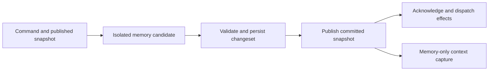

# Agent Runtime State and Context Snapshots

## Summary

Holon should represent each loaded agent's current business state in an
explicit in-memory model. Runtime decisions and context construction should
read consistent snapshots of that model. Persistent storage saves committed
changes, reconstructs the model after restart, and holds history that does not
need to remain resident.

The target is an agent state architecture. Context is a request-scoped
projection of that state; provider input is its rendered representation.
Working memory, episodes, evidence, and their durable relationships belong to
state domains. The projected context has no independent mutation authority.

The proposed contract has three parts:

1. All current core state of a loaded agent is represented in memory; ordinary
   context acquisition, construction, and budget reprojection require no
   database or filesystem reads after initialization.
2. The runtime also owns transient resources and rebuildable observations that
   are initialized dynamically and are not serialized as agent business state.
3. A mutation first computes an isolated in-memory candidate, persists its
   changes atomically, and then publishes the committed memory snapshot.
   Acknowledgements and dependent effects observe committed state.

This document specifies the proposed architecture and its invariants. Execution
admission, authority, provider replay, and storage durability retain their
respective contracts. The addressing, provenance, transactional-change, and
state-projection requirements of
[#3478](https://github.com/holon-run/holon/issues/3478) are part of this
architecture. They do not require a separate canonical context store.

## Goals

- Give loaded-agent consumers one typed model of current business facts and
  one versioned publication boundary.
- Make context selection, rendering, and reprojection pure computations over
  an immutable snapshot.
- Keep ordinary warm execution reads in memory, including source hydration
  needed for normal tool follow-ups and budget retries.
- Make durable changes, transient resources, and external observations explicit.
- Preserve atomic transitions, fencing, provenance, restart recovery, and
  existing ownership rules while moving computation toward memory.
- Bound resident history and large payloads independently of agent lifetime.

## Non-Goals

- A general-purpose in-memory database, dynamic object registry, or graph engine.
- Keeping every historical record, tool output, and attachment resident.
- Replacing current canonical tables with mandatory event sourcing. Audit
  events remain evidence, not a sufficient replay source for all business state.
- Changing the scheduler's execution protocol or creating a second authority
  for WorkItem, wait, queue, or task lifecycle.
- Allowing uncommitted state to drive model requests or acknowledged work.
- Making model-authored summaries authoritative for runtime state.
- Requiring new model calls, replacing compaction, or changing prompt content
  to establish the state architecture.

## Related Contracts

- [Scheduler–WorkItem Unified Execution Protocol](./scheduler-work-item-unified-execution-protocol.md)
- [Runtime Transition Commit Contract](./runtime-transition-commit-contract.md)
- [Runtime Host Activation Admission and Read Projections](./runtime-host-activation-admission-and-read-projections.md)
- [Runtime Object and Reference Model](./runtime-object-and-reference-model.md)
- [Runtime Ledger Sequences and Object Revisions](./runtime-ledger-sequences-and-revisions.md)
- [Provenance, Admission, and Authority](./default-trust-auth-and-control.md)
- [WorkItem Current Focus](./work-item-current-focus.md)
- [Context Candidate Budget Planner](./context-candidate-budget-planner.md)
- [Deterministic Projection Evaluation Phase 0](./projection-evaluation-phase-0.md)
- [Runtime SQLite Retention](./runtime-db-retention.md)
- [Read-Side Performance Attribution](./read-side-performance-attribution.md)

## State Model

### One logical state, two representations

`AgentStateStore` is the proposed runtime-facing owner of agent state. Its
published `AgentRuntimeState` is the representation used during loaded-agent
execution. Persistence records represent the same committed business facts
for reconstruction and unloaded access. They must not have independent
mutation semantics.

Existing domain records retain their responsibility. For example, an
`ExecutionAttempt` owns the execution lane, WorkItem execution state owns
eligibility, and a `WaitCondition` owns exact resume identity. The store groups
these facts for coherent reads and commits; it does not add another stored
`runnable`, focus, or lifecycle authority.

Loaded-agent scheduling, readiness, wait, and control projections derive from
this captured state without querying persistence for current facts. Durable
read adapters serve unloaded inspection and bootstrap; transaction-time fence
and revision validation remains part of persistence rather than a second
runtime read model.

An illustrative organization is:

```text
AgentStateStore
  published: AgentSnapshot
    identity and control
    execution attempts and bindings
    pending input metadata and admission watermarks
    current WorkItems, tasks, waits, timers, triggers, continuations
    working memory, episode anchors, continuity references
    bounded evidence working set and lookup indexes
  resources: RuntimeResources
    provider clients, task handles, cancellation, subscriptions
    versioned configuration, capabilities, guidance and file observations
  persistence: typed load and commit adapter
```

These are responsibility boundaries, not a requirement for one large struct,
one global mutex, or a new public API.

### Immutable sharing and publication

Each agent has a single writer and an `ArcSwap<AgentSnapshot>` publication
root. The root shares immutable domain state for identity/control, execution,
WorkItems/waits, tasks, scheduling, and evidence. Domain indexes reference
immutable records through `Arc<Record>`. A candidate reuses unchanged domains
and records, copying only changed records and the affected index structures.
Atomic root replacement publishes the complete compatible state together.
Records and indexes reachable from a published root are not mutated in place.

Each canonical commit returns a typed committed-domain delta containing all
records and removals in its invariant, including database-assigned sequences.
It describes the existing transaction; it is not a second event log or mutation
authority. A domain reader is usable only when coherent bootstrap, every writer,
removal/availability changes, and recovery cover its dependencies. Partial domain
coverage does not imply that the complete context or scheduler view is Ready.

A resident record may be a typed projection of a canonical persistence record:
identity/revision, required current facts, bounded preview, and a body locator.
It need not retain an entire storage record with embedded stdout or attachment
bytes. Projection metadata refers to the canonical fact and has no independent
mutation authority. Referencing an allocation containing a full body retains
and accounts for that whole allocation, even when only its preview is rendered.

Input qualification tracks the canonical payload and its actual dependency
relationships. Observer revisions, such as a conversation display revision
advanced by a queue status change, do not invalidate an unchanged input body.
A fixed upgrade checkpoint must include a body digest for records without a
canonical content hash. A selected body is checked against that digest after
its metadata and byte-budget preflight, before its first materialization.
Payload hints do not establish a Turn assignment or authorize loading another
record; only the canonical relationship or a validated recovery proof does.

An asserted provider-recovery source may be invalid because its canonical
Message or Turn does not exist. Preparation can capture a dedicated, bounded
authority-validation proof of that absence in the same persistence view. It
does not turn a missing, unqualified, foreign, or pruned record into a general
empty lookup. Related source writes invalidate the proof and require a newly
prepared closure before the scheduler can reject the input; a source that has
become valid requires replanning. Selecting a recovery message as ordinary
history does not itself grant its asserted sources authority or residency.

Use standard collections and explicit copy-on-write ownership. The design
does not require a persistent-collection library, generic actor framework, or
multi-version database. An affected index may still cost O(n) to copy; sharing
records avoids deep-copying payloads but does not make every update O(1).

Capture holds the published root only while selecting and validating its
dependencies. `ContextSnapshot` retains the selected record and observation
references, identity tokens, and request metadata; it does not retain the
entire `AgentSnapshot` or its complete domain maps across a model call. Domain
and record references must not point back to the root. There is no automatic
history of published roots: old roots and records are released when their
actual readers finish.

Records needed by permitted budget/history reprojections are selected as part
of the snapshot's prepared input set. A request cannot escape that set by
following a mutable global index during rendering. Resource observations are
immutable as well; compatible observation references are captured under the
same short publication boundary, while live clients and handles remain outside
the state graph.

### Residency and persistence classes

| Class | Examples | Residency and recovery |
| --- | --- | --- |
| Current business facts | identity/control, execution binding, open WorkItems, active tasks/waits/timers/triggers, pending input identities | Resident while the agent state owner is loaded; recovered from committed persistence |
| Continuity working set | relevant operator input, recent turn evidence, pending results, selected episode previews | Resident under explicit limits, with required references pinned; recoverable from their canonical sources |
| Derived indexes and projections | readiness indexes, by-ref lookup, context candidates, token estimates | Rebuilt from published facts; no independent business authority |
| Transient resources | process handles, clients, locks, cancellation tokens | Initialized or reattached according to existing recovery rules; not restored by deserializing handles |
| Observed external resources | plan files, AGENTS.md, curated memory, skill catalogs, configuration | Canonical source retains ownership; memory stores the latest explicitly observed version |
| Cold evidence and large bodies | old transcript, full stdout, attachments, historical episode bodies | Persisted and addressed by refs; loaded explicitly into a bounded working set when needed |

All live business metadata must remain available to correctness checks.
Resident history limits do not authorize discarding active waits or pending
input. Large results and attachments may use locators with resident bounded
previews where the input protocol permits it. Accepted queued messages must
retain the input payload required for their ordinary execution while the owner
is loaded, including an operator anchor that subsequent rounds still require.
A locator cannot replace a required root-input body merely to meet a cache
budget. Account pending input bytes separately, apply backpressure before
accepting more input, and release them to history policy only after consumption
or cancellation and all continuity pins end. Bootstrap restores pending input
before readiness; ordinary queue claim is not a cold-hydration exemption.

Logical accepted-input accounting follows the durable pending obligation across
runtime unload and reload. Physical allocation accounting follows the actual
shared buffers and their remaining owners; releasing a runtime does not erase
an accepted or indeterminate admission ticket. Within a live Host ledger, a
fresh pending read preserves the original accepted ticket identity rather than
issuing a new allowance. A known deletion acknowledgement releases Accepted
charges only under the original identity reservation, with a fresh coherent view
proving the same incarnation is Deleted and has no pending queue entries. A
tombstone alone does not prove its pending obligations ended. Unknown admissions
remain fenced until their original commit family resolves them.

Bootstrap reads current facts and bounded continuity through one coherent
database read transaction. Focused loaders use queue identities, by-ID/batch-ID
lookups, and owner tails rather than loading all history to filter it afterward.
The prepared history coverage includes the current owner's configured window
and the agent-tail fallback that the enabled selector can use. Ordinary window
advancement incorporates committed evidence; it does not repeatedly hydrate.

If an existing accepted backlog exceeds the configured activation budget,
activation reports explicit resource exhaustion with required and available
capacity. Durable work and identity remain intact; an operator can adjust the
budget and retry. Activation does not silently drop payloads, overcommit without
a bound, or replace ordinary claims with per-message cold reads.

If required live metadata or pending payloads exceed resource limits, apply
explicit admission/backpressure or report resource exhaustion; do not silently
forget accepted work. Unloaded agents remain unloadable without losing identity.

Task status and recovery obligations are durable even though the associated
process handle is transient. Observed file content is not ephemeral merely
because it is cached in memory: the file remains its persistent source.

### Memory budgets

History residency is byte-budgeted per agent and across the host, with record
count and per-body limits as additional guards. The proposed starting budgets
are 32 MiB per loaded agent and 512 MiB across the host for reclaimable history.
These are configurable sizing assumptions to calibrate with measurements,
not total agent/process memory limits or established production defaults.

Accounting separates current business metadata, reclaimable history, pinned
request evidence, observations, index overhead, and temporary candidate copies.
Within the historical payload pool, shared allocations are counted once;
pinning reclassifies a retained allocation rather than charging it twice.
Pinned evidence remains visible in total retained-memory accounting even when
it cannot be reclaimed to satisfy the history budget.
Per-agent accounting charges the allocations that agent retains; host-wide
physical accounting deduplicates allocations shared across agents. Observations
and superseded versions still pinned by requests are accounted separately from
the 32 MiB / 512 MiB reclaimable-history budgets, with explicit size and
admission limits rather than an unmeasured exemption.

Eviction removes only unpinned, nonrequired history from the resident working
set. The prepared ordinary-context window and its bounded dependency closure
remain available. Memory pressure cannot convert ordinary history-window
advancement into repeated disk hydration. If mandatory facts or pins prevent
bounded operation, limit additional optional hydration and apply explicit
admission/backpressure before accepting more work. Do not evict accepted work,
invalidate a live snapshot, or delete identity to satisfy a cache budget.

### Snapshot identity

A published root has an opaque identity scoped to its owner incarnation and
publication generation. This is an in-process consistency token, not a new
global ledger sequence or a replacement for object `revision` fields.

A context snapshot captures together:

- the published state identity and relevant committed object revisions;
- execution attempt, turn, owner binding, and admitted input watermark;
- the selected immutable records and resolved evidence dependencies;
- resource observation epochs and projection policy version;
- an explicit clock sample and other request-specific environment values.

State identity and resource epochs have different meanings. The capture fixes
their compatible combination; it must not read separate mutable maps at
different times and call the result one snapshot. A snapshot records which
pending inputs have actually been admitted to this execution, not every input
currently queued for the agent.

An older snapshot can remain readable for an in-flight request or diagnostics.
It cannot authorize a later state mutation without current revision and
execution-fence validation. Capture is a short memory operation; no store
lock is held across model calls, tools, or network waits.
The capture boundary checks owner readiness and fences together with the root
and resource epochs. An `ArcSwap` load alone does not establish this contract.
Commit/publication coordination must close the relevant capture/authority gate
before a durable result can leave memory behind, keeping it closed until the
root is installed or recovery owns the fence.

## Mutation Ownership and Commit

### Ownership

Each agent has one serialized mutation coordinator at a time. This is state
mutation ownership, independent of whether a model execution lane is active.
Commands may arrive from tools, control APIs, task supervisors, timers,
callbacks, message delivery, recovery, or resource refresh.

Host registry phase, agent lifecycle/incarnation, and shared host resources
remain host-owned. Ownership transfer between a loaded runtime and an unloaded
agent coordinator uses the existing lifecycle/admission fences. Two owners
must never concurrently accept authoritative writes for one agent incarnation.

A host-owned per-agent slot outlives any execution runtime. Ownership transfer
uses the same mutation reservation as submissions; it cannot overtake a pending
commit. Durable identity incarnation, process-local owner epoch, and publication
generation are distinct: identity recreation changes the receipt namespace,
owner replacement fences old handles, and publication advances only within the
current owner epoch. A successor inherits unresolved recovery responsibility;
claiming ownership does not itself open the publication gate.

Retiring an identity closes new admission while preserving narrowly proven
cleanup for its already accepted executions. A cleanup command validates the
same incarnation, original qualified source and actual execution relationship,
and the original State expectation in its transaction. Its finite write set
may settle the original queue item and create the corresponding terminal
evidence; it cannot start a new run or Turn, grant unrelated history current
membership, or recreate evidence with a pruned current alias. An exact original
receipt remains recoverable in that retiring incarnation. Cleanup authority
does not grant ordinary context activation or access to a successor identity.

Unloaded metadata mutations can load the necessary state, use the same commit
protocol, and release it without starting a provider or scheduler execution.
Read-only access to unloaded agents continues to use durable reads and must not
activate the runtime. Loaded-to-unloaded handoff must reconcile in-flight
commits before releasing mutation ownership.

Global startup repair runs before runtime activation. It reserves all affected
agent incarnations, including orphaned durable records, and revalidates that
scope under the activation handoff before committing. It cannot run while a
loaded, temporary, or retiring instance is active. A known commit retains its
original recovery result across publication repair; rerunning SQL must not
replace an already consumed recovery result.

Offline repair borrows the caller's existing exclusive maintenance lease for
that database. Each original repair transaction freezes and validates its finite
qualified input footprint before writing, then refreshes the actual changed
versions in the same transaction. A maintenance capability cannot adopt late
history or grant an unrelated new identity old continuity.

Cross-agent delivery submits a command to the target owner and preserves its
existing authorization, delivery identity, and receipt protocol. The sender
does not mutate the target snapshot or hold its own mutation lock while waiting
on another owner. Operations that already require a transaction spanning
multiple agents or host facts retain a host coordinator and their complete
atomic write set. Before preparing or committing such a transaction, the host
coordinator reserves the affected owners in deterministic order and fences
dependent authority decisions and new context captures. Reservations use a
deadlock-free host protocol; an agent command does not hold its mutation lock
while awaiting another owner. All affected snapshots must be reconciled to the
commit or marked unavailable before reservations are released. A partially
published host transaction cannot grant execution from mismatched owner views.

A transaction may reserve an additional owner solely to coordinate a recovery
gate. Such a reservation does not authorize a business write to that namespace.
The prepared command validates every mutable target against its primary scope,
including existing rows reached through global IDs. A truly absent read-only
namespace can remain absent; a State row without its identity is an error.
The original receipt still covers the complete reserved group.

### Memory-first preparation, commit-before-publication

The proposed sequence is:



1. The coordinator authorizes the caller and checks for an already committed
   command identity/payload. An exact replay returns its original receipt
   without running the state reducer or replaying effects; a conflicting
   payload is rejected. Only a new command is validated against the current
   published state and prepared as a candidate with a typed changeset. Stable
   command identity,
   timestamps, and allocated identifiers are fixed for retries. Record/index
   allocation and invariant checks are prepared before persistence wherever
   possible, leaving committed sequence binding and root publication small.
2. Inside the transaction the persistence adapter checks the receipt again,
   before rejecting stale expected revisions, then validates new mutations'
   object revisions, owner incarnation, and admission fences. A replay never
   reapplies the private candidate. The candidate remains private throughout.
3. One transaction writes the complete invariant: changed business records,
   related records, audit events, and required indexing/delivery intents.
   Typed transaction repositories implement this persistence boundary.
4. The adapter returns committed records and assigned sequences. The owner
   installs a snapshot containing exactly that committed result, including
   updates or invalidation of its dependent derived indexes.
5. The runtime acknowledges success and runs the permitted post-commit effects.

Readers do not consume candidates. Commands affecting the same owner are
ordered through publication, so delayed installation cannot replace a newer
snapshot. A known persisted-but-unpublished state blocks new authoritative
decisions and new context captures until reconciliation. Observational readers
may still receive an explicitly versioned older snapshot.

Publication does not perform a second authoritative write. Resolve conflicts
before commit or submit a new explicit command after installing the committed
result. A replay of an older committed command returns its receipt without
reinstalling historical records over a newer published root.

A per-agent reservation spans preparation, persistence, and publication or
explicit recovery handoff. Runtime-state locks and the publication gate are
short critical sections used to copy or install facts; they are released before
SQL, provider, tool, or network waits. Reservation acquisition belongs at the
command entry point, before taking state locks. Acquiring a reservation inside
a legacy persistence helper that already holds a state lock reverses this order.
Root, readiness, and owner epoch are validated under one publication gate.

Transaction callbacks may be retried and must have no provider, filesystem,
notification, or external side effects. Persistence stores changed records,
not a full serialized copy of all resources and history after every mutation.

### Durable command identity and receipts

Reuse a domain's stable delivery, execution, or operation identity when it
already proves the command's committed outcome. Expected revision validation
alone prevents conflicting writes; it does not necessarily recover the result
of a successful command after the object has advanced again. Where the domain
witness is insufficient, persist a focused receipt in the same transaction as
the mutation. This is a per-family contract, not a universal event-sourcing
requirement or a new unbounded command registry.

A receipt contains the following logical information:

- schema version and operation family;
- stable command identity scoped to the durable agent identity/lifecycle;
- canonical request digest, including requested expected revisions;
- original committed outcome, affected object identities and committed
  revisions, and any result data required to answer a retry;
- durable commit witness and recoverable effect/attempt references when needed.

The digest covers the original semantic command and frozen operation fields,
not a retry's transport metadata, new process-local snapshot token, or current
owner incarnation. Runtime-owner incarnation remains an admission fence, not
the deduplication namespace: replacing a process must not hide old receipts.
A deleted and newly created durable identity cannot reuse another identity's
receipts. Diagnostic timestamps do not serve as deduplication keys.

New evidence and invocation bindings retain verifiable lifecycle attribution.
Initial upgrade can explicitly adopt existing live work, pending inputs/results,
waits, continuations, and recovery obligations together with their mandatory
source closure. The adoption records permitted owner/reference scopes, policy,
and upgrade boundary; it does not claim that legacy evidence originally belonged
to the current incarnation. Later selection of an adopted live owner can prepare
its bounded history under the same scope. Adoption neither rewrites all old
payloads nor creates another lifecycle authority or unlimited retention root.
Identity recreation starts new automatic continuity. Authorized explicit queries
can still inspect old history, with legacy/unknown attribution represented.

The same identity and payload recover the original result even after subsequent
state changes. The same identity with a different payload is a conflict. The
receipt must retain sufficient historical outcome information; looking up the
latest mutable row is not equivalent. For example, when a Stop acknowledgement
was lost and a later Start has succeeded, retrying that Stop returns its original
result without stopping the agent again. A genuinely new Stop needs a new
command identity.

Receipt retention covers the domain's supported retry and recovery horizon.
After expiry, a previously accepted identity must not silently become a fresh
command; the domain needs a retained deduplication fence or an enforceable
expiry protocol. Result payload pruning and replay protection are separate
retention decisions.

### Failure and acknowledgement semantics

| Outcome | Required behavior |
| --- | --- |
| Validation rejection or definitely uncommitted failure | Discard candidate; keep published state; return typed failure |
| Committed and published | Return committed identity/revisions; dispatch permitted effects |
| Committed but publication failed | Keep commit authoritative; fence the owner, rebuild/install in place, and reconcile the request; never roll back persistence to match old memory |
| Commit result is indeterminate | Fence dependent decisions; resolve the stable command identity against canonical records/commit witness before retrying |
| Event or worker notification failed after commit | Recover from persisted event/queue/outbox state; report the effect failure without undoing business state |

A caller retry after a lost acknowledgement recovers its durable receipt and
committed object identities/revisions. After restart or owner replacement, the
response may carry a new in-process snapshot identity; a token from the old
incarnation is not restored. Audit text alone is not a commit witness.

For a known commit with a still-valid owner, publication failure immediately
fences new mutations, dependent authority decisions, and context captures.
Rebuild from the committed result or a coherent persistence snapshot, validate
identity/revisions and dependency invariants, then atomically install the root
and remove the fence. Recovery never rewrites business state to match an old
cache and never blindly replays external effects.

An indeterminate commit, unreadable persistence, or a failed bounded rebuild
keeps the owner fenced for host recovery. If the incarnation has changed, the
old owner exits rather than reloading and overwriting its successor. Releasing
or replacing an owner still requires commit reconciliation, execution
quiescence, and producer/admission fencing; publication failure grants no
shortcut to unload.

Before SQL starts, the owner retains a typed witness descriptor with the recovery
ticket: command family/version, durable incarnation, stable operation scope,
request digest, and required invocation binding. A resolver handles only its
matching family and complete recovery group. Receipt absence proves an attempt
uncommitted only after that attempt ends, a sufficiently fresh read succeeds,
and every successful branch (including no-op) is atomically linked to an
immutable, retained witness. An optional or mutable sub-command witness cannot
prove the encompassing transaction absent. A receipt recovers the original
outcome; it never reinstalls a historical candidate over current committed state.

Replay does not redispatch completed or indeterminate non-idempotent effects.
Safe scheduler/index notifications may be reissued, and unfinished durable
cancellation/cleanup obligations continue under their original run/task
generation. Returning the original receipt does not assert physical completion.

A newly submitted invocation that finds a fully observed original receipt does
not republish that invocation's historical events or recreate its physical
cancellation responsibility. This differs from resolving the original lost
acknowledgement or repairing its known publication failure, which still owns
the original unresolved installation and notification responsibility. Both
paths reconcile affected caches from current coherent records and preserve
the original small command result, including successful no-op outcomes.

Control commits the complete administrative transition together: posture and
admission facts, affected tasks/results, waits, timers and pending wakes,
queue disposition, triggers, execution interruptions, workspace occupancy,
audit/index intents, original outcome, and exact cancellation obligations.
Pending wakes remain targets even when their one-shot timer has completed.
A healthy Start preserves the current execution, including the interval
between canonical claim and Turn creation; it requires the original active
processing lease and canonical source/attempt proof.

A queued reducer-only Control need not create an execution attempt. Protecting
its consuming run instead requires the same-view canonical Control message,
Dequeued queue entry, actual input assignment, active Turn and State binding,
plus the original registered processing lease. An absent attempt alone grants
no protection. A preallocated Turn ID is a hint until the Turn and assignment
exist; a missing started Turn remains a consistency error.

When Stop has already settled an executing input, the original run verifies
that exact Control receipt and canonical terminal facts before completing its
local exit responsibility. It preserves that result instead of writing a second
terminal disposition over it, including when provider completion races Stop.

Before an acknowledged claim can yield during installation, the runtime
retains its original processing completion lease. Stop signals and joins
these exact run/task/timer generations only after publication. Missing local
handles are not completion evidence. Proven never-started or joined resources
may settle their obligations; unprovable legacy or orphan resources are
durably handed off with explicit needs-attention evidence. In particular, an
exclusive database lease does not prove an orphan OS command has exited.
Artifact cleanup requires proof that its original producers ended and that
the current artifact still belongs to the exact committed task generation.

Runtime retirement stops and drains its own physical producers without
changing durable Task/Timer intent into an administrative Stop. A Host Start
that replaces a stopped instance retains the entire admitted handoff before
closing that instance, targets its exact owner epoch, and never reopens the
old instance's admission.

Persistence errors retain transaction phase and certainty independently of
retryability. A failed commit or uncertain cleanup must not rerun a transaction
callback merely because the underlying error is normally retryable. Only a
proven uncommitted attempt may use that retry policy.

The owner retains commit and publication responsibility after a request is
cancelled. Dropping a waiting request or reservation cannot reopen a gate after
SQL may have committed. Shutdown and unload drain owned mutation tasks outside
the reservation so admitted producers can complete their terminal settlements.
An already admitted Host startup worker retains its preactivation recovery
authority during Closing; new startup requests remain fenced. This authority
does not permit recovery after runtime activation or prove that an OS producer
has terminated.

The host retains physical exit responsibility for temporary instances from
creation, atomically ordered with host shutdown admission. Caller cancellation
or cleanup arriving after Closing cannot detach an unowned instance. Shutdown
stops and drains registered instances before coordinating their existing
identity retirement; an indeterminate commit preserves the recovery fence and
home. This fallback does not authorize home removal. Normal successful cleanup
retains its existing cleanup policy.

Event, scheduler, or index-worker notification failures after successful root
publication use durable rediscovery and bounded retries. They do not invalidate
the committed root merely because a wakeup was lost. A derived index required
for snapshot correctness must be repaired before Ready; an asynchronous search
index follows its own availability contract. Resource observation failures
normally make only dependent contexts `NotReady`, rather than declaring all
business state corrupt.

Cache publication is rebuildable; scheduler notifications are hints backed by
durable work. External sends, process launches, tool actions, and provider
requests preserve their existing attempt/receipt and recovery contracts. An
unknown non-idempotent external result must not be replayed merely because a
snapshot is being reconstructed. This RFC adds no blanket exactly-once claim.

### Work, wait, and continuation coverage

The Work domain shares qualified WorkItems, waits, and continuation frames with
State and input evidence under one publication token. State retains focus and
the execution protocol retains eligibility. This domain derives their views;
it does not add a second runnable, focus, or lifecycle authority.

Live coverage includes every Open or Completing WorkItem, Active or Triggered
wait, active continuation, and the WorkItems at its endpoints. State bindings,
settlement obligations, and exact resolved-wait generations add mandatory
owners. The non-open display window is independently bounded to 128 records in
canonical order. That window cannot truncate live obligations. The existing
work-queue projection still selects Active waits belonging to Open WorkItems;
resident coverage and a particular consumer's selection are distinct.

A fixed upgrade or explicit import checkpoint freezes this domain's members,
canonical digests, and latest completion heads. Its optional historical owners
do not expand Episode live-owner membership. First import can extend only the
original import actor's mandatory closure and actual received or changed
records. A later body, duplicate append, or ordinary acquisition cannot grant
old records new scope. Fresh durable identities start with empty coverage.

The latest completion head follows the canonical nonempty Result Brief query,
including its deterministic timestamp and ID ordering. An explicit empty head
is a proved observation; an absent index entry requires preparation. Head
source refs follow the actual content-source Transcript and, for an incoming
Transcript, its related Message. A missing optional completion source can
retain the existing empty presentation only with an exact same-view proof
bound to that head version and that source edge. It cannot exempt the same
record when another owning edge or mandatory root requires it. Foreign,
unqualified, or pruned records are not global absence. Related writes
invalidate or refresh this observation in their original transaction.

Canonical writers return finite actual write sets, including older waits
implicitly cancelled by registration. Several updates to the same key return
only its final transaction state. Complete continuation-set OCC remains in
force. Qualification and dependent input facts are registered after business
writes and final State/count updates, before the original whole-command
receipt. Queue, Control, TaskResult, Timer, startup, and existing deletion or
repair transactions obey the same boundary when they touch this domain.
Uncertain persistence keeps the original receipt and owner gate; positive
recovery installs current coherent domains while returning the original
command outcome.

### Dispatch memory and compound Work commands

A prepared wait or completion that ends an actual dispatch commits its business
facts and the dispatch memory phase in the original Queue transaction. The
whole Queue receipt is checked before new business OCC. Memory validation
binds the original pre-State, actual Turn, source, and builder once. After
business writes, the memory plan is applied to the actual final State by
replacing only its working-memory fields. It cannot overwrite final focus,
control, counts, usage, workspace, or execution bindings. No later State write
may invalidate the memory receipt's recorded revision. Episode, audit, index,
memory-phase receipt, and whole-command receipt commit or roll back together.
An isolated memory-phase receipt cannot acknowledge the enclosing command.

Post-dispatch idle or sleep projection retains the original run binding and
cancellation owner until its Queue terminal and memory transaction is
acknowledged. A posture change alone does not prove producer exit. The
completion epilogue releases only that exact original run; if runtime admission
is closing, it then exits before starting further scheduling or planning.

A detached Work completion during a running dispatch records a focused durable
memory obligation in its original transaction. The first obligation freezes
that dispatch's prior closure, memory baseline, source, and operation values;
subsequent commands deduplicate and append their refs without replacing the
baseline. Normal dispatch finalization derives the final committed Work view,
applies the existing memory planner once, and marks the obligation settled in
the same transaction as the memory receipt. It does not finalize a new Episode
for each intermediate tool call.

Both the next-dispatch claim and actual Turn creation reject an unresolved
obligation for the preceding dispatch. Existing terminal settlement and
preactivation recovery can settle it after proving its original producer
ended, without a provider call or a new background actor. A lease or cancelled
handle does not prove physical exit. If State or builder advanced beyond the
frozen fence, recovery retains a typed repair gate rather than overwriting
newer memory. An already committed memory receipt may settle the obligation
without rerunning its plan.

A direct or Control-driven Work change with no actual dispatch keeps the last
canonical working-memory checkpoint. Current context derives the new Work
facts from the published domain. It creates no artificial Turn, Episode
boundary, or second persistent memory baseline. Existing-admission cleanup
retains its exact incarnation and lifecycle proof; it does not authorize new
work or installation into a successor identity.

Automatic memory decoration preserves the original typed command descriptor,
complete owner group, and frozen memory intent. A retry restores that exact
decoration before checking the whole-command receipt; a command originally
committed without a dispatch remains undecorated after a later Turn starts.
Reusing its nonce with changed business input is a conflict. Replayed result
metadata does not authorize repeating effects or publishing the old State.

A stopped dispatch may finish memory only after its original processing lease
has physically completed and the same transaction validates its original Stop,
terminal Turn, source sequence, and Start receipt. This finishes memory without
rewriting the terminal Turn or interrupting tools again. If its identity has
retired, the original lease instead records an immutable, bounded handoff of
these addresses before releasing the physical cancellation obligation. The
handoff neither completes the memory phase nor writes a successor State.

Preactivation recovery uses a revocable exclusive startup capability together
with canonical interruption or Stop evidence. Interruption, posture clearing,
and memory completion retain their separate acknowledged transactions and exact
recovery gates. Completing memory under this capability does not prove an
orphan OS process exited. Proof selection, decoded records, and planner output
share the preparation budget; persisted addresses do not grant authority to
recreate a process capability.

### Task facts, results, and original Stop effects

Task residency distinguishes qualified current records, explicit unavailable or
pruned references, and historical records that cannot grant current authority.
Relations validate their exact Task generation before following Work or source
Message dependencies. An invalid Result relation remains observable for finite
canonical cleanup; it cannot make a foreign or unqualified Work a capture root.
A cleanup phase rechecks that relation in its own transaction, so a relation
that became valid cannot be settled from an earlier invalid observation.

Complete active Task metadata, unsettled Result metadata, and pending Stop
responsibilities are independent of bounded terminal history. Selected records
and exact-generation Stop heads share the Task domain revision. A terminal Task
or empty queue does not remove an unfinished Stop from startup inventory. Raw
maintenance can invalidate coverage without manufacturing qualified records or
a Ready Task domain. Result writers, Control, startup interruption, and deletion
maintenance return their complete actual write footprint for one domain install.

Task status also captures read-only observations of original worktree cleanup
and the latest child delegation. These observations bind the exact selected Task
locator and share its domain revision; they grant neither mutation authority nor
source-body membership. Cleanup overlays preserve the original artifact and
lineage, exposing only cleanup status, reason, error, changed files, retention,
and branch-cleanup evidence. Delegation observations preserve the existing
latest-for-child ordering. Unavailable metadata and observed absence remain
separate, including when an optional delegation is omitted from a response.
The original completion and delegation writers maintain accepted metadata in
their owning transactions. Named preparation can consume the fixed original
inventory; a normal reader cannot adopt an unacknowledged canonical tail.

Task query relations are complete observations in the same captured view. A
native Task's first acknowledged insertion advances a durable incarnation-local
birth cursor; updates and receipt replay do not create another birth. Fixed
history and first-import members precede a newly admitted observation session.
Live query roles retain the entire required birth interval or completed-reply
relation independently of the bounded terminal history window. Their members
count as current facts while the role remains live, and admission fails before
allocation when that complete set exceeds its budget. An observed empty reply
relation differs from unavailable or pruned membership. These indexes select
already qualified Task facts and grant no Input body or mutation authority.

A producer generation preserves the raw rejoin shape as well as the Task's
original birth. An absent contract, a valid creator-allocated obligation and
generation without a parent Turn, and a complete bound rejoin are distinct.
Explicit null, zero or foreign markers cannot become an unbound contract by
failing to decode a complete fence. A creator without a parent has no model
reentry authority; the eventual Result Message's provenance Turn cannot grant it.

A Running input obtains its original clock from the qualified actual Task and
its independently accepted canonical Message in the same owner-held capture.
A native expected-birth header supplies equality only. A historical missing
header requires an immutable association between both original fixed-cohort
members, or the exact live producer's private seal. Such an association never
follows a later Task birth or raw rejoin generation under the same Task ID and
does not itself admit an Input body. Fixed Input and Task-query fingerprints use
the same metadata representation and retain the independent body proofs required
by that original cohort.

The original child monitor retains actual child incarnation, delivery/baseline,
lifecycle duty and artifact addresses before it can publish Running or freeze a
Stop that takes over those responsibilities. Binding is an acknowledged Task
mutation under the original producer, with its own recoverable whole receipt;
it preserves the Task birth, Work and rejoin contract. A Stop coordinating that
binding releases its first parent reservation before awaiting the same producer,
then reacquires and validates the current Task and the identical original lease.
Missing current qualification preserves the producer's responsibility.

Finite child creation is Host-owned from registration through its actual result,
independently of the abortable monitor and caller. Created identity or worktree
side effects remain attached to that original responsibility even if a later
creation step fails; an unexecuted plan is not proof of a created artifact.
The subsequent whole ACK or an exact durable Stop handoff must cover the actual
child and artifact facets before releasing the source. None of these
observations independently grants identity deletion or artifact removal.

TaskStop has a focused durable effect record within the Task domain. Its first
transaction updates the original Task and records its immutable intent and
whole-command receipt. The intent freezes identity incarnation, original Task
locator and generation, owner epoch, signal kind, exact local lease identity or
explicit absence, original child association, artifact addresses, and the
Result continuation's nonce, Message identity, clock, and canonical Work binding.
It admits no Result and performs no physical action in that transaction.

The runtime retains its local plan before SQL and registers the owned worker
before the caller's first suspension. An unknown commit cannot permit a signal;
only the original acknowledged and published intent can authorize the frozen
local target. A distinct later Force request is a new intent, never an upgrade
of replayed Cancel. The worker never looks up a replacement handle by Task ID.
A child included solely as an initial read dependency preserves its existing
published State and domain allocations; this grants no child mutation or
activation. Retired or absent-State child observations remain metadata only.

Physical monitor completion, child retirement, worktree disposition, and Result
admission have separate acknowledged progress. A monitor join proves neither
OS-process exit nor child retirement. Archiving a child revalidates the frozen
incarnation and parent creation-Task association before and after drain using
the existing lifecycle rules. Worktree removal requires original artifact
ownership and producer-exit evidence held through the filesystem operation;
missing evidence produces an explicit retained disposition. These observations
do not independently authorize identity deletion or successor writes.

Result delivery proceeds independently of physical attention. Its original
frozen continuation uses the existing qualified Task/Result/Work/Wait/Input
transaction and applicable deferred-memory obligations, with one complete
receipt after all writes. The typed ACK distinguishes actual delivery from
finite unavailability; a successful metadata-only outcome cannot count its
unadmitted template as accepted input. Only that original attempt's newly
reserved tickets are resolved from this ACK. Existing accepted inputs remain
owned and accounted independently.

A loaded runtime may install a Stop phase through its ordinary mutation adapter
only when both the original ACK and the fresh current scope support complete
current-domain installation. No State, incomplete coverage, or a retired scope
uses the original owner's finite metadata actor. A sealed fresh observation
binds the finished original attempt, phase receipt, initial whole Stop receipt,
and actual current scope; it cannot hydrate missing State or turn TaskNone into
Ready. Retired recovery does not read successor State. Positive recovery returns
the original result while preserving current installation and accepted-input
accounting; receipt replay is not permission to repeat physical effects.

The public Stop reply describes the acknowledged initial Task mutation.
Its owned continuation remains responsible for Result admission and the
independent physical facets after the caller disconnects. A completed original
monitor releases only the matching instance handle; a later lease under the
same Task ID remains untouched.

Physical retirement joins the original instance's owned mutation workers before
resolving their durable scope. When that instance's owner has been replaced,
only a closed-admission instance may ask the Host to reconcile its original
agent/incarnation through the current owner and complete witness group. This
does not grant the old token publication rights. Unknown outcomes and original
worker failures remain errors; resource drain cannot turn them into Ready or
successful exit proof.

An original Stop plan can outlive replacement of its in-process mutation owner.
A retry keeps its original descriptor, immutable receipt binding and exact local
lease; Cancel and Force remain distinct commands. A positive publication can
be reused without selecting another Task handle. If the initial publication
was lost, the Host first resolves the original finished attempt under the real
current scope owner. Only a ready current publication containing the exact
original Stop record, equal to its fresh whole receipt, may grant the frozen
local signal capability. The publication token belongs to that current owner;
the old Runtime does not install state with its former epoch. Missing Task
coverage permits named preparation through an already registered current
Runtime, never activation merely to continue Stop. Missing or retired State
remains an explicit unavailable/attention outcome, not fabricated readiness.

Completed Stop facets may no longer appear in pending inventories. The Host
also observes retained finished local attempts by their original descriptor,
including terminal whole acknowledgements, before releasing their exact local
plan. An original attempt may be released as uncommitted only after it ended,
its complete recovery group is resolved, and a fresh reserved read proves the
joint absence of both the mandatory Stop effect and its unpruned whole receipt.
Every successful initial Stop, including a Task no-op, writes both atomically.


#### Original worktree cleanup observation

Worktree cleanup is a closed continuation of one initial Stop receipt. Its
request identity contains that immutable original address and a deterministic
phase nonce. Only this action excludes the current progress revision and
filesystem observations from the business digest: those are local compare-and-
set metadata and derived results, not a new cleanup request. Existing progress
commands retain their original digest contract.

The Host first reconciles the original owner's unknown attempt and checks the
full phase receipt. A committed receipt returns its original ACK before Git is
run. Otherwise it holds bootstrap locks and mutation owners in sorted scope
order, validates the same parent incarnation, qualified original Task generation,
frozen artifact and repository address, retired original child association, and
the sealed complete producer-exit capability. Retired/successor or unavailable
associations retain the artifact. The SQLite read ends before Git; the bootstrap
and owner gates cover branch inspection, dirty checking, and ordinary removal.

Only that gated actual cleanup can mint the opaque Removed/AlreadyRemoved
observation. The Host releases its owners before the original metadata actor
commits that observation, actual audits, domain revision and whole phase receipt
atomically. If FS succeeded but SQL definitely rolled back, retry may observe
AlreadyRemoved under the same original request. A positive receipt always wins
and never repeats FS. Failed/retained outcomes keep the existing branch/dirty
policy; monitor join, Task cancellation and Result delivery are not exit proof.

### Durability level

Commit means a successful database transaction under the configured durability
policy. Transaction commit, WAL synchronization, and checkpointing are distinct;
acknowledgements must not promise stronger crash or power-loss durability than
the selected policy provides. This architecture does not change that policy.

Arbitrary delayed write-back of published core business state is not part of
the proposal. Derived caches and transient observations need no business-state
commit. Files retain their own persistence and acknowledgement contracts.

## Memory-Only Context Construction

### Capture and render interfaces

The conceptual boundary is:

```text
capture_context(state, resources, request, policy)
  -> Ready(ContextSnapshot)
   | NeedsHydration(required_refs, reason)
   | NotReady(reason)

build_context(snapshot, budget) -> BuiltContext
reproject_context(snapshot, smaller_budget) -> BuiltContext
```

Selection, reference lookup, rendering, and budget reprojection for a ready
snapshot have no storage, filesystem, network, or mutation capability. Existing
budget priorities, pinned minima, owner filters, and cache stability rules
continue to apply. `build_context` does not create plan files or resolve
recovery lineage from the database.

Initial assembly, history-selector changes within prepared policy bounds,
ordinary tool follow-ups, and budget retries use resident data. New request
snapshots may include newly committed tool results and admitted input. A retry
of one snapshot with a smaller budget preserves its input set and state
identity; it cannot consume queued input again.

Late operator input is admitted at the existing safe boundary. Arrival after
capture does not mutate an already-submitted provider request. Provider
fallback/reentry preserves the admitted root message, predecessor attempt,
owner binding, provenance, and exact continuation fences.

Snapshot readability does not grant execution authority. Immediately before a
new provider request or effect is admitted for dispatch, the runtime validates
the current owner/execution fence and applicable capability policy. A Stop,
owner replacement, or authorization revocation after capture can therefore
block dispatch from that snapshot. A budget retry that starts a new provider
attempt crosses the same barrier. Ordinary resource-content refresh alone
does not invalidate previously captured input unless execution policy requires
it; already dispatched requests follow the existing cancellation protocol.

### Working-set preparation and explicit hydration

Bootstrap populates current business facts and the initial continuity working
set. Committed mutations update it incrementally: accepted input, tool results,
briefs, turn outcomes, and episode anchors enter memory when produced, rather
than being reread from storage at the next turn.

Required context roots include the admitted current input, relevant operator
anchor, execution-bound WorkItem and plan observation, active waits/pending
results, and evidence needed by selected recent turns. Recovery additionally
requires the validated source turn, root message, and predecessor execution.
Typed bounded dependency rules determine the necessary closure; the runtime
does not recursively load every historical lineage edge.

A genuinely nonresident dependency can request hydration under a typed cause:
`Bootstrap`, `ExplicitRefRecall`, `ExecutionOwnerChange`, `WorkspaceChange`,
`ValidatedRecovery`, or explicit `ProjectionPolicyExpansion`. Ordinary
relevance selection and advancement of the recent-history window are not
hydration causes. New committed evidence updates the resident window directly;
ordinary selection operates on that prepared window. A new policy requiring
more archived history must declare its expansion rather than silently fall
back to storage each turn.

The loader authorizes the target, reads the needed
version, and returns immutable records. The owner revalidates their dependency
versions before installing them. A mutable current-state reference must match
the requested current revision; an explicit immutable historical reference
may legitimately resolve an older version. A changed request binding, mismatched
version, or unauthorized target rejects installation rather than substituting
the newest record. Existing same-agent cross-workspace ref access remains valid;
the active workspace alone is not an authorization boundary.
Missing optional history is represented as unavailable; missing mandatory
continuity evidence prevents `Ready` with a typed reason.

An explicit preparation uses the caller's frozen selector windows, history
limits, recovery sources and resource version under the same reservation as
capture. It may add required accepted/current-owner dependencies, but it does
not reselect the model or replace that request with default policy. The owner
retains all accepted payloads; each request pins only its selected dependency
closure, rather than pinning the entire pending queue or published root.

Hydration has explicit ref/count/byte/depth limits and records its reason,
source reads, bytes, and duration. Oversized bodies remain addressable through
existing tools with bounded previews. Hitting a bound cannot silently remove
the root operator input or fabricate an empty history. Snapshot references pin
the records they use until the request, its reprojections, and any in-flight
provider continuation release them; resource accounting includes these pins.

Ordinary steady-state capture must not perform recurring "preparation" queries
for the latest records. Moving current I/O into a wrapper before the pure
renderer is an intermediate refactor, not achievement of the memory-read goal.

### Dynamic resources and files

Resource observations carry source identity, content digest when applicable,
an immutable body or bounded preview, and an observation epoch. Known file-tool
writes, workspace switches, configuration reloads, and explicit refresh requests
invalidate or update the affected observation. Watchers discover external edits;
watcher overflow, restart, or known missed events invalidate affected
observations and schedule reconciliation. An explicit refresh operation remains
available when watching is unsupported or unreliable. The renderer never polls
or scans files once per turn to simulate fresh memory state.
An asynchronous refresh carries the invalidation generation it observed;
installation revalidates that generation, workspace, and source identity so a
late read cannot overwrite a newer invalidation or observation.

The runtime promises the latest observed resource version, not instantaneous
agreement with arbitrary external file writes. Once a required observation is
known dirty, capture reports `NotReady` until it is refreshed or a documented
error policy is applied. Refresh happens outside rendering and is measured as
I/O. Strict freshness checks, when requested, are explicit operations with
their own cost.
Existing captured snapshots retain their immutable observation version when a
later invalidation blocks new captures.

Plan creation belongs to the WorkItem/file workflow. The renderer consumes an
already observed plan preview and locator. Workspace identity participates in
resource keys so switching roots cannot reuse another root's instructions.
Capabilities, skill catalogs, and environment projections are initialized and
refreshed as resources; refresh does not invent durable business mutations.
Clock samples are captured explicitly per request under the existing time
context contract.

## Startup, Unload, and Persistence Boundaries

Startup loads a coherent persistence snapshot, applies the existing canonical
recovery protocol, initializes resources, and prepares required continuity
data before announcing the owner ready. Bootstrap reads and explicit cold
loading are allowed and separately observable.

The store is not ready if an interrupted commit, an ownership fence, or missing
required evidence is unresolved. Recovery compares canonical identity and
state; it does not reconstruct lifecycle by guessing from rendered prompts or
model summaries.

Unload closes the mutation admission gate, reconciles outstanding commits,
and releases memory/resources under existing runtime retirement rules.
Resident-state eviction does not delete agent identity or durable history.
Read-only inspection of an unloaded agent continues without waking it.

Persistence remains typed. Its schema needs to support coherent loading,
expected-revision validation, durable command outcome lookup, and bounded cold
evidence reads; it need not mirror the memory layout or add a universal version
column to every record. Files remain separate canonical resources; a SQLite
commit cannot make arbitrary file edits atomic. Operations publishing a new
artifact reference must use their defined file-write/receipt protocol before
exposing that reference as ready.

## Context as an Agent State Projection

The projection boundary is:

```text
ContextSnapshot = capture(
  published agent state, compatible resource observations, admitted request,
  frozen projection policy and clock sample
)
Context = project(ContextSnapshot, budget)
ProviderInput = render(Context, provider format)
```

Agent state here includes current business facts and the prepared continuity
working set. Resource observations make external guidance and capabilities
available as frozen inputs; clients, process handles, and private or irrelevant
state do not enter the prompt merely because they are held in memory. Selection
preserves execution ownership, access policy, provenance, and the admitted
input set. A full state serialization is not a valid substitute for projection.

### Addressable projection inputs

Context candidates expose a common descriptor over typed domain records:
reference and kind, owner, source identity/revision, applicable provenance and
authority metadata, available lineage, and a bounded payload or body locator.
This is a read interface over the same canonical facts, not another independently
mutable `ContextNode` payload table. Fields retain their domain meanings; a
unified descriptor does not grant every record the same authority or lifecycle.

Every emitted runtime reference has a typed resolver contract. A ready snapshot
already contains its mandatory projection dependencies; an explicit lookup of
optional cold evidence may load it under the hydration contract. Resolution
distinguishes access denial, unavailable or pruned evidence, and version
mismatch instead of silently substituting a current record. Existing lineage
and evidence links are accessible through this same interface and preserve
their source identities across capture and rendering.

WorkItem current-state refs and mutable plan paths are distinct from immutable
version refs. Exact historical retrieval requires saved versions and the
applicable retention contract; a descriptor must not claim historical content
exists merely because an object has a revision counter. No universal graph
database or speculative version history for every table is required.

### Durable memory and semantic changes

Episode finalization atomically persists the episode, source relationships,
builder/epoch progression, command witness, audit, and index intent before
publication. Boundary detection remains deterministic and finalization retries
preserve the original operation and episode identities. Finalized content is
immutable; a semantic correction requires an explicit successor operation
rather than overwriting evidence that an earlier snapshot referenced.

The original StartedTurn transaction freezes the actual dispatch identity,
source binding, prior closure, and working-memory baseline. An unfinished start
is a durable memory obligation even before the first detached Work command.
Detached commands append their original command identities and actual source
references in their own whole transactions; they preserve the first baseline,
episode identities, and clock sample. Continuation tools in the same dispatch
may proceed, while a new dispatch cannot replace an unfinished baseline.

Wait/completion settlement and normal dispatch completion consume that original
obligation with the final business state in one transaction. The planner may
overlay only working memory, preserving all other business changes. Its episode,
phase receipt, obligation completion, and whole-command receipt commit together.
A completed obligation retains compact receipt bindings instead of old bodies.
Recovery requires the original producer to have ended and the original state
fence still to match; otherwise it retains an explicit repair gate. Direct Stop
keeps its cancellation authority, and same-incarnation Deleting cleanup remains
limited to the original admitted dispatch.

Addressing, provenance, atomic state changes, and projection are intrinsic to
this design. An in-memory representation alone does not create model-authored
summaries, `supersedes` relationships, semantic retirement, or cross-agent
sharing rules. These are optional state-domain capabilities with their own
commands, validation, and policy. When present, `derive/retire/restore/relate`
use the same owner and commit protocol, and their results become state that
subsequent projections can select.

A model proposal is input to a validated state command. Proposal absence or
failure must not block wait/settlement, and summaries remain derived evidence.
Projection does not call a model or silently persist a new summary while
rendering. Cross-agent sharing requires explicit access and provenance rules;
the existence of a resolvable ref does not authorize sharing.

Messages remain canonical ingress and causal evidence, while structured work,
wait, plan, and memory state provide explicit continuity facts. This does not
authorize dropping the admitted operator input, required dialogue history, or
provider protocol anchors. Choosing a different mix of messages and derived
memory is a projection-policy decision; memory residency by itself does not
establish that summaries can safely replace messages.

Provenance, `authority_class`, admission, and execution policy retain their
distinct meanings. A tool receipt's runtime origin does not elevate the
authority of external text in its output. A model summary of an operator
instruction does not become a new operator instruction.

Memory eviction, prompt budget omission, semantic retirement, and physical
retention are four distinct operations. `retire` itself does not delete bytes;
it also does not promise that all referenced history is retained forever.
Existing typed retention roots remain authoritative until explicitly revised.
Reading a ref or following an edge still requires target access checks.

Retention and maintenance are state writers too. A pruning batch uses the same
affected-owner coordination to return typed removal/availability changes and
update or invalidate resident lookups before new captures. A dropped
notification cannot leave the owner treating pruned evidence as available.
Already captured immutable snapshots may retain their materialized copies
until release; those copies must not be reinserted into persistence or presented
as proof that a durable source still exists. Subsequent lookups observe the
pruned state under the existing resolver contract.

Transcript and tool evidence belonging to a current Deleting identity stays
protected until retirement completes. The retention planner checks this in its
own coherent view, including dry-run and deletion; it does not bypass an
unresolved owner or grant a Deleting identity ordinary writer authority. After
the identity becomes Deleted, the existing age, floor, and durable-root rules
apply again. A stalled retirement can therefore delay evidence reclamation.

A memory pin preserves bytes for an in-flight snapshot; it is not a new durable
retention root. Evidence required for restart/replay must be protected through
the existing typed durable-root contract. Identity deletion keeps its own
admission, cancellation, and disposal protocol and is not treated as ordinary
history pruning.

## Projection and Consistency Invariants

Context is a deterministic projection of a captured state and policy. It
preserves admitted current input, the required direct predecessor, canonical
evidence uniqueness, execution ownership, and authority boundaries. A smaller
budget does not add new evidence or change the admitted input set; mandatory
continuity that cannot fit fails explicitly rather than silently disappearing.
Restart reconstruction of the same committed inputs preserves these semantics.

The memory-only boundary includes acquisition through provider-request
construction, ordinary tool follow-ups, history-window advancement, and budget
reprojection. It is not limited to rendering one already prepared snapshot.
Explicit cold recall, recovery loading, and resource refresh remain visible
operations with distinct reasons and costs; ordinary selection cannot be
reclassified as cold loading.

Observability distinguishes context reads, hydration causes, captured state and
resource identities, resident/pinned/candidate bytes, commit/publication lag,
and outstanding recovery/effect obligations. Performance or cache measurements
must include acquisition and request preparation, not just renderer time.
Provider usage and cache placement have their own contract; deterministic
snapshot content alone does not imply a cache hit or better task quality.


### Accepted TaskResult reducer routing

After the original EnsurePending/Admit ACK, owner-unavailable routing captures the
finite qualified Result/Work dependency under its original owner. Invalid Result
relations grant no Work body access. The unchanged owner-unavailable settlement
actor commits before the subsequent Task/parent routing read. That read selects
Task and Work from one final publication; ordinary decisions borrow only those
selected facts and the finite parent Input read carrier.

An existing Task authorizes only its exact current qualified locator and original
parent. Canonical Task global absence preserves the original first-create timing
and `should_ignore(None) == false`. In that branch a private parsed-source proof
must bind the actual accepted Message, exact agent/origin/task, original
RuntimeInstruction/RuntimeOwned TaskRejoin route, and every parser-derived Task
field. The parser's two original local timestamps remain local constructor facts.
A candidate detail hint alone grants no historical Input read.

The parent read is a visible, owner-held accepted-source preparation. It reuses
current/fixed Input fingerprint and prune validation without creating aliases or
adding parent IDs to long-lived mandatory roots. Only the parent Turn and its
produced Brief IDs are read; real global absence preserves false, while known
pruned/frozen-missing/foreign/corrupt evidence stays a typed failure. NoState,
retired identities, missing Task domains and unknown qualification never fall
back to canonical repository reads.

Actual ledger guards precede parser clones, SQL body materialization and native
JSON node traversal. The same finite allowance subtracts selected capture/proof
materials before the read phase; shared Arc payloads keep their existing Weak/Pins
observation rather than being counted as new copied allocations. Returned
carriers hold selected Arcs, finite observations and guards, with no root/storage
back-reference. Original Task writes, model-reentry rules and final writer OCC
remain separate from this read authority.

### Child monitor 的完整 Task 观察

Child completion 使用同一 child scope、incarnation 与 publication 的 State、完整 active Task 和 live Work/Wait 观察。invocation 的 parentTurn 关系使用有限活跃角色，完整保存已接纳 Task 的 ID、原 parent_turn_id、status、locator 与 availability；显式空集表示完整观察，Pruned/Unavailable 成员不得通过忽略该成员而判定完成。该关系不授予历史 Task 正文、Input/Result、重入或删除权限。

原 accepted monitor 持有调用者拥有的角色 lease，覆盖首次具名有限元数据 acquire、后续纯 capture 与实际消费。只有新的协议 Turn 或实际 owner 更替建立新角色；普通轮询不得因窗口滚动、缺失或失败而隐式回读 canonical history。角色集合通过已有 Task writer/Current recovery 同 revision 维护，Weak registry 不保留 Runtime 或 Root，释放角色后下一次实际 ACK 可以收窄元数据。

Loaded 分支严格使用当前 owner 的 selected capture，并把实际 ledger guards 保留至同步判断及其原消费边界。TaskNone、foreign、retired 或不完整观察显式失败，不转入 raw Storage 兜底。真正 unloaded 的显式 inspection 保持独立边界，不为查询激活 Runtime。Delivery/ExecutionProtocol 证据保持各自来源，不能借 Task 关系授予其他领域的资格。
### Scheduling residency and original fixed qualification

Scheduling uses three explicit families: Timer, TimerWake and ExternalTrigger.
Its ready view contains all qualified active timers, all pending wakes (including
those owned by a completed timer), the active default trigger, bounded historical
bodies and requested by-ID facts. A pending wake retains its original fire count;
later timer advances do not rewrite that admission identity. Captures hold only
selected record Arcs, independent metadata and Weak ledger observations. They do
not retain an Agent root, storage handle or physical timer/command resource.

The original fixed cutover actor stores a sealed, bounded metadata inventory with
exact body and full normalized-column digests. This inventory is independent of
Episode ownership: it does not widen Episode members or source refs, or rewrite
old payloads with an invented incarnation. The final Scheduling migration consumes
that original inventory. First import may advance only its frozen members or
actually received typed-equal stored records from the original Timer/Trigger
import transactions. A later current read cannot recapture a canonical tail.
Ordinary preparation requires the exact Active identity and State; named original
recovery may read its same-incarnation Deleting scope without granting business
admission. NoState and retired predecessors return unavailable metadata, never
Ready, and do not read a successor State.

Original writers reserve a finite pre-SQL footprint, including any wake's owning
timer. A non-cloneable proof borrows that actual transaction and verifies original
qualification or actual global absence. The finalizer checks every reserved target
against the actual write set, reads stored canonical facts, validates the final
business State and emits one complete finite delta before the original whole
receipt. Its body and metadata guards remain alive through receipt/publication;
the delta alone cannot manufacture a ready domain when the original root was
unprepared. Generic new writes cannot revive pruned or foreign-incarnation IDs.
NoState maintenance and actual removals require their own original actor proof.

Timer fire merge and callback accounting retain their existing transaction
boundaries. A merged fire may advance its Timer without a new wake, Message or
pending ticket. Callback wake admission and delivery accounting remain separate
reservations and preserve an intervening revocation. Loaded Scheduling readers
require complete writer, removal and joint recovery/publication coverage, with
one body owner and no independent shadow cache.


Timer producers use a frozen whole-transaction command for creation, firing,
and cancellation. A frozen existing pending wake keeps the original merge
branch: only the Timer advances, with no new Message, Pending ticket, or Memory
responsibility. A new-wake branch preserves the original Message/Queue/Wait/State
transaction and its accepted Source metadata. Queue incorporation reports its
actual Wake write from the successful original update. Each domain finalizes
once before the original whole receipt; current installation uses fresh current
facts rather than replaying historical DTOs. Scheduling dependencies are derived
from the current pending frontier, not pinned forever by an old receipt window.
Control, startup, deletion/import actors and coherent root/read integration
preserve this qualification and publication contract. Ordinary readers cannot
fall back to storage or create a NoState Ready domain.


Control Stop maintains Scheduling qualification in its original transaction. Its
finite target set includes active Timers, the independent complete pending-Wake
set (whose owner may already be Completed), and the actual active Triggers. SQL
write acknowledgments, rather than desired DTOs or cancellation counts, identify
the changed records. Existing raw cleanup preserves the business contract without
adopting unqualified history. The actual final State and complete Scheduling view
are finalized once before the original Control receipt and its immediately
referencing cancellation obligations; publication and physical signals follow ACK.

Existing-only Scheduling maintenance is a separate borrowed, same-transaction
qualification proof. It checks the exact identity before any State access and
retains only original qualified/fixed aliases. NoState maintenance emits incomplete
coverage with an explicit new revision after actual changes; it does not construct
State or a Ready domain. It cannot introduce new IDs, revive Pruned members, or
replace a successor's facts. The original startup/deletion actor still supplies
business authorization and whole-outcome responsibility. Unbound original seed
overlays and owner/receipt integration preserve the same qualification boundary.


#### 删除协调者的既有 Scheduling 维护 ACK

删除协调者沿原 unloaded、job/inc/phase 与 metadata owner 执行。普通 Quiesce 保留每个 Active Timer 仅改 Cancelled 的原事务；ParentCleanup 保留原 blocker，并在原 bulk 事务取消 Timer 与 pending Wake、丢弃对应 Queue；Ingress 保留每个 Active Trigger 的原撤销事务。有限 IDs 按原顺序分批，实际写集只来自 SQL changed/RETURNING，不能从计划、计数或返回候选反推。

同一事务先预预算实际 identity/job、原正文和 normalized projection、有限关联 Queue/Wake，再验证既有 qualified/fixed 子集；原业务 SQL 后只更新该子集 alias，并使已有 coverage 以一次 revision 进入显式 incomplete。raw 旧行可以按原业务取消，不能由清理获得新成员资格。已固定但尚未完成 JSON 导入的原成员可以维护其版本；普通 loader 仍要求原 import seal，清理不制造 seal、补采尾部或新 Ready。NoState 不创建 State；同原 inc 的 Deleted CleanupRepair 保原业务且不更改已退休 namespace，不读取 successor State。

实际 Host ledger 的 Candidate guards 经原 metadata ACK/Known 保存与发布交接；Unknown 保原 owner 门禁，不能以后一次 no-op 冒充原事务不存在。元数据 ACK 不安装 Scheduling Ready。startup/exclusive-unbound、复合 root 准备与恢复及普通读取遵循相同资格和原回执发布边界。

#### Scheduling exclusive startup 的固定版本维护

原 Host preactivation handoff、maintenance lease 与完整原 scope reservation 持续覆盖原 global stale-Wait/Stopped 清理事务。该事务先以真实 Host ledger 计量 State/live Wait/有限同 owner 依赖及取消候选，再执行原 canonical Wait/Timer/Wake/Queue/State 顺序；actual Timer/Wake keys 来自原更新出口，资格 ACK 与业务同事务。Current 或同代 Deleting 仅维护既有 fixed/qualified 子集并使 coverage 显式 incomplete，raw 旧清理不追认；Deleted 原清理不触退休 namespace。原历史 Task/Trigger/Timer 观察只选择 live Wait 实际引用，保持原同 owner/ID/status stale 判定，不授任何依赖正文新资格。

无 identity 的原 fixed seed 只由实际 `ExclusiveStartupInputRecovery` 与原 `LegacySeedRecoveryScope` 授予现有 Timer/Wake 的取消版本记录。原 fixed manifest/digest 不变，focused seed sidecar 同事务保存当前已 ACK digest；只接受 Active→Cancelled、Pending→Cancelled 及原取消时间字段，地址、owner、火次与其余正文保持。真正首次绑定原 seed 后可以物化该已 ACK 版本，FreshEmpty/successor、晚到 raw key、Pruned 或无原 anchor 均不能借此获得成员资格。该版本记录不构造 identity/incarnation/State/Ready，也不扩原固定承接集合、窗口或 manifest。返回的 actual identities/States/material guards 先进入原 Known metadata 再发布；不会先激活或在事务外重读正文补资格。

#### Scheduling cold bootstrap 的 Wake 规范化

原 bootstrap Wake 规范化保持独立的 metadata 事务、原 Queue 重复项顺序/丢弃规则、原 pending keeper、原独立火次、原每个分支的时钟调用和之后的 pending 重算。单次原 selection 在实际 Host ledger 的原始字节/normalized字段/native JSON节点 admission 后读取；原逻辑 Pending 额度门禁先于 native JSON 解析。实际取消 keys 从原 UPDATE RETURNING 取得，复活与 INSERT keys 从其实际 affected 出口取得。

已有 fixed/qualified Wake 只更新其现有成员版本，raw 旧清理不追认。首次缺失 Wake 的私有同事务能力只能由原 qualified Timer、实际同 owner Queued/Interrupted TimerTick Message 的完整字段/实际序号及 Input current/fixed 资格构造；只允许该冻结 pair/body，Timer 其余正文保持，禁止旧 Pruned/global collision 或 raw Timer 授权。原已观察 Absent 可以接受首次实际版本，且原 alias 必须在业务期间不变。它不写 Message、不建 Run/Turn/activation、无新 Input 票或 dispatch memory checkpoint，也不把 Message body grant 回普通 Input aliases。取消/复活/首次实际 Wake 资格与原 canonical Queue/Wake 写入同 ACK；一次 sparse revision 使完整标记失效，原 cold Known metadata 后才开始下一 bootstrap 阶段，不隐式安装 Ready 或启用普通 reader fallback。


#### Scheduling ExternalTrigger 的原回执与两阶段 delivery

ExternalTrigger producer 使用封闭的 Ensure、Reset、Revoke、Account 原命令及独立 whole receipt family。真实 owner 下的写前观察先验证原 identity/State、有限 key 的 fixed/current 资格与 full normalized projection；它不是普通 reader fallback。命令冻结原 default/body、生成的 ID/token/hash、第一次时钟与 callback disposition。Ensure 命中已有 token 时保留原 no-op/旧记录，未使用的新 ID 不成为写目标；缺 token 的替换与 Reset 按原同事务先撤销再创建，actual keys 仅从实际 affected 出口取得。

原 receipt 在原业务前查询，重放只返回原 outcome，不能用后来 latest record 改写成功结果。finite preproof 后执行原 SQL、读取实际 stored ACK，一次 Scheduling finalizer 与原 whole receipt 同事务。初始观察、命令、完整原 receipt、pre/post readback 与 finalizer 共用本次剩余额度；真实 Host Candidate guards 贯穿 ACK、publication 与原后置 audit 边界。原 namespace 未准备时 delta 仍显式需要具名准备，不能制造 Ready。新 ingress 仅 Active；原既有 Revoke/Account 可在同代 Deleting 收束，但不替代原业务 admission gate，不复活 Pruned 或 raw/foreign key。

callback delivery 保留两个独立原 ACK：第一阶段在 owner 下观察已 qualified 的 Active capability，释放 owner 后按原 submit_wake_hint 取得 disposition；第二阶段重新获 owner 并读取当前已 qualified record，再按第一时钟记账。中间撤销不会被旧快照覆盖，Account 保留当前 Revoked/revoked_at。两阶段不合并为新事务，也不引入新 callback 外发。Trigger producer 本身不写 Message、Queue、Task、Run/Turn、activation、identity 或 Episode/dispatch memory；Wake 的责任仍属于其原独立入口。

### Scheduling publication and projection reads

Scheduling is an explicit optional domain in the same published Agent root as
State, Episode, Input, Work and Task. None requires preparation and cannot stand
for an empty live frontier. A successful original ACK saves its actual finite
Scheduling delta in Known facts before installation awaits. Exact original
receipt recovery prepares current Scheduling in the same SQL view as the other
domains; the old receipt grants no historical Timer or Trigger body authority.
A metadata-only or retired scope carries no Ready Scheduling and cannot load a
successor State. Pending Wake Message dependencies join Input preparation from
the actual current frontier, independently of optional history.

The scheduler, Work projections and loaded context select Trigger facts and the
active Timer count from that same root. They do not query canonical Timer or
Trigger bodies, consult a shadow cache, or interpret a missing domain as empty.
An explicit owner preparation may install a requested current/fixed selector;
ordinary capture itself cannot hydrate a missed key or recapture a late tail.
Selected copies share the caller's remaining bounded read allowance: retained
Scheduling metadata and bodies are counted with new Trigger DTO copies before
allocation, and actual ledger guards remain through derived projection building.
This read allowance does not redefine every named preparation's separate
material budget or claim an exact allocator/RSS bound.


Accepted Timer/Trigger read queries keep selected Scheduling facts and their
actual owned-output guard through synchronous Tool or HTTP serialization.
An exact Timer query reserves selector material before copying its ID and may
prepare only the original current/fixed namespace. A foreign normalized owner
is rejected before decoding its body; unqualified raw late rows, pruned members
and historical-table unavailability retain their distinct strict failures.
Legacy in-process DTO methods preserve their return shape, while production
wire adapters use the internal owned carrier. Loaded Host State queries select
Timer and Trigger DTOs together and verify one stable publication generation
across their other loaded projections; a changing publication is a typed retry
failure, never a storage-body fallback. These DTO guards carry no root, storage,
producer handle or new admission authority.


Timer bootstrap retains a selected Scheduling capture from the same coherent
read as its published root, rather than decoding an additional raw active-Timer
list. Recovery preserves the canonical millisecond created-at descending / ID
ascending order. Before building that borrowed ordering vector or copying any
Timer body, it reserves bounded metadata and counts selected material together
with the new copies against the clamped read allowance.

Timer loop registration uses the already held original owner and its published
Scheduling capture. It checks the exact Timer agent, ID and original created-at
generation, then preserves the original admission, cancellation and lease
checks. Missing or unqualified facts cannot fall back to a canonical Timer row
or the caller's DTO. The loop owns only its Timer copy and actual ledger guard;
it does not retain the captured root or unrelated Timer/Trigger history. That
guard remains through sleeps, original firing and physical loop completion.


### Timer fire/cancel 的读取与提交

原 accepted Timer writer 在既有 owner 内显式准备有限 Timer key 与必要 Work live 集合，随后只从同一个 published root 读取 Timer、完整 pending Wake 和唯一 Active Timer Wait 的 Open-owner 关联。纯 lookup 不做 SQL fallback；原 fixed/current qualification、Pruned/foreign/NoState 仍严格。初次 Timer generation/expected/cadence/source 冻结，State OCC 重试只重新观察该原 scope 的 pending 分支；actual Timer/Queue/Wait/Work/Input/Task/Source 仍由原 whole TX/receipt 与一次 finalizer 负责。merge 不投新 Input 票或新 source。

最终选中 Scheduling+Work、仍活 selector 与 Timer/pending/correlation owned command 副本先 clamp64MiB/65536 后累计，actual Host Candidate guard 先于 clone并跨原 ACK。具名 hydration 继续原独立 hard bounds/ledger，不声明整个 Runtime acquire/native RSS 同时限64MiB。原低层 SQL pending observer 保留作独立writer兼容/测试，不再是这些 Runtime 路由的普通读取回退。

### WaitFor 的 Scheduling 只读边界

原 WaitFor 命令在已持有的 mutation owner 内，以有限 current/fixed Scheduling
请求显式准备 Timer/完整 pending Wake 或 active default ExternalTrigger。后续
Timer deadline、completed pending trigger 及 ExternalIngress ID 只由该次 published
root 派生；原 Absent/foreign/Pruned/不可用分别保持 typed 结果，不以旧 DTO 或 SQL
miss fallback 补正文。register 复用原 owner，外部 Tool/terminal retry 准备只取得一次
owner，不能嵌套取得同 scope 的 mutation owner。

新 Scheduling 派生材料在 clone 前按已选中记录与该材料的组合预算计量，guard
随 PreparedWait 保留到原 Wait/Queue whole ACK。active Timer 仍选择 nextFireAt，
completed Timer 仍必须有真实 pending Wake；取消、缺失、owner mismatch 与原
TaskResult/OperatorInput 的业务错误、exact Wait、Work blocker、执行协议保持原义。
这不声称整段 Wait 既有 State/Work/Task/事件适配器或所有 native RSS 已统一预算；
普通 reader 的 projection 不执行隐藏 hydration。

A Timer queue claim selects its incorporation tuple from complete pending-Wake
coverage and Work facts in the same owner-held publication. The accepted claim
prepares these domains explicitly before the pure selection. Absence or a Wake
for another Message preserves the original no-incorporation branch; a missing
or incomplete Scheduling domain cannot fall back to the canonical Timer tables.
The original Queue transaction still validates and writes incorporation with its
other domain effects and whole receipt. Selected views and owned tuple copies
share the finite claim-read allowance; the tuple guard remains held through ACK.

Work focus and Command environment decisions use the complete active Trigger
relation from the same publication as their Work or State observations. Work
focus may prepare that finite relation at its accepted command boundary; an
ordinary Command projection cannot adopt a missing or raw Trigger. Trigger
copies and generated callback URLs are admitted before allocation, and their
actual material guards remain with the prepared Work or Command value. These
read projections grant no delivery, activation, reset or revocation authority.


### Cold Host Scheduling read scope

An accepted cold state query reserves the exact Active incarnation without
activating a Runtime. If that owner still has a ready published root, Scheduling
selection uses that root, while a bounded same-scope State read verifies the
pair. Otherwise the named preparation uses only the original current/fixed
qualification in one transaction. No read can adopt a later raw row.

NoState may display an empty Scheduling list only after an exact fresh-empty
binding or the original sealed fixed inventories prove all three families were
observed empty, and canonical, current, qualified, fixed and import membership
are all empty. Missing availability or any original member yields a typed
failure; the query does not create State, aliases, a ready root or activation.
Retired/successor scopes are rejected before the successor State body is read.

The cold decode material, selected facts and projected Timer/Trigger copies
share one bounded allowance. Their actual ledger guards remain in the response
carrier through child observations and synchronous serialization. The closure
uses the same complete selected active Timer observation, rather than reading
Timer bodies again. Primary-scope owners are released before awaiting child
summaries; immutable selected material survives independently of the root.


### Agent summary Scheduling material

The full summary's active Trigger list is derived from the same SchedulerRead
as its State, Work posture and Timer closure observation. It cannot open a
second Trigger read after those facts have been captured. A cold full or compact
summary uses the exact-incarnation cold Scheduling query and its original
current/fixed qualification, including its explicit NoState empty proof.

The Rust summary return value owns the selected Scheduling observations and
projection allowance. It serializes transparently as the existing AgentSummary
DTO. Host bridge and list calls preserve that carrier; GetAgent keeps its
material while serializing the original full or compact DTO, and HTTP consumes
the carrier in its synchronous serializer. Compact projections retain the
Scheduling observation independently through serialization. These values have
no Root, database or physical producer back-reference.

This contract concerns Scheduling material. State, Work, Task, Wait,
event and child observations retain their own explicit accounting and
coherence boundaries; a summary does not assert that all domains share one
whole-request peak allowance or publication.


### Callback token discovery

HTTP callback discovery reads only a finite address and delivery-mode header.
Integer raw and normalized-column lengths are admitted to the actual Host ledger
before any JSON parse or owned address; native JSON node counts consume the
remaining record allowance before header decoding. The original active-token
LIMIT 1 selection is preserved. Normalized ID, owner, active status and token
hash must agree with the body. No State, incarnation, qualification or activation
is inferred from this global locator.

The locator and its material survive until the scoped producer's original
admission and delivery finish. That producer still verifies original qualified
Scheduling membership, authority and revocation fences in its existing two
phases. Discovery never authorizes delivery after revocation.

The existing public Host Record-returning APIs are explicit bounded compatibility
adapters. They use the same raw/node preflight and then deserialize the finite record and
validate all normalized fields before returning the DTO; their material spans any
activation await. The legacy DTO output boundary retains explicit wire material
accounting limits. Production HTTP does not use that compatibility route.


### Scheduling installation has one body owner

Timer and Trigger bodies are installed only through the qualified Scheduling
domain in the original joint publication. Bootstrap and mutation installation
do not retain a second full-history projection cache. Current recovery keeps
only the original acknowledged selectors; an existing normalized foreign row
fails, and a missing row remains an original selector rather than a body to
resurrect. Fresh qualified-domain preparation supplies current availability
and bodies independently of the original outcome.

The first whole receipt still verifies every original Timer/Trigger target is
present, fully typed, and exact in normalized/body ID and owner under its
original scope. Receipt replay does not require that old row to remain after
pruning. This separation cannot adopt raw rows or turn a metadata-only recovery
into a ready domain.


#### Scheduling history preserves each original consumer order

Loaded Timer history uses the original full payload creation time descending and
ID tie-break; cold Timer output retains the original normalized update/creation
order, selects its bounded limit, then reverses. Cold Trigger output retains
normalized creation order and ID; loaded Trigger order uses full payload time.
The resident coverage retains the finite union of both accepted head selections,
and each projection emits only its own history keys plus complete live keys.

History selection follows original current aliases or fixed/import metadata,
never a later raw canonical tail. Current aliases preserve actual acknowledged
status, update-sort and creation headers beside their body/projection digests.
The loaded selector expands only the normalized creation-time cutoff bucket;
raw byte/slot admission precedes every header String, projection encoding and
payload JSON extraction. Every expanded candidate must match its original
body/projection digests before its full timestamp participates in ordering.
Creation headers must also match canonical and payload-normalized time. Missing,
foreign or changed present members remain typed failures. Optional Pruned heads
retain their accepted cohort and availability without a body; explicit body or
owning-dependency reads remain typed Pruned. Original loaded timestamp order may
be reused only from a complete, same-revision observation of the same cohort;
otherwise loaded-history reads require preparation. Millisecond headers never
substitute for removed payload nanoseconds, and no later tail fills the gap.
An oversized boundary bucket is ResourceExhausted, never an approximate or truncated top K. Prior
finite accepted heads are revalidated so drift cannot hide a previously observed
member below a later cutoff. None of these observations grants new membership,
activation, identity mutation or historical Input authority.


### 外部资源的已观察版本与捕获生命周期

Loaded Context/EffectivePrompt 通过具名资源刷新观察 AGENTS、memory 文件、skills/catalog、templates、notes 与原 qualified Work 的 plan。刷新冻结实际 scope/incarnation、workspace/execution source、config generation、原 Work revision 后，在 mutation owner/SQLite writer 外执行文件 I/O；安装在原 owner 下重新验证来源及 invalidation generation。外部编辑只承诺 latest observed；有界、可停止并等待的 reconcile observer 负责后续观察，dispatch/capture/render 不负责读盘探测。

已知写入、workspace/config 切换以及 observer overflow/restart 先将依赖置 Dirty。新 mandatory capture 拒绝 Dirty/RefreshFailed，已持有的 immutable Arc 保留原版本。Absent 表示成功观察到可选来源不存在，不能将读取失败降为 Absent；原可选 notes/catalog 的省略语义保留，同时记录该来源的失败。刷新不授予 Task/Work/Input/identity 写入权限。

同一 capture 使用调用方已持有的一次 publication State/Work，不能以 latest root 补另一代 State 或 Work。资源 carrier 只持 core 观察及实际选中的 plan Arcs/预算 guards，没有 Runtime/root/存储反向引用。Core-only summary 不保留完整 plan body map。ContextSnapshot、EffectivePrompt 和 owned wire material 将资源 pins 保留到实际 provider request 或同步序列化完成；裸 DTO convenience helper 不能替代该交接。

临时 subagent execution 使用原 producer 的具名资源 source phase，读取实际 execution workspace 后复核原 scope/source/generation，不覆盖 Runtime active-workspace 的观察。原 Work/file workflow 负责 plan 文件创建/更新，capture/render 只能观察已有结果。资源预算是原 request 有界材料与实际 Host ledger guard，不新增全局 quota 或业务授权；encoded/native metadata 与正文计量不声称等于 RSS。


可控文件 kernel 的 KnownWrite 使用 readiness lease：在实际写入开始前标 Dirty，refresh/install 拒绝进行中的 write，结束后再推进 generation 并唤醒 observer。lease 必须由真实同步 kernel、blocking closure 或 Runtime owned worker持有；HTTP/Tool caller 取消不能把仍进行的底层写误判为结束。它不授文件权限，也不增加业务接纳。

任意 Command 不采用覆盖整个进程生命的 active-write lease，避免阻断原后台任务模型。原 process producer 在 start 及实际 wait/status 获得任何退出结果时（包括非零退出、信号退出）失效资源；运行中细粒度文件变化只承诺 latest observed，不声称进程文件写具有原子性。foreground 返回后的下一 Context 必须经过退出边界的新观察；caller 取消、Task terminal metadata 或 Unknown 不是 physical exit。


### Host 实例的资源写入 fence

可控文件 kernel 的 resource write lease 同时绑定原 Host 实例的 write
stamp/count。Host 全局 writer 在 fleet snapshot 之前登记；新激活 Runtime
即使不在该 snapshot 中，也必须通过同一 Host stamp 才能捕获或安装资源。
资源读取前取 stamp，释放 fence 做有界 I/O；安装及冷读取交接再次以短同步
fence 核同 stamp/count。fence 不是文件、Task 或身份写权限，也不持有 mutation
owner 跨文件 I/O。old captures 继续保留原观测值。

实际 blocking/owned kernel 持有原 lease，HTTP/Tool caller 取消不释放其物理
责任。Host tracker 私有有界库存登记只等该 kernel 真正完成的 waiter；
其 BTree 节点、JoinHandle、固定材料保持至物理退出且实际reap/drain，未调度或
finished未reap的waiter仍纳原硬bound。waiter 保留原 Host/maintenance lease，Host Closing 拒新 Host writer 与新资源
capture，既有 Runtime kernel可在原业务准入下完成。全部原 Runtime producer
join 后封存 resource writer，等待真实 kernel 全部退出并 join waiter 后才
释放 maintenance lease。新 Host 不以旧 caller 取消或 ready-counter 归零猜测
物理退出。

任意 Command 不持整个进程生命周期的 active-write lease。其原 start 与真实
wait/status 退出（含非零和信号）仅推进 Host 与原 Runtime 资源 stamp 并通知
重观察；运行中仍为 latest-observed 语义。新 Runtime 的核心 bootstrap 可在
明确 known physical writer 导致的 Dirty(KnownWrite) 下完成；资源部分仍不可
捕获，由原 observer 在物理退出通知后准备，其他真实 source/I/O/预算错误
不降级为该延迟。

### 执行命令的有限只读输入

Work 创建、字段更新和 Wait 结算的命令规划使用调用者已持有 publication 的 Input 执行观察。只选完整 open frontier 的至多一个原 qualified Attempt，以及本命令精确 Work ID 的 Present/Absent/Pruned 观察；不加载或复制整个 Protocol 历史。完整 frontier 声明缺正文必须显式 preparation 错误，不能当作无 open attempt；未初始化分区不能含正向执行事实。成功观察到 source 尚无 Attempt 或精确 Work 不存在的负向元数据不构造执行事实。

具名 source 只短借同 held owner 的 Input 与实际 ledger，释放 owner 后不能继续选择；返回 carrier 只持选中 Arc、原 scope/token 和实际 material guards，无 Root、Runtime、Storage 或全域 map 回边。新 command 的地址、reason 及所需副本在首次 clone 前与选中材料共享有界额度，carrier保到原命令 ACK/publication。Wait 的原 Task 查询、错误与首次创建时序保持；只在实际需要规划执行命令时消费 source 失败，不能为了只读准备提前持久化 Task。

此观察仅提供原业务规划输入。原 Command 仍通过 Wait 结算、Work active/repair/terminal/generation 规则、same-ID revision/OCC、原事务 reducer 与 whole receipt 顺序继续校验；old selected Arc 不授权覆盖当前事实。原 Frozen command 在回执重放时保持 nonce、时间与字段，不重新规划或以普通读取冒充 recovery。


### Published Queue and audit read facts

Ordinary Queue disposition and audit predicates use a finite immutable domain
attached to the same published State and original identity. Its complete Queue
frontier records every pending status and exact accepted counts for all statuses;
a Message body still requires its independent Input qualification. An unknown
canonical Queue member prevents a complete frontier. Global absence, original
Pruned membership and unavailable source tables are distinct observations.

Audit selection follows accepted event sequence and normalized creation order.
Initial publication materializes the scheduler's 64 Event bodies and keeps 100
accepted headers for the Summary count. These limits describe separate consumer
roles. A consumer whose original predicate uses 512 Event bodies retains that
window through explicit bounded owner preparation; a pure capture never expands
it or falls back to SQL. The maximum explicit body or count window is 512.
Finite ordinary-window leases bind the original owner scope, epoch and ledger.
A prepared carrier keeps its lease across external decision hooks and original
repreparation. Writers maintain the maximum live ordinary body and header windows,
independently of the minimum native-birth cursor. Releasing the carrier permits
the next actual writer or State-only acknowledgement to narrow the window using
the same qualified body Arcs. Truncated headers cannot remain exhaustive for a
larger count. A pure capture never reopens the discarded history or expands the
window; only the original named preparation may do so. Accepted order remains
unchanged. A count observation does not grant access to an unmaterialized body.
Shared Arc pins account for one physical Value tree, with each owned copy and
finite selector charged before allocation.

Original cutover and first import freeze Queue/Event IDs, normalized headers and
body/projection fingerprints without creating an incarnation or decoding the
whole historical Event pool. Later raw rows cannot refill that inventory.
Original same-incarnation continuity must be explicit; empty canonical tables do
not establish FreshEmpty. Selected materialization validates the fixed/current
locator, owner, body and normalized projection in the same read view.

Each original business transaction freezes its finite maintenance targets before
SQL. Only actual repository write/readback exits mint non-clone observations
bound to that transaction and target set. One finalizer advances the domain
revision and observes the final State before the original whole acknowledgement;
no-op writes cannot adopt an old raw member. A lightweight State notification caused by an actual posture or Queue claim
belongs to that original whole acknowledgement. Its ID, time and lightweight
payload freeze before business SQL, after borrowed copy/native material is
admitted. The original State/Queue capability remains the only mutation
authority; the notification cannot manufacture a NoState or retired-scope actor.
Its accepted Event and native birth advance with the same finalizer and roll
back with the original State command. Receipt replay preserves the original
notification rather than appending it after publication. A StartedTurn likewise
freezes its lightweight State, turn-start and optional original replay
annotations inside its original Posture acknowledgement. The actual source and
Turn/Memory capabilities still validate their own relationships; annotations
convey no authority to read another Turn or manufacture a dispatch seed.
The original terminal-processing notification freezes separately from early
Queue audits and appends after its actual Memory epilogue. The exact Settle,
terminal Turn and State remain its business authority. Before append, its
lightweight payload must equal the final actual State; Memory may change only
fields outside that projection. The original whole receipt binds the frozen
notification and rolls it back together with Queue, Turn and Memory. Legacy
terminal commands that did not emit this notification retain their command
shape and digest.

Qualification conveys read facts,
not permission to mutate the business row. Removal, startup and retired-scope
maintenance preserve original authority and explicitly invalidate incomplete
coverage; they cannot construct an empty State or a ready successor domain.

The original Event append acknowledgement also records its first native birth
in the same transaction, after its exact qualified member is installed. It uses
the original durable event sequence and an incarnation-local high-water mark;
retention cannot lower that mark. Existing fixed/imported bodies and no-op
replays never gain a native birth. This complete metadata source is independent
of the finite body windows and grants no body or mutation permission.

An explicit Event birth role materializes every accepted post-cursor member
under the same raw/native allowance, preserving Pruned and incomplete source
observations. Pure report capture selects canonical Arcs from that publication
and keeps their guards through use. Per-row decoder scratch is released only
after its qualified Arc is observed; still-live selector and body material
remain cumulative. Older coverage without the birth source is incomplete for
this role, rather than an empty report.

Ordinary loaded scheduler, Summary acquisition, and Skills acquisition hold the
original owner reservation and select a single Ready publication. They do not
reconcile a Known or Unknown ticket, validate canonical SQL, or clone the mutable
runtime agent. Queue status and the scheduler's 64 Event bodies come from that
publication's qualified current facts; Summary's bounded Event and Brief counts
come from the same accepted metadata/windows. A missing Current domain remains
an explicit preparation error. A real command acquisition or explicit cold
inspection retains its named authority and recovery boundary.

Lifecycle 的非空 State 尾审计必须与其真实 State 变化共用原 Posture
whole ACK，并保持 `agent_state_mutated` 在前、原业务审计在后的顺序。
借用实际 workspace 地址预计量后才分配 Event 容器、JSON 和地址副本，材料
保留至原 ACK。再次验证后已空的维护集合保持原 Noop；非空尾审计不得以
相同 State 制造写入，也不得藉此取得 NoState 或另一 incarnation 的权限。

### Published identity header

原Mutation owner publication保存单一已接纳identity header及其同allocation owned guard。Metadata ACK更新该header；State ACK仅在原actual ACK携带明确identity facet时更新，否则继承原header。State absence/retired不授Ready。普通loaded入口从同root借identity及guard，cold首locator在normalized raw/native预算后读取；selected观察仅保原Arc与guard，不保Root、Runtime或DB回边。任何原identity/body cache都不能替代该实际ACK资格，旧capture只保内存寿命，不能授后来身份或正文权限。


### Legacy Delivery source cutover

Legacy Delivery summaries belong to the existing qualified Input family. An
independent migration cutover freezes their original normalized owner, Work and
Turn addresses, creation order and complete payload version. A bound member
retains its actual positive identity incarnation; an unbound member may retain
only its original continuity seed. The facet has no ordinary-read alias or
permission to activate a Runtime, adopt a later raw tail or bind a successor.
Missing original tables are an explicit unavailable observation.

The full durable inventory may exceed a resident request's record limit. The
migration streams one original row at a time under its one named unscoped
scratch ledger: pure SQL byte lengths and actual raw guards precede JSON native
node counts; actual node guards precede typed decoding, hashing and stream seal.
The row and its scratch guards are released before advancing. The shared hard
bounds apply to simultaneously owned material, not the accumulated number of
already released rows. These estimates describe owned Rust scratch, not SQLite
internal allocations or process RSS. Any invalid row rolls back the complete
facet, and immutable header/member fences prevent reopening a sealed capture.

Later qualified preparation must use the original fixed or actual writer
footprint and its actual scope. Fixed/import/hydration membership does not acquire
native birth. The List latest-nonempty and Get latest-any head predicates remain
separate: an empty latest-any row may suppress an older nonempty row. Head
selection grants no body authority and does not create a reverse owning edge
from a Delivery summary to its Turn. Selected bodies, their source metadata and
wire copies retain the original actual ledger guards through their real handoff.


### Input observation sessions

Input 的 live query role 与原 owning closure 共用同一域。原生首次 INSERT 的 actual whole ACK推进 incarnation-local birth cursor；更新、重放、fixed/import/hydration不分配新 birth。一个 held owner 在同一已发布 root 上登记 Task/Input/Event 游标和角色，完整 post-birth 成员独立于普通历史窗口，不能任意 LIMIT 或从后来 raw rowid认领。metadata只选择原 qualified Input；缺版本、Pruned与完整空集合明确区分，不授 Turn body、Ready或mutation权限。

Registry仅持调用者 lease 的 Weak；原scope/inc/ownerEpoch和实际ledger绑定。borrowed selectors与仍活原lease材料先累计计量，再复制合并集合；drop角色后下一实际writer可收窄。selected capture只保原canonical Arcs/Pins、关系metadata和guard到实际消费，无Root/Runtime/DB回边。普通capture不隐式 SQL准备；Source未完整维护时应显式Incomplete。原first-native证明来自具体业务TX的before-SQL私有footprint，不能用提交后的alias缺失或generic append代替；原oncefinalizer与receipt原子更新完整游标/成员。


Tool 的有限 run-report 补充与原 prompt projection 共用精确 D3 locator；路径与 Sleep reason 不改变 prompt 的 32KiB 上界，原 command Task ID 仍来自该已接纳 projection。缺失补充表示该报告未准备，不能默认为空报告。具名水化或实际来源版本改变时，在原 same-TX qualification、normalized header 和材料 guard 下单遍校验完整原文 SHA，再生成有限补充；不保留 stdout 或完整 input/output Value。只读 incremental cell 地址仅是 I/O 定位，不授成员或 birth。已封印同 locator 的补充随原 immutable Arc/Pins 纯内存消费，State ACK 不要求重哈未变化 Tool，scope/revision/digest 改变则不能复用旧补充。所有原文 scratch、finite JSON、selector和补充副本须在首次分配前累计到同实际 allowance，guard保持至实际交接/消费。

Tool 的报告水化对原 canonical cell 使用只读增量流，不先由 SQLite JSON 函数解析完整 input/output。流式 decoder 的唯一可增长 scratch 在读取前按实际 cell 字节上界计量；未知字段以不生成 String/Value 的 visitor 跳过。选中字段先借用计完整字符串、键和容器，再在同 allowance 形成有限 Value/报告。每条 Source 的 decoder、buffer 和有限中间 Value 销毁后，只保留已独立接纳的报告材料，并归还同 Input/Memory phase 的真实临时 debit；原 scope/ledger 与最后实际 guard holder 校验不能省略。

Tool prompt 的具名读取与报告共用流式原文材料边界；它按原 canonical writer 的纯字段投影合同形成 command、summary、batch scalar counters，不重新解释输出中的 JSON 字符串或以 SQL 数值真值扩张标志。summary 依 UTF-8 字符裁剪并保 NUL，原 result 键存在即保其优先级；这使同 locator 的只读候选与真实 writer 事实一致。batch 的输入规模只保整数，输出仅观察原前 N 项的 disposition/exit scalars；额外项和完整 stdout/artifact 不形成 Value/Vec。normalized Work/Turn 关联必须与已资格原文对应；原 32KiB prompt 上界仍在原 qualified constructor。


Input birth Source 在原命名准备的同一事务内读取 incarnation-local cursor 与完整 post-cut metadata；完整性按该 cut 的连续序列核对，不扫描旧正文，也不以普通窗口或任意 LIMIT 截断。required 与 born key 只进入原 owning/body 资格闭包，成功后才随同一 resident 发布 coverage；Pruned 保留原 birth 并明确表示 unavailable，不能补读 raw latest。

原 owner 的 live selector、registry slot 与合并 snapshot 由各自实际 guard 承载。Input 阶段借入这些同 allocation 材料时先验证 scope、owner epoch 与 ledger，同 guard 只扣一次，Memory 借同一观察而不再次登记。角色与 Source metadata 不授正文、State、Ready 或 mutation 权；NoState、retired、缺 source schema 或不完整 frontier 保持显式门禁。


Input query 的 required/born roots 是完整报告观察集合，与原业务 mandatory-body 集合分别保存在同一 coverage。已接纳 Pruned root 保留 birth 与明确 unavailable，不能变为空成员或读 raw successor；若同一 key 同时属于原 mandatory，原完整正文门禁仍优先拒绝。纯报告 capture 保同一 qualified closure、Arcs/Pins 与 typed unavailable，不为观察角色新增业务读取或 mutation 权限。

原 Input 首次写入证明在业务 SQL 前冻结实际 birth cursor；同一具体事务的最终 D3 readback 消费该证明，随原 delta 携带私有非 Serde advance。advance 只记录该事务的完整连续新增序列及其精确 locator，并由原 footprint 的同 allocation guard 保持至 ACK/Known 的最后 holder。更新、导入和既有地址只保原 birth，不能从后来 alias 或 raw rowid补授。新 root 只能在原 cursor、live role 和 owning closure 完整匹配时增量沿用查询覆盖；否则保持 Incomplete。once receipt 与回滚边界不变，capability 本身不授正文、State、Ready 或 mutation。


Received Turn import 保留原五个实际传入 Vec 的来源，不将它们替换为原 SQL cohort 或普通 cold raw provider。原唯一 pre-Host scratch ledger 先观察同时存活的完整 messages/Tool/Brief/Delivery/Wait 与 spare capacity；原单一 derive 算法在 Turn/map/ID/trigger 首 clone 前借用计量实际派生字段。五 Vec consume 后退役其原估计，派生 map/Vec、逐条 existing Turn decoder、assignment/replay 原 footprint 借同一个硬上限；每行实际 scratch 退出后释放，不把所有已退出行累计为常驻。原 error/failed checkpoint 到完成的真实材料保持，业务 import/complete 仍同原事务、failed marker 与 retry 可观察性不变。不创造 Input alias/birth/Ready；巨大的 received Vec 被硬上限拒绝不代替原 SQL streaming 100k 完整导入的兼容验收。

#### Original Input writer 角色来源

Input 写入的查询角色由原 mutation reservation 冻结，包含原 scope、owner epoch、实际 ledger 的有限 selector 快照及其 guard。无活动角色是显式空快照；缺少该来源不能解释为完整空集合。来源不持 Root、Runtime 或 DB 回指，也不授予正文、State、删除或新写权限。

原 Native INSERT proof 在首个 scope/key 复制前，将已持 selector 的实际材料从同一硬上限中扣除。实际同事务 D3 readback 消费该 proof 后，原 frontier 增量保留同一个来源与 guard 至 whole ACK 结束；既有 nonce、业务摘要、receipt 顺序及 replay 语义保持。Runtime、Host 的原终态与恢复写入共用实际 reservation，不能根据同名 ID 或 raw rowid 补造角色。


#### Native writer 的共享读材料

原 Native INSERT 的 scope/key 与身份工作树在第一次复制前由实际 InputReadMaterial 登记。该 phase 借用同事务 Work、Task、Current、Scheduling proof 的实际 scope、ledger、usage 和仍持 guard；已观察到 Memory 的原材料只扣 Input 余量，Current 尚未观察的部分通过原 sealed observer 一次交给 Memory。Native guard由这个 Input phase 创建并由 proof共享，不能在 Host与Memory各造一份估算。新读回、finalizer及最终DTO继续服从同一剩余额度；资格、原业务OCC和whole receipt仍由原事务持有。

原 Model 分支的审计必须保留真正 Noop 的语义。真实 State 变化与原 Model
尾审计共用原 Posture wholeACK；State 未变时，只能由首次 held owner
在原具体分支完成后密封同 scope/incarnation、owner epoch、实际 ledger
及已冻结 Event 摘要的短命来源。该来源不保留 Root、Runtime、数据库或
旧 State 正文，释放首次 owner 后以 fresh State 作为 OCC 见证完成原 Audit。
原同 incarnation、State 存在的 Deleting 权限保留；来源不授 NoState、
retired、replacement 或任意 Event 权限。原 Event ID/time 不因重试或
fresh State 正常推进而重生，提交前的责任登记必须覆盖 caller 取消。


泛型原写入的 Native 证明以同一 concrete TX 短借原 Input 材料，移动并归还真实 guard 容器和累计 usage，不再登记 scope 或已观察的 prior。Tool 原冻结 DTO 在业务序列化及 Effects clone 前按实际共存的两个原生 JSON 树和四份编码材料计量；原 D3 readback 借这份余量，以 borrowed DTO 的流式 canonical serde SHA 与实际只读 Blob 完整 SHA 精确相等作为源版本前提。有限 prompt 继续沿 normalized clock、32 KiB 上限和原字段语义，报告补充绑定同一个实际 locator；NoState 或非 Active 原清理 ACK 不产生报告 Ready。原作用域、清理 proof、nonce、业务资格与 whole receipt 保持唯一权威，材料 observer 只传递该原事务预算。业务后续各域 finalizer 必须继续在新增分配前扣同 phase 的真实剩余额度，不能以末尾累计检查替代首复制 admission。


原 Focus 对已接纳 CompleteWorkItem 事实的语义 no-op 不重写 canonical JSON。该分支在业务 SQL 前以原 current/fixed 资格、exact fingerprint 和完整只读 Blob SHA 封存旧来源，只有实际 kernel 确认 no-op 才能复用；合法旧 JSON 格式或省略 default 字段不要求等于新 serializer 字节。业务后仍须与该原封印字段及全部字节精确一致，不能从后来同 ID row 重新认领来源。实际 rewritten Tool 继续要求本次 borrowed DTO 的 canonical serde SHA 与原文严格相等。原无 canonical hash 的 qualified Tool 保留 canonical ACK，缺失报告仍显式 Incomplete，不由 no-op 补授 Ready。旧比较器的原文/原生 DTO 材料在 decoder 前计入同一 Input/Memory phase，顺序流式计数 scratch 销毁后退休，真实 old DTO guard 保持至交接。


原 Runtime shutdown 在关闭正常准入及执行原 State/abort 投影后，才能由
同一 held owner 密封固定 shutdown 审计组。State ACK 保留原独立提交边界；
其后原请求审计与可选 run-aborted 审计按原顺序共用一次 whole receipt、
Current finalizer 及实际 Event birth。首次 Audit 副本前登记材料，密封来源
保原 scope/incarnation、owner epoch、实际 ledger、完整组摘要与 guard；
fresh owner 只重核当前 State 的 OCC，不重生原 Event ID/time 或补造 companion。
已接纳 Host shutdown/temporary cleanup worker 负责完成该组，不能在关闭后
重新申请普通准入。同 incarnation 且 State 存在的 Deleting 权限保留；
缺 State、retired 或 successor 不授新的 metadata 权限。本地取消或退役观察
不证明 OS process exit、process-group quiescence、worktree cleanup 或身份删除。


公开 operator abort 在任何业务副作用前登记原完整 owned 请求。原 run ID
校验及 stop-after-abort/idle-after-abort 投影保持不变；原 State/abort ACK
先完成，随后才由同 held 原 handle 密封该次审计和 outcome 的有限材料。
原独立 Audit 事务只消费该 operator 分支的来源，以 fresh State OCC 完成；
不能借 Model 或 shutdown factory 更换请求 family、mode、原 Event ID/time。
调用者取消不取消已接纳 worker，Closing 拒绝新请求而保已登记责任。
审计失败保留已完成的原 abort/State 事实，不能倒退物理取消或伪造 NoState
权限；原同 incarnation、State 存在的 Deleting 边界与后继代际拒绝保持。

实际 Tool writer 的语义 no-op 交接保留原 alias 资格。只有业务前已资格的完整来源封印、原 kernel 实际 no-op 与业务后相同事务的精确 D3 readback 可以形成私有交接；Native 消费时还须证明该 key 不在原业务前的 absent 集合。旧成员的 birth 保留或为零，真实首次插入仍只接受 committed-writer ACK；旧无 canonical hash 的有限报告仍为 Incomplete。

原 Workspace standalone State 请求的 Host-owned 材料只能以同原 scope、owner epoch 和实际 ledger 的私有 loan 进入首 scope/receipt 之前的 Input 累计，原 Host guard 保持其原归属。后续 Current 准备与最终 readback 用该 Input 已用余量收窄，在真实 guard 首分配前验证，再把实际新增成本借回同 phase；原 loan 专用 Arc 与 State ACK/effects 共持，不改变原业务资格、OCC、receipt 重放或 NoState/retired 边界。


Workspace 的已接纳请求副本由专用实际材料 loan 保持，loan 仅约束预算，
不授 State、文件、Work、Input 或删除权限。它封原 scope/incarnation、
owner epoch、actual ledger、完整 native/copy cost 和原实际 guard；在
首次 clone 前接纳，原独立 State 与后续观察 Audit 均须先借其成本，不能
为每个子读取重新获得完整额度。Host-owned guard 保原分配身份，不能
伪装为 agent-scoped Input guard；原 Prepared/ACK 独立持其 loan 到实际
最后 holder，并在首 receipt、scope/domain decoder 前扣除同阶段余量。
原物理完成、OCC、错误处理和 Audit 顺序保持，普通只读 capture 不借此
认领 later raw Workspace 或启动新的 mutation。真 State Noop 仍保原
独立观察语义，同 incarnation StateSome 的原权限不扩为 NoState。


AgentHome 的切换由原接纳 worker 保留请求 loan，并按原 State ACK、旧 occupancy
释放、有效 skills 刷新、workspace_used 观察的顺序完成。退出先冻结原 active
entry/profile 的借用事实，再复用同一 worker 和 loan 切回 Home，最后观察原
workspace_exited；其 boundary 与 execution root 属于切换前的入口，不由切换
后的 State 重建。重复 Home 的真正 State Noop 仍保留独立 used 观察。
active workspace 的 detach 与 Home switch 沿同一已接纳请求调用 private
inner，不能在 Closing 中重新取得 Open 准入。已有 worker 不因调用者取消
丢失责任；新请求仍服从原 admission。

Used、Exited 与 Attached 各自采用封闭的原字段构造器；Event ID/time 在
首次密封后重放不变，独立 Audit 回滚不倒退已经完成的 State/occupancy
事实。Exited 的 execution root 在顶层与 boundary 重复出现时，借用预计量
计入两份动态内容。原 scope/incarnation、owner epoch、actual ledger 与
fresh State OCC 继续约束 Audit；这些观察不证明 OS/process 退出，也不
授 worktree removal、branch deletion 或持久 identity 删除权限。


Canonical、managed 与 existing worktree 的进入请求由原 worker/ExecutionLease
保持，完整 borrowed 请求先计量再复制。它们沿原 attachment/profile、Git、
execution-root registry、occupancy 和 State/OCC 规则完成；成功 State
ACK 后才释放原 occupancy、刷新 skills 并密封 workspace_entered。新
occupancy/managed worktree 仅在原 DefinitelyNotCommitted 分支清理；
Unknown 保留原物理责任，Known 只接续原 ACK 的 candidate。

进入观察的 fixed builder 保留原 canonical/managed 字段和 existing 的
detected_kind/ownership 字段；顶层与 boundary 的 root ID 均计动态材料。
已有 switch worker 直接调用同 loan/lease inner，不能因一次内部 delegation
重新 Open 接纳。Removed root 的新 generation ID 仍在原实际 request
worker 中一次产生，不从 later read 重生；审计角色不授权 Git 删除或改写
原 foreign/history 资格。

同一原 Memory writer 的最早 Input prefix 在 checkpoint 首次读取前借入原 M2 累计。原 Input 首 guard 的 allocation identity 只验证这一 phase 的材料连续性，不能授业务或正文权限；续接时保原 guard、实际 ledger 与累计 usage，已由 M2 扣过的 Work/Task/Scheduling 不再重复扣。checkpoint 首全 JSON 遍历先有原始字节 guard，再计完整值、对象键与容器，原硬 cap 和资格保持。


WorkspaceControl 的 path attach、fallback detach、worktree create/reuse
与 registered removal 各保留一个已接纳 worker 和原 ExecutionLease。首
额外请求副本前借用全部动态参数计量；嵌套 attach/detach/switch/enter
只借同一 lease/loan，不重新 Open 接纳。原 Git common-dir/git-dir、
checkout、lock、dirty、occupancy、merge reachability 和 CAS branch-tip
删除规则决定物理操作，观察审计不能替代这些规则。

worktree_created 只随原 created 分支，reuse/conflict 不补造创建事件；
dirty-retained 与 successful-removed 各保留原独立观察及字段。原物理
结果或 durable registry 写入已完成后，Audit 失败不倒退这些事实，原
branch-deletion failure/Noop 分支不凭补写事件伪装成功。Source scope、
owner epoch、actual ledger 与 fresh State OCC 继续约束同一观察。


普通 full AgentSummary 的 JSON wire 复用原 owned read carrier：编码前借原
scope/incarnation/actual ledger 的累计 Source 材料，在同一限制中接纳新的
encoded byte buffer 与有限 holder/guard 元数据，不重复登记原资源或
Scheduling 分配。JSON writer 只能写入已接纳的精确长度，不在分配后再
补预算。HTTP Bytes 的实际 owner 保原 carrier 与 encoded guard 到最后一个
response/clone/slice holder；已观察旧快照可以继续序列化，不借最新 Root
重新认领来源，也不以 response 返回代表字节已发送或已释放。


Task 的具名读取材料沿原 owner ledger 逐阶段计量。读取 normalized 投影前，先以每一实际列的 BLOB 长度计入同一 remaining allowance；整数 affinity 不作为固定长度保证。原八份材料预留覆盖 SQLite 首个 JSON 投影的转义工作窗口，完整 payload 值、对象键和投影容器计量通过后才解码，并继续保留原 exact projection size/digest 合同。Current coverage 与 fixed roots 的原始字节也必须先于 JSON 遍历门禁，业务 membership 数与完整 native 节点数分别验证；guard 随该真实 phase 的中间材料存活，不授成员资格、复活 tombstone 或跨 incarnation 读取权限。


Legacy managed-worktree entry and exit retain their original State ACK before
their observation ACK. An accepted public request retains its owned worker and
material through caller cancellation; an original registered child spawn uses
only its exact recorded child incarnation and physically created seed to
continue that entry without opening a second admission. The observation and
request material grants no filesystem removal, child exit, or identity deletion
right. The original `removed` flag remains a caller observation for the registry
update; it does not manufacture proof of physical removal.


Ordinary model projections admit the existing resolver's actual selected
allocations before copying them. The original route, alias, unique fallback,
metadata precedence and endpoint constraints remain one shared algorithm. Its
same-key eager candidate strings and reasoning options, actual selected endpoint
and bounded policy/evidence containers enter the caller's existing material
phase; unrelated catalog entries do not. Model reference accounting borrows raw
components rather than invoking an allocating display serializer. The returned
finite model DTO and actual guard retain no publication, State or catalog.
Existing unobserved resolver wrappers remain compatible until each ordinary
reader's same-publication acquisition and wire carrier consumes this material.


Loaded compact primary projection selects scheduler facts and its actual identity
from one held publication. Its existing State display copies and selected model
resolver share the caller phase before allocation; WorkQueue and posture move
into the original projection rather than copying them again. The finite selected
read, identity and actual guards survive owner release without retaining a root.
The parent reservation is released before observing a different child owner.
This primary boundary does not authorize child/fleet or cold reads: those
observations still require their own original qualified source and cumulative
material, followed by the response's actual final encoded holder.


原 Task W1 proof、同步 preflight 和最终 readback 应使用同一个实际 Task 材料接口；原 Memory 只借已经注册的 Task guard，Task 自身 allowance 同时包含相同 native 下界。完整选择 preflight 是临时材料，其内部完成 loader 与 current 校验后同步销毁 snapshot，且仅在同 phase 的新增 guards 都没有其他强持有者时退回该实际增量；原 proof.before 与 selector allocation 继续存活。最终 readback 使用该时刻共享余量收窄原 policy，真实 usage 和 guard 随 whole ACK/未知提交重放责任保留，不由 raw ID、DTO 或独立整额预算授予 SourceReady。


原单 scope、无 Memory 的普通写入也从同一个 Input 材料阶段借余量。首 scope 与 whole receipt 读取先吸收实际 owner 的 query/Current/Event、Resource 和专用 Workspace loan；Task receipt 继续受原更严 policy 限制。各 family prepare 只借当时余量，最终 readback 再取一次余量并仅归还实际新增 usage，不重复登记旧 guard 或把 Host guard 改成 agent guard。普通 Task 的 Workspace loan 可同时携带原 Host request 与同 scope 的 Task copy，专用 carrier 保留到 whole ACK 最后持有者；该会计事实不扩充原 Task 命令权限。完整 Source 安装只消费原 actual ACK 的有限 query 元数据和 selected Arcs，不常驻旧 writer phase 或 loan。

The original parent worktree producer observes successful physical creation
before its Task metadata ACK and records metadata only after that ACK. The
request and still-live Task copy share one original accounting loan; selected
read and selector material is released before the business write phase. An
observation failure preserves the original physical result and existing Task
ACK boundary without granting a new removal or a second creation.


An indefinite Sleep override retains the light State observation and runnable
Work selected from one published read. Its original WorkQueue SystemTick still
requires its own admission and whole ACK before the posture/state observation
pair is frozen and committed under a separate whole receipt. The observation
keeps the pre-Tick fields; later State is used only for the original fresh State
OCC. It grants no Tick, Work, NoState or retired-scope authority.

The accepted override owns the Tick and observation continuation through caller
cancellation. Its borrowed-size gates precede new light State, Work and Event
copies. The actual request guards debit the shared Input allowance before its
first receipt or body decoder; the dead Work copy and its guard end before the
observation phase. Native Event membership and publication still follow their
actual original transaction, and receipt recovery does not emit another Tick.


原 Scheduling 最终维护应借用本 whole transaction 已持有的实际 business State；有 State ACK 时用其最终值，否则用该事务原先核实的 State。该引用仅省去独立重复解码，原 bounded register 仍在同 TX 检验 canonical State 与 proof，Memory 借同一实际 guard 和剩余额度，不因此授予 NoState 或替换代际的权限。


Regular Scheduler Task capture plans to admit actual caller material and selected
Task/Stop bodies before the existing roots, closure, coverage and pin allocations.
The domain's logical row/window bound remains separate from actual byte/native
phase limits. A verified same-ledger, same-scope physical Arc loan may subtract
only that body's additional allowance; selectors and copied coverage remain new
material. The full selected estimate and additional estimate are distinct, and
returned finite captures hold actual guards without retaining a publication.
Only after original capture locals exit may its private scratch reservation
transfer to retained metadata; errors drop their DTOs before that reservation.
Ordinary Scheduler integration and its same-publication loan validation remain
mandatory before this shared-phase entry can replace the compatibility wrappers.


The full Scheduling capture plans to use the same explicit caller phase before
its original live/history roots, optional-Pruned-aware Wake closure, full
coverage clone and selected pins. Physical body allowance is borrowed only for
selected qualified Timer/Wake/Trigger Arcs; a large unselected body is not
measured or copied. Logical history/required-row policy remains separate from
byte/native material limits. The original capture locals must exit before the
private reservation transfers to retained metadata and finite selected guards.
The ordinary Scheduler consumer remains a mandatory joint integration step.


Runtime worktree cleanup retains each original policy branch's observation at
that branch, rather than collecting observations after physical work has
finished. The request is owned before physical continuation; its original
metadata allocation is moved into that worker and returned with its accounting
loan, including when an observation ACK fails. Caller cancellation does not
release an accepted cleanup worker. Each observation uses the original scoped,
current State OCC and actual material allowance before any receipt/body decode.

Cleanup status, a terminal Task, and an audit observation do not prove child
physical exit or authorize filesystem or branch removal. Original Git checks
and physical-owner/Stop obligations continue to decide removal. An observation
rollback does not undo a completed physical operation, and receipt recovery
must not repeat it. Frozen Host and original Control completion adapters retain
their independent physical responsibilities and original output sequence.


Supplemental Task output-head maintenance borrows the original Input phase before
reading its existing coverage, identity, and continuity headers. Its own Task
new-material limit intersects the Input remainder; material held by other domains
is borrowed as prior rather than treated as Task allocation. Identity raw bytes
and complete native keys precede decoding. Metadata-only maintenance reads no
State body or unused fixed capture, preserves original Task availability and
source aliases, and returns its actual guards to the same whole-ACK carrier.


### Bootstrap interrupted Task 的 worktree 责任

恢复时的 active Task 观察、Stopped State、TaskInterrupted ACK 和 parent monitor
取消/完成，均不构成独立 child 的物理退出证明。没有原 exact producer exit 和
artifact owner 证明时，bootstrap 只将原 worktree 地址标为 Retained，并随原
Interrupted Task 与 Result whole ACK 保存保留理由；不得探测路径后推断已删除，
也不得执行 Git remove/branch delete。原具名 Stop/Host actor 仍只能凭其原
opaque exit、同代关联和持有的 artifact owner 执行清理；不得按旧 Task ID
重新取得 successor 的删除或取消权限。


Full-current Input capture plans to share the existing validated mandatory and
completion-closure algorithm with explicit actual caller material limits. A
same-scope, same-ledger selected body loan discounts only identical physical
Arcs; the standalone estimate still includes every selected body, while the
additional estimate excludes that verified loan and all exited scratch. Key
observation preserves the actual object shape including field-key nodes, and
all three temporary/retained pin structures are admitted before registration.
Errors drop actual capture DTOs before their private reservation. This family
entry does not activate Input query Source readiness or replace the mandatory
ordinary Scheduler same-publication and cumulative projection integration.


Original standalone Result selection reserves the actual selected normalized
columns and complete Result native nodes before copying any address or decoding
its body. The original ordered eight-row owner predicate remains unchanged.
Task dependency projections reserve raw scalar fields without parsing opaque
foreign or stale Task bodies; the original qualified predicate owns that later
classification. The same Task allowance and actual Memory guard callback account
for these materials once, separate from SQL predicate scratch retirement.


A RunOnce poll compares original Task coverage revision, native Event birth
cursor, streamed born Input aliases and its selected State fields. Resource-only
publication generations cannot reset the original quiescence window. Terminal
text surviving a poll moves from its already guarded selected State allocation;
its original guard and owner-incarnation binding remain live. The next capture
borrows that real allowance before its first selected State or domain copy, and
keeps the loan through projection. Neither a poll fact nor a material loan grants
Task status, source completeness, child exit or filesystem authority.


A closed Workspace Task metadata request may carry the original Runtime owner's
automatic Deferred Memory decoration after its initial NoMemory setter. The
sealed plain descriptor and exact one-layer preserved Input selector are required;
explicit Memory, Started/Finish, other Resource loans, and standalone Posture
remain outside this accounting branch. The actual Workspace guard stays in its
dedicated carrier while the original Input prefix lends its cost to Memory once.


M2 的原成员 whole-receipt 验证采用同一事务材料阶段：先按原 checkpoint 的冻结 nonce 集合，纯标量计算实际 reader 十列 normalized 原始字节上界，再计入三份 JSON 的值、对象键和容器。原成员依次校验，工作集按单条最大值预留，原 checksum、scope、descriptor、结果与 receipt-last 规则保持。无效 JSON 不获得资格；原 receipt reader 保留其错误。材料 guard 随原 M2 阶段持有至最后使用者释放。


Ordinary Scheduler source selection borrows one immutable publication. Its actual
State header, finite Task selector, selected Work/Input/Task/Scheduling and Current
allocations share one phase limit before their first copy. An original born report
may lend only physically identical selected Task/Input/Event bodies after exact
publication, scope, owner and actual-ledger validation. All new selectors, keys,
coverage, containers and pins remain additional material. The source phase does
not prepare a missing domain, activate Source readiness or grant filesystem work;
projection copies and their final wire holders require the same cumulative phase.

### Runtime loop failure observations

A Runtime loop's original failure observation retains its frozen Event ID, time,
owner scope, incarnation, owner epoch, and actual material guard before waiting
for a mutation owner. Its closed source authorizes only that observation. The
Audit transaction qualifies the actual Event and publishes Current facts before
the original independent failure-State cleanup. An Audit failure does not skip
that State cleanup. A committed but unpublished or unacknowledged Audit is
reconciled through its original receipt before the next State mutation.

The original same-incarnation StateSome Deleting boundary remains valid; the
source grants no generic NoState or successor-incarnation authority. It proves
no claim release, worker exit, worktree disposal, or identity deletion. Source
material and live Event-role material share the first receipt and Current read
allowance; borrowing an existing guard does not register its allocation again.


A RunOnce Task output uses its original held report Task and exact accepted output
head. Older Message sources and completed message-wait replies are explicit finite
Input roots from the same publication; birth cursors do not grant those bodies.
Only original selected physical Input allocations may share the outer allowance.
Task overlay, native object keys, render buffers and full file acquisition consume
one cumulative remaining allowance before allocation. The selected source and
all original guards survive asynchronous file reads and the final result carrier.
Missing historical inputs preserve named preparation and require recapturing the
whole report publication, rather than fetching each Task from a different cut.


原 Task 最终读回的材料生命周期以同步调用边界为准：完整 raw、typed 和临时 snapshot 的同时存活峰值仍须先通过原实际 ledger 与请求上限。只有该调用已返回、其新增 guard 均无其他 holder，且返回 delta 的正文 Arc、完整原生节点、coverage、关系根与 ledger bookkeeping 已由借用原值计量并保留实际 guard，才可从同一 phase 及 Memory 借款中退休已结束临时材料的差值。原 proof.before、selector 与更早 phase 不属于可退休集合；无法证明唯一 holder 或保留材料超出已承保峰值时整个原事务失败。返回 guard 随原 ACK/effects 的最后 holder 释放，退休不增加资格、正文权限或 Source 完整性。

### Ordinary scheduler projection material

An ordinary scheduler capture selects Work, Input, Task, Scheduling and Current
facts from one immutable owner publication. A supplied outer material loan is
validated against that publication, scope, owner epoch and actual ledger before
selection. Only original physical body Arcs may be shared; new selectors, owned
Task/Wait/Work copies, protocol maps, posture, diagnostics and pin memberships
consume the same remaining allowance before their first allocation. The original
selection, closure, sorting and unavailable predicates remain authoritative.

The selected read retains its original guards and only selected bodies, without
a Root, Runtime or database backedge. Its standalone estimate includes its body
sources; its additional estimate excludes only validated outer body loans and
never includes the caller's prior again. Temporary projection peaks can remain
conservatively charged while the read is retained. A subsequent API projection
or wire encoder must borrow the actual retained material and admit its own
allocations before copying; a body loan grants no new read or mutation authority.


原 Input writer 的 live-role Source 可在同一 mutation reservation 内借用其 Ready publication 的 query metadata：完整 borrowed encoded/native/container 计量和 actual guard 必须先于第一个 key/map clone，Source 仅保存这份有界 metadata 与 guard，不保存 Root、Runtime 或正文集合。其材料与原 selector snapshot 一并计入首 Input/Memory phase；pending recovery 没有可借 Ready baseline，保留真实 selectors 并显式缺少增量基线。该 metadata 不授正文或写权限，之后只有实际同事务 Native advance 与完整 owning closure 可支持增量安装；基线缺失、cut 不兼容或 source 未闭合仍 Incomplete。


原 Task 仅返回 revision 或 SQL 标量 material estimate 的同步读阶段，完整 raw/native 解码与 projection 工作集仍须在首分配前承保；标量取出且 typed coverage/SQL statements 全部退出后，才以原 phase mark、同 scope/request/ledger 及新 guard 唯一 holder 核验退休该临时 suffix。原 aliases、proof.before、既有业务输出 envelope 和所有更早 phase 保留；后续真实业务副本独立承保，不以已结束 SQL projection 工作集重复占用其余量。该退休不跳过完整 coverage decoder、projection 校验或任何原资格/receipt 边界。


### Ordinary compact response material

A loaded compact response borrows the existing Slim field mapping directly for serialization, including its original omissions and display-path strings. It admits the exact encoded byte allocation into the selected parent material's remaining allowance before reserving the buffer. The encoded HTTP Bytes owner keeps the original projection, source guards and encoder guard alive through the last cloned or sliced body chunk; no Root, Runtime or database handle is added. Existing child output DTOs also count in this concrete wire phase. Their original acquisition/source lifetime, cold compact acquisition and fleet cumulative preparation require their own actual material handoff and cannot be inferred from an encoder reservation.


### Task 读取临时材料的同步存活边界

同一原写入 phase 中，SQL 原文、完整 native 节点和规范投影须在 decoder 首次分配前获准。顺序 decoder 返回后，只保实际返回 DTO 的完整字段、对象键、容器和独立 allocation；后续 metadata、关系键、qualified Arc 与验证临时集合各自在首次复制前计量。只返回标量的原消费者须先真实释放完整 DTO，再以原 scope、request、ledger、guard 唯一性证明退还其临时差值，不能退休仍持有的 proof.before、selector 或跨 ACK 材料。完整 coverage 与已验证 body map 在原 ACK 内按 ownership 移动；该会计边界不授予资格、Ready、删除或跨 incarnation 权限。


### Loaded full summary parent and selected model material

The loaded Full summary borrows its actual held identity allocation before ordinary Scheduler selection. Its original selected-model resolver then runs against that selected State and the held configuration using the same cumulative remaining allowance after resource observation. The returned model DTO and its original material travel with the summary through the existing encoded Bytes owner; the Trigger phase and encoder borrow that material once rather than grant an independent model budget. This changes neither route/fallback/policy selection nor the public JSON. Child, notification, execution/workspace and fleet acquisition require their own source and cumulative material handoffs.


### C4 loaded child summary 的原选集与材料载体

loaded child 观察沿原 owner 的同一 Ready publication 选择 State、identity、Scheduler 和末 16 Brief；Host 既有 Active/Child/parent 选择地址仅校验 ID/incarnation/kind/parent，不跟随 successor 或借用物理 Task/Control 写权限。原 identity guard 的实际费用在 Scheduler 首 selector/正文复制前与 caller prior 联合准入。blocked/phase/最后 Ack 与 terminal Brief 的原算法不变，其临时 Task 引用向量及四个真实选中文字在首 clone 前计量。

私有 OwnedChildAgentSummaryRead 将原 public DTO 与 selected facts、identity guard、输出 guards 共同移动；材料费用排除仍由调用方持有的 prior，不保 Root、Runtime、owner 或 DB 回边，不重复登记原 source。独立 Runtime 入口是 Host 聚合的基础，Host aggregate/父 Full-Compact wire、cold bounded inspection、fleet 与非 child public readers 必须随后实际消费该载体；未接入口不能称整个 C4 或 child 读取闭合。


### 原 Input publication 的材料描述与复制时点

原 reservation 可借用同一 publication 的 scope、完整 coverage、locator keys 和 owning IDs，
冻结有限 digest 与实际复制估算。描述只保存有限值及其真实 guard，不持有 Root、Runtime、
正文 map 或历史 stdout；guard 在首次 scope 复制前按原 ledger 与原角色材料剩余额度准入。

未来 publication 的 clone/selector 工作集与当前描述分开计量。原 Input/Memory 最终阶段必须在
readback scratch 已真实退出后、首次 publication 复制前，用同 phase 的剩余额度承保该工作集。
新 resident 仅保存新有界 query 元数据及其真实 guard，原 Source、writer phase 和 Host loan
只承担原 ACK 交接责任。Source 缺失、游标或完整角色不匹配保持 Incomplete。


### Task resident 构造阶段的真实临时集合

Task coverage 移入 resident 时不再次复制其 State/status/output 元数据。构造前应借用量测
实际 root、pending、related TaskKey 和校验临时 key/sequence/pointer slots，完整计入可变 ID、
键与容器；root 集合、pending 队列和逐记录 related 集合的并存材料须在首复制前同时承保。
原 coverage/body allocation guard 保持独立，只有构造退出后的临时集合 guard 可按原唯一
holder 规则退休。此分工不改变完整 terminal/birth/reply 范围、资格或预算上限。


原 Source 的未来复制估算只作 checked 值保存。只冻结 descriptor 或确切 receipt replay 时，
不得用尚未发生的 publication copy 大小拒绝当前合法材料；未来 copy 的 caller/configured
cap 与同phase prior 必须在其实际首次复制入口重新取交与准入。


### C4 全 loaded child 的 Host 聚合与父 wire

普通父 Compact/Full 的全 loaded child 路径沿原 Active+Child+parent cache 谓词，在原同步 cache read-lock 中借用所选 identity 测量、同 Host ledger 首复制准入后才复制该选集。临时 Runtime handles、原两次稳定排序 scratch、DTO/material slots 一同有界；无 await/IO 穿 cache lock，释放父 owner 后才逐 child 获取其原 owner。同一 cap 先扣真实父 material prior、再顺序加入 selector 与每 child actual own，原已选 Input/Task body不重登记。只原实际 Host-owned selector guard 可验证为该 inventory，不把它塞入 parent Input scope。

私有 aggregate 将每 child 的 selected Source/identity/output guards 保到 Compact/Full 原 Bytes owner 的最后 slice；新 child DTO 已在真实复制前扣账，borrowed encoder 不再次登记其正文或把 caller prior 当 own。任何 loaded child 的 typed incomplete/foreign/retired 直接返回原错误，不回退 Storage。真实 cold 成员返回显式 None 区分未进入 loaded 路径，保原冷适配器合同/排序而不伪称 complete empty 或 zero IO；其有界 qualified inspection、全冷/混合聚合、裸 Host API、delivery metadata writer、execution/notifications/fleet 仍是 mandatory 后继，不能称整个 C4 闭合。


### TaskInput child follow-up 的原请求材料

原 TaskInput follow-up 在其单 child scope 的首 receipt/scope/Memory 读取前，借用原 Host
request guard 的 validated scope/owner epoch/ledger 实际成本；该 guard 保留 Host 归属，
不得作为 agent Input guard 注册或借作 Workspace 权限。自动 Deferred 仍按原封装进入同一
Input/Memory 累计阶段。

确切 receipt replay 维持原恢复权限。新业务在同 TX 取得实际 identity 后、Memory 与首业务
写前重核原 CreatedChild 的 incarnation、parent/task/private/ownership 关系。专用 loan Arc
随原 Prepared、witness/Unknown fresh 与 effects 承担交接责任，最后实际 holder 释放；
它不保存旧 Root/Runtime/Task body，也不把同 incarnation 的 idle replacement 当作新身份。


### 原 Task written-row 的 sizing 与 typed readback 材料

原 written-row finalizer 可先在 raw column guard 下借用完整规范列，逐字节量测 JSON escaping
上界；计量不得先构造 JSON String/Value，也不得用字符 length 丢失 NUL。原 sizing SQL 完整
退出后，其唯一临时 guard 可退休；typed decoder 在首 owned payload/projection 前按实际
payload、规范列和 SQL projection 长度及全部 native keys/container 另行承保。

raw/typed 的会计分期不改变原规范 projection、payload/digest 比较、foreign 判定或资格。
回调只允许两个标量事实逃逸，其 row/sizing 工作集在同步 finalizer 内退出；原 proof.before、
当前 coverage 与其他域仍活的 guard 不属于此退休集合，预算上限与 whole receipt 顺序保持。


Task written-row 的 SQLite sizing 工作集必须同时承保可能移动的 realloc 旧、新容量，
raw 规范列仍独立保持。typed expected/临时 canonical 字段则按实际 payload 大小另行计量；
即使同 TX trigger 使规范列变短或漂移，也不得假设 payload 与规范长度相等来承保复制。


### Initial Input native query baseline

The original bootstrap reservation may prepare the Input query baseline inside
its coherent identity/State/domain transaction. Its actual owner epoch and the
installed native birth source determine the accepted cursor; no live birth cut
or historical body is implied. The same preparation preserves ordinary windows
and Work/Task owning roots and uses their existing joint material phase. A
subsequent writer without a complete incremental capsule invalidates this query
baseline. Missing source, NoState, retired scope, or an unreserved bootstrap
cannot synthesize a complete empty query.


### Shared selected Scheduler projection for explicit cold inspection

The loaded Scheduler's original post-selection projection may be factored into a finite pure helper over already-qualified State/Work/Task/Input/Scheduling/Current captures and its existing output admission counter. Trigger copies, Task references, Wait activation, WorkQueue, execution protocol, posture, advisories and the original last-16 Brief selection retain one algorithm and their original first-clone observers. The loaded caller still initializes that same output guard, validates the resource stamp and finishes/retains all original guards in the original order. The helper cannot acquire a Runtime/Root/DB or prepare missing facts.

A cold consumer must supply the actual jointly prepared source, original same-allocation body loans and the same cumulative remaining phase before calling this projection. Extracting the loaded body does not itself enable cold fallback, prove absent State empty or close Host/wire responsibility.


### Original mutation acquisition as Input Source prior

The original reservation may lend the actual candidate/base allocation through
a private scoped acquisition carrier. The Input Source validates the same
scope, owner epoch, and ledger and subtracts that allocation before registry
selector copying. Its snapshot retains the same guard and reports it once in
the original phase visitor. This accounting does not add a body selector,
qualification, or Ready permission. Host request loans keep their distinct
allocation and binding. The guard remains owned until the last reservation,
Source, or ACK holder releases it.


### Cold child selected domains and one material phase

Inactive child inspection is a named cold cause under its original exact Active-incarnation owner and one SQL transaction. Its bounded identity/State header precedes ordinary qualified Task active/unsettled selection, Work current/owning selection, Scheduling, Current Queue/Event and the finite Input Brief/WorkExecution/owning closure. All selectors, native trees and decoders share the actual Host ledger and one Input material allowance after the caller's still-held prior. Qualification sidecars may advance only existing fixed/current membership; inspection cannot adopt raw late records, use receipt/recovery authority, create a Runtime or publish Ready. The finite selected source and its original guards escape together; its material estimate excludes the caller's prior and retains no Root/Runtime/Host/DB or owner reservation.

Original Work capture first registers an actual Host-owned address view before scoped ledger-key copies. Its private factory lends a sealed scope/ledger/exact-guard origin to the original Work observer. Retaining that origin metadata is admitted by the same Work/Memory phase before cloning; the original address guard and its cost are never registered again. Cold material validates only those exact marked Host views with the Host validator; every other guard retains strict scoped validation. Failed scoped checks do not fall back to Host validation.

The StateSome source foundation requires the same original pure Scheduler/child projection and actual Host/wire consumer before activation. A missing State is an explicit unavailable observation here; original freshly empty child display requires an independent complete all-domain empty proof. Pure selection must loan only the same already guarded physical body Arcs from the cold source, while admitting every new selector/header/Vec/DTO before copying. Separate full-domain limits or a final after-clone total cannot replace that shared phase.

### 原 Command、Work warning 与 Skill activation 审计观察

process_execution_requested 保持在实际 Command TaskCreated 之前；work_item_completion_warning 保留原任意观察 Work ID 与六字段 payload；skill_activated 保持实际 activeSkills State ACK 之后的独立 Audit ACK，审计失败不撤回先前 State。固定 family 源凭据在事件 JSON、command display/boundary 或 Skill 审计 DTO 首次复制前借用计量字段，封存原事件 ID/time/body 与同实例 scope/owner epoch/实际 ledger，完整实际 guard 成本进入原 Audit 首 receipt/Current phase 余量。其权限仅原 Active 身份，不继承 Lifecycle 的 Deleting、NoState 或 Task/Work/物理操作权限。

公开 Work warning 请求在执行准入后由原 owned worker 持有到原 ACK；已经接纳的 turn 内部继续沿具名 owned 入口，不在内层重复 Open 准入。所有回滚、Known/Unknown 收据和后继 publication 遵循同一原 wholeACK 规则，普通 Current 读取不查询审计正文。


### Final-phase Input query publication

A complete original birth advance may retain a query only when its original
accepted cursor, live roles, required roots and concrete-TX native membership
remain complete. The original final Input phase admits publication scratch and
the next metadata allocation before the first key/map copy. Actual final State
selectors are part of this sealed forecast. The owner derives mandatory roots
from borrowed qualified records, and preserves old query roots through recall
invalidation until the new frontier can be trimmed. The new Root retains only
its bounded metadata guard and selected body allocations; Source, request
loans, writer phase and transient scratch remain ACK responsibilities. Missing
proof or an unsupported compound writer preserves Incomplete.
