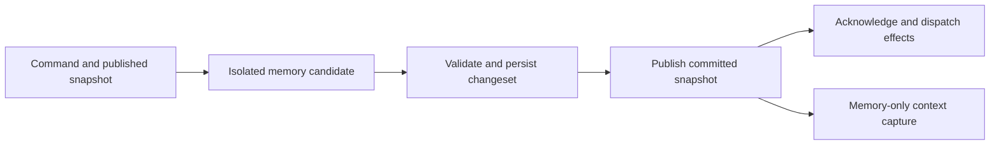

# Agent Runtime State and Context Snapshots

## Summary

Holon should represent each loaded agent's current business state in an
explicit in-memory model. Runtime decisions and context construction should
read consistent snapshots of that model. Persistent storage saves committed
changes, reconstructs the model after restart, and holds history that does not
need to remain resident.

The target is an agent state architecture. Context is a request-scoped
projection of that state; provider input is its rendered representation.
Working memory, episodes, evidence, and their durable relationships belong to
state domains. The projected context has no independent mutation authority.

The proposed contract has three parts:

1. All current core state of a loaded agent is represented in memory; ordinary
   context acquisition, construction, and budget reprojection require no
   database or filesystem reads after initialization.
2. The runtime also owns transient resources and rebuildable observations that
   are initialized dynamically and are not serialized as agent business state.
3. A mutation first computes an isolated in-memory candidate, persists its
   changes atomically, and then publishes the committed memory snapshot.
   Acknowledgements and dependent effects observe committed state.

This document specifies the proposed architecture and its invariants. Execution
admission, authority, provider replay, and storage durability retain their
respective contracts. The addressing, provenance, transactional-change, and
state-projection requirements of
[#3478](https://github.com/holon-run/holon/issues/3478) are part of this
architecture. They do not require a separate canonical context store.

## Goals

- Give loaded-agent consumers one typed model of current business facts and
  one versioned publication boundary.
- Make context selection, rendering, and reprojection pure computations over
  an immutable snapshot.
- Keep ordinary warm execution reads in memory, including source hydration
  needed for normal tool follow-ups and budget retries.
- Make durable changes, transient resources, and external observations explicit.
- Preserve atomic transitions, fencing, provenance, restart recovery, and
  existing ownership rules while moving computation toward memory.
- Bound resident history and large payloads independently of agent lifetime.

## Non-Goals

- A general-purpose in-memory database, dynamic object registry, or graph engine.
- Keeping every historical record, tool output, and attachment resident.
- Replacing current canonical tables with mandatory event sourcing. Audit
  events remain evidence, not a sufficient replay source for all business state.
- Changing the scheduler's execution protocol or creating a second authority
  for WorkItem, wait, queue, or task lifecycle.
- Allowing uncommitted state to drive model requests or acknowledged work.
- Making model-authored summaries authoritative for runtime state.
- Requiring new model calls, replacing compaction, or changing prompt content
  to establish the state architecture.

## Related Contracts

- [Scheduler–WorkItem Unified Execution Protocol](./scheduler-work-item-unified-execution-protocol.md)
- [Runtime Transition Commit Contract](./runtime-transition-commit-contract.md)
- [Runtime Host Activation Admission and Read Projections](./runtime-host-activation-admission-and-read-projections.md)
- [Runtime Object and Reference Model](./runtime-object-and-reference-model.md)
- [Runtime Ledger Sequences and Object Revisions](./runtime-ledger-sequences-and-revisions.md)
- [Provenance, Admission, and Authority](./default-trust-auth-and-control.md)
- [WorkItem Current Focus](./work-item-current-focus.md)
- [Context Candidate Budget Planner](./context-candidate-budget-planner.md)
- [Deterministic Projection Evaluation Phase 0](./projection-evaluation-phase-0.md)
- [Runtime SQLite Retention](./runtime-db-retention.md)
- [Read-Side Performance Attribution](./read-side-performance-attribution.md)

## State Model

### One logical state, two representations

`AgentStateStore` is the proposed runtime-facing owner of agent state. Its
published `AgentRuntimeState` is the representation used during loaded-agent
execution. Persistence records represent the same committed business facts
for reconstruction and unloaded access. They must not have independent
mutation semantics.

Existing domain records retain their responsibility. For example, an
`ExecutionAttempt` owns the execution lane, WorkItem execution state owns
eligibility, and a `WaitCondition` owns exact resume identity. The store groups
these facts for coherent reads and commits; it does not add another stored
`runnable`, focus, or lifecycle authority.

Loaded-agent scheduling, readiness, wait, and control projections derive from
this captured state without querying persistence for current facts. Durable
read adapters serve unloaded inspection and bootstrap; transaction-time fence
and revision validation remains part of persistence rather than a second
runtime read model.

An illustrative organization is:

```text
AgentStateStore
  published: AgentSnapshot
    identity and control
    execution attempts and bindings
    pending input metadata and admission watermarks
    current WorkItems, tasks, waits, timers, triggers, continuations
    working memory, episode anchors, continuity references
    bounded evidence working set and lookup indexes
  resources: RuntimeResources
    provider clients, task handles, cancellation, subscriptions
    versioned configuration, capabilities, guidance and file observations
  persistence: typed load and commit adapter
```

These are responsibility boundaries, not a requirement for one large struct,
one global mutex, or a new public API.

### Immutable sharing and publication

Each agent has a single writer and an `ArcSwap<AgentSnapshot>` publication
root. The root shares immutable domain state for identity/control, execution,
WorkItems/waits, tasks, scheduling, and evidence. Domain indexes reference
immutable records through `Arc<Record>`. A candidate reuses unchanged domains
and records, copying only changed records and the affected index structures.
Atomic root replacement publishes the complete compatible state together.
Records and indexes reachable from a published root are not mutated in place.

A resident record may be a typed projection of a canonical persistence record:
identity/revision, required current facts, bounded preview, and a body locator.
It need not retain an entire storage record with embedded stdout or attachment
bytes. Projection metadata refers to the canonical fact and has no independent
mutation authority. Referencing an allocation containing a full body retains
and accounts for that whole allocation, even when only its preview is rendered.

Use standard collections and explicit copy-on-write ownership. The design
does not require a persistent-collection library, generic actor framework, or
multi-version database. An affected index may still cost O(n) to copy; sharing
records avoids deep-copying payloads but does not make every update O(1).

Capture holds the published root only while selecting and validating its
dependencies. `ContextSnapshot` retains the selected record and observation
references, identity tokens, and request metadata; it does not retain the
entire `AgentSnapshot` or its complete domain maps across a model call. Domain
and record references must not point back to the root. There is no automatic
history of published roots: old roots and records are released when their
actual readers finish.

Records needed by permitted budget/history reprojections are selected as part
of the snapshot's prepared input set. A request cannot escape that set by
following a mutable global index during rendering. Resource observations are
immutable as well; compatible observation references are captured under the
same short publication boundary, while live clients and handles remain outside
the state graph.

### Residency and persistence classes

| Class | Examples | Residency and recovery |
| --- | --- | --- |
| Current business facts | identity/control, execution binding, open WorkItems, active tasks/waits/timers/triggers, pending input identities | Resident while the agent state owner is loaded; recovered from committed persistence |
| Continuity working set | relevant operator input, recent turn evidence, pending results, selected episode previews | Resident under explicit limits, with required references pinned; recoverable from their canonical sources |
| Derived indexes and projections | readiness indexes, by-ref lookup, context candidates, token estimates | Rebuilt from published facts; no independent business authority |
| Transient resources | process handles, clients, locks, cancellation tokens | Initialized or reattached according to existing recovery rules; not restored by deserializing handles |
| Observed external resources | plan files, AGENTS.md, curated memory, skill catalogs, configuration | Canonical source retains ownership; memory stores the latest explicitly observed version |
| Cold evidence and large bodies | old transcript, full stdout, attachments, historical episode bodies | Persisted and addressed by refs; loaded explicitly into a bounded working set when needed |

All live business metadata must remain available to correctness checks.
Resident history limits do not authorize discarding active waits or pending
input. Large results and attachments may use locators with resident bounded
previews where the input protocol permits it. Accepted queued messages must
retain the input payload required for their ordinary execution while the owner
is loaded, including an operator anchor that subsequent rounds still require.
A locator cannot replace a required root-input body merely to meet a cache
budget. Account pending input bytes separately, apply backpressure before
accepting more input, and release them to history policy only after consumption
or cancellation and all continuity pins end. Bootstrap restores pending input
before readiness; ordinary queue claim is not a cold-hydration exemption.

If required live metadata or pending payloads exceed resource limits, apply
explicit admission/backpressure or report resource exhaustion; do not silently
forget accepted work. Unloaded agents remain unloadable without losing identity.

Task status and recovery obligations are durable even though the associated
process handle is transient. Observed file content is not ephemeral merely
because it is cached in memory: the file remains its persistent source.

### Memory budgets

History residency is byte-budgeted per agent and across the host, with record
count and per-body limits as additional guards. The proposed starting budgets
are 32 MiB per loaded agent and 512 MiB across the host for reclaimable history.
These are configurable sizing assumptions to calibrate with measurements,
not total agent/process memory limits or established production defaults.

Accounting separates current business metadata, reclaimable history, pinned
request evidence, observations, index overhead, and temporary candidate copies.
Within the historical payload pool, shared allocations are counted once;
pinning reclassifies a retained allocation rather than charging it twice.
Pinned evidence remains visible in total retained-memory accounting even when
it cannot be reclaimed to satisfy the history budget.
Per-agent accounting charges the allocations that agent retains; host-wide
physical accounting deduplicates allocations shared across agents. Observations
and superseded versions still pinned by requests are accounted separately from
the 32 MiB / 512 MiB reclaimable-history budgets, with explicit size and
admission limits rather than an unmeasured exemption.

Eviction removes only unpinned, nonrequired history from the resident working
set. The prepared ordinary-context window and its bounded dependency closure
remain available. Memory pressure cannot convert ordinary history-window
advancement into repeated disk hydration. If mandatory facts or pins prevent
bounded operation, limit additional optional hydration and apply explicit
admission/backpressure before accepting more work. Do not evict accepted work,
invalidate a live snapshot, or delete identity to satisfy a cache budget.

### Snapshot identity

A published root has an opaque identity scoped to its owner incarnation and
publication generation. This is an in-process consistency token, not a new
global ledger sequence or a replacement for object `revision` fields.

A context snapshot captures together:

- the published state identity and relevant committed object revisions;
- execution attempt, turn, owner binding, and admitted input watermark;
- the selected immutable records and resolved evidence dependencies;
- resource observation epochs and projection policy version;
- an explicit clock sample and other request-specific environment values.

State identity and resource epochs have different meanings. The capture fixes
their compatible combination; it must not read separate mutable maps at
different times and call the result one snapshot. A snapshot records which
pending inputs have actually been admitted to this execution, not every input
currently queued for the agent.

An older snapshot can remain readable for an in-flight request or diagnostics.
It cannot authorize a later state mutation without current revision and
execution-fence validation. Capture is a short memory operation; no store
lock is held across model calls, tools, or network waits.
The capture boundary checks owner readiness and fences together with the root
and resource epochs. An `ArcSwap` load alone does not establish this contract.
Commit/publication coordination must close the relevant capture/authority gate
before a durable result can leave memory behind, keeping it closed until the
root is installed or recovery owns the fence.

## Mutation Ownership and Commit

### Ownership

Each agent has one serialized mutation coordinator at a time. This is state
mutation ownership, independent of whether a model execution lane is active.
Commands may arrive from tools, control APIs, task supervisors, timers,
callbacks, message delivery, recovery, or resource refresh.

Host registry phase, agent lifecycle/incarnation, and shared host resources
remain host-owned. Ownership transfer between a loaded runtime and an unloaded
agent coordinator uses the existing lifecycle/admission fences. Two owners
must never concurrently accept authoritative writes for one agent incarnation.

Unloaded metadata mutations can load the necessary state, use the same commit
protocol, and release it without starting a provider or scheduler execution.
Read-only access to unloaded agents continues to use durable reads and must not
activate the runtime. Loaded-to-unloaded handoff must reconcile in-flight
commits before releasing mutation ownership.

Cross-agent delivery submits a command to the target owner and preserves its
existing authorization, delivery identity, and receipt protocol. The sender
does not mutate the target snapshot or hold its own mutation lock while waiting
on another owner. Operations that already require a transaction spanning
multiple agents or host facts retain a host coordinator and their complete
atomic write set. Before preparing or committing such a transaction, the host
coordinator reserves the affected owners in deterministic order and fences
dependent authority decisions and new context captures. Reservations use a
deadlock-free host protocol; an agent command does not hold its mutation lock
while awaiting another owner. All affected snapshots must be reconciled to the
commit or marked unavailable before reservations are released. A partially
published host transaction cannot grant execution from mismatched owner views.

### Memory-first preparation, commit-before-publication

The proposed sequence is:



1. The coordinator authorizes the caller and checks for an already committed
   command identity/payload. An exact replay returns its original receipt
   without running the state reducer or replaying effects; a conflicting
   payload is rejected. Only a new command is validated against the current
   published state and prepared as a candidate with a typed changeset. Stable
   command identity,
   timestamps, and allocated identifiers are fixed for retries. Record/index
   allocation and invariant checks are prepared before persistence wherever
   possible, leaving committed sequence binding and root publication small.
2. Inside the transaction the persistence adapter checks the receipt again,
   before rejecting stale expected revisions, then validates new mutations'
   object revisions, owner incarnation, and admission fences. A replay never
   reapplies the private candidate. The candidate remains private throughout.
3. One transaction writes the complete invariant: changed business records,
   related records, audit events, and required indexing/delivery intents.
   Typed transaction repositories implement this persistence boundary.
4. The adapter returns committed records and assigned sequences. The owner
   installs a snapshot containing exactly that committed result, including
   updates or invalidation of its dependent derived indexes.
5. The runtime acknowledges success and runs the permitted post-commit effects.

Readers do not consume candidates. Commands affecting the same owner are
ordered through publication, so delayed installation cannot replace a newer
snapshot. A known persisted-but-unpublished state blocks new authoritative
decisions and new context captures until reconciliation. Observational readers
may still receive an explicitly versioned older snapshot.

Publication does not perform a second authoritative write. Resolve conflicts
before commit or submit a new explicit command after installing the committed
result. A replay of an older committed command returns its receipt without
reinstalling historical records over a newer published root.

Transaction callbacks may be retried and must have no provider, filesystem,
notification, or external side effects. Persistence stores changed records,
not a full serialized copy of all resources and history after every mutation.

### Durable command identity and receipts

Reuse a domain's stable delivery, execution, or operation identity when it
already proves the command's committed outcome. Expected revision validation
alone prevents conflicting writes; it does not necessarily recover the result
of a successful command after the object has advanced again. Where the domain
witness is insufficient, persist a focused receipt in the same transaction as
the mutation. This is a per-family contract, not a universal event-sourcing
requirement or a new unbounded command registry.

A receipt contains the following logical information:

- schema version and operation family;
- stable command identity scoped to the durable agent identity/lifecycle;
- canonical request digest, including requested expected revisions;
- original committed outcome, affected object identities and committed
  revisions, and any result data required to answer a retry;
- durable commit witness and recoverable effect/attempt references when needed.

The digest covers the original semantic command and frozen operation fields,
not a retry's transport metadata, new process-local snapshot token, or current
owner incarnation. Runtime-owner incarnation remains an admission fence, not
the deduplication namespace: replacing a process must not hide old receipts.
A deleted and newly created durable identity cannot reuse another identity's
receipts. Diagnostic timestamps do not serve as deduplication keys.

The same identity and payload recover the original result even after subsequent
state changes. The same identity with a different payload is a conflict. The
receipt must retain sufficient historical outcome information; looking up the
latest mutable row is not equivalent. For example, when a Stop acknowledgement
was lost and a later Start has succeeded, retrying that Stop returns its original
result without stopping the agent again. A genuinely new Stop needs a new
command identity.

Receipt retention covers the domain's supported retry and recovery horizon.
After expiry, a previously accepted identity must not silently become a fresh
command; the domain needs a retained deduplication fence or an enforceable
expiry protocol. Result payload pruning and replay protection are separate
retention decisions.

### Failure and acknowledgement semantics

| Outcome | Required behavior |
| --- | --- |
| Validation rejection or definitely uncommitted failure | Discard candidate; keep published state; return typed failure |
| Committed and published | Return committed identity/revisions; dispatch permitted effects |
| Committed but publication failed | Keep commit authoritative; fence the owner, rebuild/install in place, and reconcile the request; never roll back persistence to match old memory |
| Commit result is indeterminate | Fence dependent decisions; resolve the stable command identity against canonical records/commit witness before retrying |
| Event or worker notification failed after commit | Recover from persisted event/queue/outbox state; report the effect failure without undoing business state |

A caller retry after a lost acknowledgement recovers its durable receipt and
committed object identities/revisions. After restart or owner replacement, the
response may carry a new in-process snapshot identity; a token from the old
incarnation is not restored. Audit text alone is not a commit witness.

For a known commit with a still-valid owner, publication failure immediately
fences new mutations, dependent authority decisions, and context captures.
Rebuild from the committed result or a coherent persistence snapshot, validate
identity/revisions and dependency invariants, then atomically install the root
and remove the fence. Recovery never rewrites business state to match an old
cache and never blindly replays external effects.

An indeterminate commit, unreadable persistence, or a failed bounded rebuild
keeps the owner fenced for host recovery. If the incarnation has changed, the
old owner exits rather than reloading and overwriting its successor. Releasing
or replacing an owner still requires commit reconciliation, execution
quiescence, and producer/admission fencing; publication failure grants no
shortcut to unload.

Event, scheduler, or index-worker notification failures after successful root
publication use durable rediscovery and bounded retries. They do not invalidate
the committed root merely because a wakeup was lost. A derived index required
for snapshot correctness must be repaired before Ready; an asynchronous search
index follows its own availability contract. Resource observation failures
normally make only dependent contexts `NotReady`, rather than declaring all
business state corrupt.

Cache publication is rebuildable; scheduler notifications are hints backed by
durable work. External sends, process launches, tool actions, and provider
requests preserve their existing attempt/receipt and recovery contracts. An
unknown non-idempotent external result must not be replayed merely because a
snapshot is being reconstructed. This RFC adds no blanket exactly-once claim.

### Durability level

Commit means a successful database transaction under the configured durability
policy. Transaction commit, WAL synchronization, and checkpointing are distinct;
acknowledgements must not promise stronger crash or power-loss durability than
the selected policy provides. This architecture does not change that policy.

Arbitrary delayed write-back of published core business state is not part of
the proposal. Derived caches and transient observations need no business-state
commit. Files retain their own persistence and acknowledgement contracts.

## Memory-Only Context Construction

### Capture and render interfaces

The conceptual boundary is:

```text
capture_context(state, resources, request, policy)
  -> Ready(ContextSnapshot)
   | NeedsHydration(required_refs, reason)
   | NotReady(reason)

build_context(snapshot, budget) -> BuiltContext
reproject_context(snapshot, smaller_budget) -> BuiltContext
```

Selection, reference lookup, rendering, and budget reprojection for a ready
snapshot have no storage, filesystem, network, or mutation capability. Existing
budget priorities, pinned minima, owner filters, and cache stability rules
continue to apply. `build_context` does not create plan files or resolve
recovery lineage from the database.

Initial assembly, history-selector changes within prepared policy bounds,
ordinary tool follow-ups, and budget retries use resident data. New request
snapshots may include newly committed tool results and admitted input. A retry
of one snapshot with a smaller budget preserves its input set and state
identity; it cannot consume queued input again.

Late operator input is admitted at the existing safe boundary. Arrival after
capture does not mutate an already-submitted provider request. Provider
fallback/reentry preserves the admitted root message, predecessor attempt,
owner binding, provenance, and exact continuation fences.

Snapshot readability does not grant execution authority. Immediately before a
new provider request or effect is admitted for dispatch, the runtime validates
the current owner/execution fence and applicable capability policy. A Stop,
owner replacement, or authorization revocation after capture can therefore
block dispatch from that snapshot. A budget retry that starts a new provider
attempt crosses the same barrier. Ordinary resource-content refresh alone
does not invalidate previously captured input unless execution policy requires
it; already dispatched requests follow the existing cancellation protocol.

### Working-set preparation and explicit hydration

Bootstrap populates current business facts and the initial continuity working
set. Committed mutations update it incrementally: accepted input, tool results,
briefs, turn outcomes, and episode anchors enter memory when produced, rather
than being reread from storage at the next turn.

Required context roots include the admitted current input, relevant operator
anchor, execution-bound WorkItem and plan observation, active waits/pending
results, and evidence needed by selected recent turns. Recovery additionally
requires the validated source turn, root message, and predecessor execution.
Typed bounded dependency rules determine the necessary closure; the runtime
does not recursively load every historical lineage edge.

A genuinely nonresident dependency can request hydration under a typed cause:
`Bootstrap`, `ExplicitRefRecall`, `ExecutionOwnerChange`, `WorkspaceChange`,
`ValidatedRecovery`, or explicit `ProjectionPolicyExpansion`. Ordinary
relevance selection and advancement of the recent-history window are not
hydration causes. New committed evidence updates the resident window directly;
ordinary selection operates on that prepared window. A new policy requiring
more archived history must declare its expansion rather than silently fall
back to storage each turn.

The loader authorizes the target, reads the needed
version, and returns immutable records. The owner revalidates their dependency
versions before installing them. A mutable current-state reference must match
the requested current revision; an explicit immutable historical reference
may legitimately resolve an older version. A changed request binding, mismatched
version, or unauthorized target rejects installation rather than substituting
the newest record. Existing same-agent cross-workspace ref access remains valid;
the active workspace alone is not an authorization boundary.
Missing optional history is represented as unavailable; missing mandatory
continuity evidence prevents `Ready` with a typed reason.

Hydration has explicit ref/count/byte/depth limits and records its reason,
source reads, bytes, and duration. Oversized bodies remain addressable through
existing tools with bounded previews. Hitting a bound cannot silently remove
the root operator input or fabricate an empty history. Snapshot references pin
the records they use until the request, its reprojections, and any in-flight
provider continuation release them; resource accounting includes these pins.

Ordinary steady-state capture must not perform recurring "preparation" queries
for the latest records. Moving current I/O into a wrapper before the pure
renderer is an intermediate refactor, not achievement of the memory-read goal.

### Dynamic resources and files

Resource observations carry source identity, content digest when applicable,
an immutable body or bounded preview, and an observation epoch. Known file-tool
writes, workspace switches, configuration reloads, and explicit refresh requests
invalidate or update the affected observation. Watchers discover external edits;
watcher overflow, restart, or known missed events invalidate affected
observations and schedule reconciliation. An explicit refresh operation remains
available when watching is unsupported or unreliable. The renderer never polls
or scans files once per turn to simulate fresh memory state.
An asynchronous refresh carries the invalidation generation it observed;
installation revalidates that generation, workspace, and source identity so a
late read cannot overwrite a newer invalidation or observation.

The runtime promises the latest observed resource version, not instantaneous
agreement with arbitrary external file writes. Once a required observation is
known dirty, capture reports `NotReady` until it is refreshed or a documented
error policy is applied. Refresh happens outside rendering and is measured as
I/O. Strict freshness checks, when requested, are explicit operations with
their own cost.
Existing captured snapshots retain their immutable observation version when a
later invalidation blocks new captures.

Plan creation belongs to the WorkItem/file workflow. The renderer consumes an
already observed plan preview and locator. Workspace identity participates in
resource keys so switching roots cannot reuse another root's instructions.
Capabilities, skill catalogs, and environment projections are initialized and
refreshed as resources; refresh does not invent durable business mutations.
Clock samples are captured explicitly per request under the existing time
context contract.

## Startup, Unload, and Persistence Boundaries

Startup loads a coherent persistence snapshot, applies the existing canonical
recovery protocol, initializes resources, and prepares required continuity
data before announcing the owner ready. Bootstrap reads and explicit cold
loading are allowed and separately observable.

The store is not ready if an interrupted commit, an ownership fence, or missing
required evidence is unresolved. Recovery compares canonical identity and
state; it does not reconstruct lifecycle by guessing from rendered prompts or
model summaries.

Unload closes the mutation admission gate, reconciles outstanding commits,
and releases memory/resources under existing runtime retirement rules.
Resident-state eviction does not delete agent identity or durable history.
Read-only inspection of an unloaded agent continues without waking it.

Persistence remains typed. Its schema needs to support coherent loading,
expected-revision validation, durable command outcome lookup, and bounded cold
evidence reads; it need not mirror the memory layout or add a universal version
column to every record. Files remain separate canonical resources; a SQLite
commit cannot make arbitrary file edits atomic. Operations publishing a new
artifact reference must use their defined file-write/receipt protocol before
exposing that reference as ready.

## Context as an Agent State Projection

The projection boundary is:

```text
ContextSnapshot = capture(
  published agent state, compatible resource observations, admitted request,
  frozen projection policy and clock sample
)
Context = project(ContextSnapshot, budget)
ProviderInput = render(Context, provider format)
```

Agent state here includes current business facts and the prepared continuity
working set. Resource observations make external guidance and capabilities
available as frozen inputs; clients, process handles, and private or irrelevant
state do not enter the prompt merely because they are held in memory. Selection
preserves execution ownership, access policy, provenance, and the admitted
input set. A full state serialization is not a valid substitute for projection.

### Addressable projection inputs

Context candidates expose a common descriptor over typed domain records:
reference and kind, owner, source identity/revision, applicable provenance and
authority metadata, available lineage, and a bounded payload or body locator.
This is a read interface over the same canonical facts, not another independently
mutable `ContextNode` payload table. Fields retain their domain meanings; a
unified descriptor does not grant every record the same authority or lifecycle.

Every emitted runtime reference has a typed resolver contract. A ready snapshot
already contains its mandatory projection dependencies; an explicit lookup of
optional cold evidence may load it under the hydration contract. Resolution
distinguishes access denial, unavailable or pruned evidence, and version
mismatch instead of silently substituting a current record. Existing lineage
and evidence links are accessible through this same interface and preserve
their source identities across capture and rendering.

WorkItem current-state refs and mutable plan paths are distinct from immutable
version refs. Exact historical retrieval requires saved versions and the
applicable retention contract; a descriptor must not claim historical content
exists merely because an object has a revision counter. No universal graph
database or speculative version history for every table is required.

### Durable memory and semantic changes

Episode finalization atomically persists the episode, source relationships,
builder/epoch progression, command witness, audit, and index intent before
publication. Boundary detection remains deterministic and finalization retries
preserve the original operation and episode identities. Finalized content is
immutable; a semantic correction requires an explicit successor operation
rather than overwriting evidence that an earlier snapshot referenced.

Addressing, provenance, atomic state changes, and projection are intrinsic to
this design. An in-memory representation alone does not create model-authored
summaries, `supersedes` relationships, semantic retirement, or cross-agent
sharing rules. These are optional state-domain capabilities with their own
commands, validation, and policy. When present, `derive/retire/restore/relate`
use the same owner and commit protocol, and their results become state that
subsequent projections can select.

A model proposal is input to a validated state command. Proposal absence or
failure must not block wait/settlement, and summaries remain derived evidence.
Projection does not call a model or silently persist a new summary while
rendering. Cross-agent sharing requires explicit access and provenance rules;
the existence of a resolvable ref does not authorize sharing.

Messages remain canonical ingress and causal evidence, while structured work,
wait, plan, and memory state provide explicit continuity facts. This does not
authorize dropping the admitted operator input, required dialogue history, or
provider protocol anchors. Choosing a different mix of messages and derived
memory is a projection-policy decision; memory residency by itself does not
establish that summaries can safely replace messages.

Provenance, `authority_class`, admission, and execution policy retain their
distinct meanings. A tool receipt's runtime origin does not elevate the
authority of external text in its output. A model summary of an operator
instruction does not become a new operator instruction.

Memory eviction, prompt budget omission, semantic retirement, and physical
retention are four distinct operations. `retire` itself does not delete bytes;
it also does not promise that all referenced history is retained forever.
Existing typed retention roots remain authoritative until explicitly revised.
Reading a ref or following an edge still requires target access checks.

Retention and maintenance are state writers too. A pruning batch uses the same
affected-owner coordination to return typed removal/availability changes and
update or invalidate resident lookups before new captures. A dropped
notification cannot leave the owner treating pruned evidence as available.
Already captured immutable snapshots may retain their materialized copies
until release; those copies must not be reinserted into persistence or presented
as proof that a durable source still exists. Subsequent lookups observe the
pruned state under the existing resolver contract.

A memory pin preserves bytes for an in-flight snapshot; it is not a new durable
retention root. Evidence required for restart/replay must be protected through
the existing typed durable-root contract. Identity deletion keeps its own
admission, cancellation, and disposal protocol and is not treated as ordinary
history pruning.

## Projection and Consistency Invariants

Context is a deterministic projection of a captured state and policy. It
preserves admitted current input, the required direct predecessor, canonical
evidence uniqueness, execution ownership, and authority boundaries. A smaller
budget does not add new evidence or change the admitted input set; mandatory
continuity that cannot fit fails explicitly rather than silently disappearing.
Restart reconstruction of the same committed inputs preserves these semantics.

The memory-only boundary includes acquisition through provider-request
construction, ordinary tool follow-ups, history-window advancement, and budget
reprojection. It is not limited to rendering one already prepared snapshot.
Explicit cold recall, recovery loading, and resource refresh remain visible
operations with distinct reasons and costs; ordinary selection cannot be
reclassified as cold loading.

Observability distinguishes context reads, hydration causes, captured state and
resource identities, resident/pinned/candidate bytes, commit/publication lag,
and outstanding recovery/effect obligations. Performance or cache measurements
must include acquisition and request preparation, not just renderer time.
Provider usage and cache placement have their own contract; deterministic
snapshot content alone does not imply a cache hit or better task quality.
