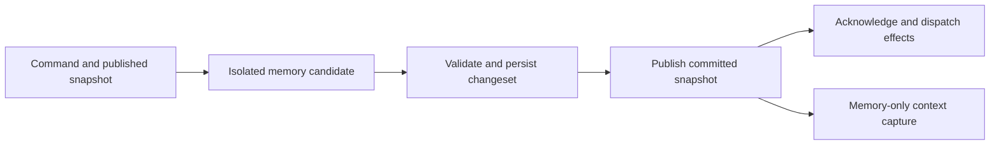

# Agent Runtime State and Context Snapshots

## Summary

Holon should represent each loaded agent's current business state in an
explicit in-memory model. Runtime decisions and context construction should
read consistent snapshots of that model. Persistent storage saves committed
changes, reconstructs the model after restart, and holds history that does not
need to remain resident.

The target is an agent state architecture. Context is a request-scoped
projection of that state; provider input is its rendered representation.
Working memory, episodes, evidence, and their durable relationships belong to
state domains. The projected context has no independent mutation authority.

The proposed contract has three parts:

1. All current core state of a loaded agent is represented in memory; ordinary
   context acquisition, construction, and budget reprojection require no
   database or filesystem reads after initialization.
2. The runtime also owns transient resources and rebuildable observations that
   are initialized dynamically and are not serialized as agent business state.
3. A mutation first computes an isolated in-memory candidate, persists its
   changes atomically, and then publishes the committed memory snapshot.
   Acknowledgements and dependent effects observe committed state.

This document specifies the proposed architecture and its invariants. Execution
admission, authority, provider replay, and storage durability retain their
respective contracts. The addressing, provenance, transactional-change, and
state-projection requirements of
[#3478](https://github.com/holon-run/holon/issues/3478) are part of this
architecture. They do not require a separate canonical context store.

## Goals

- Give loaded-agent consumers one typed model of current business facts and
  one versioned publication boundary.
- Make context selection, rendering, and reprojection pure computations over
  an immutable snapshot.
- Keep ordinary warm execution reads in memory, including source hydration
  needed for normal tool follow-ups and budget retries.
- Make durable changes, transient resources, and external observations explicit.
- Preserve atomic transitions, fencing, provenance, restart recovery, and
  existing ownership rules while moving computation toward memory.
- Bound resident history and large payloads independently of agent lifetime.

## Non-Goals

- A general-purpose in-memory database, dynamic object registry, or graph engine.
- Keeping every historical record, tool output, and attachment resident.
- Replacing current canonical tables with mandatory event sourcing. Audit
  events remain evidence, not a sufficient replay source for all business state.
- Changing the scheduler's execution protocol or creating a second authority
  for WorkItem, wait, queue, or task lifecycle.
- Allowing uncommitted state to drive model requests or acknowledged work.
- Making model-authored summaries authoritative for runtime state.
- Requiring new model calls, replacing compaction, or changing prompt content
  to establish the state architecture.

## Related Contracts

- [Scheduler–WorkItem Unified Execution Protocol](./scheduler-work-item-unified-execution-protocol.md)
- [Runtime Transition Commit Contract](./runtime-transition-commit-contract.md)
- [Runtime Host Activation Admission and Read Projections](./runtime-host-activation-admission-and-read-projections.md)
- [Runtime Object and Reference Model](./runtime-object-and-reference-model.md)
- [Runtime Ledger Sequences and Object Revisions](./runtime-ledger-sequences-and-revisions.md)
- [Provenance, Admission, and Authority](./default-trust-auth-and-control.md)
- [WorkItem Current Focus](./work-item-current-focus.md)
- [Context Candidate Budget Planner](./context-candidate-budget-planner.md)
- [Deterministic Projection Evaluation Phase 0](./projection-evaluation-phase-0.md)
- [Runtime SQLite Retention](./runtime-db-retention.md)
- [Read-Side Performance Attribution](./read-side-performance-attribution.md)

## State Model

### One logical state, two representations

`AgentStateStore` is the proposed runtime-facing owner of agent state. Its
published `AgentRuntimeState` is the representation used during loaded-agent
execution. Persistence records represent the same committed business facts
for reconstruction and unloaded access. They must not have independent
mutation semantics.

Existing domain records retain their responsibility. For example, an
`ExecutionAttempt` owns the execution lane, WorkItem execution state owns
eligibility, and a `WaitCondition` owns exact resume identity. The store groups
these facts for coherent reads and commits; it does not add another stored
`runnable`, focus, or lifecycle authority.

Loaded-agent scheduling, readiness, wait, and control projections derive from
this captured state without querying persistence for current facts. Durable
read adapters serve unloaded inspection and bootstrap; transaction-time fence
and revision validation remains part of persistence rather than a second
runtime read model.

An illustrative organization is:

```text
AgentStateStore
  published: AgentSnapshot
    identity and control
    execution attempts and bindings
    pending input metadata and admission watermarks
    current WorkItems, tasks, waits, timers, triggers, continuations
    working memory, episode anchors, continuity references
    bounded evidence working set and lookup indexes
  resources: RuntimeResources
    provider clients, task handles, cancellation, subscriptions
    versioned configuration, capabilities, guidance and file observations
  persistence: typed load and commit adapter
```

These are responsibility boundaries, not a requirement for one large struct,
one global mutex, or a new public API.

### Immutable sharing and publication

Each agent has a single writer and an `ArcSwap<AgentSnapshot>` publication
root. The root shares immutable domain state for identity/control, execution,
WorkItems/waits, tasks, scheduling, and evidence. Domain indexes reference
immutable records through `Arc<Record>`. A candidate reuses unchanged domains
and records, copying only changed records and the affected index structures.
Atomic root replacement publishes the complete compatible state together.
Records and indexes reachable from a published root are not mutated in place.

Each canonical commit returns a typed committed-domain delta containing all
records and removals in its invariant, including database-assigned sequences.
It describes the existing transaction; it is not a second event log or mutation
authority. A domain reader is usable only when coherent bootstrap, every writer,
removal/availability changes, and recovery cover its dependencies. Partial domain
coverage does not imply that the complete context or scheduler view is Ready.

A resident record may be a typed projection of a canonical persistence record:
identity/revision, required current facts, bounded preview, and a body locator.
It need not retain an entire storage record with embedded stdout or attachment
bytes. Projection metadata refers to the canonical fact and has no independent
mutation authority. Referencing an allocation containing a full body retains
and accounts for that whole allocation, even when only its preview is rendered.

Input qualification tracks the canonical payload and its actual dependency
relationships. Observer revisions, such as a conversation display revision
advanced by a queue status change, do not invalidate an unchanged input body.
A fixed upgrade checkpoint must include a body digest for records without a
canonical content hash. A selected body is checked against that digest after
its metadata and byte-budget preflight, before its first materialization.
Payload hints do not establish a Turn assignment or authorize loading another
record; only the canonical relationship or a validated recovery proof does.

An asserted provider-recovery source may be invalid because its canonical
Message or Turn does not exist. Preparation can capture a dedicated, bounded
authority-validation proof of that absence in the same persistence view. It
does not turn a missing, unqualified, foreign, or pruned record into a general
empty lookup. Related source writes invalidate the proof and require a newly
prepared closure before the scheduler can reject the input; a source that has
become valid requires replanning. Selecting a recovery message as ordinary
history does not itself grant its asserted sources authority or residency.

Use standard collections and explicit copy-on-write ownership. The design
does not require a persistent-collection library, generic actor framework, or
multi-version database. An affected index may still cost O(n) to copy; sharing
records avoids deep-copying payloads but does not make every update O(1).

Capture holds the published root only while selecting and validating its
dependencies. `ContextSnapshot` retains the selected record and observation
references, identity tokens, and request metadata; it does not retain the
entire `AgentSnapshot` or its complete domain maps across a model call. Domain
and record references must not point back to the root. There is no automatic
history of published roots: old roots and records are released when their
actual readers finish.

Records needed by permitted budget/history reprojections are selected as part
of the snapshot's prepared input set. A request cannot escape that set by
following a mutable global index during rendering. Resource observations are
immutable as well; compatible observation references are captured under the
same short publication boundary, while live clients and handles remain outside
the state graph.

### Residency and persistence classes

| Class | Examples | Residency and recovery |
| --- | --- | --- |
| Current business facts | identity/control, execution binding, open WorkItems, active tasks/waits/timers/triggers, pending input identities | Resident while the agent state owner is loaded; recovered from committed persistence |
| Continuity working set | relevant operator input, recent turn evidence, pending results, selected episode previews | Resident under explicit limits, with required references pinned; recoverable from their canonical sources |
| Derived indexes and projections | readiness indexes, by-ref lookup, context candidates, token estimates | Rebuilt from published facts; no independent business authority |
| Transient resources | process handles, clients, locks, cancellation tokens | Initialized or reattached according to existing recovery rules; not restored by deserializing handles |
| Observed external resources | plan files, AGENTS.md, curated memory, skill catalogs, configuration | Canonical source retains ownership; memory stores the latest explicitly observed version |
| Cold evidence and large bodies | old transcript, full stdout, attachments, historical episode bodies | Persisted and addressed by refs; loaded explicitly into a bounded working set when needed |

All live business metadata must remain available to correctness checks.
Resident history limits do not authorize discarding active waits or pending
input. Large results and attachments may use locators with resident bounded
previews where the input protocol permits it. Accepted queued messages must
retain the input payload required for their ordinary execution while the owner
is loaded, including an operator anchor that subsequent rounds still require.
A locator cannot replace a required root-input body merely to meet a cache
budget. Account pending input bytes separately, apply backpressure before
accepting more input, and release them to history policy only after consumption
or cancellation and all continuity pins end. Bootstrap restores pending input
before readiness; ordinary queue claim is not a cold-hydration exemption.

Logical accepted-input accounting follows the durable pending obligation across
runtime unload and reload. Physical allocation accounting follows the actual
shared buffers and their remaining owners; releasing a runtime does not erase
an accepted or indeterminate admission ticket. Within a live Host ledger, a
fresh pending read preserves the original accepted ticket identity rather than
issuing a new allowance. A known deletion acknowledgement releases Accepted
charges only under the original identity reservation, with a fresh coherent view
proving the same incarnation is Deleted and has no pending queue entries. A
tombstone alone does not prove its pending obligations ended. Unknown admissions
remain fenced until their original commit family resolves them.

Bootstrap reads current facts and bounded continuity through one coherent
database read transaction. Focused loaders use queue identities, by-ID/batch-ID
lookups, and owner tails rather than loading all history to filter it afterward.
The prepared history coverage includes the current owner's configured window
and the agent-tail fallback that the enabled selector can use. Ordinary window
advancement incorporates committed evidence; it does not repeatedly hydrate.

If an existing accepted backlog exceeds the configured activation budget,
activation reports explicit resource exhaustion with required and available
capacity. Durable work and identity remain intact; an operator can adjust the
budget and retry. Activation does not silently drop payloads, overcommit without
a bound, or replace ordinary claims with per-message cold reads.

If required live metadata or pending payloads exceed resource limits, apply
explicit admission/backpressure or report resource exhaustion; do not silently
forget accepted work. Unloaded agents remain unloadable without losing identity.

Task status and recovery obligations are durable even though the associated
process handle is transient. Observed file content is not ephemeral merely
because it is cached in memory: the file remains its persistent source.

### Memory budgets

History residency is byte-budgeted per agent and across the host, with record
count and per-body limits as additional guards. The proposed starting budgets
are 32 MiB per loaded agent and 512 MiB across the host for reclaimable history.
These are configurable sizing assumptions to calibrate with measurements,
not total agent/process memory limits or established production defaults.

Accounting separates current business metadata, reclaimable history, pinned
request evidence, observations, index overhead, and temporary candidate copies.
Within the historical payload pool, shared allocations are counted once;
pinning reclassifies a retained allocation rather than charging it twice.
Pinned evidence remains visible in total retained-memory accounting even when
it cannot be reclaimed to satisfy the history budget.
Per-agent accounting charges the allocations that agent retains; host-wide
physical accounting deduplicates allocations shared across agents. Observations
and superseded versions still pinned by requests are accounted separately from
the 32 MiB / 512 MiB reclaimable-history budgets, with explicit size and
admission limits rather than an unmeasured exemption.

Eviction removes only unpinned, nonrequired history from the resident working
set. The prepared ordinary-context window and its bounded dependency closure
remain available. Memory pressure cannot convert ordinary history-window
advancement into repeated disk hydration. If mandatory facts or pins prevent
bounded operation, limit additional optional hydration and apply explicit
admission/backpressure before accepting more work. Do not evict accepted work,
invalidate a live snapshot, or delete identity to satisfy a cache budget.

### Snapshot identity

A published root has an opaque identity scoped to its owner incarnation and
publication generation. This is an in-process consistency token, not a new
global ledger sequence or a replacement for object `revision` fields.

A context snapshot captures together:

- the published state identity and relevant committed object revisions;
- execution attempt, turn, owner binding, and admitted input watermark;
- the selected immutable records and resolved evidence dependencies;
- resource observation epochs and projection policy version;
- an explicit clock sample and other request-specific environment values.

State identity and resource epochs have different meanings. The capture fixes
their compatible combination; it must not read separate mutable maps at
different times and call the result one snapshot. A snapshot records which
pending inputs have actually been admitted to this execution, not every input
currently queued for the agent.

An older snapshot can remain readable for an in-flight request or diagnostics.
It cannot authorize a later state mutation without current revision and
execution-fence validation. Capture is a short memory operation; no store
lock is held across model calls, tools, or network waits.
The capture boundary checks owner readiness and fences together with the root
and resource epochs. An `ArcSwap` load alone does not establish this contract.
Commit/publication coordination must close the relevant capture/authority gate
before a durable result can leave memory behind, keeping it closed until the
root is installed or recovery owns the fence.

## Mutation Ownership and Commit

### Ownership

Each agent has one serialized mutation coordinator at a time. This is state
mutation ownership, independent of whether a model execution lane is active.
Commands may arrive from tools, control APIs, task supervisors, timers,
callbacks, message delivery, recovery, or resource refresh.

Host registry phase, agent lifecycle/incarnation, and shared host resources
remain host-owned. Ownership transfer between a loaded runtime and an unloaded
agent coordinator uses the existing lifecycle/admission fences. Two owners
must never concurrently accept authoritative writes for one agent incarnation.

A host-owned per-agent slot outlives any execution runtime. Ownership transfer
uses the same mutation reservation as submissions; it cannot overtake a pending
commit. Durable identity incarnation, process-local owner epoch, and publication
generation are distinct: identity recreation changes the receipt namespace,
owner replacement fences old handles, and publication advances only within the
current owner epoch. A successor inherits unresolved recovery responsibility;
claiming ownership does not itself open the publication gate.

Retiring an identity closes new admission while preserving narrowly proven
cleanup for its already accepted executions. A cleanup command validates the
same incarnation, original qualified source and actual execution relationship,
and the original State expectation in its transaction. Its finite write set
may settle the original queue item and create the corresponding terminal
evidence; it cannot start a new run or Turn, grant unrelated history current
membership, or recreate evidence with a pruned current alias. An exact original
receipt remains recoverable in that retiring incarnation. Cleanup authority
does not grant ordinary context activation or access to a successor identity.

Unloaded metadata mutations can load the necessary state, use the same commit
protocol, and release it without starting a provider or scheduler execution.
Read-only access to unloaded agents continues to use durable reads and must not
activate the runtime. Loaded-to-unloaded handoff must reconcile in-flight
commits before releasing mutation ownership.

Global startup repair runs before runtime activation. It reserves all affected
agent incarnations, including orphaned durable records, and revalidates that
scope under the activation handoff before committing. It cannot run while a
loaded, temporary, or retiring instance is active. A known commit retains its
original recovery result across publication repair; rerunning SQL must not
replace an already consumed recovery result.

Offline repair borrows the caller's existing exclusive maintenance lease for
that database. Each original repair transaction freezes and validates its finite
qualified input footprint before writing, then refreshes the actual changed
versions in the same transaction. A maintenance capability cannot adopt late
history or grant an unrelated new identity old continuity.

Cross-agent delivery submits a command to the target owner and preserves its
existing authorization, delivery identity, and receipt protocol. The sender
does not mutate the target snapshot or hold its own mutation lock while waiting
on another owner. Operations that already require a transaction spanning
multiple agents or host facts retain a host coordinator and their complete
atomic write set. Before preparing or committing such a transaction, the host
coordinator reserves the affected owners in deterministic order and fences
dependent authority decisions and new context captures. Reservations use a
deadlock-free host protocol; an agent command does not hold its mutation lock
while awaiting another owner. All affected snapshots must be reconciled to the
commit or marked unavailable before reservations are released. A partially
published host transaction cannot grant execution from mismatched owner views.

A transaction may reserve an additional owner solely to coordinate a recovery
gate. Such a reservation does not authorize a business write to that namespace.
The prepared command validates every mutable target against its primary scope,
including existing rows reached through global IDs. A truly absent read-only
namespace can remain absent; a State row without its identity is an error.
The original receipt still covers the complete reserved group.

### Memory-first preparation, commit-before-publication

The proposed sequence is:



1. The coordinator authorizes the caller and checks for an already committed
   command identity/payload. An exact replay returns its original receipt
   without running the state reducer or replaying effects; a conflicting
   payload is rejected. Only a new command is validated against the current
   published state and prepared as a candidate with a typed changeset. Stable
   command identity,
   timestamps, and allocated identifiers are fixed for retries. Record/index
   allocation and invariant checks are prepared before persistence wherever
   possible, leaving committed sequence binding and root publication small.
2. Inside the transaction the persistence adapter checks the receipt again,
   before rejecting stale expected revisions, then validates new mutations'
   object revisions, owner incarnation, and admission fences. A replay never
   reapplies the private candidate. The candidate remains private throughout.
3. One transaction writes the complete invariant: changed business records,
   related records, audit events, and required indexing/delivery intents.
   Typed transaction repositories implement this persistence boundary.
4. The adapter returns committed records and assigned sequences. The owner
   installs a snapshot containing exactly that committed result, including
   updates or invalidation of its dependent derived indexes.
5. The runtime acknowledges success and runs the permitted post-commit effects.

Readers do not consume candidates. Commands affecting the same owner are
ordered through publication, so delayed installation cannot replace a newer
snapshot. A known persisted-but-unpublished state blocks new authoritative
decisions and new context captures until reconciliation. Observational readers
may still receive an explicitly versioned older snapshot.

Publication does not perform a second authoritative write. Resolve conflicts
before commit or submit a new explicit command after installing the committed
result. A replay of an older committed command returns its receipt without
reinstalling historical records over a newer published root.

A per-agent reservation spans preparation, persistence, and publication or
explicit recovery handoff. Runtime-state locks and the publication gate are
short critical sections used to copy or install facts; they are released before
SQL, provider, tool, or network waits. Reservation acquisition belongs at the
command entry point, before taking state locks. Acquiring a reservation inside
a legacy persistence helper that already holds a state lock reverses this order.
Root, readiness, and owner epoch are validated under one publication gate.

Transaction callbacks may be retried and must have no provider, filesystem,
notification, or external side effects. Persistence stores changed records,
not a full serialized copy of all resources and history after every mutation.

### Durable command identity and receipts

Reuse a domain's stable delivery, execution, or operation identity when it
already proves the command's committed outcome. Expected revision validation
alone prevents conflicting writes; it does not necessarily recover the result
of a successful command after the object has advanced again. Where the domain
witness is insufficient, persist a focused receipt in the same transaction as
the mutation. This is a per-family contract, not a universal event-sourcing
requirement or a new unbounded command registry.

A receipt contains the following logical information:

- schema version and operation family;
- stable command identity scoped to the durable agent identity/lifecycle;
- canonical request digest, including requested expected revisions;
- original committed outcome, affected object identities and committed
  revisions, and any result data required to answer a retry;
- durable commit witness and recoverable effect/attempt references when needed.

The digest covers the original semantic command and frozen operation fields,
not a retry's transport metadata, new process-local snapshot token, or current
owner incarnation. Runtime-owner incarnation remains an admission fence, not
the deduplication namespace: replacing a process must not hide old receipts.
A deleted and newly created durable identity cannot reuse another identity's
receipts. Diagnostic timestamps do not serve as deduplication keys.

New evidence and invocation bindings retain verifiable lifecycle attribution.
Initial upgrade can explicitly adopt existing live work, pending inputs/results,
waits, continuations, and recovery obligations together with their mandatory
source closure. The adoption records permitted owner/reference scopes, policy,
and upgrade boundary; it does not claim that legacy evidence originally belonged
to the current incarnation. Later selection of an adopted live owner can prepare
its bounded history under the same scope. Adoption neither rewrites all old
payloads nor creates another lifecycle authority or unlimited retention root.
Identity recreation starts new automatic continuity. Authorized explicit queries
can still inspect old history, with legacy/unknown attribution represented.

The same identity and payload recover the original result even after subsequent
state changes. The same identity with a different payload is a conflict. The
receipt must retain sufficient historical outcome information; looking up the
latest mutable row is not equivalent. For example, when a Stop acknowledgement
was lost and a later Start has succeeded, retrying that Stop returns its original
result without stopping the agent again. A genuinely new Stop needs a new
command identity.

Receipt retention covers the domain's supported retry and recovery horizon.
After expiry, a previously accepted identity must not silently become a fresh
command; the domain needs a retained deduplication fence or an enforceable
expiry protocol. Result payload pruning and replay protection are separate
retention decisions.

### Failure and acknowledgement semantics

| Outcome | Required behavior |
| --- | --- |
| Validation rejection or definitely uncommitted failure | Discard candidate; keep published state; return typed failure |
| Committed and published | Return committed identity/revisions; dispatch permitted effects |
| Committed but publication failed | Keep commit authoritative; fence the owner, rebuild/install in place, and reconcile the request; never roll back persistence to match old memory |
| Commit result is indeterminate | Fence dependent decisions; resolve the stable command identity against canonical records/commit witness before retrying |
| Event or worker notification failed after commit | Recover from persisted event/queue/outbox state; report the effect failure without undoing business state |

A caller retry after a lost acknowledgement recovers its durable receipt and
committed object identities/revisions. After restart or owner replacement, the
response may carry a new in-process snapshot identity; a token from the old
incarnation is not restored. Audit text alone is not a commit witness.

For a known commit with a still-valid owner, publication failure immediately
fences new mutations, dependent authority decisions, and context captures.
Rebuild from the committed result or a coherent persistence snapshot, validate
identity/revisions and dependency invariants, then atomically install the root
and remove the fence. Recovery never rewrites business state to match an old
cache and never blindly replays external effects.

An indeterminate commit, unreadable persistence, or a failed bounded rebuild
keeps the owner fenced for host recovery. If the incarnation has changed, the
old owner exits rather than reloading and overwriting its successor. Releasing
or replacing an owner still requires commit reconciliation, execution
quiescence, and producer/admission fencing; publication failure grants no
shortcut to unload.

Before SQL starts, the owner retains a typed witness descriptor with the recovery
ticket: command family/version, durable incarnation, stable operation scope,
request digest, and required invocation binding. A resolver handles only its
matching family and complete recovery group. Receipt absence proves an attempt
uncommitted only after that attempt ends, a sufficiently fresh read succeeds,
and every successful branch (including no-op) is atomically linked to an
immutable, retained witness. An optional or mutable sub-command witness cannot
prove the encompassing transaction absent. A receipt recovers the original
outcome; it never reinstalls a historical candidate over current committed state.

Replay does not redispatch completed or indeterminate non-idempotent effects.
Safe scheduler/index notifications may be reissued, and unfinished durable
cancellation/cleanup obligations continue under their original run/task
generation. Returning the original receipt does not assert physical completion.

A newly submitted invocation that finds a fully observed original receipt does
not republish that invocation's historical events or recreate its physical
cancellation responsibility. This differs from resolving the original lost
acknowledgement or repairing its known publication failure, which still owns
the original unresolved installation and notification responsibility. Both
paths reconcile affected caches from current coherent records and preserve
the original small command result, including successful no-op outcomes.

Control commits the complete administrative transition together: posture and
admission facts, affected tasks/results, waits, timers and pending wakes,
queue disposition, triggers, execution interruptions, workspace occupancy,
audit/index intents, original outcome, and exact cancellation obligations.
Pending wakes remain targets even when their one-shot timer has completed.
A healthy Start preserves the current execution, including the interval
between canonical claim and Turn creation; it requires the original active
processing lease and canonical source/attempt proof.

A queued reducer-only Control need not create an execution attempt. Protecting
its consuming run instead requires the same-view canonical Control message,
Dequeued queue entry, actual input assignment, active Turn and State binding,
plus the original registered processing lease. An absent attempt alone grants
no protection. A preallocated Turn ID is a hint until the Turn and assignment
exist; a missing started Turn remains a consistency error.

When Stop has already settled an executing input, the original run verifies
that exact Control receipt and canonical terminal facts before completing its
local exit responsibility. It preserves that result instead of writing a second
terminal disposition over it, including when provider completion races Stop.

Before an acknowledged claim can yield during installation, the runtime
retains its original processing completion lease. Stop signals and joins
these exact run/task/timer generations only after publication. Missing local
handles are not completion evidence. Proven never-started or joined resources
may settle their obligations; unprovable legacy or orphan resources are
durably handed off with explicit needs-attention evidence. In particular, an
exclusive database lease does not prove an orphan OS command has exited.
Artifact cleanup requires proof that its original producers ended and that
the current artifact still belongs to the exact committed task generation.

Runtime retirement stops and drains its own physical producers without
changing durable Task/Timer intent into an administrative Stop. A Host Start
that replaces a stopped instance retains the entire admitted handoff before
closing that instance, targets its exact owner epoch, and never reopens the
old instance's admission.

Persistence errors retain transaction phase and certainty independently of
retryability. A failed commit or uncertain cleanup must not rerun a transaction
callback merely because the underlying error is normally retryable. Only a
proven uncommitted attempt may use that retry policy.

The owner retains commit and publication responsibility after a request is
cancelled. Dropping a waiting request or reservation cannot reopen a gate after
SQL may have committed. Shutdown and unload drain owned mutation tasks outside
the reservation so admitted producers can complete their terminal settlements.
An already admitted Host startup worker retains its preactivation recovery
authority during Closing; new startup requests remain fenced. This authority
does not permit recovery after runtime activation or prove that an OS producer
has terminated.

The host retains physical exit responsibility for temporary instances from
creation, atomically ordered with host shutdown admission. Caller cancellation
or cleanup arriving after Closing cannot detach an unowned instance. Shutdown
stops and drains registered instances before coordinating their existing
identity retirement; an indeterminate commit preserves the recovery fence and
home. This fallback does not authorize home removal. Normal successful cleanup
retains its existing cleanup policy.

Event, scheduler, or index-worker notification failures after successful root
publication use durable rediscovery and bounded retries. They do not invalidate
the committed root merely because a wakeup was lost. A derived index required
for snapshot correctness must be repaired before Ready; an asynchronous search
index follows its own availability contract. Resource observation failures
normally make only dependent contexts `NotReady`, rather than declaring all
business state corrupt.

Cache publication is rebuildable; scheduler notifications are hints backed by
durable work. External sends, process launches, tool actions, and provider
requests preserve their existing attempt/receipt and recovery contracts. An
unknown non-idempotent external result must not be replayed merely because a
snapshot is being reconstructed. This RFC adds no blanket exactly-once claim.

### Work, wait, and continuation coverage

The Work domain shares qualified WorkItems, waits, and continuation frames with
State and input evidence under one publication token. State retains focus and
the execution protocol retains eligibility. This domain derives their views;
it does not add a second runnable, focus, or lifecycle authority.

Live coverage includes every Open or Completing WorkItem, Active or Triggered
wait, active continuation, and the WorkItems at its endpoints. State bindings,
settlement obligations, and exact resolved-wait generations add mandatory
owners. The non-open display window is independently bounded to 128 records in
canonical order. That window cannot truncate live obligations. The existing
work-queue projection still selects Active waits belonging to Open WorkItems;
resident coverage and a particular consumer's selection are distinct.

A fixed upgrade or explicit import checkpoint freezes this domain's members,
canonical digests, and latest completion heads. Its optional historical owners
do not expand Episode live-owner membership. First import can extend only the
original import actor's mandatory closure and actual received or changed
records. A later body, duplicate append, or ordinary acquisition cannot grant
old records new scope. Fresh durable identities start with empty coverage.

The latest completion head follows the canonical nonempty Result Brief query,
including its deterministic timestamp and ID ordering. An explicit empty head
is a proved observation; an absent index entry requires preparation. Head
source refs follow the actual content-source Transcript and, for an incoming
Transcript, its related Message. A missing optional completion source can
retain the existing empty presentation only with an exact same-view proof
bound to that head version and that source edge. It cannot exempt the same
record when another owning edge or mandatory root requires it. Foreign,
unqualified, or pruned records are not global absence. Related writes
invalidate or refresh this observation in their original transaction.

Canonical writers return finite actual write sets, including older waits
implicitly cancelled by registration. Several updates to the same key return
only its final transaction state. Complete continuation-set OCC remains in
force. Qualification and dependent input facts are registered after business
writes and final State/count updates, before the original whole-command
receipt. Queue, Control, TaskResult, Timer, startup, and existing deletion or
repair transactions obey the same boundary when they touch this domain.
Uncertain persistence keeps the original receipt and owner gate; positive
recovery installs current coherent domains while returning the original
command outcome.

### Dispatch memory and compound Work commands

A prepared wait or completion that ends an actual dispatch commits its business
facts and the dispatch memory phase in the original Queue transaction. The
whole Queue receipt is checked before new business OCC. Memory validation
binds the original pre-State, actual Turn, source, and builder once. After
business writes, the memory plan is applied to the actual final State by
replacing only its working-memory fields. It cannot overwrite final focus,
control, counts, usage, workspace, or execution bindings. No later State write
may invalidate the memory receipt's recorded revision. Episode, audit, index,
memory-phase receipt, and whole-command receipt commit or roll back together.
An isolated memory-phase receipt cannot acknowledge the enclosing command.

Post-dispatch idle or sleep projection retains the original run binding and
cancellation owner until its Queue terminal and memory transaction is
acknowledged. A posture change alone does not prove producer exit. The
completion epilogue releases only that exact original run; if runtime admission
is closing, it then exits before starting further scheduling or planning.

A detached Work completion during a running dispatch records a focused durable
memory obligation in its original transaction. The first obligation freezes
that dispatch's prior closure, memory baseline, source, and operation values;
subsequent commands deduplicate and append their refs without replacing the
baseline. Normal dispatch finalization derives the final committed Work view,
applies the existing memory planner once, and marks the obligation settled in
the same transaction as the memory receipt. It does not finalize a new Episode
for each intermediate tool call.

Both the next-dispatch claim and actual Turn creation reject an unresolved
obligation for the preceding dispatch. Existing terminal settlement and
preactivation recovery can settle it after proving its original producer
ended, without a provider call or a new background actor. A lease or cancelled
handle does not prove physical exit. If State or builder advanced beyond the
frozen fence, recovery retains a typed repair gate rather than overwriting
newer memory. An already committed memory receipt may settle the obligation
without rerunning its plan.

A direct or Control-driven Work change with no actual dispatch keeps the last
canonical working-memory checkpoint. Current context derives the new Work
facts from the published domain. It creates no artificial Turn, Episode
boundary, or second persistent memory baseline. Existing-admission cleanup
retains its exact incarnation and lifecycle proof; it does not authorize new
work or installation into a successor identity.

Automatic memory decoration preserves the original typed command descriptor,
complete owner group, and frozen memory intent. A retry restores that exact
decoration before checking the whole-command receipt; a command originally
committed without a dispatch remains undecorated after a later Turn starts.
Reusing its nonce with changed business input is a conflict. Replayed result
metadata does not authorize repeating effects or publishing the old State.

A stopped dispatch may finish memory only after its original processing lease
has physically completed and the same transaction validates its original Stop,
terminal Turn, source sequence, and Start receipt. This finishes memory without
rewriting the terminal Turn or interrupting tools again. If its identity has
retired, the original lease instead records an immutable, bounded handoff of
these addresses before releasing the physical cancellation obligation. The
handoff neither completes the memory phase nor writes a successor State.

Preactivation recovery uses a revocable exclusive startup capability together
with canonical interruption or Stop evidence. Interruption, posture clearing,
and memory completion retain their separate acknowledged transactions and exact
recovery gates. Completing memory under this capability does not prove an
orphan OS process exited. Proof selection, decoded records, and planner output
share the preparation budget; persisted addresses do not grant authority to
recreate a process capability.

### Task facts, results, and original Stop effects

Task residency distinguishes qualified current records, explicit unavailable or
pruned references, and historical records that cannot grant current authority.
Relations validate their exact Task generation before following Work or source
Message dependencies. An invalid Result relation remains observable for finite
canonical cleanup; it cannot make a foreign or unqualified Work a capture root.
A cleanup phase rechecks that relation in its own transaction, so a relation
that became valid cannot be settled from an earlier invalid observation.

Complete active Task metadata, unsettled Result metadata, and pending Stop
responsibilities are independent of bounded terminal history. Selected records
and exact-generation Stop heads share the Task domain revision. A terminal Task
or empty queue does not remove an unfinished Stop from startup inventory. Raw
maintenance can invalidate coverage without manufacturing qualified records or
a Ready Task domain. Result writers, Control, startup interruption, and deletion
maintenance return their complete actual write footprint for one domain install.

Task status also captures read-only observations of original worktree cleanup
and the latest child delegation. These observations bind the exact selected Task
locator and share its domain revision; they grant neither mutation authority nor
source-body membership. Cleanup overlays preserve the original artifact and
lineage, exposing only cleanup status, reason, error, changed files, retention,
and branch-cleanup evidence. Delegation observations preserve the existing
latest-for-child ordering. Unavailable metadata and observed absence remain
separate, including when an optional delegation is omitted from a response.
The original completion and delegation writers maintain accepted metadata in
their owning transactions. Named preparation can consume the fixed original
inventory; a normal reader cannot adopt an unacknowledged canonical tail.

Task query relations are complete observations in the same captured view. A
native Task's first acknowledged insertion advances a durable incarnation-local
birth cursor; updates and receipt replay do not create another birth. Fixed
history and first-import members precede a newly admitted observation session.
Live query roles retain the entire required birth interval or completed-reply
relation independently of the bounded terminal history window. Their members
count as current facts while the role remains live, and admission fails before
allocation when that complete set exceeds its budget. An observed empty reply
relation differs from unavailable or pruned membership. These indexes select
already qualified Task facts and grant no Input body or mutation authority.

A producer generation preserves the raw rejoin shape as well as the Task's
original birth. An absent contract, a valid creator-allocated obligation and
generation without a parent Turn, and a complete bound rejoin are distinct.
Explicit null, zero or foreign markers cannot become an unbound contract by
failing to decode a complete fence. A creator without a parent has no model
reentry authority; the eventual Result Message's provenance Turn cannot grant it.

A Running input obtains its original clock from the qualified actual Task and
its independently accepted canonical Message in the same owner-held capture.
A native expected-birth header supplies equality only. A historical missing
header requires an immutable association between both original fixed-cohort
members, or the exact live producer's private seal. Such an association never
follows a later Task birth or raw rejoin generation under the same Task ID and
does not itself admit an Input body. Fixed Input and Task-query fingerprints use
the same metadata representation and retain the independent body proofs required
by that original cohort.

The original child monitor retains actual child incarnation, delivery/baseline,
lifecycle duty and artifact addresses before it can publish Running or freeze a
Stop that takes over those responsibilities. Binding is an acknowledged Task
mutation under the original producer, with its own recoverable whole receipt;
it preserves the Task birth, Work and rejoin contract. A Stop coordinating that
binding releases its first parent reservation before awaiting the same producer,
then reacquires and validates the current Task and the identical original lease.
Missing current qualification preserves the producer's responsibility.

Finite child creation is Host-owned from registration through its actual result,
independently of the abortable monitor and caller. Created identity or worktree
side effects remain attached to that original responsibility even if a later
creation step fails; an unexecuted plan is not proof of a created artifact.
The subsequent whole ACK or an exact durable Stop handoff must cover the actual
child and artifact facets before releasing the source. None of these
observations independently grants identity deletion or artifact removal.

TaskStop has a focused durable effect record within the Task domain. Its first
transaction updates the original Task and records its immutable intent and
whole-command receipt. The intent freezes identity incarnation, original Task
locator and generation, owner epoch, signal kind, exact local lease identity or
explicit absence, original child association, artifact addresses, and the
Result continuation's nonce, Message identity, clock, and canonical Work binding.
It admits no Result and performs no physical action in that transaction.

The runtime retains its local plan before SQL and registers the owned worker
before the caller's first suspension. An unknown commit cannot permit a signal;
only the original acknowledged and published intent can authorize the frozen
local target. A distinct later Force request is a new intent, never an upgrade
of replayed Cancel. The worker never looks up a replacement handle by Task ID.
A child included solely as an initial read dependency preserves its existing
published State and domain allocations; this grants no child mutation or
activation. Retired or absent-State child observations remain metadata only.

Physical monitor completion, child retirement, worktree disposition, and Result
admission have separate acknowledged progress. A monitor join proves neither
OS-process exit nor child retirement. Archiving a child revalidates the frozen
incarnation and parent creation-Task association before and after drain using
the existing lifecycle rules. Worktree removal requires original artifact
ownership and producer-exit evidence held through the filesystem operation;
missing evidence produces an explicit retained disposition. These observations
do not independently authorize identity deletion or successor writes.

Result delivery proceeds independently of physical attention. Its original
frozen continuation uses the existing qualified Task/Result/Work/Wait/Input
transaction and applicable deferred-memory obligations, with one complete
receipt after all writes. The typed ACK distinguishes actual delivery from
finite unavailability; a successful metadata-only outcome cannot count its
unadmitted template as accepted input. Only that original attempt's newly
reserved tickets are resolved from this ACK. Existing accepted inputs remain
owned and accounted independently.

A loaded runtime may install a Stop phase through its ordinary mutation adapter
only when both the original ACK and the fresh current scope support complete
current-domain installation. No State, incomplete coverage, or a retired scope
uses the original owner's finite metadata actor. A sealed fresh observation
binds the finished original attempt, phase receipt, initial whole Stop receipt,
and actual current scope; it cannot hydrate missing State or turn TaskNone into
Ready. Retired recovery does not read successor State. Positive recovery returns
the original result while preserving current installation and accepted-input
accounting; receipt replay is not permission to repeat physical effects.

The public Stop reply describes the acknowledged initial Task mutation.
Its owned continuation remains responsible for Result admission and the
independent physical facets after the caller disconnects. A completed original
monitor releases only the matching instance handle; a later lease under the
same Task ID remains untouched.

Physical retirement joins the original instance's owned mutation workers before
resolving their durable scope. When that instance's owner has been replaced,
only a closed-admission instance may ask the Host to reconcile its original
agent/incarnation through the current owner and complete witness group. This
does not grant the old token publication rights. Unknown outcomes and original
worker failures remain errors; resource drain cannot turn them into Ready or
successful exit proof.

An original Stop plan can outlive replacement of its in-process mutation owner.
A retry keeps its original descriptor, immutable receipt binding and exact local
lease; Cancel and Force remain distinct commands. A positive publication can
be reused without selecting another Task handle. If the initial publication
was lost, the Host first resolves the original finished attempt under the real
current scope owner. Only a ready current publication containing the exact
original Stop record, equal to its fresh whole receipt, may grant the frozen
local signal capability. The publication token belongs to that current owner;
the old Runtime does not install state with its former epoch. Missing Task
coverage permits named preparation through an already registered current
Runtime, never activation merely to continue Stop. Missing or retired State
remains an explicit unavailable/attention outcome, not fabricated readiness.

Completed Stop facets may no longer appear in pending inventories. The Host
also observes retained finished local attempts by their original descriptor,
including terminal whole acknowledgements, before releasing their exact local
plan. An original attempt may be released as uncommitted only after it ended,
its complete recovery group is resolved, and a fresh reserved read proves the
joint absence of both the mandatory Stop effect and its unpruned whole receipt.
Every successful initial Stop, including a Task no-op, writes both atomically.


#### Original worktree cleanup observation

Worktree cleanup is a closed continuation of one initial Stop receipt. Its
request identity contains that immutable original address and a deterministic
phase nonce. Only this action excludes the current progress revision and
filesystem observations from the business digest: those are local compare-and-
set metadata and derived results, not a new cleanup request. Existing progress
commands retain their original digest contract.

The Host first reconciles the original owner's unknown attempt and checks the
full phase receipt. A committed receipt returns its original ACK before Git is
run. Otherwise it holds bootstrap locks and mutation owners in sorted scope
order, validates the same parent incarnation, qualified original Task generation,
frozen artifact and repository address, retired original child association, and
the sealed complete producer-exit capability. Retired/successor or unavailable
associations retain the artifact. The SQLite read ends before Git; the bootstrap
and owner gates cover branch inspection, dirty checking, and ordinary removal.

Only that gated actual cleanup can mint the opaque Removed/AlreadyRemoved
observation. The Host releases its owners before the original metadata actor
commits that observation, actual audits, domain revision and whole phase receipt
atomically. If FS succeeded but SQL definitely rolled back, retry may observe
AlreadyRemoved under the same original request. A positive receipt always wins
and never repeats FS. Failed/retained outcomes keep the existing branch/dirty
policy; monitor join, Task cancellation and Result delivery are not exit proof.

### Durability level

Commit means a successful database transaction under the configured durability
policy. Transaction commit, WAL synchronization, and checkpointing are distinct;
acknowledgements must not promise stronger crash or power-loss durability than
the selected policy provides. This architecture does not change that policy.

Arbitrary delayed write-back of published core business state is not part of
the proposal. Derived caches and transient observations need no business-state
commit. Files retain their own persistence and acknowledgement contracts.

## Memory-Only Context Construction

### Capture and render interfaces

The conceptual boundary is:

```text
capture_context(state, resources, request, policy)
  -> Ready(ContextSnapshot)
   | NeedsHydration(required_refs, reason)
   | NotReady(reason)

build_context(snapshot, budget) -> BuiltContext
reproject_context(snapshot, smaller_budget) -> BuiltContext
```

Selection, reference lookup, rendering, and budget reprojection for a ready
snapshot have no storage, filesystem, network, or mutation capability. Existing
budget priorities, pinned minima, owner filters, and cache stability rules
continue to apply. `build_context` does not create plan files or resolve
recovery lineage from the database.

Initial assembly, history-selector changes within prepared policy bounds,
ordinary tool follow-ups, and budget retries use resident data. New request
snapshots may include newly committed tool results and admitted input. A retry
of one snapshot with a smaller budget preserves its input set and state
identity; it cannot consume queued input again.

Late operator input is admitted at the existing safe boundary. Arrival after
capture does not mutate an already-submitted provider request. Provider
fallback/reentry preserves the admitted root message, predecessor attempt,
owner binding, provenance, and exact continuation fences.

Snapshot readability does not grant execution authority. Immediately before a
new provider request or effect is admitted for dispatch, the runtime validates
the current owner/execution fence and applicable capability policy. A Stop,
owner replacement, or authorization revocation after capture can therefore
block dispatch from that snapshot. A budget retry that starts a new provider
attempt crosses the same barrier. Ordinary resource-content refresh alone
does not invalidate previously captured input unless execution policy requires
it; already dispatched requests follow the existing cancellation protocol.

### Working-set preparation and explicit hydration

Bootstrap populates current business facts and the initial continuity working
set. Committed mutations update it incrementally: accepted input, tool results,
briefs, turn outcomes, and episode anchors enter memory when produced, rather
than being reread from storage at the next turn.

Required context roots include the admitted current input, relevant operator
anchor, execution-bound WorkItem and plan observation, active waits/pending
results, and evidence needed by selected recent turns. Recovery additionally
requires the validated source turn, root message, and predecessor execution.
Typed bounded dependency rules determine the necessary closure; the runtime
does not recursively load every historical lineage edge.

A genuinely nonresident dependency can request hydration under a typed cause:
`Bootstrap`, `ExplicitRefRecall`, `ExecutionOwnerChange`, `WorkspaceChange`,
`ValidatedRecovery`, or explicit `ProjectionPolicyExpansion`. Ordinary
relevance selection and advancement of the recent-history window are not
hydration causes. New committed evidence updates the resident window directly;
ordinary selection operates on that prepared window. A new policy requiring
more archived history must declare its expansion rather than silently fall
back to storage each turn.

The loader authorizes the target, reads the needed
version, and returns immutable records. The owner revalidates their dependency
versions before installing them. A mutable current-state reference must match
the requested current revision; an explicit immutable historical reference
may legitimately resolve an older version. A changed request binding, mismatched
version, or unauthorized target rejects installation rather than substituting
the newest record. Existing same-agent cross-workspace ref access remains valid;
the active workspace alone is not an authorization boundary.
Missing optional history is represented as unavailable; missing mandatory
continuity evidence prevents `Ready` with a typed reason.

An explicit preparation uses the caller's frozen selector windows, history
limits, recovery sources and resource version under the same reservation as
capture. It may add required accepted/current-owner dependencies, but it does
not reselect the model or replace that request with default policy. The owner
retains all accepted payloads; each request pins only its selected dependency
closure, rather than pinning the entire pending queue or published root.

Hydration has explicit ref/count/byte/depth limits and records its reason,
source reads, bytes, and duration. Oversized bodies remain addressable through
existing tools with bounded previews. Hitting a bound cannot silently remove
the root operator input or fabricate an empty history. Snapshot references pin
the records they use until the request, its reprojections, and any in-flight
provider continuation release them; resource accounting includes these pins.

Ordinary steady-state capture must not perform recurring "preparation" queries
for the latest records. Moving current I/O into a wrapper before the pure
renderer is an intermediate refactor, not achievement of the memory-read goal.

### Dynamic resources and files

Resource observations carry source identity, content digest when applicable,
an immutable body or bounded preview, and an observation epoch. Known file-tool
writes, workspace switches, configuration reloads, and explicit refresh requests
invalidate or update the affected observation. Watchers discover external edits;
watcher overflow, restart, or known missed events invalidate affected
observations and schedule reconciliation. An explicit refresh operation remains
available when watching is unsupported or unreliable. The renderer never polls
or scans files once per turn to simulate fresh memory state.
An asynchronous refresh carries the invalidation generation it observed;
installation revalidates that generation, workspace, and source identity so a
late read cannot overwrite a newer invalidation or observation.

The runtime promises the latest observed resource version, not instantaneous
agreement with arbitrary external file writes. Once a required observation is
known dirty, capture reports `NotReady` until it is refreshed or a documented
error policy is applied. Refresh happens outside rendering and is measured as
I/O. Strict freshness checks, when requested, are explicit operations with
their own cost.
Existing captured snapshots retain their immutable observation version when a
later invalidation blocks new captures.

Plan creation belongs to the WorkItem/file workflow. The renderer consumes an
already observed plan preview and locator. Workspace identity participates in
resource keys so switching roots cannot reuse another root's instructions.
Capabilities, skill catalogs, and environment projections are initialized and
refreshed as resources; refresh does not invent durable business mutations.
Clock samples are captured explicitly per request under the existing time
context contract.

## Startup, Unload, and Persistence Boundaries

Startup loads a coherent persistence snapshot, applies the existing canonical
recovery protocol, initializes resources, and prepares required continuity
data before announcing the owner ready. Bootstrap reads and explicit cold
loading are allowed and separately observable.

The store is not ready if an interrupted commit, an ownership fence, or missing
required evidence is unresolved. Recovery compares canonical identity and
state; it does not reconstruct lifecycle by guessing from rendered prompts or
model summaries.

Unload closes the mutation admission gate, reconciles outstanding commits,
and releases memory/resources under existing runtime retirement rules.
Resident-state eviction does not delete agent identity or durable history.
Read-only inspection of an unloaded agent continues without waking it.

Persistence remains typed. Its schema needs to support coherent loading,
expected-revision validation, durable command outcome lookup, and bounded cold
evidence reads; it need not mirror the memory layout or add a universal version
column to every record. Files remain separate canonical resources; a SQLite
commit cannot make arbitrary file edits atomic. Operations publishing a new
artifact reference must use their defined file-write/receipt protocol before
exposing that reference as ready.

## Context as an Agent State Projection

The projection boundary is:

```text
ContextSnapshot = capture(
  published agent state, compatible resource observations, admitted request,
  frozen projection policy and clock sample
)
Context = project(ContextSnapshot, budget)
ProviderInput = render(Context, provider format)
```

Agent state here includes current business facts and the prepared continuity
working set. Resource observations make external guidance and capabilities
available as frozen inputs; clients, process handles, and private or irrelevant
state do not enter the prompt merely because they are held in memory. Selection
preserves execution ownership, access policy, provenance, and the admitted
input set. A full state serialization is not a valid substitute for projection.

### Addressable projection inputs

Context candidates expose a common descriptor over typed domain records:
reference and kind, owner, source identity/revision, applicable provenance and
authority metadata, available lineage, and a bounded payload or body locator.
This is a read interface over the same canonical facts, not another independently
mutable `ContextNode` payload table. Fields retain their domain meanings; a
unified descriptor does not grant every record the same authority or lifecycle.

Every emitted runtime reference has a typed resolver contract. A ready snapshot
already contains its mandatory projection dependencies; an explicit lookup of
optional cold evidence may load it under the hydration contract. Resolution
distinguishes access denial, unavailable or pruned evidence, and version
mismatch instead of silently substituting a current record. Existing lineage
and evidence links are accessible through this same interface and preserve
their source identities across capture and rendering.

WorkItem current-state refs and mutable plan paths are distinct from immutable
version refs. Exact historical retrieval requires saved versions and the
applicable retention contract; a descriptor must not claim historical content
exists merely because an object has a revision counter. No universal graph
database or speculative version history for every table is required.

### Durable memory and semantic changes

Episode finalization atomically persists the episode, source relationships,
builder/epoch progression, command witness, audit, and index intent before
publication. Boundary detection remains deterministic and finalization retries
preserve the original operation and episode identities. Finalized content is
immutable; a semantic correction requires an explicit successor operation
rather than overwriting evidence that an earlier snapshot referenced.

The original StartedTurn transaction freezes the actual dispatch identity,
source binding, prior closure, and working-memory baseline. An unfinished start
is a durable memory obligation even before the first detached Work command.
Detached commands append their original command identities and actual source
references in their own whole transactions; they preserve the first baseline,
episode identities, and clock sample. Continuation tools in the same dispatch
may proceed, while a new dispatch cannot replace an unfinished baseline.

Wait/completion settlement and normal dispatch completion consume that original
obligation with the final business state in one transaction. The planner may
overlay only working memory, preserving all other business changes. Its episode,
phase receipt, obligation completion, and whole-command receipt commit together.
A completed obligation retains compact receipt bindings instead of old bodies.
Recovery requires the original producer to have ended and the original state
fence still to match; otherwise it retains an explicit repair gate. Direct Stop
keeps its cancellation authority, and same-incarnation Deleting cleanup remains
limited to the original admitted dispatch.

Addressing, provenance, atomic state changes, and projection are intrinsic to
this design. An in-memory representation alone does not create model-authored
summaries, `supersedes` relationships, semantic retirement, or cross-agent
sharing rules. These are optional state-domain capabilities with their own
commands, validation, and policy. When present, `derive/retire/restore/relate`
use the same owner and commit protocol, and their results become state that
subsequent projections can select.

A model proposal is input to a validated state command. Proposal absence or
failure must not block wait/settlement, and summaries remain derived evidence.
Projection does not call a model or silently persist a new summary while
rendering. Cross-agent sharing requires explicit access and provenance rules;
the existence of a resolvable ref does not authorize sharing.

Messages remain canonical ingress and causal evidence, while structured work,
wait, plan, and memory state provide explicit continuity facts. This does not
authorize dropping the admitted operator input, required dialogue history, or
provider protocol anchors. Choosing a different mix of messages and derived
memory is a projection-policy decision; memory residency by itself does not
establish that summaries can safely replace messages.

Provenance, `authority_class`, admission, and execution policy retain their
distinct meanings. A tool receipt's runtime origin does not elevate the
authority of external text in its output. A model summary of an operator
instruction does not become a new operator instruction.

Memory eviction, prompt budget omission, semantic retirement, and physical
retention are four distinct operations. `retire` itself does not delete bytes;
it also does not promise that all referenced history is retained forever.
Existing typed retention roots remain authoritative until explicitly revised.
Reading a ref or following an edge still requires target access checks.

Retention and maintenance are state writers too. A pruning batch uses the same
affected-owner coordination to return typed removal/availability changes and
update or invalidate resident lookups before new captures. A dropped
notification cannot leave the owner treating pruned evidence as available.
Already captured immutable snapshots may retain their materialized copies
until release; those copies must not be reinserted into persistence or presented
as proof that a durable source still exists. Subsequent lookups observe the
pruned state under the existing resolver contract.

Transcript and tool evidence belonging to a current Deleting identity stays
protected until retirement completes. The retention planner checks this in its
own coherent view, including dry-run and deletion; it does not bypass an
unresolved owner or grant a Deleting identity ordinary writer authority. After
the identity becomes Deleted, the existing age, floor, and durable-root rules
apply again. A stalled retirement can therefore delay evidence reclamation.

A memory pin preserves bytes for an in-flight snapshot; it is not a new durable
retention root. Evidence required for restart/replay must be protected through
the existing typed durable-root contract. Identity deletion keeps its own
admission, cancellation, and disposal protocol and is not treated as ordinary
history pruning.

## Projection and Consistency Invariants

Context is a deterministic projection of a captured state and policy. It
preserves admitted current input, the required direct predecessor, canonical
evidence uniqueness, execution ownership, and authority boundaries. A smaller
budget does not add new evidence or change the admitted input set; mandatory
continuity that cannot fit fails explicitly rather than silently disappearing.
Restart reconstruction of the same committed inputs preserves these semantics.

The memory-only boundary includes acquisition through provider-request
construction, ordinary tool follow-ups, history-window advancement, and budget
reprojection. It is not limited to rendering one already prepared snapshot.
Explicit cold recall, recovery loading, and resource refresh remain visible
operations with distinct reasons and costs; ordinary selection cannot be
reclassified as cold loading.

Observability distinguishes context reads, hydration causes, captured state and
resource identities, resident/pinned/candidate bytes, commit/publication lag,
and outstanding recovery/effect obligations. Performance or cache measurements
must include acquisition and request preparation, not just renderer time.
Provider usage and cache placement have their own contract; deterministic
snapshot content alone does not imply a cache hit or better task quality.


### D5 accepted TaskResult reducer routing

After the original EnsurePending/Admit ACK, owner-unavailable routing captures the
finite qualified Result/Work dependency under its original owner. Invalid Result
relations grant no Work body access. The unchanged owner-unavailable settlement
actor commits before the subsequent Task/parent routing read. That read selects
Task and Work from one final publication; ordinary decisions borrow only those
selected facts and the finite parent Input read carrier.

An existing Task authorizes only its exact current qualified locator and original
parent. Canonical Task global absence preserves the original first-create timing
and `should_ignore(None) == false`. In that branch a private parsed-source proof
must bind the actual accepted D3 Message, exact agent/origin/task, original
RuntimeInstruction/RuntimeOwned TaskRejoin route, and every parser-derived Task
field. The parser's two original local timestamps remain local constructor facts.
A candidate detail hint alone grants no historical Input read.

The parent read is a visible, owner-held accepted-source preparation. It reuses
current/fixed Input fingerprint and prune validation without creating aliases or
adding parent IDs to long-lived mandatory roots. Only the parent Turn and its
produced Brief IDs are read; real global absence preserves false, while known
pruned/frozen-missing/foreign/corrupt evidence stays a typed failure. NoState,
retired identities, missing Task domains and unknown qualification never fall
back to canonical repository reads.

Actual ledger guards precede parser clones, SQL body materialization and native
JSON node traversal. The same finite allowance subtracts selected capture/proof
materials before the read phase; shared Arc payloads keep their existing Weak/Pins
observation rather than being counted as new copied allocations. Returned
carriers hold selected Arcs, finite observations and guards, with no root/storage
back-reference. Original Task writes, model-reentry rules and final writer OCC
remain separate from this read authority.

### Child monitor 的完整 Task 观察

Child completion 使用同一 child scope、incarnation 与 publication 的 State、完整 active Task 和 live Work/Wait 观察。invocation 的 parentTurn 关系使用有限活跃角色，完整保存已接纳 Task 的 ID、原 parent_turn_id、status、locator 与 availability；显式空集表示完整观察，Pruned/Unavailable 成员不得通过忽略该成员而判定完成。该关系不授予历史 Task 正文、Input/Result、重入或删除权限。

原 accepted monitor 持有调用者拥有的角色 lease，覆盖首次具名有限元数据 acquire、后续纯 capture 与实际消费。只有新的协议 Turn 或实际 owner 更替建立新角色；普通轮询不得因窗口滚动、缺失或失败而隐式回读 canonical history。角色集合通过已有 Task writer/Current recovery 同 revision 维护，Weak registry 不保留 Runtime 或 Root，释放角色后下一次实际 ACK 可以收窄元数据。

Loaded 分支严格使用当前 owner 的 selected capture，并把实际 ledger guards 保留至同步判断及其原消费边界。TaskNone、foreign、retired 或不完整观察显式失败，不转入 raw Storage 兜底。真正 unloaded 的显式 inspection 保持独立边界，不为查询激活 Runtime。Delivery/ExecutionProtocol 证据保持各自来源，不能借 Task 关系授予其他领域的资格。
